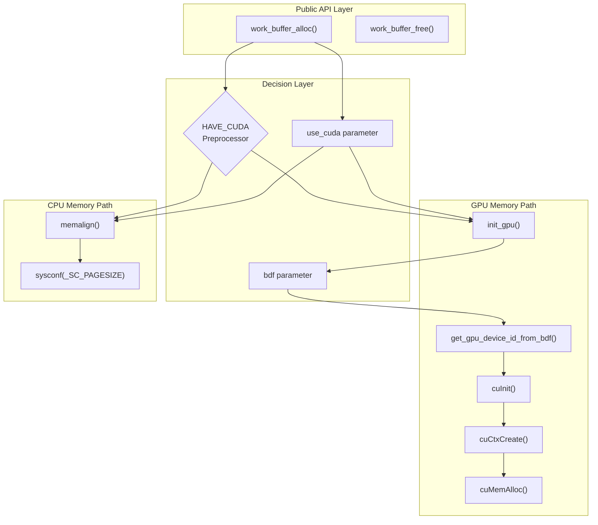
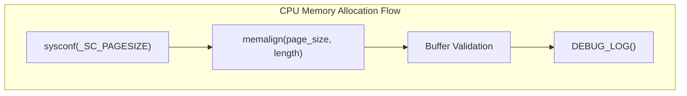
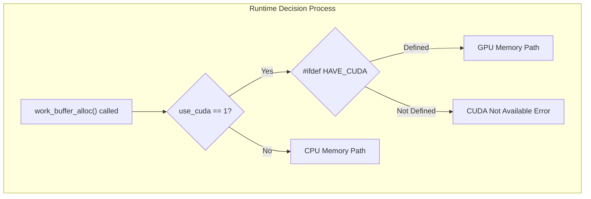
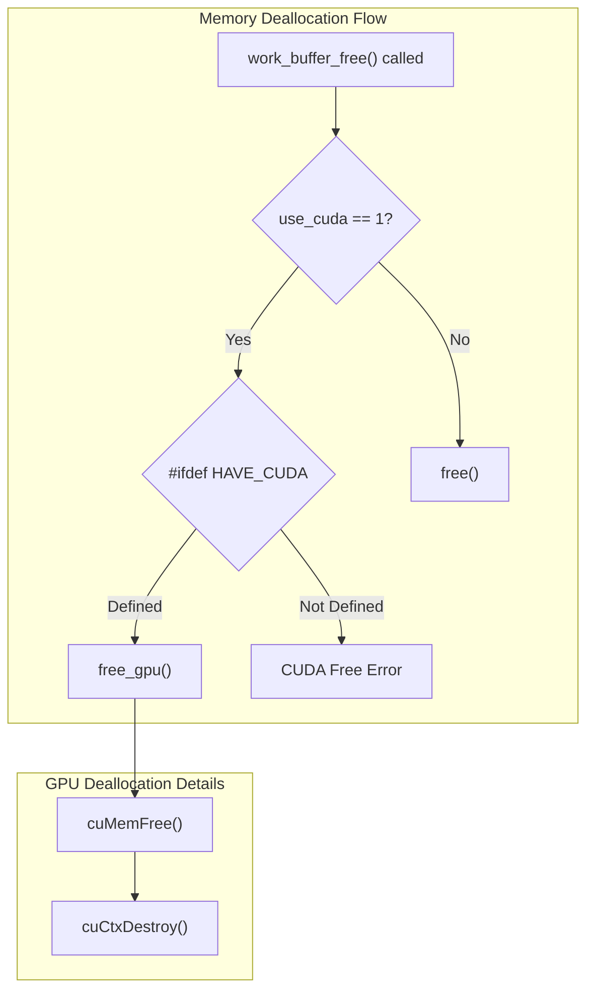

<!-- source: DeepWiki mcp.deepwiki.com · repo Mellanox/gpu_direct_rdma_access · page 4 Memory Management Subsystem · fetched 2026-11-11 -->

# Memory Management Subsystem

<details>
<summary>Relevant source files</summary>

The following files were used as context for generating this wiki page:

- [gpu_mem_util.c](gpu_mem_util.c)
- [gpu_mem_util.h](gpu_mem_util.h)

</details>


## Purpose and Scope

The Memory Management Subsystem provides a unified abstraction layer for allocating memory buffers that can be used with RDMA operations. It supports both CPU and GPU memory allocation through a single interface, enabling the system to work optimally with GPU Direct RDMA while maintaining compatibility with CPU-only configurations.

This subsystem handles the complexity of CUDA context management, device selection, and memory allocation strategies while exposing a simple API to higher-level components. For information about how these memory buffers are registered with RDMA devices, see [Core RDMA Engine](#3).

**Sources:** [gpu_mem_util.h:40-50](), [gpu_mem_util.c:228-231]()

## Architecture Overview

The Memory Management Subsystem employs a dual-path architecture that makes allocation decisions at both compile-time and runtime. The system uses preprocessor directives to include CUDA support when available, and runtime parameters to select between GPU and CPU memory allocation.



**Sources:** [gpu_mem_util.c:232-258](), [gpu_mem_util.c:156-211]()

## Memory Allocation Interface

The subsystem exposes two primary functions that abstract the complexity of memory management:

| Function | Purpose | Parameters | Return Value |
|----------|---------|------------|--------------|
| `work_buffer_alloc` | Allocate memory buffer | `length`, `use_cuda`, `bdf` | Buffer pointer or NULL |
| `work_buffer_free` | Deallocate memory buffer | `buff`, `use_cuda` | void |

### Function Signatures

```c
void *work_buffer_alloc(size_t length, int use_cuda, const char *bdf);
void work_buffer_free(void *buff, int use_cuda);
```

The `bdf` parameter specifies the GPU device using Bus-Device-Function format (e.g., "3e:02.0"), enabling precise control over which GPU device is used for memory allocation.

**Sources:** [gpu_mem_util.h:45](), [gpu_mem_util.h:50](), [gpu_mem_util.c:232](), [gpu_mem_util.c:263]()

## GPU Memory Management Implementation

### CUDA Context Initialization

The GPU memory path begins with CUDA runtime initialization and context creation. The system performs device enumeration and selection based on the provided BDF identifier:

```mermaid
graph TB
    subgraph "GPU_Init_Flow" ["GPU Initialization Flow"]
        cuInit_call["cuInit(0)"]
        print_gpu_devices_info["print_gpu_devices_info()"]
        get_gpu_device_id_from_bdf_call["get_gpu_device_id_from_bdf()"]
        cuDeviceGet["cuDeviceGet()"]
        cuCtxCreate_call["cuCtxCreate()"]
        cuCtxSetCurrent["cuCtxSetCurrent()"]
        cuMemAlloc_call["cuMemAlloc()"]
    end
    
    subgraph "BDF_Resolution" ["BDF Resolution Process"]
        sscanf_bdf["sscanf(bdf, \"%x:%x.%x\")"]
        cuDeviceGetCount["cuDeviceGetCount()"]
        device_iteration["Device Iteration Loop"]
        cuDeviceGetAttribute["cuDeviceGetAttribute()"]
        bdf_match["BDF Match Check"]
    end
    
    cuInit_call --> print_gpu_devices_info
    print_gpu_devices_info --> get_gpu_device_id_from_bdf_call
    get_gpu_device_id_from_bdf_call --> sscanf_bdf
    sscanf_bdf --> cuDeviceGetCount
    cuDeviceGetCount --> device_iteration
    device_iteration --> cuDeviceGetAttribute
    cuDeviceGetAttribute --> bdf_match
    bdf_match --> cuDeviceGet
    cuDeviceGet --> cuCtxCreate_call
    cuCtxCreate_call --> cuCtxSetCurrent
    cuCtxSetCurrent --> cuMemAlloc_call
```

**Sources:** [gpu_mem_util.c:156-211](), [gpu_mem_util.c:113-154](), [gpu_mem_util.c:87-111]()

### GPU Device Selection Algorithm

The `get_gpu_device_id_from_bdf` function implements a precise device selection mechanism:

1. **BDF Parsing**: Parses the input BDF string using `sscanf` with format `"%x:%x.%x"` [gpu_mem_util.c:123]()
2. **Device Enumeration**: Iterates through all available CUDA devices [gpu_mem_util.c:140-151]()
3. **Attribute Matching**: Compares PCI bus ID and device ID attributes [gpu_mem_util.c:146-148]()
4. **Device Index Return**: Returns the matching device index for CUDA operations [gpu_mem_util.c:149]()

**Sources:** [gpu_mem_util.c:113-154]()

### GPU Memory Allocation Strategy

GPU memory allocation uses a page-aligned strategy with a 64KB alignment requirement:

- **Page Alignment**: GPU buffers are aligned to 64KB boundaries [gpu_mem_util.c:158-162]()
- **Memory Allocation**: Uses `cuMemAlloc` for GPU memory allocation [gpu_mem_util.c:203]()
- **Context Management**: Creates and manages CUDA context with `CU_CTX_MAP_HOST` flag [gpu_mem_util.c:188]()

**Sources:** [gpu_mem_util.c:158-162](), [gpu_mem_util.c:203](), [gpu_mem_util.c:188]()

## CPU Memory Management Implementation

### CPU Memory Allocation

For CPU memory allocation, the system uses page-aligned allocation to ensure compatibility with RDMA memory registration requirements:



The allocation process:
1. **Page Size Discovery**: Retrieves system page size using `sysconf(_SC_PAGESIZE)` [gpu_mem_util.c:249]()
2. **Aligned Allocation**: Uses `memalign` to ensure proper memory alignment [gpu_mem_util.c:250]()
3. **Error Handling**: Validates allocation success and provides error messages [gpu_mem_util.c:251-254]()

**Sources:** [gpu_mem_util.c:248-256]()

## Compilation and Runtime Configuration

### Preprocessor Directives

The system uses conditional compilation to support environments with and without CUDA:

| Directive | Purpose | Impact |
|-----------|---------|--------|
| `HAVE_CUDA` | Enable CUDA support | Includes CUDA headers and GPU functions |
| `_GNU_SOURCE` | GNU extensions | Enables advanced memory alignment functions |

**Sources:** [gpu_mem_util.c:51-54](), [gpu_mem_util.c:37]()

### Runtime Decision Flow



**Sources:** [gpu_mem_util.c:236-246](), [gpu_mem_util.c:247-256]()

## Error Handling and Debugging

### Debug Infrastructure

The subsystem includes comprehensive debugging capabilities:

- **Debug Macros**: `DEBUG_LOG` and `FDEBUG_LOG` for conditional logging [gpu_mem_util.c:61-64]()
- **CUDA Assertion**: `CUCHECK` macro for CUDA error validation [gpu_mem_util.c:74-78]()
- **Device Information**: `print_gpu_devices_info` for device enumeration debugging [gpu_mem_util.c:87-111]()

### Error Conditions

| Error Type | Detection | Response |
|------------|-----------|----------|
| Invalid BDF Format | `sscanf` return value validation | Error message and -1 return [gpu_mem_util.c:124-127]() |
| No CUDA Devices | Device count check | Error message and NULL return [gpu_mem_util.c:135-138]() |
| CUDA Initialization Failure | `cuInit` return code | Error message and NULL return [gpu_mem_util.c:165-168]() |
| Memory Allocation Failure | Allocation result validation | Error message and cleanup [gpu_mem_util.c:204-207]() |

**Sources:** [gpu_mem_util.c:124-127](), [gpu_mem_util.c:135-138](), [gpu_mem_util.c:165-168](), [gpu_mem_util.c:204-207]()

## Memory Deallocation

### Unified Deallocation Interface

The `work_buffer_free` function provides symmetrical cleanup for both memory types:



GPU memory deallocation includes:
- **Memory Release**: `cuMemFree` to release GPU memory [gpu_mem_util.c:218]()
- **Context Cleanup**: `cuCtxDestroy` to clean up CUDA context [gpu_mem_util.c:222]()

**Sources:** [gpu_mem_util.c:263-275](), [gpu_mem_util.c:213-225]()

---

