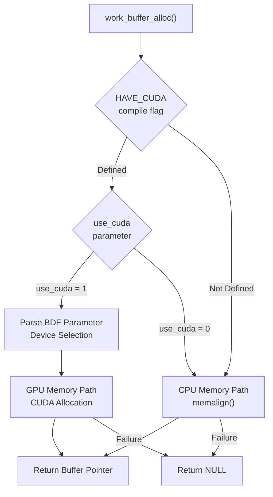
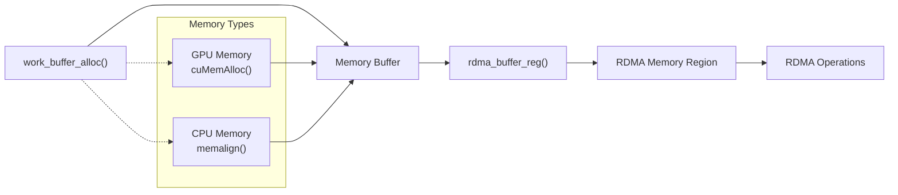

<!-- source: DeepWiki mcp.deepwiki.com · repo Mellanox/gpu_direct_rdma_access · page 4.1 Memory Interface · fetched 2026-11-11 -->

# Memory Interface

<details>
<summary>Relevant source files</summary>

The following files were used as context for generating this wiki page:

- [gpu_mem_util.h](gpu_mem_util.h)

</details>


## Purpose and Scope

This document covers the Memory Interface API that provides a unified abstraction layer for allocating memory buffers suitable for RDMA operations. The interface abstracts the complexity of choosing between CPU and GPU memory allocation based on both compile-time configuration and runtime parameters.

For detailed implementation of CUDA context management and device selection strategies, see [Memory Implementation](#4.2). For information about how allocated memory is registered with the RDMA subsystem, see [RDMA Interface Definition](#3.1).

## API Overview

The Memory Interface consists of two primary functions that provide allocation and deallocation services:

| Function | Purpose |
|----------|---------|
| `work_buffer_alloc` | Allocates memory on CPU or GPU based on configuration |
| `work_buffer_free` | Deallocates previously allocated memory |

The interface uses a dual-decision mechanism combining compile-time flags (`HAVE_CUDA`) with runtime parameters (`use_cuda`) to determine the appropriate memory allocation strategy.

**Sources:** [gpu_mem_util.h:40-50]()

## Function Signatures

### work_buffer_alloc

```c
void *work_buffer_alloc(size_t length, int use_cuda, const char *bdf);
```

**Parameters:**
- `length`: Size of the memory buffer to allocate in bytes
- `use_cuda`: Runtime flag indicating whether to use GPU memory (1) or CPU memory (0)
- `bdf`: Bus:Device.Function identifier for GPU device selection (used only when `use_cuda` is true)

**Return Value:**
- Pointer to allocated buffer on success
- `NULL` on allocation failure

### work_buffer_free

```c
void work_buffer_free(void *buff, int use_cuda);
```

**Parameters:**
- `buff`: Pointer to the buffer to deallocate
- `use_cuda`: Must match the value used during allocation to ensure proper cleanup

**Sources:** [gpu_mem_util.h:45-50]()

## Memory Allocation Decision Flow

The memory allocation process follows a structured decision tree that determines the appropriate allocation mechanism:



**Sources:** [gpu_mem_util.h:41-44]()

## Integration with RDMA System

The allocated memory buffers are designed to be registered with the RDMA subsystem for direct hardware access. The allocation interface ensures compatibility with RDMA memory registration requirements:



**Sources:** [gpu_mem_util.h:41-44]()

## Usage Patterns

### Basic CPU Memory Allocation

```c
// Allocate CPU memory buffer
void *buffer = work_buffer_alloc(4096, 0, NULL);
if (buffer == NULL) {
    // Handle allocation failure
}

// Use buffer for RDMA operations
// ...

// Free when done
work_buffer_free(buffer, 0);
```

### GPU Memory Allocation with Device Selection

```c
// Allocate GPU memory on specific device
const char *gpu_bdf = "0000:3b:00.0";
void *gpu_buffer = work_buffer_alloc(4096, 1, gpu_bdf);
if (gpu_buffer == NULL) {
    // Handle allocation failure or fallback to CPU
}

// Use GPU buffer for RDMA operations
// ...

// Free GPU memory
work_buffer_free(gpu_buffer, 1);
```

### Conditional Allocation Based on Hardware Availability

```c
// Try GPU first, fallback to CPU if needed
int use_gpu = (cuda_available && gpu_bdf != NULL) ? 1 : 0;
void *buffer = work_buffer_alloc(buffer_size, use_gpu, gpu_bdf);

// Cleanup with matching use_gpu flag
work_buffer_free(buffer, use_gpu);
```

**Sources:** [gpu_mem_util.h:45-50]()

## Error Handling

The interface provides simple error reporting through `NULL` return values from `work_buffer_alloc`. Applications should always check for allocation failures and implement appropriate fallback strategies, such as:

- Falling back from GPU to CPU memory allocation
- Reducing buffer sizes if memory is constrained
- Gracefully degrading performance expectations

The `work_buffer_free` function does not return error codes and should be called with the same `use_cuda` parameter value used during allocation to ensure proper cleanup of the underlying memory management subsystem.

**Sources:** [gpu_mem_util.h:43-44]()

---

