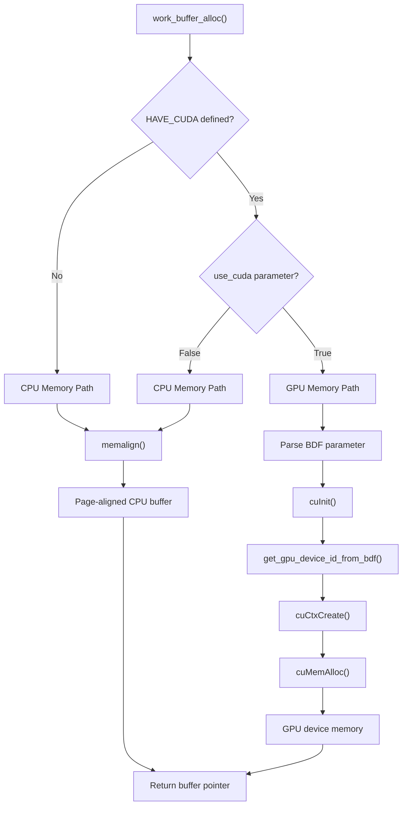
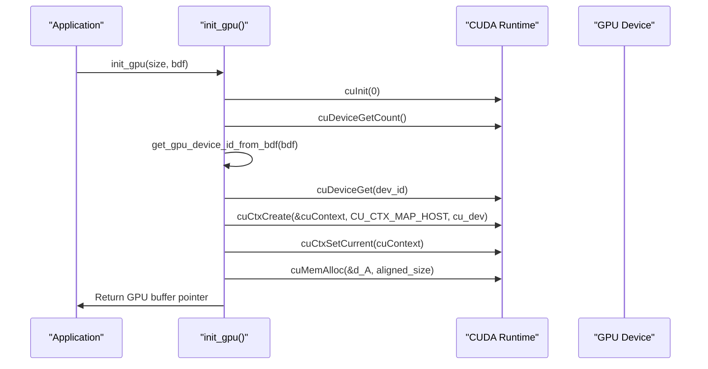
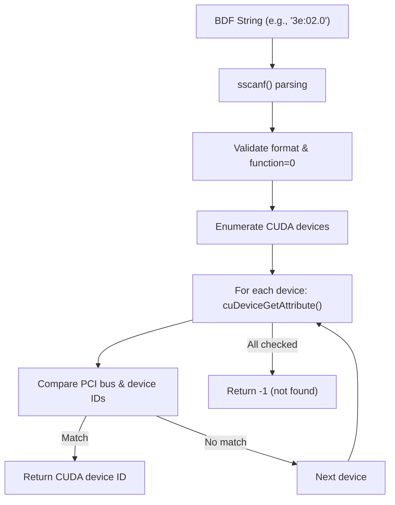
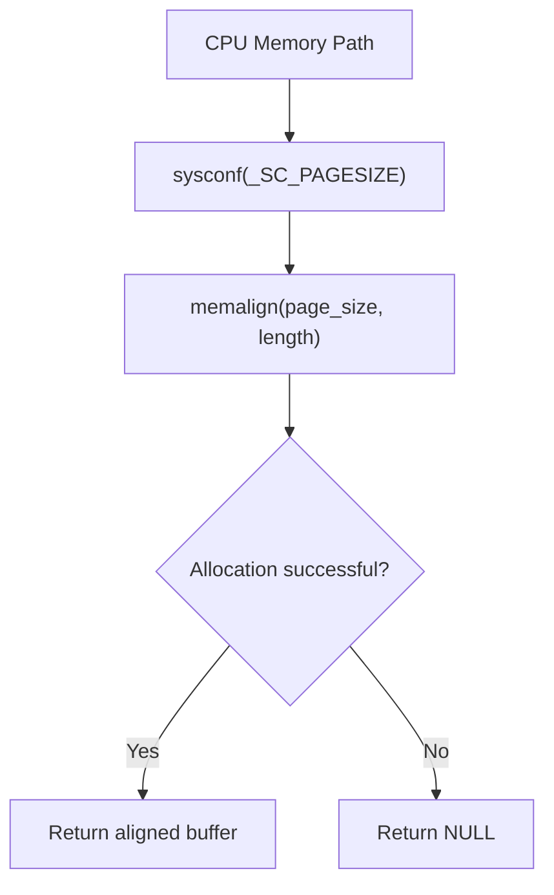
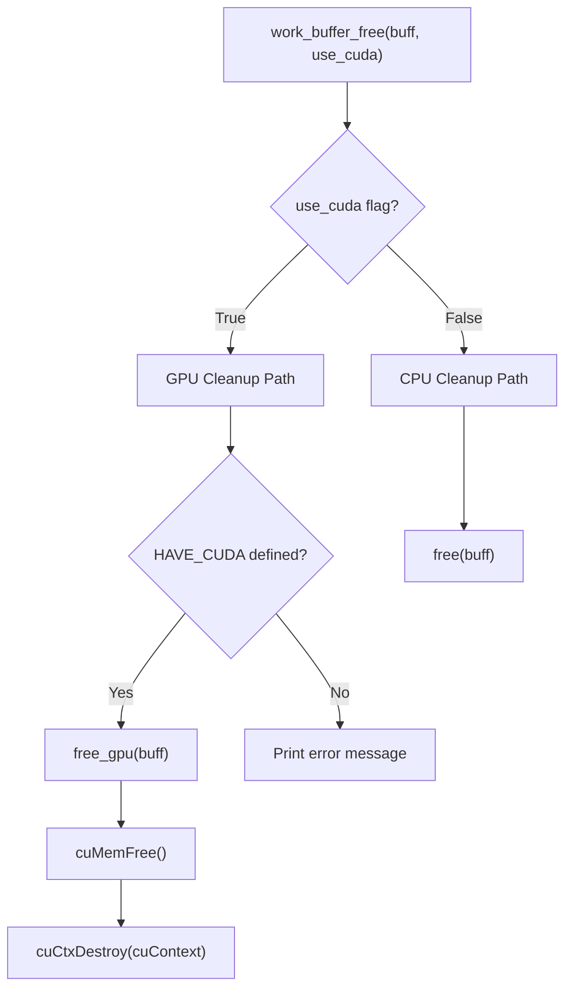
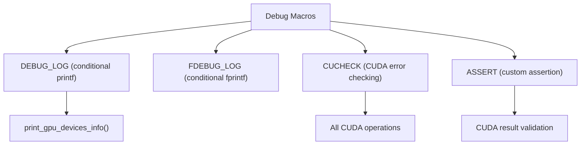

<!-- source: DeepWiki mcp.deepwiki.com · repo Mellanox/gpu_direct_rdma_access · page 4.2 Memory Implementation · fetched 2026-11-11 -->

# Memory Implementation

<details>
<summary>Relevant source files</summary>

The following files were used as context for generating this wiki page:

- [gpu_mem_util.c](gpu_mem_util.c)

</details>


This document covers the internal implementation of the unified memory allocation subsystem that supports both CPU and GPU memory with RDMA registration capabilities. The implementation provides transparent memory allocation through compile-time and runtime configuration options, enabling flexible deployment across different hardware configurations.

For the high-level memory management API, see [Memory Interface](#4.1). For RDMA-specific memory registration details, see [RDMA Implementation Details](#3.2).

## Allocation Strategy Overview

The memory implementation uses a dual-path allocation strategy that selects between CPU and GPU memory based on both compile-time preprocessor flags and runtime parameters. This design enables the same codebase to support multiple deployment scenarios without requiring separate builds.

### Dual-Path Memory Allocation



**Sources:** [gpu_mem_util.c:232-258]()

## GPU Memory Implementation

The GPU memory allocation path involves several stages: CUDA initialization, device selection by PCI Bus-Device-Function (BDF), context creation, and memory allocation.

### CUDA Context Management

The system maintains a single global CUDA context (`cuContext`) that is created during the first GPU allocation and destroyed during cleanup. The context creation process follows this sequence:



**Sources:** [gpu_mem_util.c:156-211](), [gpu_mem_util.c:82]()

### Device Selection by BDF

The GPU device selection mechanism uses PCI Bus-Device-Function (BDF) identifiers to select specific GPU devices. This enables optimal pairing with InfiniBand adapters on the same PCI bridge for maximum performance.

| Function | Purpose | Input Format |
|----------|---------|--------------|
| `get_gpu_device_id_from_bdf()` | Convert BDF string to CUDA device ID | "3e:02.0" (hex:hex.hex) |
| `print_gpu_devices_info()` | Debug listing of all CUDA devices | N/A |

The BDF parsing logic validates the format and matches against available CUDA devices by comparing PCI bus and device IDs:



**Sources:** [gpu_mem_util.c:113-154](), [gpu_mem_util.c:87-111]()

### GPU Memory Alignment

GPU memory allocation uses 64KB page alignment to optimize memory access patterns and ensure compatibility with GPU memory management:

```c
const size_t gpu_page_size = 64*1024;
aligned_size = (gpu_buf_size + gpu_page_size - 1) & ~(gpu_page_size - 1);
```

**Sources:** [gpu_mem_util.c:158-162]()

## CPU Memory Implementation

The CPU memory allocation path provides a simpler fallback mechanism using standard system calls with page alignment for optimal RDMA performance.

### Page-Aligned Allocation



The page alignment ensures that CPU buffers are properly aligned for efficient RDMA operations and memory registration with InfiniBand hardware.

**Sources:** [gpu_mem_util.c:249-254]()

## Memory Deallocation

The deallocation process mirrors the allocation strategy, using the `use_cuda` flag to determine the appropriate cleanup path:

### Deallocation Strategy



**Sources:** [gpu_mem_util.c:263-275](), [gpu_mem_util.c:213-225]()

## Compilation Strategy

The implementation uses conditional compilation to support deployments with and without CUDA capabilities:

| Preprocessor Flag | Effect | Code Path |
|-------------------|--------|-----------|
| `HAVE_CUDA` | Enables CUDA compilation | Includes cuda.h, enables GPU functions |
| Not defined | CPU-only build | GPU functions return errors |

This strategy allows the same source code to generate different binaries optimized for specific deployment environments while maintaining API compatibility.

**Sources:** [gpu_mem_util.c:51-54](), [gpu_mem_util.c:238-242](), [gpu_mem_util.c:266-270]()

## Error Handling and Debugging

The implementation includes comprehensive error handling and debug output controlled by global debug flags:

### Debug Infrastructure



**Sources:** [gpu_mem_util.c:61-78](), [gpu_mem_util.c:87-111]()

---

