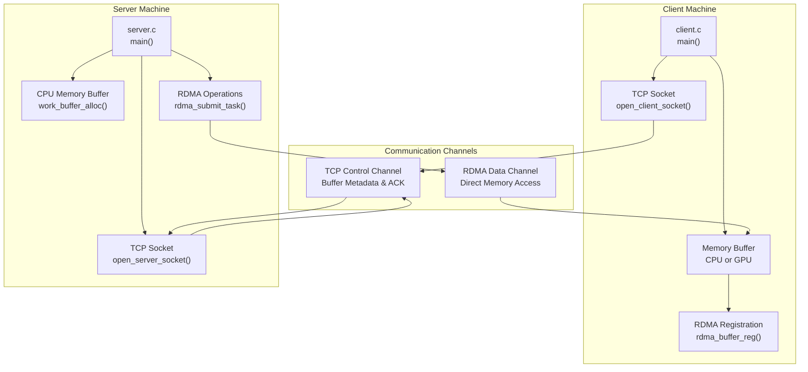
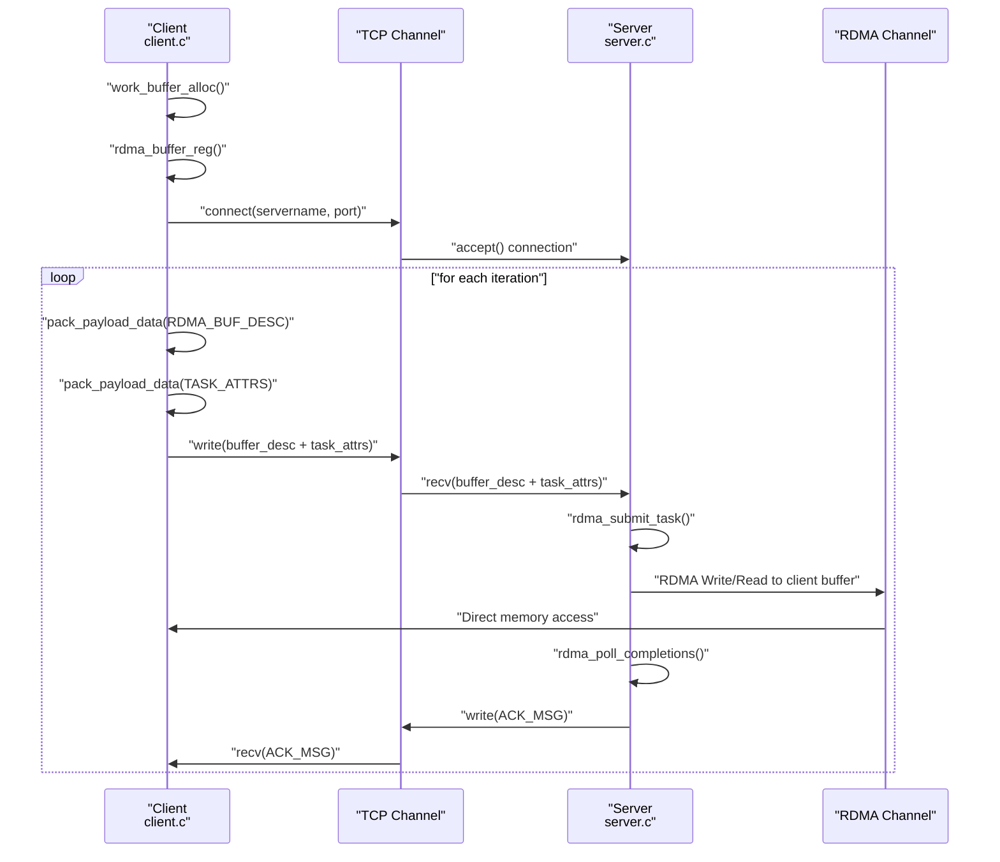
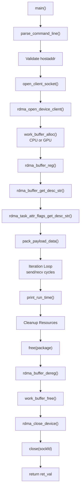
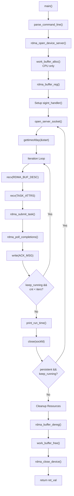
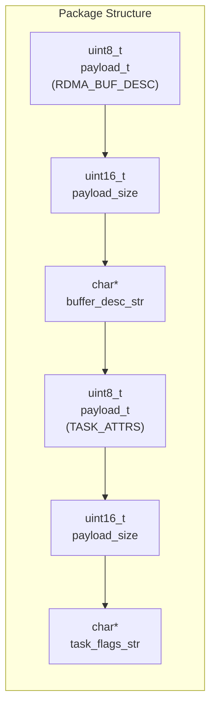
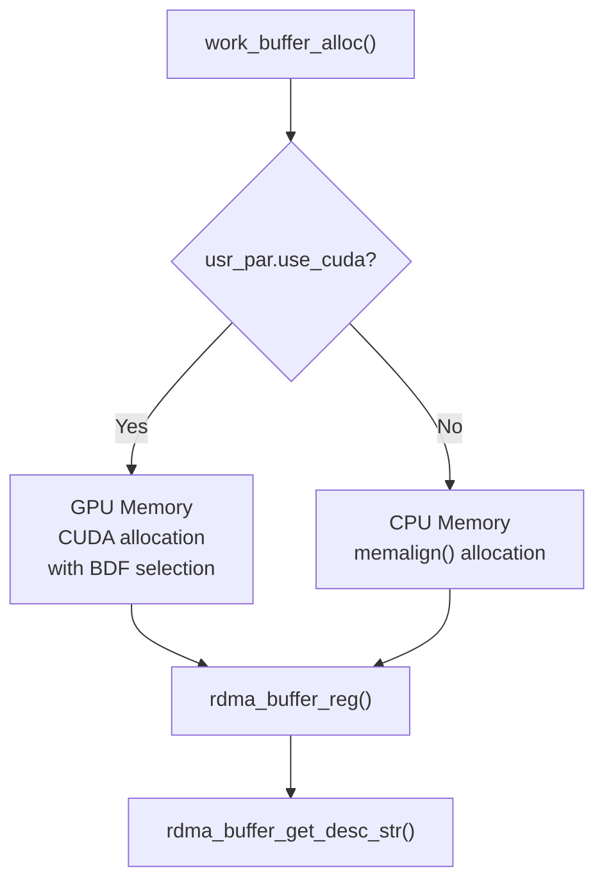
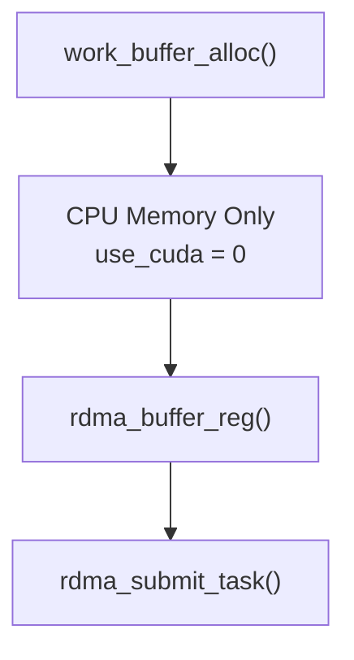
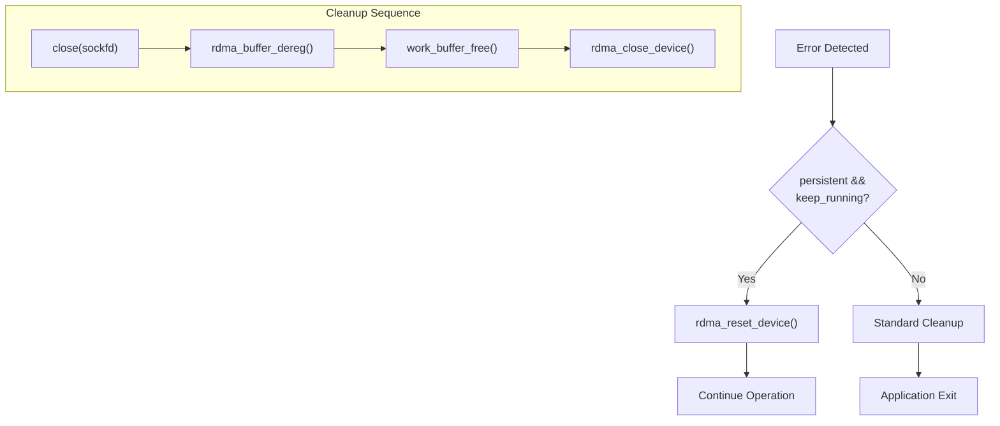

<!-- source: DeepWiki mcp.deepwiki.com · repo Mellanox/gpu_direct_rdma_access · page 5 Client-Server Applications · fetched 2026-11-11 -->

# Client-Server Applications

Relevant source files

The following files were used as context for generating this wiki page:

- [README.md](README.md)
- [client.c](client.c)
- [server.c](server.c)

This document covers the main application programs that demonstrate GPU Direct RDMA capabilities using Dynamic Connect Queue Pairs. The client and server applications work together to perform high-performance memory transfers between distributed systems, with the client capable of using either GPU or CPU memory while the server performs RDMA operations directly to the client's allocated buffers.

For details about the underlying RDMA engine used by these applications, see [Core RDMA Engine](#3). For information about memory allocation strategies, see [Memory Management Subsystem](#4).

## Application Architecture

The system implements a client-server architecture where the client allocates memory buffers and the server performs RDMA operations to those buffers. The applications use a hybrid communication model with TCP for control messages and RDMA for high-performance data transfer.

Sources: [client.c:302-466](), [server.c:239-427](), [README.md:1-91]()

## Communication Protocol

The applications implement a multi-phase protocol that separates control operations (over TCP) from data operations (over RDMA). Each iteration follows a strict sequence to ensure synchronization between client and server.

Sources: [client.c:410-437](), [server.c:300-404](), [client.c:144-159]()

## Application Lifecycle

Both applications follow structured initialization, execution, and cleanup phases. The server can operate in persistent mode to handle multiple client connections sequentially.

### Client Application Lifecycle

Sources: [client.c:302-466](), [client.c:206-300]()

### Server Application Lifecycle

Sources: [server.c:239-427](), [server.c:162-237](), [server.c:283-415]()

## Command Line Interfaces

Both applications provide comprehensive command line interfaces for configuration. The client supports GPU device selection while the server focuses on network and performance parameters.

### Client Parameters

| Parameter | Description | Default | Code Reference |
|-----------|-------------|---------|----------------|
| `-t, --task-flags` | RDMA operation type (0=WRITE, 1=READ) | 0 | [client.c:236-238]() |
| `-a, --addr` | Local host IP address (mandatory) | None | [client.c:240-242]() |
| `-p, --port` | Server port number | 18515 | [client.c:244-250]() |
| `-s, --size` | Message size in bytes | 4096 | [client.c:252-254]() |
| `-n, --iters` | Number of iterations | 1000 | [client.c:256-258]() |
| `-u, --use-cuda` | GPU device BDF (e.g., "3e:02.0") | None | [client.c:260-268]() |
| `-D, --debug-mask` | Debug flags (bit 0=debug, bit 1=fast path) | 0 | [client.c:270-273]() |

### Server Parameters

| Parameter | Description | Default | Code Reference |
|-----------|-------------|---------|----------------|
| `-P, --persistent` | Handle multiple client connections | 0 | [server.c:192-194]() |
| `-a, --addr` | Local host IP address (mandatory) | None | [server.c:196-198]() |
| `-p, --port` | Listen port number | 18515 | [server.c:200-206]() |
| `-s, --size` | Message size in bytes | 4096 | [server.c:208-210]() |
| `-n, --iters` | Number of iterations | 1000 | [server.c:212-214]() |
| `-l, --sg_list-len` | Scatter-gather list length | 0 | [server.c:216-218]() |
| `-D, --debug-mask` | Debug flags (bit 0=debug, bit 1=fast path) | 0 | [server.c:220-223]() |

Sources: [client.c:188-204](), [server.c:146-160](), [client.c:206-300](), [server.c:162-237]()

## Data Packaging Protocol

The client implements a custom protocol for sending buffer metadata and task attributes to the server. This protocol uses type-length-value encoding to support extensible message formats.

The `pack_payload_data()` function [client.c:144-159]() implements this protocol, while the server parses packages using the `recv()` loop [server.c:313-340]().

Sources: [client.c:123-159](), [client.c:378-398](), [server.c:313-340]()

## Memory Allocation Strategies

The applications use different memory allocation strategies based on their roles and hardware capabilities:

### Client Memory Allocation

### Server Memory Allocation

The client memory allocation [client.c:346-351]() supports both CPU and GPU memory based on the `use_cuda` parameter and optional BDF specification, while the server [server.c:264-268]() always uses CPU memory for its local buffer.

Sources: [client.c:346-357](), [server.c:264-268](), [client.c:260-268]()

## Error Handling and Recovery

Both applications implement comprehensive error handling with proper resource cleanup. The server supports device reset for error recovery in persistent mode.

### Error Handling Flow

The server implements RDMA device reset [server.c:392-393]() for error recovery, while both applications use labeled goto statements for structured cleanup [client.c:445-464](), [server.c:412-426]().

Sources: [server.c:385-396](), [client.c:445-464](), [server.c:412-426]()

---

