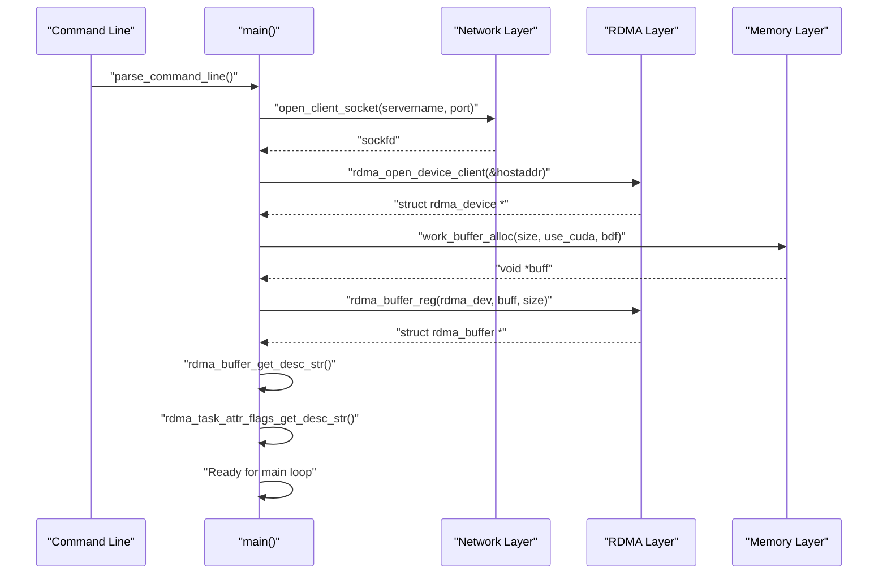
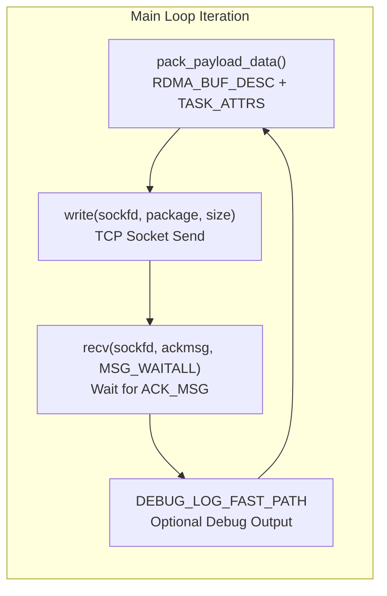
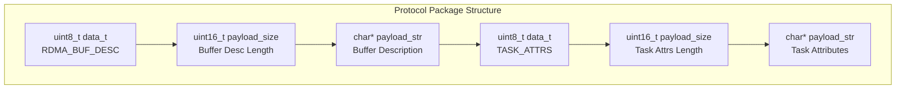
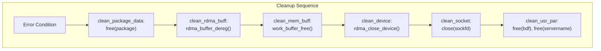

<!-- source: DeepWiki mcp.deepwiki.com · repo Mellanox/gpu_direct_rdma_access · page 5.1 Client Application · fetched 2026-11-11 -->

# Client Application

Relevant source files

The following files were used as context for generating this wiki page:

- [client.c](client.c)

## Purpose and Scope

The Client Application is the initiating component in the GPU Direct RDMA system that performs memory allocation, RDMA registration, and coordinates remote memory operations with the server. It demonstrates how to use the core RDMA engine and memory management subsystem to perform high-performance GPU-to-GPU or CPU-to-CPU memory transfers over InfiniBand networks.

For information about the server-side counterpart, see [Server Application](#5.2). For details about the underlying RDMA operations, see [Core RDMA Engine](#3). For memory allocation specifics, see [Memory Management Subsystem](#4).

## Application Architecture

The client application follows a sequential initialization and execution pattern, coordinating between TCP control messages and RDMA data operations:

```mermaid
graph TB
    subgraph "Client Application Architecture"
        MAIN["main()"]
        
        subgraph "Initialization Phase"
            PARSE["parse_command_line()"]
            SOCKET["open_client_socket()"]
            RDMA_INIT["rdma_open_device_client()"]
            MEM_ALLOC["work_buffer_alloc()"]
            BUF_REG["rdma_buffer_reg()"]
            DESC_GEN["rdma_buffer_get_desc_str()"]
        end
        
        subgraph "Execution Phase"
            MAIN_LOOP["Main Loop (iters)"]
            PACK_DATA["pack_payload_data()"]
            SEND_MSG["write() - TCP Socket"]
            WAIT_ACK["recv() - TCP Socket"]
        end
        
        subgraph "Cleanup Phase"
            BUF_DEREG["rdma_buffer_dereg()"]
            MEM_FREE["work_buffer_free()"]
            DEV_CLOSE["rdma_close_device()"]
        end
        
        subgraph "Data Structures"
            USER_PARAMS["struct user_params"]
            PAYLOAD_ATTR["struct payload_attr"]
            RDMA_DEV["struct rdma_device"]
            RDMA_BUFF["struct rdma_buffer"]
        end
    end
    
    MAIN --> PARSE
    PARSE --> USER_PARAMS
    PARSE --> SOCKET
    SOCKET --> RDMA_INIT
    RDMA_INIT --> RDMA_DEV
    RDMA_INIT --> MEM_ALLOC
    MEM_ALLOC --> BUF_REG
    BUF_REG --> RDMA_BUFF
    BUF_REG --> DESC_GEN
    DESC_GEN --> MAIN_LOOP
    MAIN_LOOP --> PACK_DATA
    PACK_DATA --> PAYLOAD_ATTR
    PACK_DATA --> SEND_MSG
    SEND_MSG --> WAIT_ACK
    WAIT_ACK --> BUF_DEREG
    BUF_DEREG --> MEM_FREE
    MEM_FREE --> DEV_CLOSE
```

Sources: [client.c:302-466]()

## Command Line Interface

The client application accepts multiple configuration options through the `struct user_params` structure:

| Option | Long Form | Type | Default | Description |
|--------|-----------|------|---------|-------------|
| `-t` | `--task-flags` | `uint32_t` | 0 | RDMA operation type: 0=WRITE, 1=READ |
| `-a` | `--addr` | IP address | Required | Local host network device IP address |
| `-p` | `--port` | `int` | 18515 | TCP control connection port |
| `-s` | `--size` | `unsigned long` | 4096 | Message size in bytes |
| `-n` | `--iters` | `int` | 1000 | Number of iterations |
| `-u` | `--use-cuda` | BDF string | None | Enable GPU memory with device BDF |
| `-D` | `--debug-mask` | Bitmask | 0 | Debug output control |

The `parse_command_line()` function processes these options and validates parameters such as port ranges and required fields.

Sources: [client.c:188-300]()

## Initialization Sequence

The client follows a strict initialization sequence that establishes both control and data plane connectivity:

Key initialization functions:
- `open_client_socket()` establishes TCP control connection using `getaddrinfo()` and `connect()`
- `rdma_open_device_client()` initializes RDMA device with Dynamic Connect Transport (DCT)
- `work_buffer_alloc()` allocates either CPU or GPU memory based on `use_cuda` flag
- `rdma_buffer_reg()` registers the buffer for RDMA operations

Sources: [client.c:78-121](), [client.c:337-376]()

## Main Execution Loop

The client coordinates RDMA operations through a TCP-based protocol with the server:

The loop executes for the number of iterations specified by the `-n` parameter. Each iteration:

1. **Package Data**: Uses `pack_payload_data()` to create a binary protocol containing buffer descriptor and task attributes
2. **Send Trigger**: Transmits the package via TCP socket to signal the server to perform RDMA operation
3. **Wait for Completion**: Blocks on `recv()` waiting for the `ACK_MSG` acknowledgment
4. **Debug Output**: Optionally prints buffer contents and timing information

Sources: [client.c:410-437]()

## Protocol Implementation

The client implements a simple binary protocol for communicating RDMA metadata to the server:

The `pack_payload_data()` function implements this protocol, while helper functions generate the string representations:
- `rdma_buffer_get_desc_str()` serializes RDMA buffer metadata (address, rkey, etc.)
- `rdma_task_attr_flags_get_desc_str()` creates an 8-character hex string for task flags

Sources: [client.c:123-186](), [client.c:378-398]()

## Memory Management Integration

The client abstracts memory allocation through the unified memory management interface:

| Function | Purpose | Parameters |
|----------|---------|------------|
| `work_buffer_alloc()` | Allocate CPU or GPU memory | `size`, `use_cuda`, `bdf` |
| `work_buffer_free()` | Deallocate memory | `buff`, `use_cuda` |
| `rdma_buffer_reg()` | Register for RDMA | `rdma_dev`, `buff`, `size` |
| `rdma_buffer_dereg()` | Unregister RDMA buffer | `rdma_buff` |

When `use_cuda` is enabled, the client allocates GPU memory using the specified Bus-Device-Function (BDF) identifier. Otherwise, it falls back to CPU memory allocation.

Sources: [client.c:345-366](), [client.c:448-452]()

## Error Handling and Cleanup

The client implements structured cleanup using goto-based error handling with labeled cleanup sections:

Each cleanup label handles a specific resource type, ensuring proper deallocation regardless of where the error occurred during initialization or execution.

Sources: [client.c:445-465]()

---

