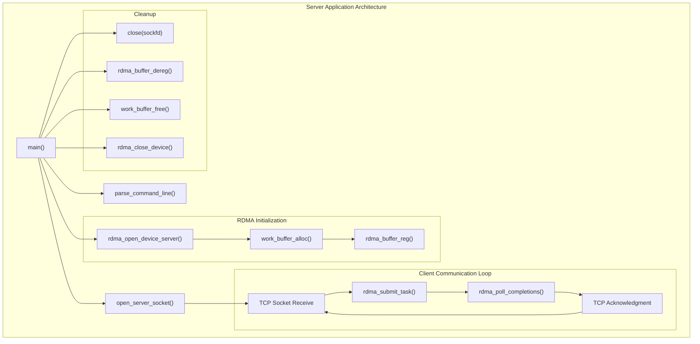
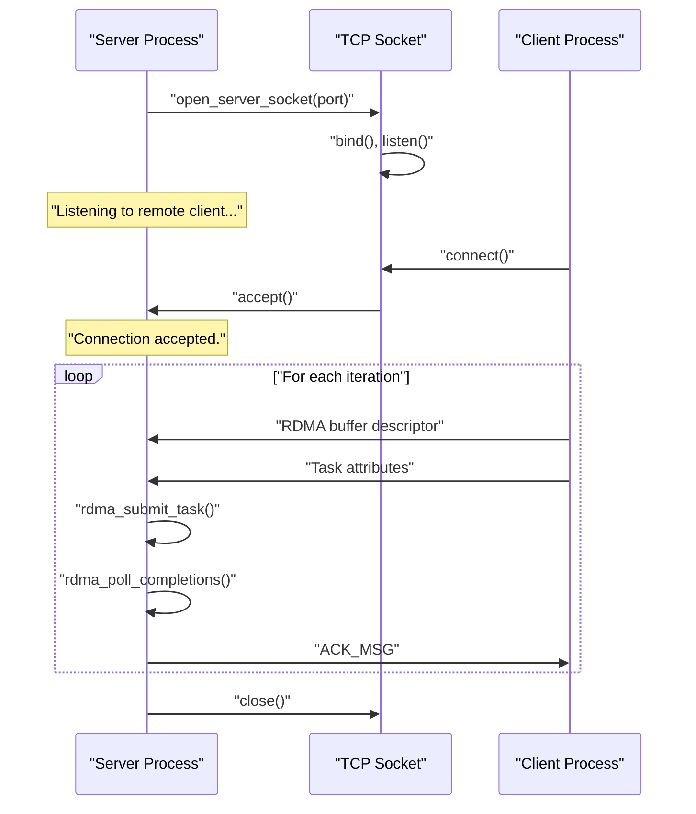
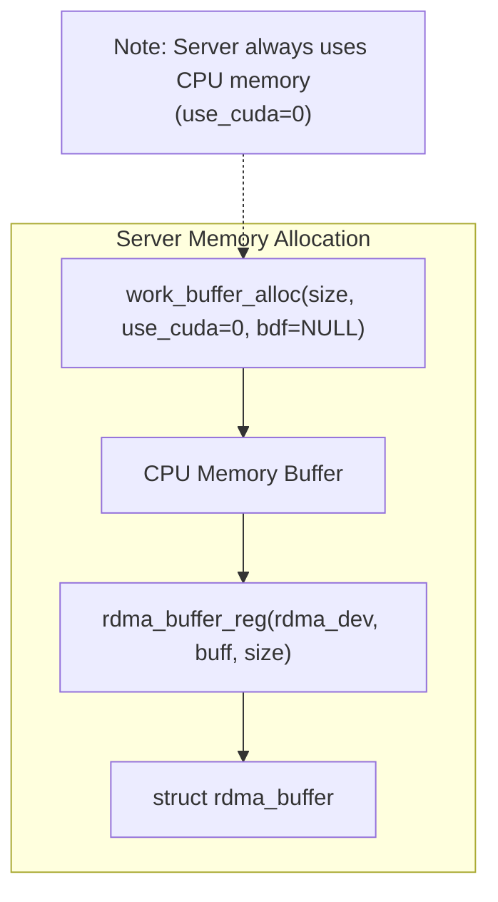
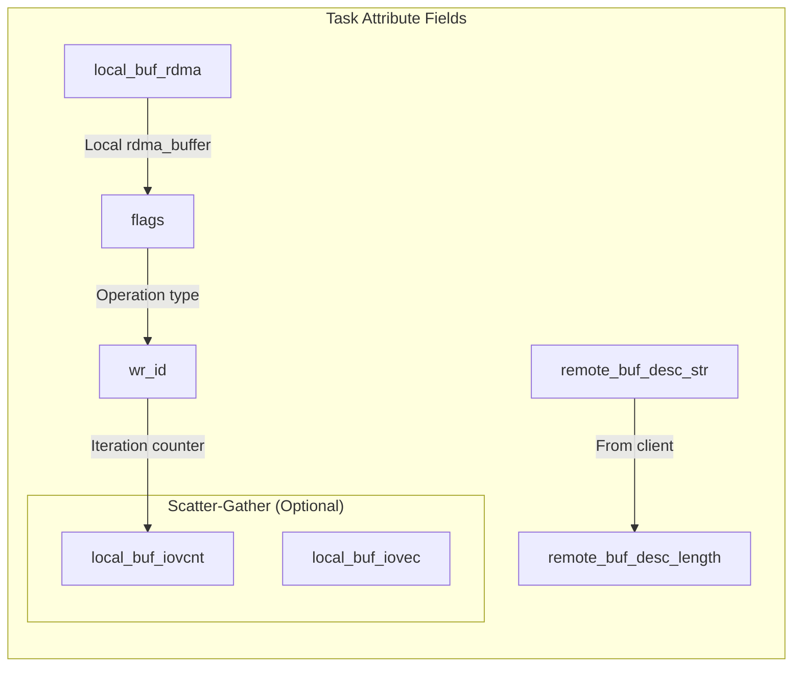
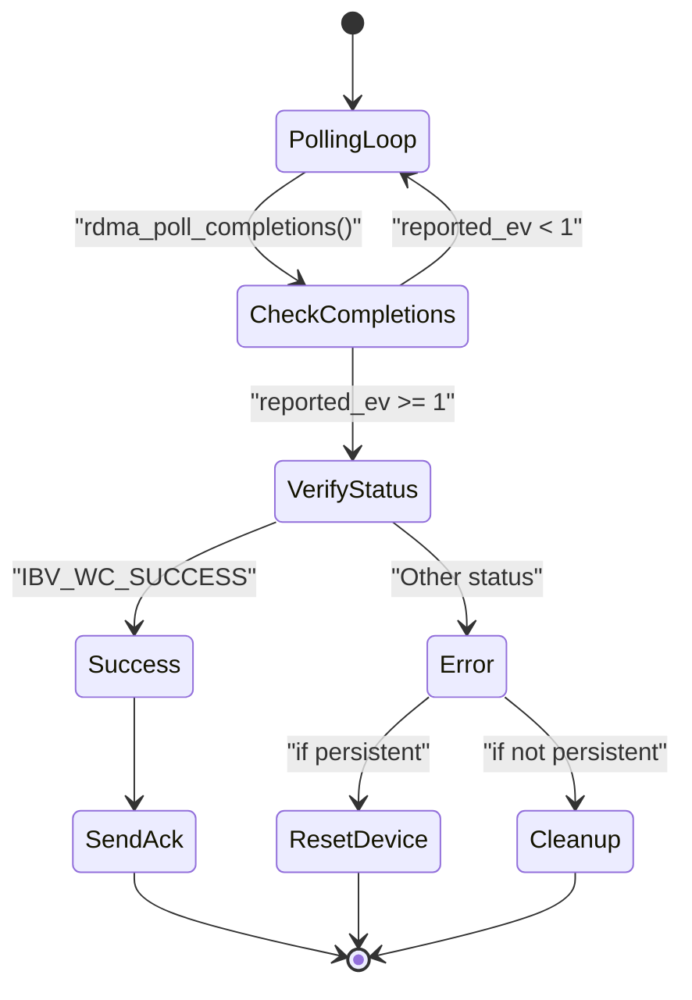
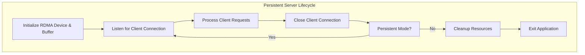

<!-- source: DeepWiki mcp.deepwiki.com · repo Mellanox/gpu_direct_rdma_access · page 5.2 Server Application · fetched 2026-11-11 -->

# Server Application

Relevant source files

The following files were used as context for generating this wiki page:

- [server.c](server.c)

This document covers the server-side application that performs RDMA operations to client memory and manages TCP control connections. The server application acts as the RDMA initiator, executing read and write operations against memory buffers registered by remote clients.

For information about the client-side counterpart, see [Client Application](#5.1). For details about the underlying RDMA operations, see [Core RDMA Engine](#3).

## Purpose and Architecture

The server application (`server.c`) implements the server-side logic for GPU Direct RDMA operations. Unlike the client application which can use either GPU or CPU memory, the server always allocates its local buffers in CPU memory and performs RDMA operations against remote client memory buffers.

Sources: [server.c:239-427]()

## Configuration Parameters

The server application accepts various command-line parameters through the `user_params` structure:

| Parameter | Flag | Default | Description |
|-----------|------|---------|-------------|
| `persistent` | `-P, --persistent` | 0 | Server waits for additional client connections after transfer completion |
| `hostaddr` | `-a, --addr` | Required | IP address of the local host network device |
| `port` | `-p, --port` | 18515 | TCP port to listen on for client connections |
| `size` | `-s, --size` | 4096 | Size of message to exchange in bytes |
| `iters` | `-n, --iters` | 1000 | Number of RDMA operations to perform |
| `num_sges` | `-l, --sg_list-len` | 0 | Number of scatter-gather elements (0 = legacy mode) |

Sources: [server.c:66-74](), [server.c:162-237]()

## Connection Management

The server implements a TCP-based control channel for coordination with clients:

The `open_server_socket()` function handles the complete TCP socket setup process, including address resolution, binding, and accepting client connections.

Sources: [server.c:89-144](), [server.c:283-289]()

## Memory Management

The server allocates and manages its local memory buffers using the unified memory management interface:

Unlike the client application, the server always allocates CPU memory by passing `use_cuda=0` to `work_buffer_alloc()`. This buffer serves as the local staging area for RDMA operations against remote client memory.

Sources: [server.c:262-277]()

## RDMA Operation Flow

The main processing loop coordinates RDMA operations with client synchronization:

```mermaid
graph TB
    subgraph "RDMA Operation Cycle"
        START["Iteration Start"]
        RECV_DESC["Receive RDMA Buffer Descriptor"]
        RECV_ATTRS["Receive Task Attributes"]
        SETUP_TASK["Setup rdma_task_attr"]
        
        subgraph "Optional Scatter-Gather"
            CHECK_SGE["num_sges > 0?"]
            SETUP_IOVEC["Setup buf_iovec array"]
            CALC_PORTIONS["Calculate portion sizes"]
        end
        
        SUBMIT["rdma_submit_task()"]
        POLL_LOOP["Polling Loop"]
        CHECK_COMP["rdma_poll_completions()"]
        VERIFY["Verify completion status"]
        SEND_ACK["Send ACK_MSG"]
        END["Iteration End"]
    end
    
    START --> RECV_DESC
    RECV_DESC --> RECV_ATTRS
    RECV_ATTRS --> SETUP_TASK
    SETUP_TASK --> CHECK_SGE
    CHECK_SGE -->|"Yes"| SETUP_IOVEC
    CHECK_SGE -->|"No"| SUBMIT
    SETUP_IOVEC --> CALC_PORTIONS
    CALC_PORTIONS --> SUBMIT
    SUBMIT --> POLL_LOOP
    POLL_LOOP --> CHECK_COMP
    CHECK_COMP --> VERIFY
    VERIFY --> SEND_ACK
    SEND_ACK --> END
```

The server receives two types of payload packages from the client:
- **RDMA_BUF_DESC** (type 0): Remote buffer descriptor string containing address, size, and rkey
- **TASK_ATTRS** (type 1): Task attribute flags specifying operation parameters

Sources: [server.c:300-404]()

## Task Attribute Configuration

The server constructs `rdma_task_attr` structures to specify RDMA operation parameters:

The scatter-gather functionality allows splitting large transfers into multiple segments, with each `iovec` entry specifying a 64-byte aligned portion of the local buffer.

Sources: [server.c:343-369]()

## Completion Handling

The server implements a polling-based completion handling mechanism:

The completion polling loop continues until at least one completion event is received or the server is signaled to stop. Error conditions trigger device reset in persistent mode or application termination otherwise.

Sources: [server.c:375-396]()

## Persistent Mode Operation

When started with the `--persistent` flag, the server supports handling multiple client connections sequentially:

In persistent mode, RDMA device and buffer resources are preserved across client connections, improving efficiency for scenarios with multiple sequential client sessions.

Sources: [server.c:414-415](), [server.c:391-393]()

## Error Handling and Cleanup

The server implements structured cleanup using goto-based error handling:

| Cleanup Label | Resources Released |
|---------------|-------------------|
| `clean_socket` | TCP socket file descriptor |
| `clean_rdma_buff` | RDMA buffer registration |
| `clean_mem_buff` | Local memory buffer |
| `clean_device` | RDMA device context |

The cleanup sequence ensures proper resource deallocation regardless of where errors occur during execution.

Sources: [server.c:412-425]()

---

