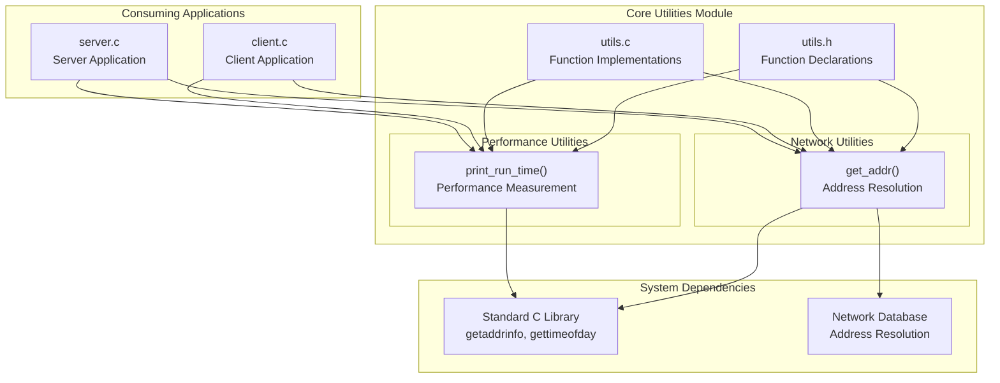
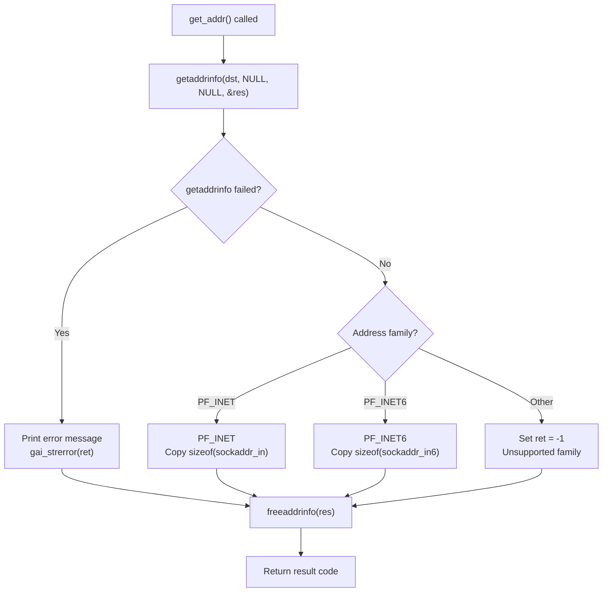
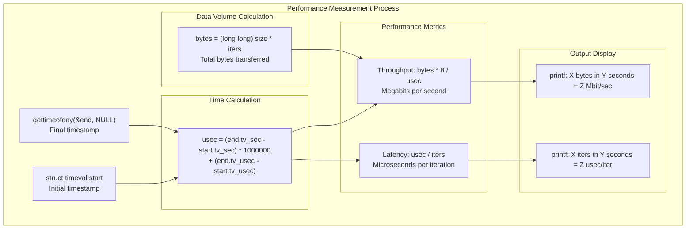
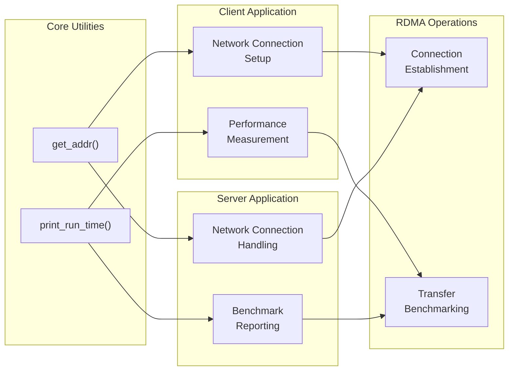

<!-- source: DeepWiki mcp.deepwiki.com · repo Mellanox/gpu_direct_rdma_access · page 6 Core Utilities · fetched 2026-11-11 -->

# Core Utilities

<details>
<summary>Relevant source files</summary>

The following files were used as context for generating this wiki page:

- [utils.c](utils.c)
- [utils.h](utils.h)

</details>


## Purpose and Scope

The Core Utilities module provides essential support functions for network address resolution and performance measurement within the GPU Direct RDMA Access system. This module contains low-level utility functions that are used throughout the codebase for converting network addresses and measuring execution performance.

This page covers the utility functions defined in [utils.h]() and implemented in [utils.c](). For information about system configuration utilities and scripts, see [System Configuration Scripts](#7). For details about the main client and server applications that use these utilities, see [Client-Server Applications](#5).

## Utility Functions Overview

The core utilities module provides two primary categories of functionality through a simple C API:

| Function | Purpose | Input Parameters | Return Value |
|----------|---------|------------------|--------------|
| `get_addr` | Convert IP address string to `sockaddr` structure | hostname/IP string, sockaddr pointer | 0 on success, error code on failure |
| `print_run_time` | Calculate and display performance metrics | start time, data size, iteration count | 0 on success, 1 on error |



**Core Utilities Architecture**

Sources: [utils.h:1-61](), [utils.c:1-88]()

## Network Address Resolution

The `get_addr` function provides network address resolution capabilities by converting hostname strings or IP addresses into `sockaddr` structures suitable for network operations.

### Function Interface

The function signature is defined in [utils.h:45]():

```c
int get_addr(char *dst, struct sockaddr *addr);
```

### Implementation Details

The address resolution process follows this workflow:



**Address Resolution Data Flow**

The implementation at [utils.c:44-64]() handles both IPv4 and IPv6 addresses:

- Uses `getaddrinfo()` for DNS resolution and address conversion
- Supports both hostname lookup and direct IP address conversion
- Copies the appropriate sockaddr structure based on address family
- Provides error handling with descriptive messages using `gai_strerror()`

Sources: [utils.c:44-64](), [utils.h:40-45]()

## Performance Measurement

The `print_run_time` function calculates and displays performance metrics for data transfer operations, providing both throughput and latency measurements.

### Function Interface

The function signature is defined in [utils.h:52]():

```c
int print_run_time(struct timeval start, unsigned long size, int iters);
```

### Measurement Calculations

The performance measurement process involves precise timing and throughput calculations:



**Performance Measurement Data Flow**

The implementation at [utils.c:66-86]() performs the following calculations:

- **Time Measurement**: Uses `gettimeofday()` to capture microsecond-precision timestamps
- **Throughput Calculation**: `(total_bytes * 8) / total_microseconds` for Mbit/sec
- **Latency Calculation**: `total_microseconds / iterations` for usec/iter
- **Data Volume**: `size * iterations` for total bytes processed

### Output Format

The function produces two lines of performance output:
1. Total data transferred with throughput in Mbit/sec
2. Total iterations with per-iteration latency in microseconds

Sources: [utils.c:66-86](), [utils.h:48-52]()

## Integration with System Components

The core utilities are used throughout the GPU Direct RDMA Access system:



**System Integration Overview**

The utilities provide essential infrastructure services:

- **Network Setup**: `get_addr()` enables hostname-to-address resolution for RDMA connections
- **Performance Analysis**: `print_run_time()` provides standardized benchmarking output across all applications
- **Cross-Platform Support**: Both functions handle IPv4/IPv6 and provide portable timing mechanisms

Sources: [utils.h:1-61](), [utils.c:1-88]()

---

