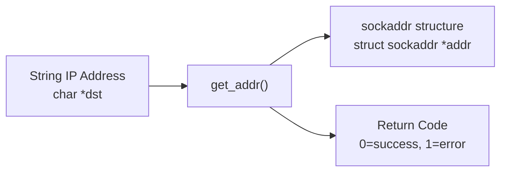
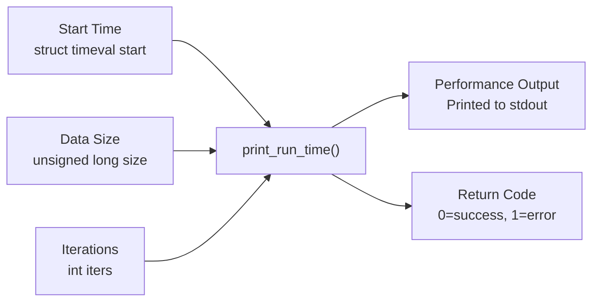
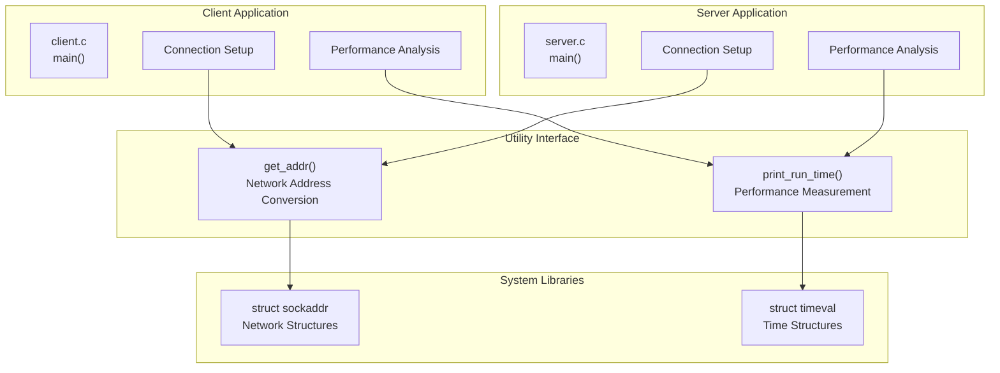
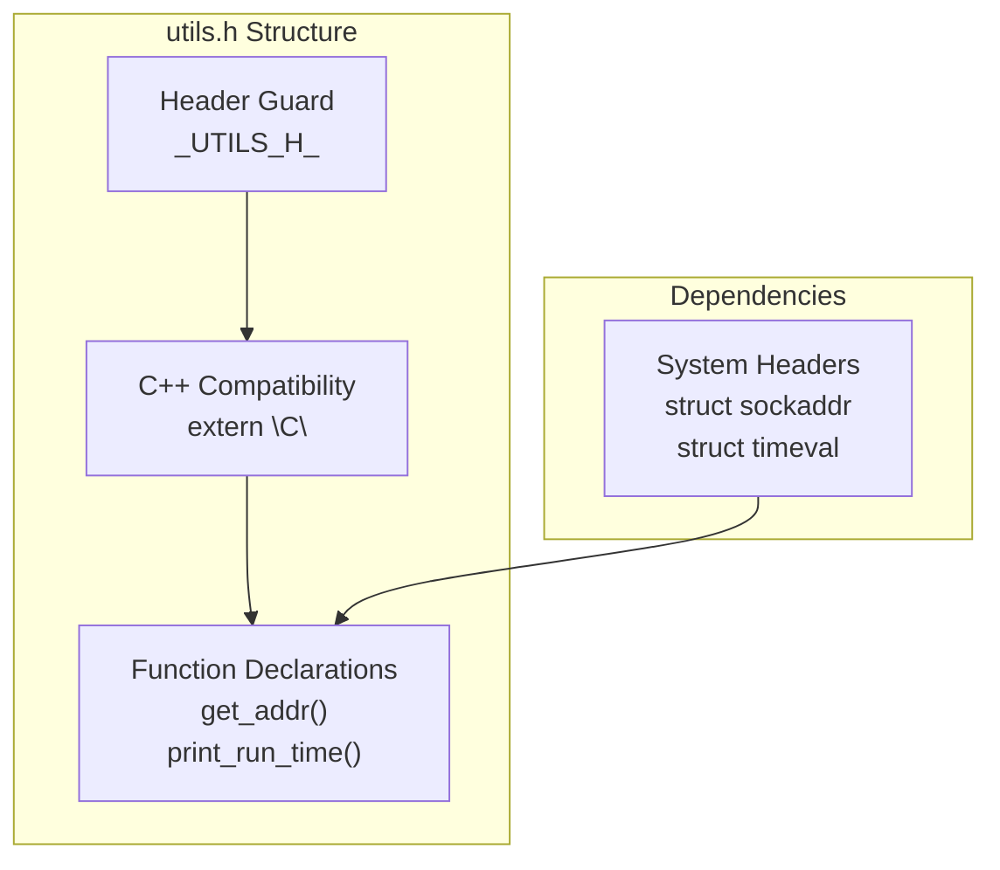

<!-- source: DeepWiki mcp.deepwiki.com · repo Mellanox/gpu_direct_rdma_access · page 6.1 Utility Interface · fetched 2026-11-11 -->

# Utility Interface

Relevant source files

The following files were used as context for generating this wiki page:

- [utils.h](utils.h)

This document describes the API interface for core utility functions that provide network address conversion and performance measurement capabilities within the GPU Direct RDMA Access system. These utilities support the basic operational needs of both client and server applications.

For implementation details of these utility functions, see [Utility Implementation](#6.2). For information about the client and server applications that use these utilities, see [Client-Server Applications](#5).

## Overview

The utility interface consists of two primary functions defined in [utils.h:40-52]():

- **Network Address Conversion**: Convert string IP addresses to `sockaddr` structures for network operations
- **Performance Measurement**: Calculate and display runtime performance metrics for RDMA operations

These utilities provide essential support functions used throughout the RDMA system for network connectivity and performance analysis.

## Function Interface Specifications

### Network Address Resolution

**Function: `get_addr`**

The `get_addr` function converts IP address strings into `sockaddr` structures suitable for network socket operations.

| Parameter | Type | Direction | Description |
|-----------|------|-----------|-------------|
| `dst` | `char *` | Input | String representation of IP address |
| `addr` | `struct sockaddr *` | Output | Populated sockaddr structure |
| **Return** | `int` | Output | 0 on success, 1 on error |

**Usage Context**: This function is primarily used by client and server applications during connection establishment to convert user-provided IP addresses into network-ready socket address structures.

### Performance Measurement

**Function: `print_run_time`**

The `print_run_time` function calculates and displays performance metrics for RDMA operations, including throughput and timing information.

| Parameter | Type | Direction | Description |
|-----------|------|-----------|-------------|
| `start` | `struct timeval` | Input | Operation start timestamp |
| `size` | `unsigned long` | Input | Total data size transferred |
| `iters` | `int` | Input | Number of iterations performed |
| **Return** | `int` | Output | 0 on success, 1 on error |

**Usage Context**: This function is used by both client and server applications to measure and report the performance of RDMA read/write operations, providing insights into throughput and latency characteristics.

## Integration Architecture

The utility interface serves as a foundational layer that abstracts common network and performance measurement operations. Both client and server applications depend on these utilities for basic operational capabilities, while the utilities themselves interface with standard system libraries for network and time management.

## Header Definition

The complete utility interface is defined in a single header file that provides C and C++ compatibility:

The header file follows standard C conventions with include guards and C++ compatibility declarations, ensuring it can be safely included in both C and C++ compilation units.

**Sources:** [utils.h:33-59]()

---

