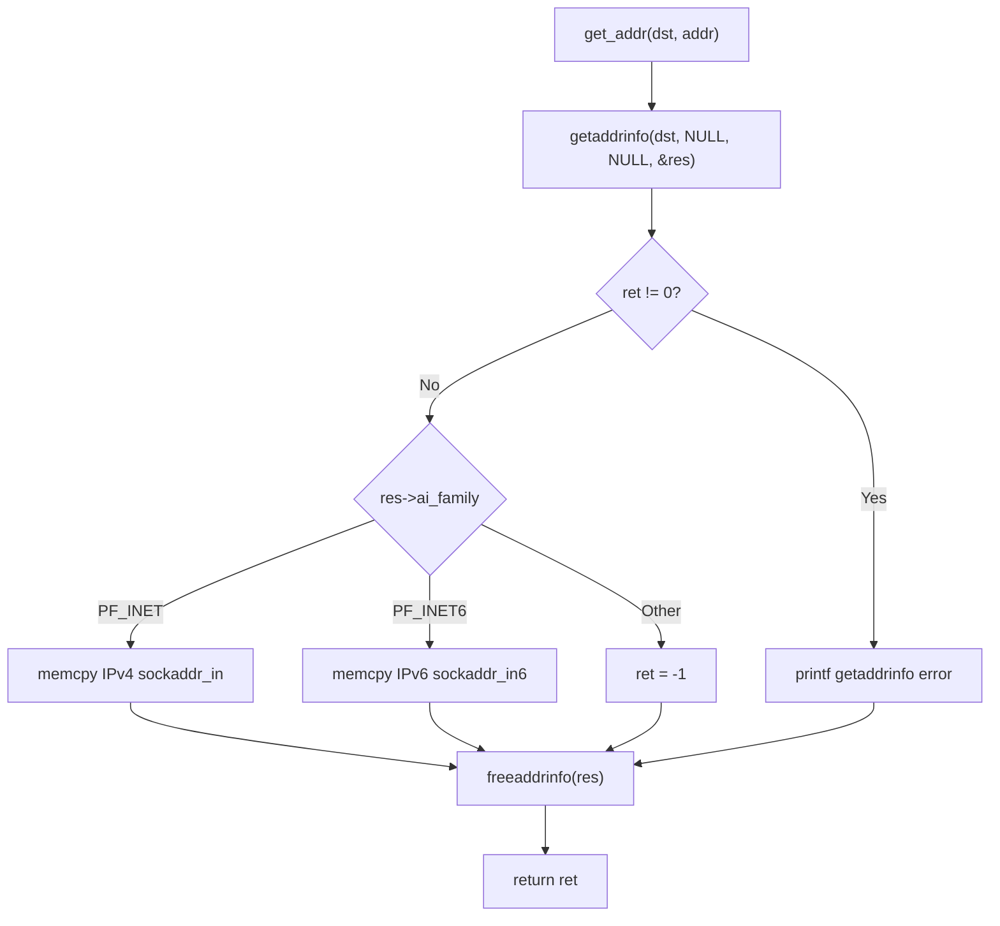
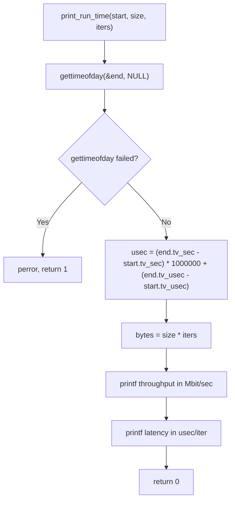
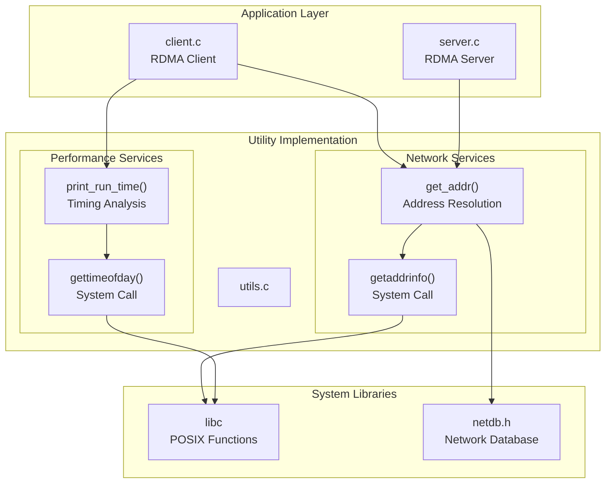
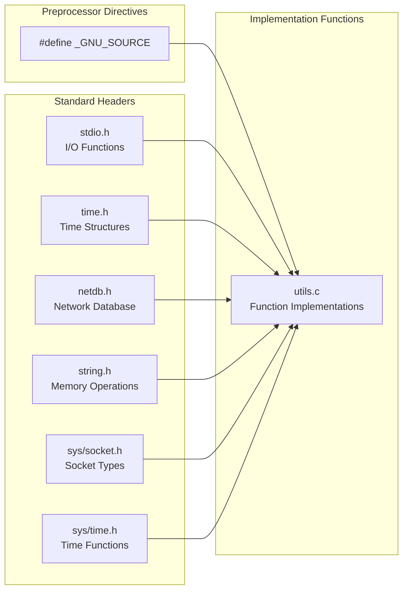

<!-- source: DeepWiki mcp.deepwiki.com · repo Mellanox/gpu_direct_rdma_access · page 6.2 Utility Implementation · fetched 2026-11-11 -->

# Utility Implementation

Relevant source files

The following files were used as context for generating this wiki page:

- [utils.c](utils.c)

This document covers the implementation details of core utility functions that provide network address resolution and performance measurement capabilities for the GPU Direct RDMA Access system. These utilities are implemented in [utils.c]() and support both the client and server applications with essential networking and timing services.

For the API documentation of these utilities, see [Utility Interface](#6.1).

## Address Resolution Implementation

The `get_addr` function provides hostname-to-socket address resolution using the POSIX `getaddrinfo` interface. The implementation supports both IPv4 and IPv6 address families with automatic protocol detection.

### Resolution Process Flow

**Address Resolution Implementation Details**

The implementation handles several key aspects:

| Aspect | Implementation Detail | Location |
|--------|----------------------|----------|
| Input Validation | Uses `getaddrinfo` for robust hostname/IP parsing | [utils.c:49]() |
| Protocol Support | Supports both IPv4 (`PF_INET`) and IPv6 (`PF_INET6`) | [utils.c:55-58]() |
| Memory Management | Automatically frees `addrinfo` resources via `freeaddrinfo` | [utils.c:62]() |
| Error Handling | Returns `getaddrinfo` error codes with descriptive messages | [utils.c:50-52]() |

Sources: [utils.c:44-64]()

## Performance Measurement Implementation  

The `print_run_time` function calculates and displays throughput and latency metrics by measuring elapsed time between operation start and completion. The implementation uses high-resolution timing and supports arbitrary data sizes and iteration counts.

### Timing Calculation Flow

**Performance Calculation Details**

The timing implementation performs these calculations:

| Metric | Formula | Purpose |
|--------|---------|---------|
| Elapsed Time | `(end.tv_sec - start.tv_sec) * 1000000 + (end.tv_usec - start.tv_usec)` | Microsecond precision timing |
| Total Bytes | `size * iters` | Total data transferred across all iterations |
| Throughput | `bytes * 8. / usec` | Network bandwidth in Mbit/sec |
| Latency | `usec / iters` | Per-operation latency in usec/iter |

The implementation uses floating-point arithmetic to provide precise throughput and latency measurements suitable for performance analysis of RDMA operations.

Sources: [utils.c:66-86]()

## Utility Integration Architecture

The utility functions integrate with the broader GPU Direct RDMA system through a clean separation of concerns, providing essential services to both client and server components.

**System Integration Points**

The utilities provide these integration points:

- **Network Resolution**: Client and server applications use `get_addr` to resolve destination addresses for RDMA connection establishment
- **Performance Monitoring**: Applications use `print_run_time` to measure and report RDMA operation performance metrics
- **Error Propagation**: Both functions return standard error codes that applications can handle appropriately

Sources: [utils.c:1-88]()

## Implementation Dependencies

The utility implementation relies on standard POSIX and GNU extensions for network and timing functionality:

The `_GNU_SOURCE` feature test macro enables access to GNU-specific extensions while maintaining compatibility with standard POSIX functions.

Sources: [utils.c:33-42]()

---

