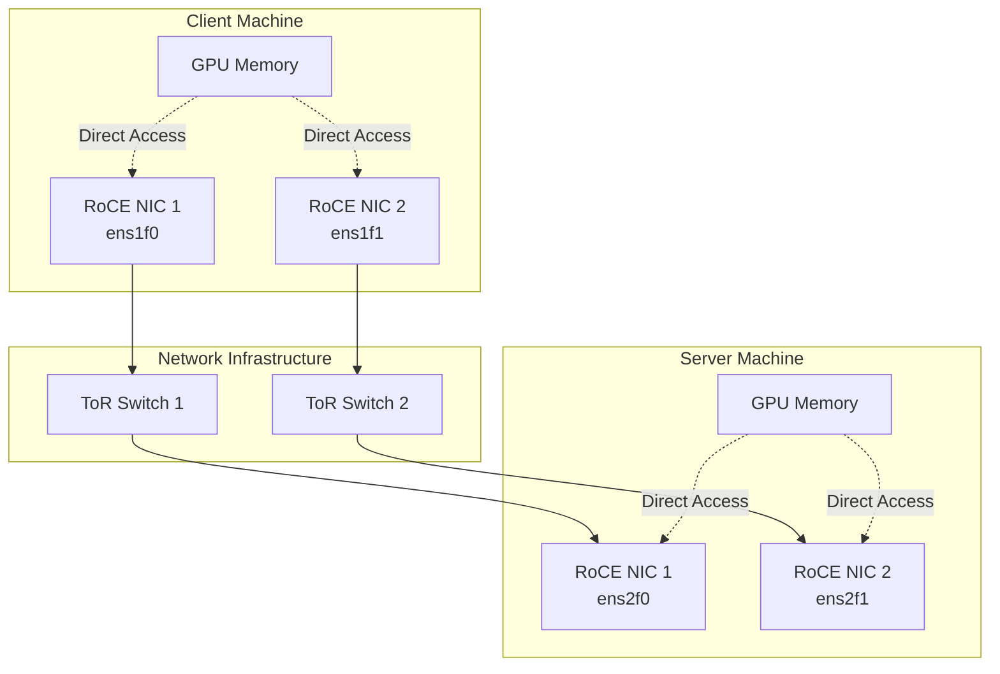
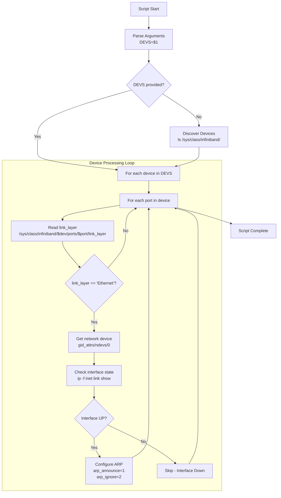
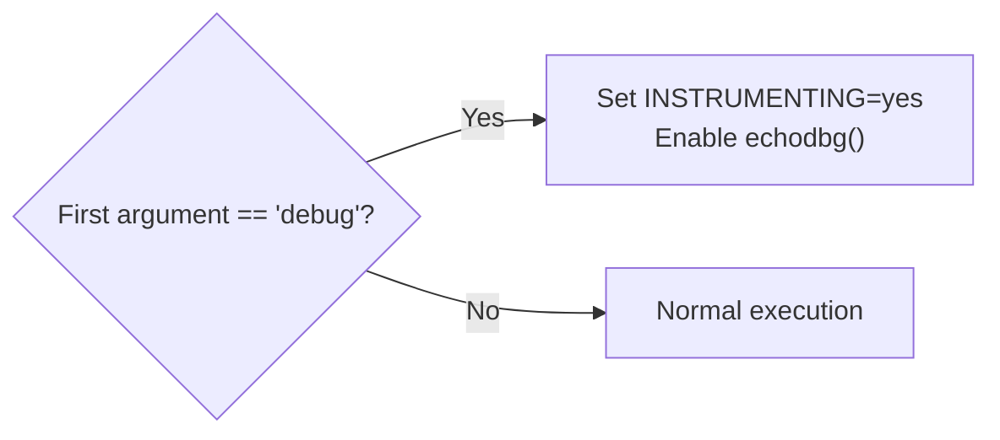

<!-- source: DeepWiki mcp.deepwiki.com · repo Mellanox/gpu_direct_rdma_access · page 7.1 Network Configuration · fetched 2026-11-11 -->

# Network Configuration

<details>
<summary>Relevant source files</summary>

The following files were used as context for generating this wiki page:

- [arp_announce_conf.sh](arp_announce_conf.sh)

</details>


This document covers the network configuration requirements and scripts for GPU Direct RDMA systems, specifically focusing on ARP (Address Resolution Protocol) configuration for multi-homed RoCE (RDMA over Converged Ethernet) environments. The primary component is the `arp_announce_conf.sh` script that automatically configures proper ARP behavior for RDMA-capable Ethernet interfaces.

For information about hardware topology discovery and optimal GPU-NIC pairings, see [Hardware Topology Discovery](#7.2).

## Purpose and Scope

The network configuration system addresses the challenges of running RDMA over Ethernet in multi-homed environments where servers have multiple network interfaces. Proper ARP configuration is critical to ensure:

- Consistent network interface selection for outbound traffic
- Prevention of ARP response conflicts between multiple interfaces
- Optimal routing for RDMA traffic paths
- Stable connectivity in complex network topologies

## Multi-homed RoCE Network Topology

The following diagram illustrates the typical network environment where this configuration is essential:



**Sources:** [arp_announce_conf.sh:44-62]()

## ARP Configuration Script Architecture

The `arp_announce_conf.sh` script implements automatic discovery and configuration of RoCE interfaces:



**Sources:** [arp_announce_conf.sh:39-62]()

## Core Configuration Functions

### Device Discovery

The script supports both explicit device specification and automatic discovery:

| Mode | Implementation | Purpose |
|------|----------------|---------|
| Explicit | `DEVS=$1` parameter | Target specific InfiniBand devices |
| Automatic | `ls /sys/class/infiniband/` | Configure all available devices |

**Sources:** [arp_announce_conf.sh:39-42]()

### Interface Type Detection

The script identifies RoCE interfaces by examining the link layer type:

```bash
ll=$(cat /sys/class/infiniband/$dev/ports/$port/link_layer)
if [ $ll = "Ethernet" ] ; then
    # Process RoCE interface
fi
```

**Sources:** [arp_announce_conf.sh:48-50]()

### Network Interface State Verification

Before applying configuration, the script verifies interface operational state:

```bash
link_st=$(ip -f inet link show $ndev | grep "state UP")
if [ -n "$link_st" ] ; then
    # Apply ARP configuration
fi
```

**Sources:** [arp_announce_conf.sh:52-53]()

## ARP Configuration Parameters

The script applies two critical ARP configuration parameters to prevent routing issues in multi-homed environments:

### arp_announce Parameter

| Value | Behavior | Use Case |
|-------|----------|----------|
| 0 | Use any local address | Default - can cause issues |
| 1 | Avoid addresses not in target subnet | **Applied by script** |
| 2 | Use only addresses on interface | Strict mode |

The script sets `net.ipv4.conf.$ndev.arp_announce=1` to ensure ARP requests use appropriate source addresses.

**Sources:** [arp_announce_conf.sh:55]()

### arp_ignore Parameter

| Value | Behavior | Use Case |
|-------|----------|----------|
| 0 | Reply for any address on any interface | Default - problematic |
| 1 | Reply only for addresses on receiving interface | Standard |
| 2 | Reply only if target address matches interface | **Applied by script** |

The script sets `net.ipv4.conf.$ndev.arp_ignore=2` to prevent interfaces from responding to ARP requests for addresses on other interfaces.

**Sources:** [arp_announce_conf.sh:56]()

## Debug Mode Support

The script includes optional debug instrumentation controlled by the first argument:



Debug mode enables verbose output through the `echodbg()` function for troubleshooting network configuration issues.

**Sources:** [arp_announce_conf.sh:31-37]()

## Usage Examples

### Basic Usage
```bash
# Configure all RoCE interfaces automatically
./arp_announce_conf.sh

# Configure specific device
./arp_announce_conf.sh mlx5_0

# Configure multiple devices
./arp_announce_conf.sh "mlx5_0 mlx5_1"
```

### Debug Mode
```bash
# Run with debug output
./arp_announce_conf.sh debug
./arp_announce_conf.sh debug mlx5_0
```

## Integration with GPU Direct RDMA System

This network configuration script serves as a foundational component for the GPU Direct RDMA system by:

1. **Preventing ARP conflicts** that could disrupt RDMA connections
2. **Ensuring consistent routing** for optimal GPU-NIC communication paths  
3. **Supporting multi-homed configurations** required for high-availability RDMA deployments
4. **Automating setup** to reduce manual configuration errors

The script is typically executed during system initialization or as part of the deployment process before starting RDMA applications.

**Sources:** [arp_announce_conf.sh:1-64]()

---

