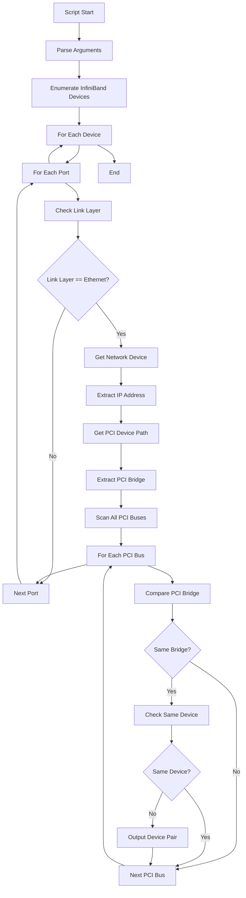
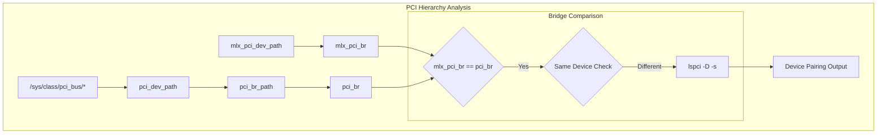

<!-- source: DeepWiki mcp.deepwiki.com · repo Mellanox/gpu_direct_rdma_access · page 7.2 Hardware Topology Discovery · fetched 2026-11-11 -->

# Hardware Topology Discovery

<details>
<summary>Relevant source files</summary>

The following files were used as context for generating this wiki page:

- [map_pci_nic_gpu.sh](map_pci_nic_gpu.sh)

</details>


This document covers the PCI topology discovery system that identifies optimal GPU-NIC pairings by analyzing PCI bridge relationships. The system helps optimize GPU Direct RDMA performance by discovering which network adapters and accelerator devices share the same PCI root complex.

For network configuration settings, see [Network Configuration](#7.1). For build system configuration, see [Build System](#2).

## Purpose and Scope

The hardware topology discovery system automatically maps the relationship between InfiniBand/RoCE network adapters and PCI devices to identify co-located components that can achieve optimal GPU Direct RDMA performance. The system analyzes PCI bridge topology to recommend device pairings that minimize inter-socket traffic and maximize memory bandwidth.

Sources: [map_pci_nic_gpu.sh:1-86]()

## Topology Discovery Workflow

The topology discovery process follows a systematic approach to enumerate devices and analyze their PCI relationships:



The script processes devices in nested loops, examining each InfiniBand device's ports and correlating them with PCI topology information.

Sources: [map_pci_nic_gpu.sh:39-84]()

## Device Enumeration and Filtering

The system discovers InfiniBand devices and filters for Ethernet-based connections suitable for RoCE:

### InfiniBand Device Discovery

```mermaid
graph TB
    subgraph "Device Discovery Process"
        SYSFS["/sys/class/infiniband/"] --> DEV_LIST["Device List"]
        DEV_LIST --> DEV_FILTER["Device Filter"]
        
        subgraph "Per-Device Analysis"
            PORT_ENUM["/sys/class/infiniband/\$dev/ports/"]
            LINK_CHECK["link_layer file"]
            ETH_FILTER["Ethernet Filter"]
        end
        
        DEV_FILTER --> PORT_ENUM
        PORT_ENUM --> LINK_CHECK
        LINK_CHECK --> ETH_FILTER
        
        subgraph "Network Interface Mapping"
            NDEV_PATH["/sys/class/infiniband/\$dev/ports/\$port/gid_attrs/ndevs/0"]
            IP_EXTRACT["ip command output"]
        end
        
        ETH_FILTER --> NDEV_PATH
        NDEV_PATH --> IP_EXTRACT
    end
```



The system reads device information from sysfs and filters for Ethernet link layer devices that support RoCE.

Sources: [map_pci_nic_gpu.sh:40-56]()

## PCI Topology Analysis

The core topology analysis maps PCI bridge relationships to identify co-located devices:

### PCI Bridge Mapping Process



The analysis extracts PCI bridge identifiers by traversing the sysfs directory hierarchy and comparing bridge paths.

Sources: [map_pci_nic_gpu.sh:57-81]()

### PCI Path Resolution

The script uses specific path manipulation to extract PCI topology information:

| Operation | Path Extraction | Purpose |
|-----------|----------------|---------|
| `mlx_pci_dev_path` | `readlink -f /sys/class/infiniband/$dev/device` | Get InfiniBand device PCI path |
| `mlx_pci_dev` | `${mlx_pci_dev_path##*/}` | Extract PCI device ID |
| `mlx_pci_br_path` | `dirname $(dirname $mlx_pci_dev_path)` | Navigate to PCI bridge directory |
| `mlx_pci_br` | `${mlx_pci_br_path##*/}` | Extract PCI bridge ID |

Sources: [map_pci_nic_gpu.sh:57-61]()

## Output Format and Usage

The script generates human-readable output that maps network interfaces to nearby PCI devices:

### Output Structure

The script produces output in the format:
```
<ip_address> (<ib_device>) is near <pci_device_description>
```

Example output:
```
192.168.1.100 (mlx5_0) is near 0000:17:00.0 NVIDIA Corporation TU102 [GeForce RTX 2080 Ti]
10.0.0.50 (mlx5_1) is near 0000:65:00.0 NVIDIA Corporation GP100GL [Tesla P100 PCIe 16GB]
```

### Debug Mode

The script supports a debug mode activated by passing `debug` as the first parameter:


Debug mode provides additional information including PCI device paths and bridge relationships.

Sources: [map_pci_nic_gpu.sh:31-37](), [map_pci_nic_gpu.sh:61]()

## Integration with GPU Direct RDMA

The topology discovery script supports the overall GPU Direct RDMA system by identifying optimal device pairings:

### Device Selection Strategy

| Scenario | Recommendation | Benefit |
|----------|----------------|---------|
| GPU and NIC on same bridge | Use paired devices | Minimized PCIe latency |
| Multiple GPUs available | Select GPU near target NIC | Optimized memory bandwidth |
| Multiple NICs available | Select NIC near target GPU | Reduced inter-socket traffic |

The script output helps administrators and applications make informed decisions about device selection for GPU Direct RDMA operations.

### Usage in GPU Memory Allocation

The topology information can be used in conjunction with the BDF (Bus:Device.Function) parameter in the memory management subsystem to select GPUs that are topologically close to the target network interface.

Sources: [map_pci_nic_gpu.sh:75-79]()

## Script Parameters and Execution

### Command Line Interface

The script accepts optional parameters for targeted device analysis:

```bash
./map_pci_nic_gpu.sh [debug] [device_list]
```

| Parameter | Purpose | Default Behavior |
|-----------|---------|------------------|
| `debug` | Enable verbose output | Silent operation |
| `device_list` | Specific InfiniBand devices | All devices in `/sys/class/infiniband/` |

### Error Handling

The script includes robust error handling for common scenarios:

- Missing IP addresses: Reports `[no ip addr]` for unconfigured interfaces
- Missing lspci information: Falls back to PCI bus identifier
- Invalid device paths: Continues processing remaining devices

Sources: [map_pci_nic_gpu.sh:53-55](), [map_pci_nic_gpu.sh:75-78]()

---

