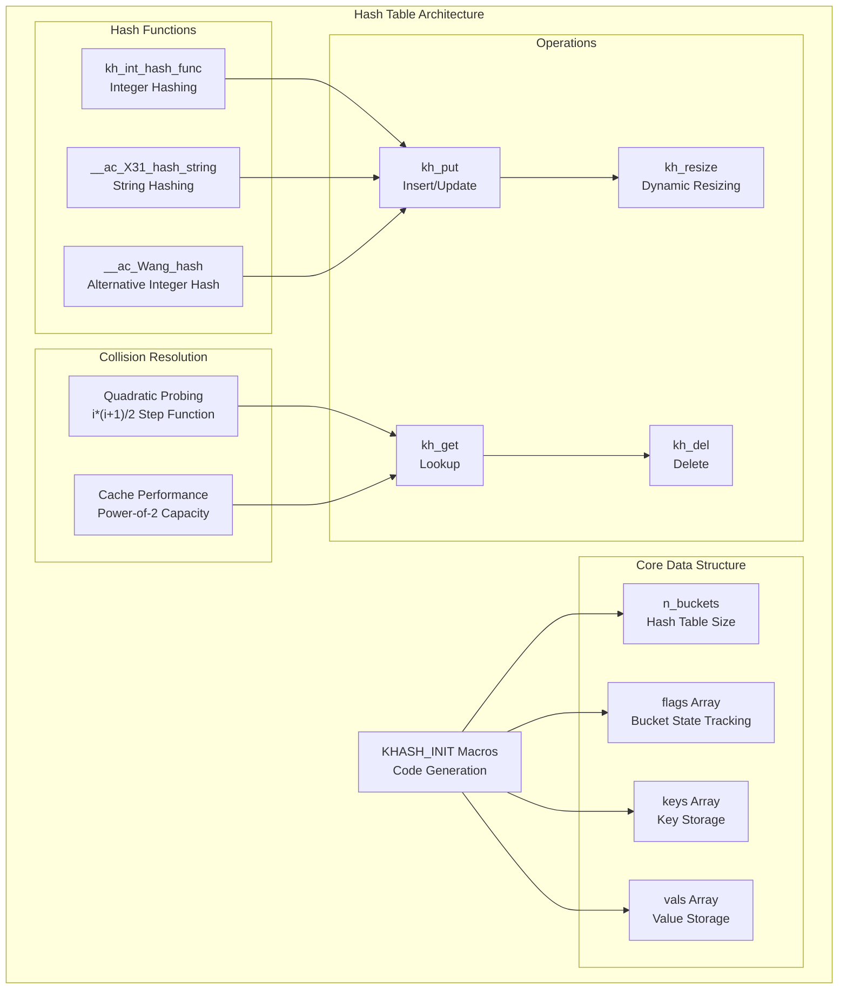
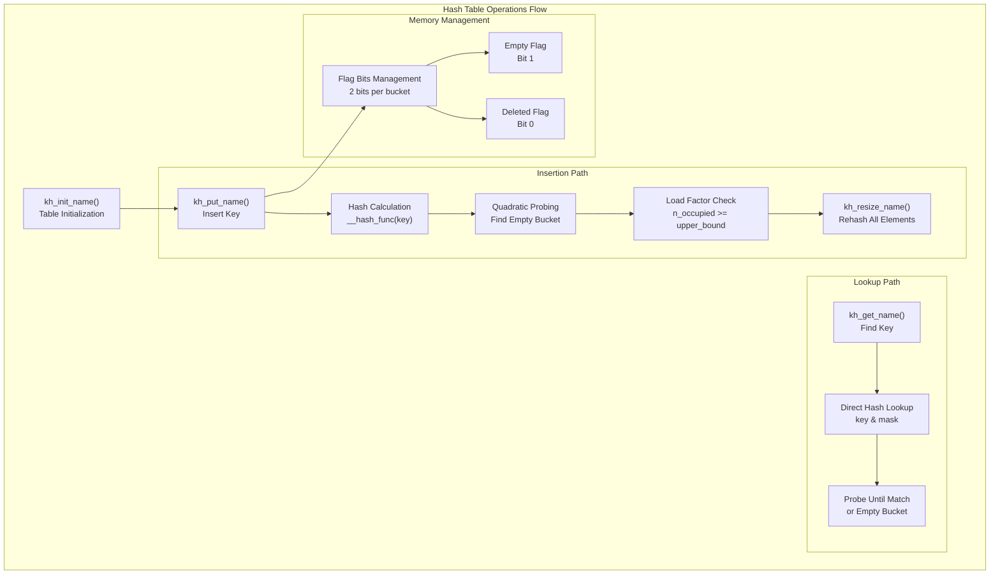
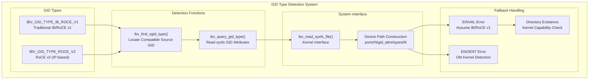
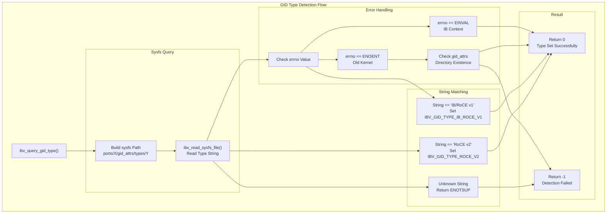
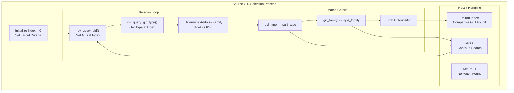

<!-- source: DeepWiki mcp.deepwiki.com · repo Mellanox/gpu_direct_rdma_access · page 8 Supporting Libraries · fetched 2026-11-11 -->

# Supporting Libraries

Relevant source files

The following files were used as context for generating this wiki page:

- [ibv_helper.h](ibv_helper.h)
- [khash.h](khash.h)

This document covers the auxiliary libraries that provide foundational functionality to the GPU Direct RDMA Access system. These libraries handle generic data structures and InfiniBand-specific operations that are essential for the core RDMA engine's operation.

The supporting libraries consist of two main components: a generic hash table implementation for efficient address handle caching, and InfiniBand helper utilities for GID type detection and management. For information about the core RDMA functionality that uses these libraries, see [Core RDMA Engine](#3). For details about the main applications that benefit from these libraries, see [Client-Server Applications](#5).

## Hash Table Library

The hash table library provides a generic, high-performance hash table implementation used throughout the RDMA system for caching frequently accessed data structures. The library is implemented as a header-only C library that uses macro-based code generation to create type-specific hash table implementations.

### Architecture and Design

The hash table implementation uses several key design principles for optimal performance in the RDMA context:

**Sources:** [khash.h:1-674]()

### Hash Table Types and Instantiation

The library supports multiple hash table configurations through macro-based instantiation:

| Macro | Key Type | Value Type | Use Case |
|-------|----------|------------|----------|
| `KHASH_SET_INIT_INT` | `khint32_t` | None (set) | Integer sets |
| `KHASH_MAP_INIT_INT` | `khint32_t` | User-defined | Integer-keyed maps |
| `KHASH_SET_INIT_INT64` | `khint64_t` | None (set) | 64-bit integer sets |
| `KHASH_MAP_INIT_INT64` | `khint64_t` | User-defined | 64-bit integer-keyed maps |
| `KHASH_SET_INIT_STR` | `const char*` | None (set) | String sets |
| `KHASH_MAP_INIT_STR` | `const char*` | User-defined | String-keyed maps |

The hash table structure is defined using the `__KHASH_TYPE` macro, which creates a structure containing bucket management fields, state flags, and separate arrays for keys and values.

**Sources:** [khash.h:197-203](), [khash.h:632-672]()

### Core Operations and Performance

The hash table provides a complete set of operations with performance optimizations specific to high-frequency RDMA operations:

The collision resolution uses quadratic probing with the step function `i*(i+1)/2`, which guarantees traversal of each bucket when the capacity is a power of 2. This approach provides better cache performance than double hashing while maintaining robustness against clustering.

**Sources:** [khash.h:244-256](), [khash.h:321-361](), [khash.h:48-76]()

### Integration with RDMA System

The hash table library is primarily used in the RDMA system for address handle caching, where it stores mappings between remote endpoints and their corresponding InfiniBand address handles. This caching mechanism is critical for performance in Dynamic Connect queue pair operations.

**Sources:** [khash.h:1-674]()

## InfiniBand Helpers

The InfiniBand helper library provides specialized utilities for querying and managing InfiniBand device properties, with particular focus on GID (Global Identifier) type detection and management. These utilities are essential for proper RoCE (RDMA over Converged Ethernet) operation and compatibility across different InfiniBand hardware generations.

### GID Type Management

The library defines and manages different GID types that correspond to various InfiniBand and RoCE protocol versions:

**Sources:** [ibv_helper.h:39-42](), [ibv_helper.h:88-145]()

### System File Interface

The helper library interacts directly with the Linux kernel's sysfs interface to obtain InfiniBand device information:

| Function | Purpose | Sysfs Path Pattern |
|----------|---------|-------------------|
| `ibv_read_sysfs_file` | Generic sysfs file reader | `{device_path}/{file}` |
| `ibv_query_gid_type` | Query specific GID type | `ports/{port}/gid_attrs/types/{index}` |
| `ibv_find_sgid_type` | Find matching source GID | Iterates through GID table |

The system handles various kernel versions and hardware capabilities through robust error handling and fallback mechanisms. When GID attribute files don't exist, the system assumes compatibility with older IB/RoCE v1 protocols.

**Sources:** [ibv_helper.h:44-80](), [ibv_helper.h:88-145]()

### GID Type Detection Algorithm

The GID type detection process implements a comprehensive algorithm for determining protocol compatibility:

The detection algorithm handles three main scenarios: successful type detection from sysfs, fallback for IB-only contexts (EINVAL), and compatibility mode for older kernels (ENOENT). This robust approach ensures operation across diverse hardware and kernel configurations.

**Sources:** [ibv_helper.h:88-145](), [ibv_helper.h:86-87]()

### Source GID Selection

The `ibv_find_sgid_type` function implements an algorithm to locate appropriate source GIDs based on type and address family requirements:

The function iterates through the device's GID table, querying both the GID value and its type, then checking for compatibility with the requested criteria. Address family determination is based on the GID's raw bytes, where IPv4-mapped addresses have specific bit patterns in their prefix.

**Sources:** [ibv_helper.h:147-176]()

---

