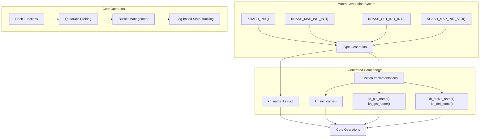
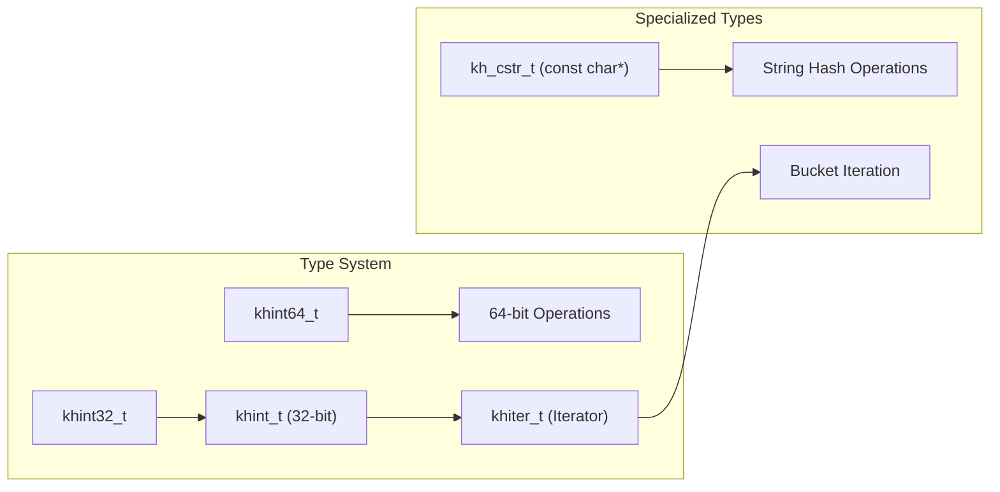
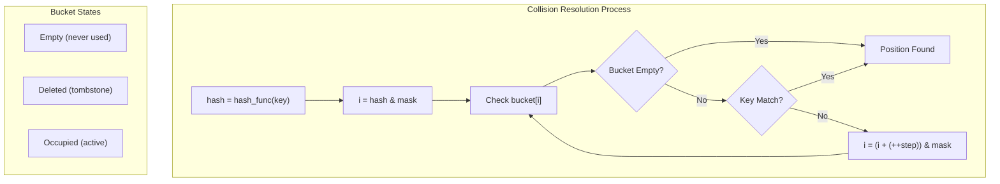
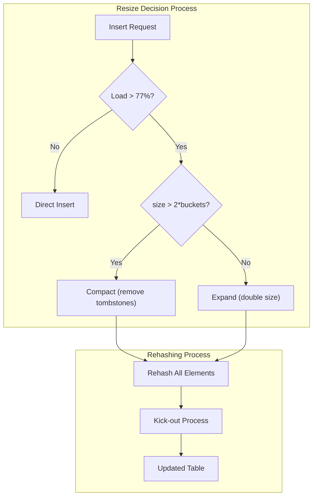
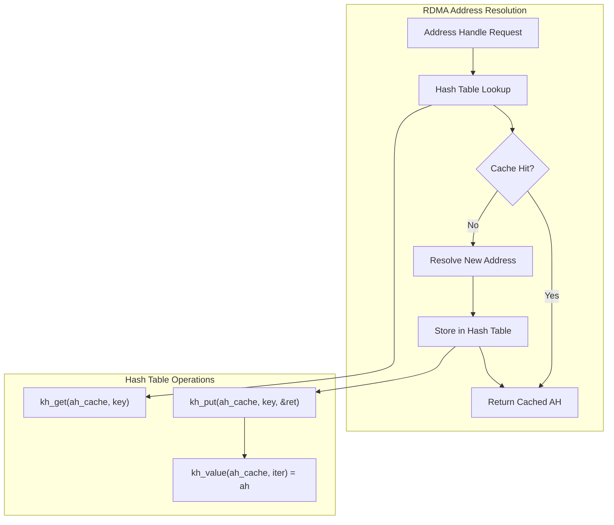

<!-- source: DeepWiki mcp.deepwiki.com · repo Mellanox/gpu_direct_rdma_access · page 8.1 Hash Table Library · fetched 2026-11-11 -->

# Hash Table Library

Relevant source files

The following files were used as context for generating this wiki page:

- [khash.h](khash.h)

## Purpose and Scope

The Hash Table Library provides a generic, high-performance hash table implementation used throughout the GPU Direct RDMA Access system for efficient key-value storage and caching operations. The library is implemented as a header-only solution using C macros to generate type-specific hash table code at compile time.

This library serves as the foundation for address handle caching in the RDMA subsystem, enabling fast lookup of network address handles during RDMA operations. For information about the RDMA engine that uses this library, see [Core RDMA Engine](#3). For details about InfiniBand-specific utilities that complement this library, see [InfiniBand Helpers](#8.2).

## Library Architecture

The khash library implements a macro-based approach to create type-safe hash tables with optimal performance characteristics. The system generates specialized hash table code for each key-value type combination.

**Sources:** [khash.h:197-203](), [khash.h:371-387](), [khash.h:632-672]()

## Core Data Structures

### Hash Table Structure

The library defines a generic hash table structure that is instantiated for specific key-value type combinations:

| Field | Type | Purpose |
|-------|------|---------|
| `n_buckets` | `khint_t` | Total number of buckets in the hash table |
| `size` | `khint_t` | Number of key-value pairs currently stored |
| `n_occupied` | `khint_t` | Number of occupied buckets (including deleted) |
| `upper_bound` | `khint_t` | Resize threshold (77% of capacity) |
| `flags` | `khint32_t*` | Bucket state flags (empty/deleted/occupied) |
| `keys` | `khkey_t*` | Array of keys |
| `vals` | `khval_t*` | Array of values (maps only) |

The flag system uses a compact representation where each bucket's state is encoded in 2 bits, allowing 16 bucket states per 32-bit integer.

**Sources:** [khash.h:197-203](), [khash.h:165-172]()

### Type Definitions and Iterators

**Sources:** [khash.h:134-144](), [khash.h:162-163](), [khash.h:658]()

## Hash Functions and Collision Resolution

### Built-in Hash Functions

The library provides optimized hash functions for common data types:

| Hash Function | Key Type | Implementation |
|---------------|----------|----------------|
| `kh_int_hash_func` | `khint32_t` | Identity function |
| `kh_int64_hash_func` | `khint64_t` | Bit mixing: `(key>>33^key^key<<11)` |
| `kh_str_hash_func` | `const char*` | X31 string hash |
| `__ac_Wang_hash` | `khint_t` | Wang's integer hash (optional) |

**Sources:** [khash.h:395-442]()

### Quadratic Probing Strategy

The library uses quadratic probing for collision resolution with the stepping function `i*(i+1)/2`, which guarantees traversal of all buckets when the capacity is a power of 2.

**Sources:** [khash.h:247-256](), [khash.h:334-348](), [khash.h:51-60]()

## API Interface

### Core Operations

The library provides a comprehensive API through macro-generated functions:

| Operation Category | Functions | Purpose |
|-------------------|-----------|---------|
| **Initialization** | `kh_init()`, `kh_init_inplace()` | Create hash tables |
| **Destruction** | `kh_destroy()`, `kh_destroy_inplace()` | Free memory |
| **Access** | `kh_get()`, `kh_put()`, `kh_del()` | Key operations |
| **Management** | `kh_resize()`, `kh_clear()` | Table maintenance |
| **Iteration** | `kh_foreach()`, `kh_foreach_key()` | Traversal |

**Sources:** [khash.h:454-625]()

### Memory Management Strategy

The library implements automatic resizing with a load factor threshold of 77% (`__ac_HASH_UPPER`). When this threshold is exceeded, the table doubles in size and rehashes all elements.

**Sources:** [khash.h:195](), [khash.h:324-332](), [khash.h:258-319]()

## Integration with RDMA System

The hash table library is primarily used within the GPU Direct RDMA system for address handle caching, providing fast lookup of previously resolved network addresses.

This integration enables the RDMA engine to maintain high-performance address resolution while minimizing redundant network operations.

**Sources:** Based on system architecture diagrams and hash table usage patterns

## Usage Examples and Patterns

### Typical Hash Map Instantiation

The library follows a pattern where users first declare a hash table type, then use the generated functions:

1. **Type Declaration**: Use macros like `KHASH_MAP_INIT_INT(name, value_type)`
2. **Instance Creation**: Call `kh_init(name)` to allocate
3. **Operations**: Use `kh_put()`, `kh_get()`, `kh_del()` for access
4. **Cleanup**: Call `kh_destroy(name, h)` to free memory

The macro system ensures type safety while maintaining high performance through compile-time code generation.

**Sources:** [khash.h:27-45](), [khash.h:640-672]()

---

