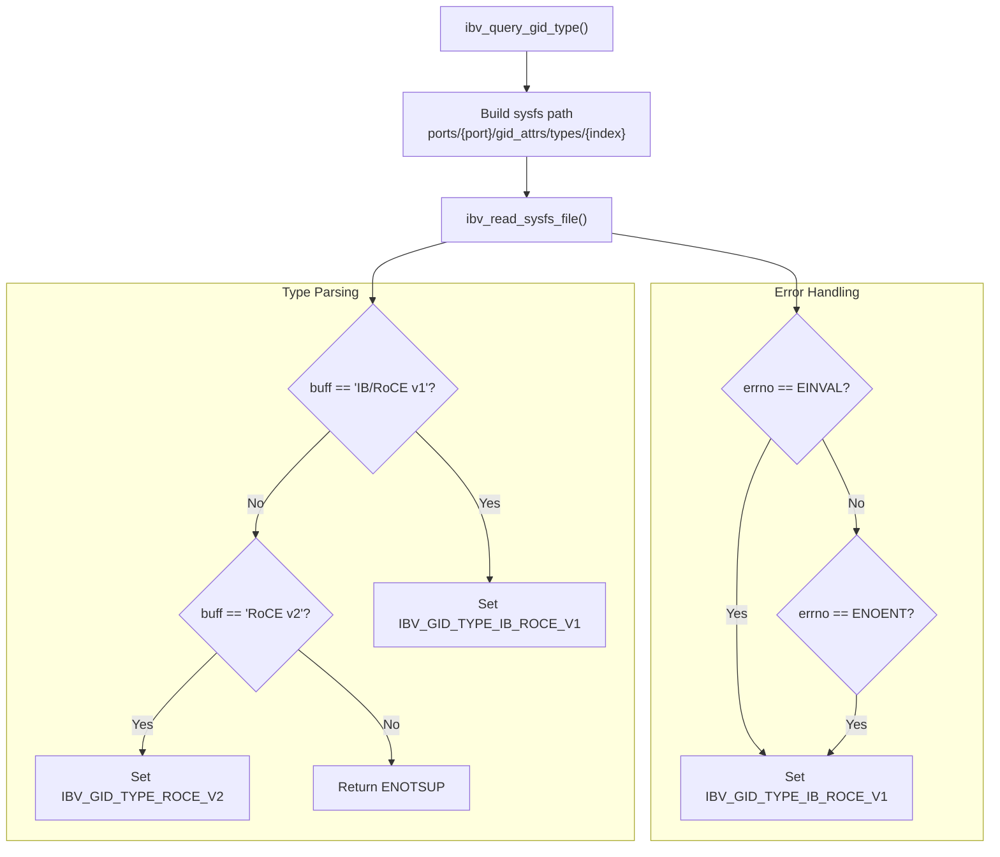
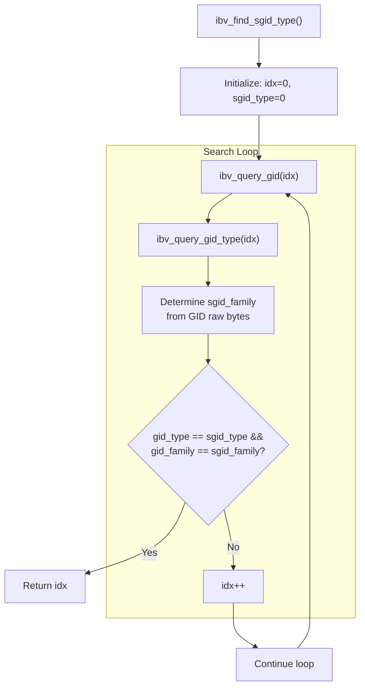
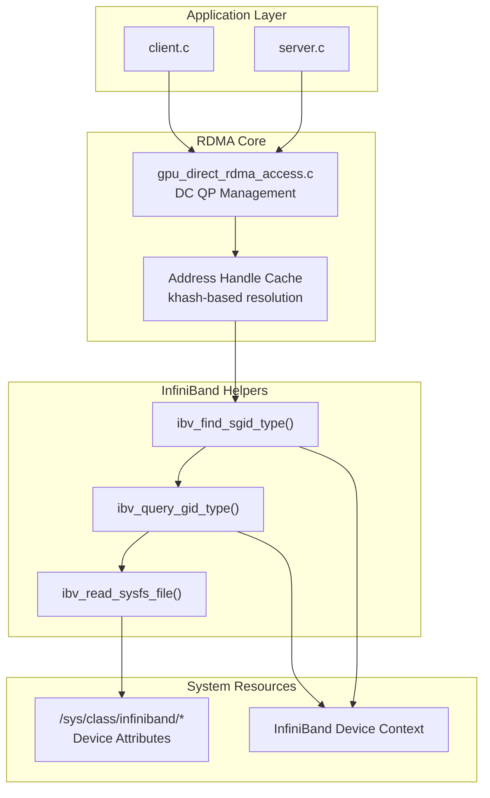

<!-- source: DeepWiki mcp.deepwiki.com · repo Mellanox/gpu_direct_rdma_access · page 8.2 InfiniBand Helpers · fetched 2026-11-11 -->

# InfiniBand Helpers

<details>
<summary>Relevant source files</summary>

The following files were used as context for generating this wiki page:

- [ibv_helper.h](ibv_helper.h)

</details>


This document covers the InfiniBand helper utilities that provide low-level device queries and GID type detection capabilities for the GPU Direct RDMA system. These utilities abstract the complexity of InfiniBand device discovery and GID management, enabling the core RDMA engine to work with different InfiniBand and RoCE configurations.

For information about the core RDMA functionality that uses these helpers, see [Core RDMA Engine](#3). For details about the hash table library used alongside these helpers, see [Hash Table Library](#8.1).

## Purpose and Architecture

The InfiniBand helpers provide essential infrastructure for querying InfiniBand device capabilities and determining the appropriate GID (Global Identifier) types for RDMA connections. The system supports both traditional InfiniBand and RoCE (RDMA over Converged Ethernet) protocols, automatically detecting and adapting to the available transport types.

### InfiniBand Helper System Architecture

```mermaid
graph TB
    subgraph "InfiniBand Helper Layer"
        ENUM[ibv_gid_type<br/>"Enumeration"]
        SYSFS[ibv_read_sysfs_file<br/>"System Interface"]
        QUERY[ibv_query_gid_type<br/>"Type Detection"]  
        FIND[ibv_find_sgid_type<br/>"GID Discovery"]
    end
    
    subgraph "System Resources"
        KERNEL["Kernel sysfs<br/>/sys/class/infiniband"]
        DEVICE["InfiniBand Device<br/>Context"]
    end
    
    subgraph "RDMA Core Integration"
        AH_CACHE["Address Handle Cache<br/>khash-based"]
        RDMA_ENGINE["Core RDMA Engine<br/>gpu_direct_rdma_access"]
    end
    
    SYSFS --> KERNEL
    QUERY --> SYSFS
    QUERY --> DEVICE
    FIND --> QUERY
    FIND --> DEVICE
    
    FIND --> AH_CACHE
    QUERY --> RDMA_ENGINE
```

Sources: [ibv_helper.h:39-176]()

## GID Type Definitions

The system defines an enumeration for InfiniBand GID types that abstracts the different RDMA transport protocols supported by the hardware.

### GID Type Enumeration

| GID Type | Value | Description |
|----------|-------|-------------|
| `IBV_GID_TYPE_IB_ROCE_V1` | 0 | Traditional InfiniBand or RoCE version 1 |
| `IBV_GID_TYPE_ROCE_V2` | 1 | RoCE version 2 (UDP-based) |

The enumeration provides a standardized way to identify and work with different RDMA transport types, enabling the system to adapt to various network configurations.

Sources: [ibv_helper.h:39-42]()

## System File Interface

The helper functions provide a robust interface for reading InfiniBand device information from the Linux kernel's sysfs filesystem.

### Sysfs File Reading

The `ibv_read_sysfs_file()` function implements safe file reading from the InfiniBand device sysfs hierarchy. It handles:

- **Path Construction**: Dynamically builds paths within the device sysfs tree
- **File Operations**: Opens, reads, and closes device attribute files  
- **String Processing**: Handles newline termination and buffer management
- **Error Handling**: Provides comprehensive error detection and cleanup

Key features include:
- Automatic null termination of read strings
- Buffer overflow protection
- Resource cleanup on all code paths
- CLOEXEC flag usage for security

Sources: [ibv_helper.h:44-80]()

## GID Type Detection

The system provides sophisticated GID type detection that adapts to different kernel versions and device capabilities.

### GID Type Query Function



The function handles multiple scenarios:
- **Modern Kernels**: Read GID type directly from sysfs attributes
- **Legacy Kernels**: Fall back to IB/RoCE v1 when attributes don't exist
- **Error Cases**: Distinguish between missing files and actual errors

Sources: [ibv_helper.h:88-145]()

## GID Discovery and Matching

The system provides advanced GID discovery capabilities that find appropriate GIDs based on transport type and address family requirements.

### GID Search Algorithm

The `ibv_find_sgid_type()` function implements a comprehensive search through available GIDs:



### Address Family Detection

The function determines address families by examining GID raw bytes:
- **IPv4 (AF_INET)**: When `sgid.raw[0] == 0 && sgid.raw[1] == 0`
- **IPv6**: Default case for other GID patterns

This enables proper matching of GIDs to the intended network protocol stack.

Sources: [ibv_helper.h:147-176]()

## Integration with Core System

The InfiniBand helpers integrate seamlessly with the broader GPU Direct RDMA system, providing essential services to multiple components.

### System Integration Points



The helpers serve critical functions in the RDMA workflow:
- **Device Discovery**: Identify available transport types during initialization
- **Address Resolution**: Select appropriate GIDs for connection establishment  
- **Transport Adaptation**: Enable seamless operation across IB and RoCE networks
- **Compatibility**: Support both modern and legacy kernel interfaces

Sources: [ibv_helper.h:1-179]()