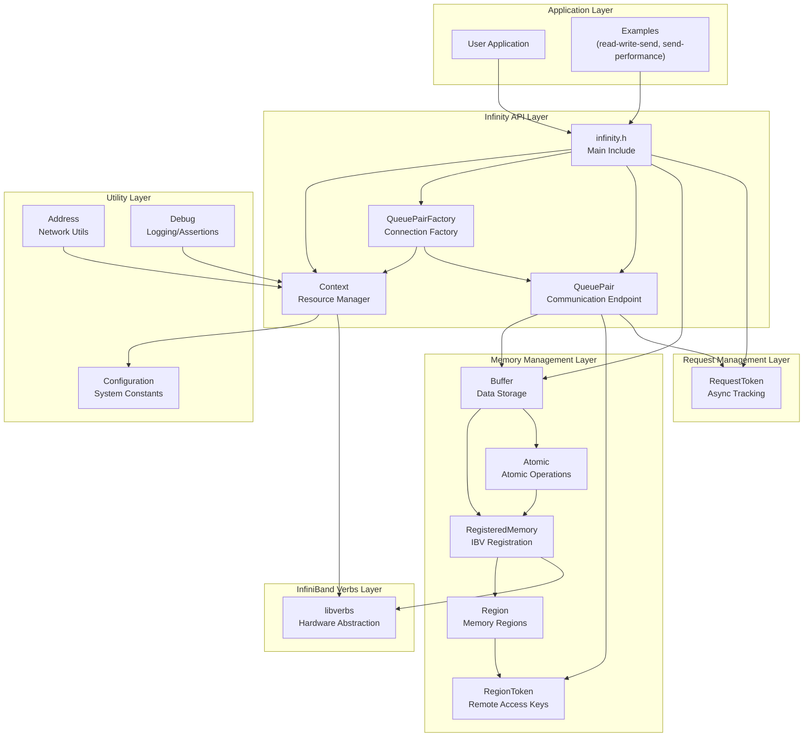
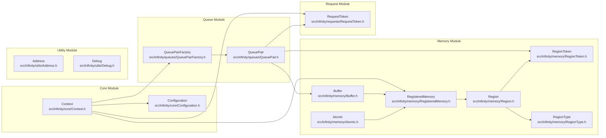

<!-- source: DeepWiki mcp.deepwiki.com · repo claudebarthels/infinity · page 1 Overview · fetched 2026-11-11 -->

# Overview

<details>
<summary>Relevant source files</summary>

The following files were used as context for generating this wiki page:

- [README.md](README.md)
- [src/infinity/infinity.h](src/infinity/infinity.h)

</details>


This document provides an overview of the Infinity RDMA library, a C++ abstraction framework for InfiniBand Remote Direct Memory Access (RDMA) operations. This page covers the library's purpose, core architecture, and main components. For detailed information about building and using the library, see [Getting Started](#2). For comprehensive API documentation, see [API Reference](#7).

## Purpose and Scope

Infinity is a lightweight C++ library that provides a high-level, object-oriented abstraction over InfiniBand Verbs (ibVerbs). The library enables developers to build high-performance RDMA applications without dealing with the low-level complexities of the InfiniBand API. It supports both one-sided operations (read, write, atomic) and two-sided operations (send, receive) while maintaining the performance characteristics of native RDMA.

**Sources:** [README.md:1-3](), [src/infinity/infinity.h:1-7]()

## What is Infinity?

Infinity serves as a middleware layer between applications and the InfiniBand hardware, abstracting away the complexities of memory registration, queue pair management, and completion handling. The library is designed to significantly lower the barrier to RDMA programming while preserving the performance benefits of direct memory access.

The library provides:
- **Simplified API**: Object-oriented interface hiding ibVerbs complexity
- **Memory Management**: Automatic registration and region management
- **Connection Management**: Factory pattern for establishing RDMA connections
- **Request Tracking**: Asynchronous operation completion handling
- **Utilities**: Network address management and debugging support

**Sources:** [README.md:3-4](), [src/infinity/infinity.h:12-24]()

## Architecture Overview

The Infinity library follows a layered architecture where higher-level abstractions build upon lower-level InfiniBand primitives:



**Sources:** [src/infinity/infinity.h:12-24](), [README.md:17-23]()

## Core Components

The library consists of several key components organized into functional modules:



**Sources:** [src/infinity/infinity.h:12-24]()

## Key Components Description

| Component | Purpose | Key Functionality |
|-----------|---------|------------------|
| `Context` | Central resource manager | Manages InfiniBand context, protection domain, completion queues |
| `QueuePairFactory` | Connection establishment | Creates and manages RDMA connections to remote hosts |
| `QueuePair` | Communication endpoint | Performs RDMA operations (read, write, send, atomic) |
| `Buffer` | Memory management | High-level wrapper for registered memory regions |
| `RegionToken` | Remote access handle | Provides remote memory access credentials |
| `RequestToken` | Asynchronous tracking | Tracks completion of RDMA operations |
| `RegisteredMemory` | IBV integration | Handles InfiniBand memory registration |

**Sources:** [src/infinity/infinity.h:12-24]()

## Basic Usage Pattern

The typical usage pattern involves creating a context, establishing connections, registering memory, and performing RDMA operations:

```cpp
// Create context and establish connection
infinity::core::Context *context = new infinity::core::Context();
infinity::queues::QueuePairFactory *qpFactory = new infinity::queues::QueuePairFactory(context);
infinity::queues::QueuePair *qp = qpFactory->connectToRemoteHost(SERVER_IP, PORT_NUMBER);

// Register memory and perform operations
infinity::memory::Buffer *localBuffer = new infinity::memory::Buffer(context, BUFFER_SIZE);
infinity::memory::RegionToken *remoteBufferToken = new infinity::memory::RegionToken(REMOTE_BUFFER_INFO);
infinity::requests::RequestToken requestToken(context);

// Execute RDMA operations
qp->read(localBuffer, remoteBufferToken, &requestToken);
requestToken.waitUntilCompleted();
```

**Sources:** [README.md:17-44]()

## Operation Types

Infinity supports two categories of RDMA operations:

| Operation Type | Description | Components Used |
|---------------|-------------|-----------------|
| **One-sided** | Direct memory access without remote CPU involvement | `QueuePair::read()`, `QueuePair::write()`, `QueuePair::atomic()` |
| **Two-sided** | Message passing requiring remote participation | `QueuePair::send()`, `QueuePair::receive()` |

**Sources:** [README.md:3](), [README.md:31-42]()

## Performance Characteristics

The library is designed to maintain the performance characteristics of native RDMA while providing a simplified programming interface. It achieves this through:

- **Zero-copy operations**: Direct memory access without data copying
- **Asynchronous processing**: Non-blocking operation completion
- **Efficient memory registration**: Optimized memory region management
- **Minimal overhead**: Thin abstraction layer over ibVerbs

**Sources:** [README.md:3-4]()

---

