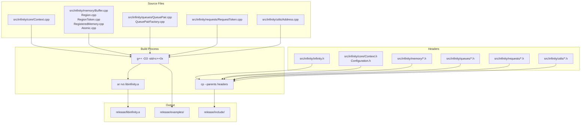
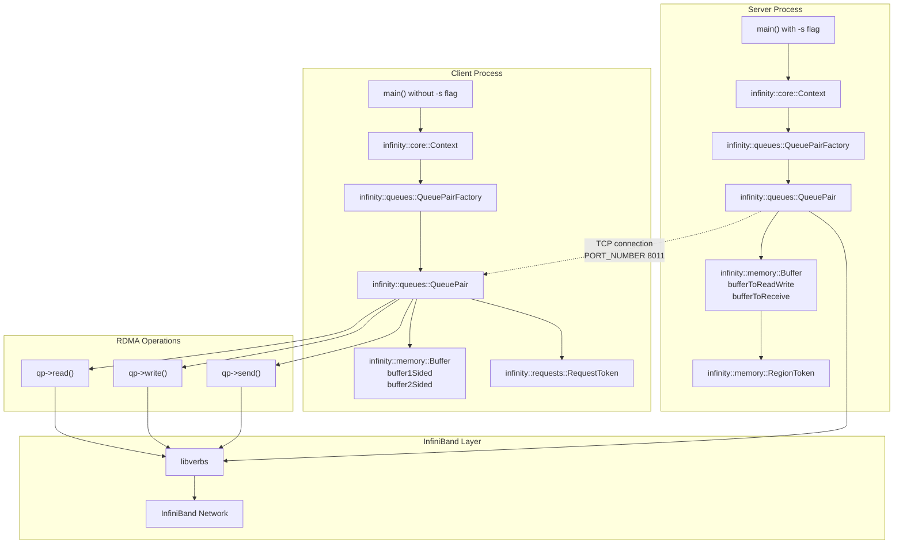

<!-- source: DeepWiki mcp.deepwiki.com · repo claudebarthels/infinity · page 2 Getting Started · fetched 2026-11-11 -->

# Getting Started

<details>
<summary>Relevant source files</summary>

The following files were used as context for generating this wiki page:

- [Makefile](Makefile)
- [src/examples/read-write-send.cpp](src/examples/read-write-send.cpp)

</details>


This page provides a practical introduction to building and using the Infinity RDMA library. It covers the essential steps to compile the library, understand its basic architecture, and run your first RDMA application.

The Infinity library is a C++ framework that provides high-level abstractions over InfiniBand Verbs for RDMA (Remote Direct Memory Access) operations. This page focuses on the practical aspects of getting started with development. For detailed information about the underlying architecture, see [Core Architecture](#3). For comprehensive API documentation, see [API Reference](#7).

## Prerequisites

Before building the Infinity library, ensure you have:

- A C++ compiler supporting C++0x standard (g++ recommended)
- InfiniBand development libraries (`libverbs`)
- Make build system
- InfiniBand hardware or software simulation environment

## Building the Library

The Infinity library uses a straightforward Makefile-based build system. The build process creates both a static library and example programs.

### Build Targets

The build system provides several targets:

| Target | Description | Output |
|--------|-------------|---------|
| `library` | Builds the static library | `release/libinfinity.a` |
| `examples` | Compiles example programs | `release/examples/` |
| `all` | Builds both library and examples | Complete build |
| `clean` | Removes build artifacts | Cleans build directories |

### Build Process



### Build Commands

To build the library:

```bash
make library
```

To build the examples:

```bash
make examples
```

To build everything:

```bash
make all
```

Sources: [Makefile:1-95]()

## Basic Usage Example

The `read-write-send.cpp` example demonstrates the fundamental RDMA operations supported by Infinity. This example implements a client-server pattern where the client performs read, write, and send operations on the server.

### Application Architecture



### Server Implementation

The server side performs these key operations:

1. **Context Initialization**: Creates the `infinity::core::Context` to manage InfiniBand resources
2. **Buffer Setup**: Allocates memory buffers for RDMA operations
3. **Connection Listening**: Binds to port 8011 and waits for incoming connections
4. **Message Reception**: Posts receive buffers and waits for incoming messages

Key server code sections:
- Context creation: [src/examples/read-write-send.cpp:44]()
- Buffer allocation: [src/examples/read-write-send.cpp:51-52]()
- Connection setup: [src/examples/read-write-send.cpp:59-60]()
- Message reception: [src/examples/read-write-send.cpp:63-64]()

### Client Implementation

The client side demonstrates the three primary RDMA operations:

1. **Connection Establishment**: Connects to the server using TCP handshake
2. **Remote Read**: Reads data from the server's memory buffer
3. **Remote Write**: Writes data to the server's memory buffer  
4. **Message Send**: Sends a message using two-sided operations

Key client code sections:
- Connection: [src/examples/read-write-send.cpp:73-74]()
- Read operation: [src/examples/read-write-send.cpp:82-84]()
- Write operation: [src/examples/read-write-send.cpp:86-88]()
- Send operation: [src/examples/read-write-send.cpp:90-92]()

### Running the Example

To run the basic example:

1. Start the server:
```bash
./release/examples/read-write-send -s
```

2. Start the client:
```bash
./release/examples/read-write-send
```

The server will display connection status and wait for the client message, while the client will perform the read, write, and send operations sequentially.

Sources: [src/examples/read-write-send.cpp:1-105]()

## Core Programming Pattern

The Infinity library follows a consistent programming pattern across all RDMA operations:

### Resource Management Flow

```mermaid
graph LR
    subgraph "Initialization"
        CreateContext["new Context()"]
        CreateFactory["new QueuePairFactory(context)"]
        CreateBuffers["new Buffer(context, size)"]
    end
    
    subgraph "Connection"
        ServerBind["bindToPort(PORT_NUMBER)"]
        ServerAccept["acceptIncomingConnection()"]
        ClientConnect["connectToRemoteHost()"]
    end
    
    subgraph "Operations"
        CreateToken["RequestToken(context)"]
        CallOperation["qp->read/write/send()"]
        WaitCompletion["requestToken.waitUntilCompleted()"]
    end
    
    subgraph "Cleanup"
        DeleteBuffers["delete buffers"]
        DeleteQP["delete qp"]
        DeleteFactory["delete qpFactory"]
        DeleteContext["delete context"]
    end
    
    CreateContext --> CreateFactory
    CreateFactory --> CreateBuffers
    CreateBuffers --> ServerBind
    CreateBuffers --> ClientConnect
    
    ServerBind --> ServerAccept
    ClientConnect --> CreateToken
    ServerAccept --> CreateToken
    
    CreateToken --> CallOperation
    CallOperation --> WaitCompletion
    WaitCompletion --> DeleteBuffers
    
    DeleteBuffers --> DeleteQP
    DeleteQP --> DeleteFactory
    DeleteFactory --> DeleteContext
```



### Memory Management

All RDMA operations require properly registered memory buffers:

- `Buffer` objects automatically handle InfiniBand memory registration
- `RegionToken` objects provide remote access handles for one-sided operations
- `RequestToken` objects track asynchronous operation completion

Sources: [src/examples/read-write-send.cpp:44-104]()

## Next Steps

After successfully building and running the basic example, you can:

1. **Explore Performance**: Run the performance testing example as described in [Performance Testing](#2.3)
2. **Understand Architecture**: Learn about the core components in [Core Architecture](#3)
3. **Memory Management**: Dive deeper into memory handling in [Memory Management](#4)
4. **Advanced Operations**: Explore atomic operations and advanced patterns in [Atomic Operations](#4.4)

The `read-write-send.cpp` example provides a foundation for understanding how to use the Infinity library. All production applications will follow similar patterns of context creation, connection establishment, buffer management, and operation execution.

Sources: [Makefile:89-93]()

---

