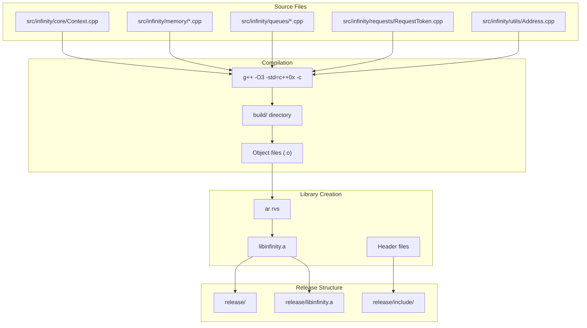
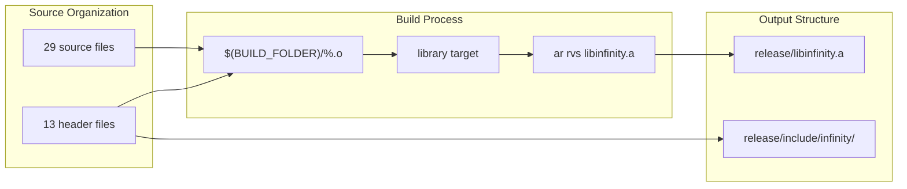
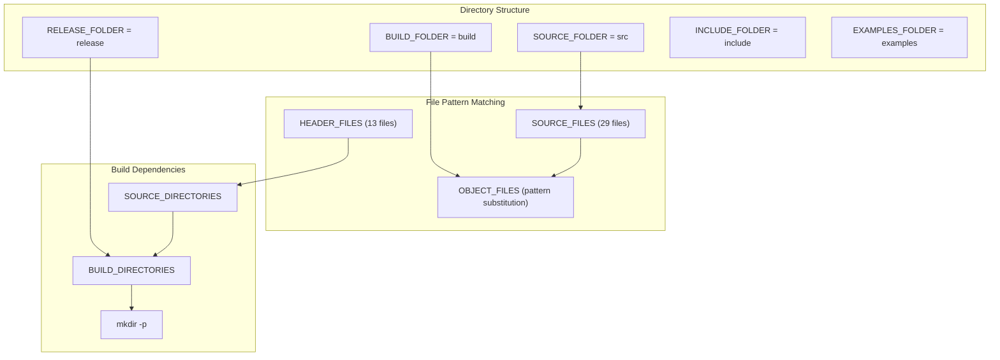

<!-- source: DeepWiki mcp.deepwiki.com · repo claudebarthels/infinity · page 2.1 Building the Library · fetched 2026-11-11 -->

# Building the Library

<details>
<summary>Relevant source files</summary>

The following files were used as context for generating this wiki page:

- [.gitignore](.gitignore)
- [Makefile](Makefile)

</details>


This document explains how to compile and build the Infinity library from source code. It covers the build system architecture, available build targets, and the compilation process that produces the static library and example programs.

For information about configuring and using the library after building, see [Basic Usage Example](#2.2). For detailed build system internals and development setup, see [Build System](#8.1).

## Prerequisites

The Infinity library requires the following dependencies to build:

- **C++ Compiler**: g++ with C++11 support (std=c++0x)
- **InfiniBand Verbs**: libverbs development libraries
- **Build Tools**: make utility
- **System**: POSIX-compatible environment

The build system uses specific compiler flags defined in [Makefile:16]():
- `-O3`: Optimization level 3 for performance
- `-std=c++0x`: C++11 standard support

## Build Process Overview

The build process follows a standard compile-link-archive pattern:



*Build Process Flow*

Sources: [Makefile:67-80]()

## Available Build Targets

The Makefile provides several build targets accessible through the `make` command:

| Target | Description | Output |
|--------|-------------|---------|
| `all` | Default target, builds library and examples | Static library + example binaries |
| `library` | Builds only the static library | `release/libinfinity.a` |
| `examples` | Builds example programs | `release/examples/` binaries |
| `clean` | Removes build artifacts | Cleans `build/` and `release/` |

### Library Target

The `library` target creates the static library through these steps:

1. **Compilation**: Source files are compiled to object files in `build/`
2. **Archiving**: Object files are archived into `release/libinfinity.a`
3. **Header Installation**: Header files are copied to `release/include/`



*Library Build Target Process*

Sources: [Makefile:74-80]()

### Examples Target

The `examples` target compiles demonstration programs that link against the library:

- **read-write-send**: Basic RDMA operations example
- **send-performance**: Performance benchmarking tool

The examples are compiled with linking flags `-linfinity -libverbs` and use the headers from `release/include/`.

Sources: [Makefile:89-93]()

## Build System Architecture

The build system is organized around several key directory structures and file patterns:



*Build System Directory and File Organization*

The build system uses pattern substitution to convert source paths to object file paths:
- Source: `$(SOURCE_FOLDER)/%.cpp`
- Object: `$(BUILD_FOLDER)/%.o`

Sources: [Makefile:21-26](), [Makefile:57-60]()

## Source File Organization

The library consists of source files organized by functional component:

```mermaid
graph TB
    subgraph "Core Components"
        CoreContext["infinity/core/Context.cpp"]
    end
    
    subgraph "Memory Management"
        MemAtomic["infinity/memory/Atomic.cpp"]
        MemBuffer["infinity/memory/Buffer.cpp"]
        MemRegion["infinity/memory/Region.cpp"]
        MemRegionToken["infinity/memory/RegionToken.cpp"]
        MemRegistered["infinity/memory/RegisteredMemory.cpp"]
    end
    
    subgraph "Queue Operations"
        QueuePair["infinity/queues/QueuePair.cpp"]
        QueueFactory["infinity/queues/QueuePairFactory.cpp"]
    end
    
    subgraph "Request Management"
        RequestToken["infinity/requests/RequestToken.cpp"]
    end
    
    subgraph "Utilities"
        UtilsAddress["infinity/utils/Address.cpp"]
    end
    
    subgraph "Compilation Target"
        LibInfinity["libinfinity.a"]
    end
    
    CoreContext --> LibInfinity
    MemAtomic --> LibInfinity
    MemBuffer --> LibInfinity
    MemRegion --> LibInfinity
    MemRegionToken --> LibInfinity
    MemRegistered --> LibInfinity
    QueuePair --> LibInfinity
    QueueFactory --> LibInfinity
    RequestToken --> LibInfinity
    UtilsAddress --> LibInfinity
```



*Source File to Library Mapping*

Sources: [Makefile:29-38]()

## Output Structure

After successful compilation, the `release/` directory contains:

```
release/
├── libinfinity.a          # Static library
├── include/               # Header files
│   └── infinity/
│       ├── infinity.h     # Main include
│       ├── core/
│       ├── memory/
│       ├── queues/
│       ├── requests/
│       └── utils/
└── examples/              # Example binaries (if built)
    ├── read-write-send
    └── send-performance
```

The header files are copied from `src/` to `release/include/` maintaining the directory structure for proper include paths.

## Dependencies and Linking

Applications using the library must link against:
- **libinfinity**: The compiled static library
- **libverbs**: InfiniBand Verbs library

The linking flags are defined as `LD_FLAGS = -linfinity -libverbs` in [Makefile:17]().

## Building the Library

To build the library:

```bash
# Build library only
make library

# Build library and examples
make all

# Build examples only (requires library to be built first)
make examples

# Clean build artifacts
make clean
```

The build process automatically creates necessary directories and handles dependencies between source files and headers.

Sources: [Makefile:63](), [Makefile:74-80](), [Makefile:89-93](), [Makefile:83-85]()

---

