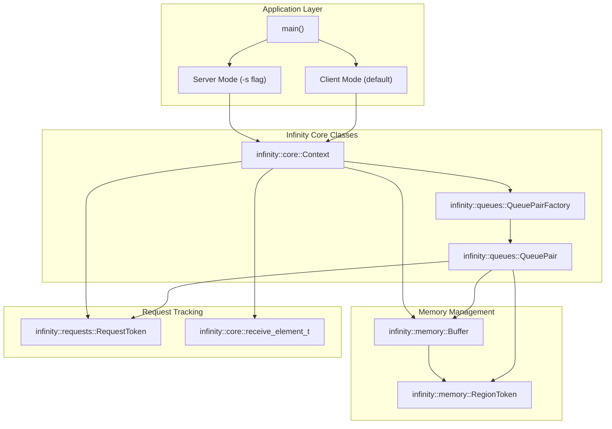
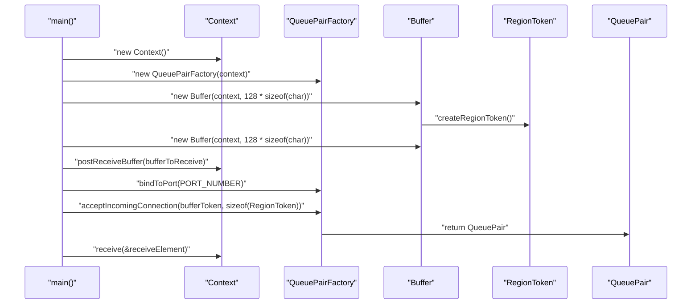
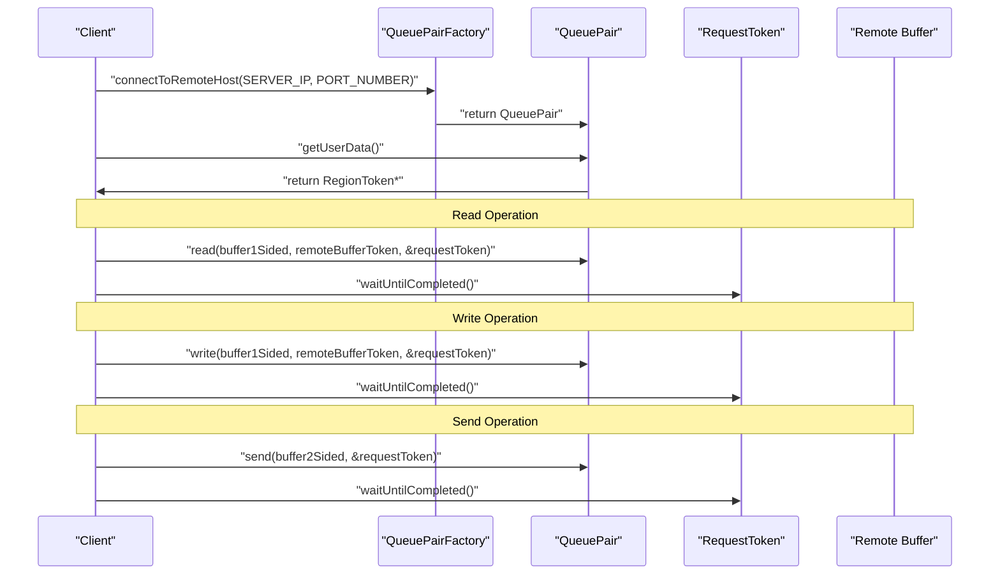
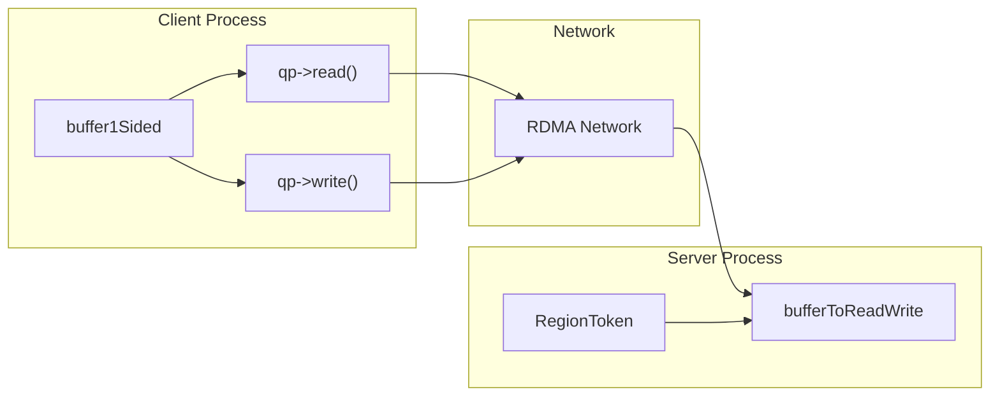
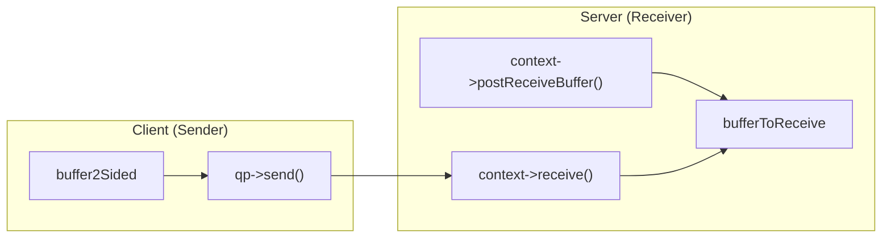
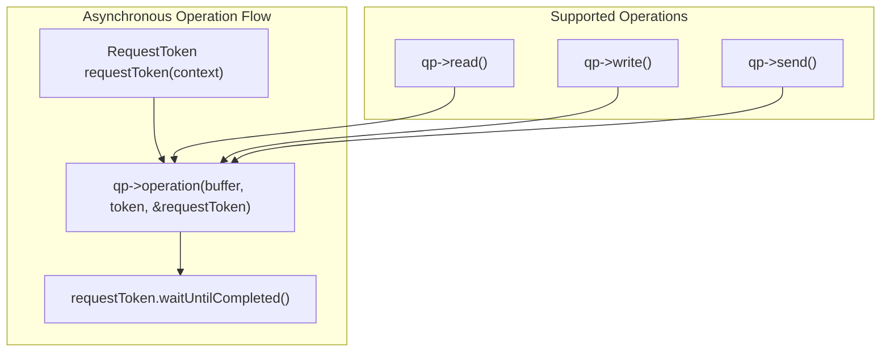
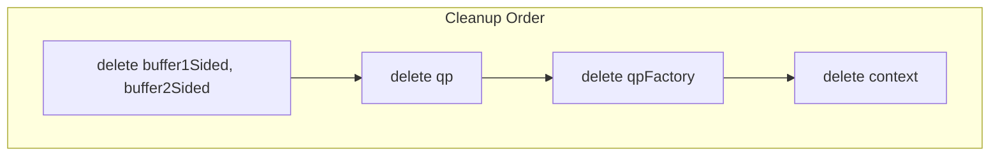

<!-- source: DeepWiki mcp.deepwiki.com · repo claudebarthels/infinity · page 2.2 Basic Usage Example · fetched 2026-11-11 -->

# Basic Usage Example

Relevant source files

The following files were used as context for generating this wiki page:

- [src/examples/read-write-send.cpp](src/examples/read-write-send.cpp)

This page demonstrates the basic usage patterns of the Infinity RDMA library through a comprehensive example that showcases read, write, and send operations. The example illustrates both server-side and client-side implementations, covering one-sided RDMA operations (read/write) and two-sided operations (send/receive).

For information about building the library, see [Building the Library](#2.1). For performance testing and optimization, see [Performance Testing](#2.3). For detailed API documentation, see [API Reference](#7).

## Example Program Structure

The basic usage example is implemented in a single program that can operate as either a server or client based on command-line arguments. The program demonstrates the complete lifecycle of RDMA operations from connection setup to data transfer.

### Program Components and Classes

**Sources:** [src/examples/read-write-send.cpp:1-105]()

## Server-Side Operations

The server component demonstrates how to set up memory regions, accept connections, and receive messages. The server creates buffers for both one-sided operations (read/write) and two-sided operations (receive).

### Server Initialization and Setup

**Sources:** [src/examples/read-write-send.cpp:44-68]()

### Server Memory Management

| Buffer Type | Purpose | Size | Usage |
|-------------|---------|------|-------|
| `bufferToReadWrite` | Target for remote read/write operations | 128 bytes | Creates `RegionToken` for remote access |
| `bufferToReceive` | Destination for incoming messages | 128 bytes | Posted to receive queue |

The server creates two distinct buffers:
- A buffer for one-sided operations that gets exposed to the client via `RegionToken`
- A buffer for two-sided receive operations that gets posted to the receive queue

**Sources:** [src/examples/read-write-send.cpp:50-56]()

## Client-Side Operations

The client component demonstrates how to connect to a remote host and perform all three types of RDMA operations: read, write, and send. All operations use `RequestToken` for asynchronous completion tracking.

### Client Connection and Operation Flow

**Sources:** [src/examples/read-write-send.cpp:72-96]()

### Client Buffer Allocation

The client creates two separate buffers to demonstrate different operation types:

| Buffer | Purpose | Operations |
|--------|---------|------------|
| `buffer1Sided` | One-sided RDMA operations | `read()`, `write()` |
| `buffer2Sided` | Two-sided operations | `send()` |

**Sources:** [src/examples/read-write-send.cpp:78-79]()

## Key RDMA Operations

### One-Sided Operations

One-sided operations (`read` and `write`) operate directly on remote memory without involving the remote CPU. These operations require a `RegionToken` to specify the remote memory location.

**Sources:** [src/examples/read-write-send.cpp:81-88]()

### Two-Sided Operations

Two-sided operations (`send` and `receive`) require participation from both the sender and receiver. The receiver must post receive buffers before the sender can send messages.

**Sources:** [src/examples/read-write-send.cpp:56-64](), [src/examples/read-write-send.cpp:90-92]()

## Request Completion Handling

All RDMA operations in the example use `RequestToken` for asynchronous completion tracking. This pattern allows for non-blocking operation initiation followed by explicit completion waiting.

### RequestToken Usage Pattern

**Sources:** [src/examples/read-write-send.cpp:82-92]()

## Connection Management

The example demonstrates the complete connection lifecycle using `QueuePairFactory`:

### Server Connection Setup
1. Create `QueuePairFactory` instance
2. Bind to port using `bindToPort(PORT_NUMBER)`
3. Accept incoming connections with `acceptIncomingConnection()`
4. Exchange connection metadata (RegionToken)

### Client Connection Setup
1. Create `QueuePairFactory` instance
2. Connect to remote host using `connectToRemoteHost(SERVER_IP, PORT_NUMBER)`
3. Retrieve connection metadata using `getUserData()`

**Sources:** [src/examples/read-write-send.cpp:59-74]()

## Resource Management

The example demonstrates proper resource cleanup by explicitly deleting all allocated objects in the correct order:

**Sources:** [src/examples/read-write-send.cpp:67-68](), [src/examples/read-write-send.cpp:94-101]()

---

