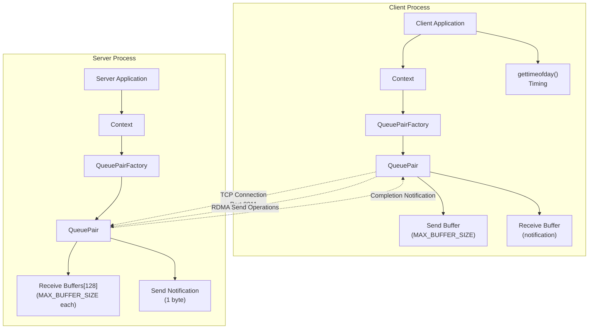
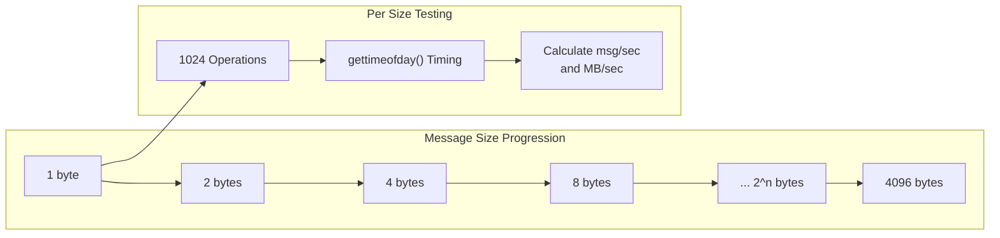
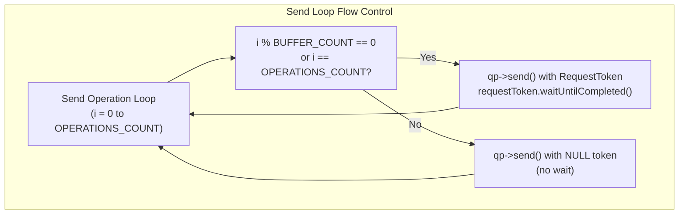

<!-- source: DeepWiki mcp.deepwiki.com · repo claudebarthels/infinity · page 2.3 Performance Testing · fetched 2026-11-11 -->

# Performance Testing

<details>
<summary>Relevant source files</summary>

The following files were used as context for generating this wiki page:

- [src/examples/send-performance.cpp](src/examples/send-performance.cpp)

</details>


## Purpose and Scope

This document explains how to use the Infinity library's performance testing capabilities to measure and optimize RDMA communication performance. The primary tool for performance testing is the `send-performance` example program, which measures message throughput and bandwidth across various message sizes using two-sided communication operations.

For information about basic usage patterns, see [Basic Usage Example](#2.2). For detailed information about the QueuePair operations being tested, see [QueuePair Operations](#3.2).

## Overview

The performance testing framework provides a client-server benchmark that measures send operation performance across different message sizes. The test systematically evaluates both message rate (messages per second) and bandwidth (MB/sec) to help identify optimal configurations for specific use cases.

## Test Structure

### Client-Server Architecture

The performance test operates as a client-server application where the client sends messages and measures performance while the server receives messages and provides synchronization feedback.



Sources: [src/examples/send-performance.cpp:51-66](), [src/examples/send-performance.cpp:109-115]()

### Configuration Constants

The performance test uses several key configuration parameters that can be modified to adjust test behavior:

| Parameter | Value | Purpose |
|-----------|-------|---------|
| `PORT_NUMBER` | 8011 | TCP port for initial connection |
| `SERVER_IP` | "192.0.0.1" | Server IP address (modify for remote testing) |
| `BUFFER_COUNT` | 128 | Number of pre-posted receive buffers |
| `MAX_BUFFER_SIZE` | 4096 | Maximum message size in bytes |
| `OPERATIONS_COUNT` | 1024 | Number of operations per message size |

Sources: [src/examples/send-performance.cpp:23-27]()

## Running the Performance Test

### Server Mode

Start the server component using the `-s` flag:

```bash
./send-performance -s
```

The server will:
1. Create receive buffers and post them to the shared receive queue
2. Bind to the specified port and wait for incoming connections
3. Accept the client connection and establish the queue pair
4. Receive messages across all test iterations
5. Send a completion notification to the client

### Client Mode

Start the client component without flags:

```bash
./send-performance
```

The client will:
1. Connect to the server at the specified IP and port
2. Create send and receive buffers
3. Send an initial warmup message
4. Execute the performance measurement loop
5. Wait for server completion notification

## Performance Measurement Process

### Message Size Progression

The test measures performance across exponentially increasing message sizes, starting from 1 byte and doubling until reaching `MAX_BUFFER_SIZE`:



Sources: [src/examples/send-performance.cpp:75-91](), [src/examples/send-performance.cpp:122-158]()

### Measurement Algorithm

The client implements a precise timing mechanism to measure send performance:

1. **Warmup Phase**: Send an initial message to establish the connection and warm up the pipeline
2. **Measurement Loop**: For each message size, send `OPERATIONS_COUNT` messages with timing
3. **Synchronization**: Use `RequestToken` for flow control every `BUFFER_COUNT` messages
4. **Metric Calculation**: Compute message rate and bandwidth from elapsed time

The key measurement code uses `gettimeofday()` for microsecond precision timing:

```cpp
struct timeval start, stop;
gettimeofday(&start, NULL);
// Send operations
gettimeofday(&stop, NULL);
uint64_t time = timeDiff(stop, start);
```

Sources: [src/examples/send-performance.cpp:130-150](), [src/examples/send-performance.cpp:176-178]()

## Flow Control and Buffering

### Request Token Management

The test implements intelligent flow control to prevent overwhelming the receive side while maintaining high performance:



Sources: [src/examples/send-performance.cpp:133-145]()

### Buffer Management

The server pre-posts multiple receive buffers to ensure continuous message reception without blocking:

- **Receive Buffer Pool**: 128 buffers of `MAX_BUFFER_SIZE` each
- **Buffer Recycling**: Completed receive buffers are immediately re-posted
- **Flow Control**: Buffer count matches client-side flow control intervals

Sources: [src/examples/send-performance.cpp:57-62](), [src/examples/send-performance.cpp:85-88]()

## Performance Metrics

### Message Rate Calculation

Message rate is calculated as operations per second:

```
msgRate = (OPERATIONS_COUNT * 1,000,000) / time_in_microseconds
```

### Bandwidth Calculation

Bandwidth is calculated as effective data transfer rate:

```
bandwidth = (OPERATIONS_COUNT * messageSize) / (1024 * 1024) / (time_in_seconds)
```

### Output Format

The test outputs results in a tabular format for each message size:

```
Sending messages of size X bytes    Y.XXX msg/sec    Z.XXX MB/sec
```

Sources: [src/examples/send-performance.cpp:151-153]()

## Interpreting Results

### Performance Characteristics

- **Small Messages**: High message rates but low bandwidth due to protocol overhead
- **Large Messages**: Lower message rates but higher bandwidth due to payload efficiency
- **Optimal Point**: The message size that provides the best balance for your application

### System Factors

Performance results are influenced by:
- **Network Hardware**: InfiniBand adapter capabilities and link speed
- **CPU Performance**: Message processing and memory copy overhead
- **Memory Bandwidth**: Buffer allocation and data movement costs
- **System Load**: Competing processes and interrupt handling

### Troubleshooting

Common issues and solutions:
- **Low Performance**: Verify InfiniBand link is active and properly configured
- **Connection Failures**: Check firewall settings and network connectivity
- **Memory Issues**: Ensure sufficient memory for buffer allocation
- **Timing Inconsistencies**: Run multiple iterations and average results

Sources: [src/examples/send-performance.cpp:1-179]()

---

