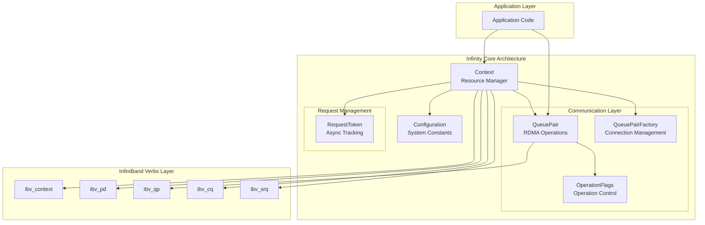
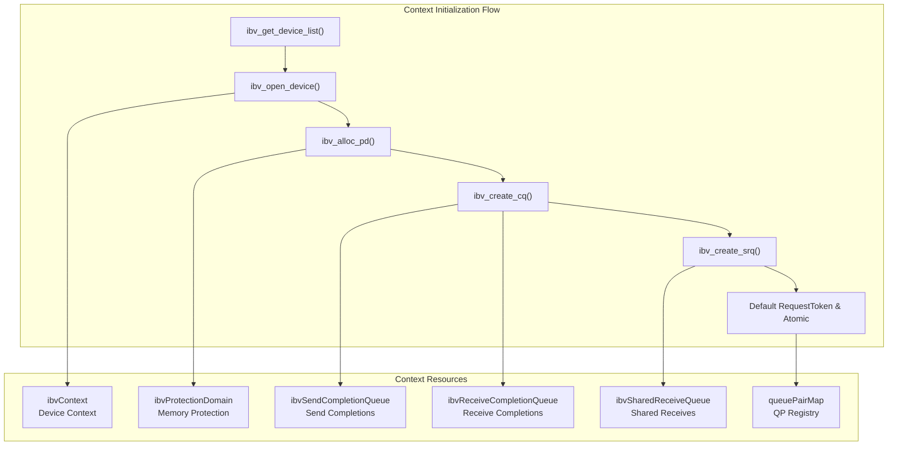
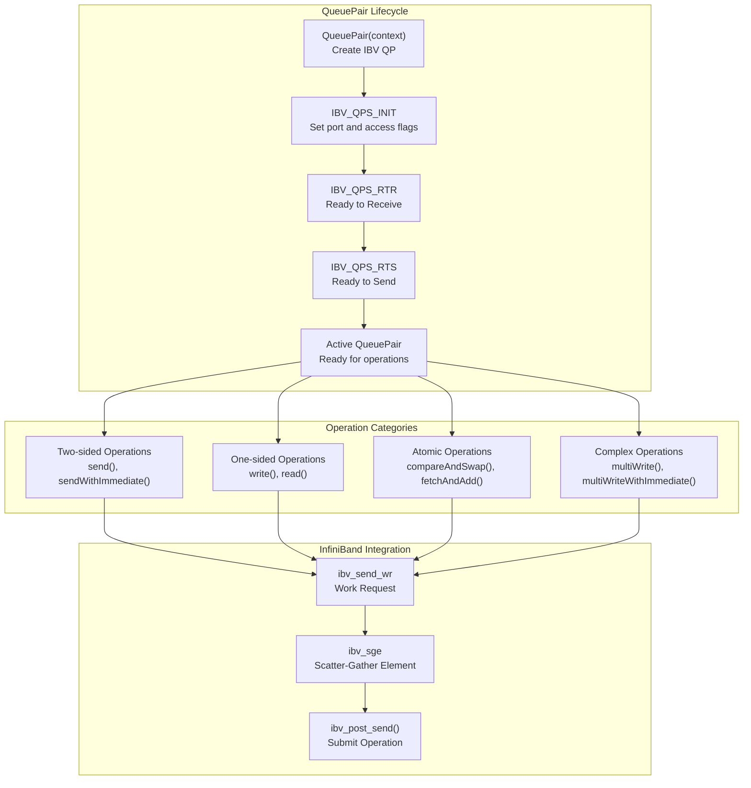
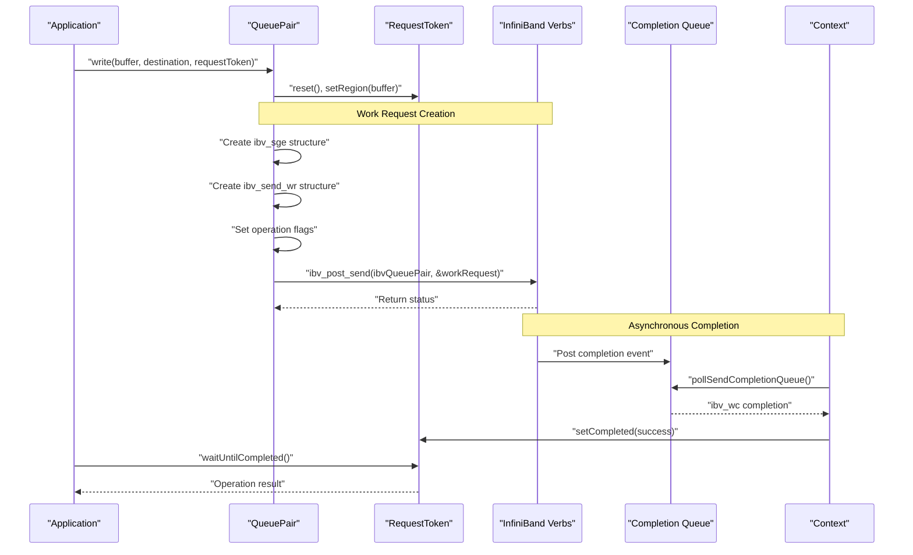
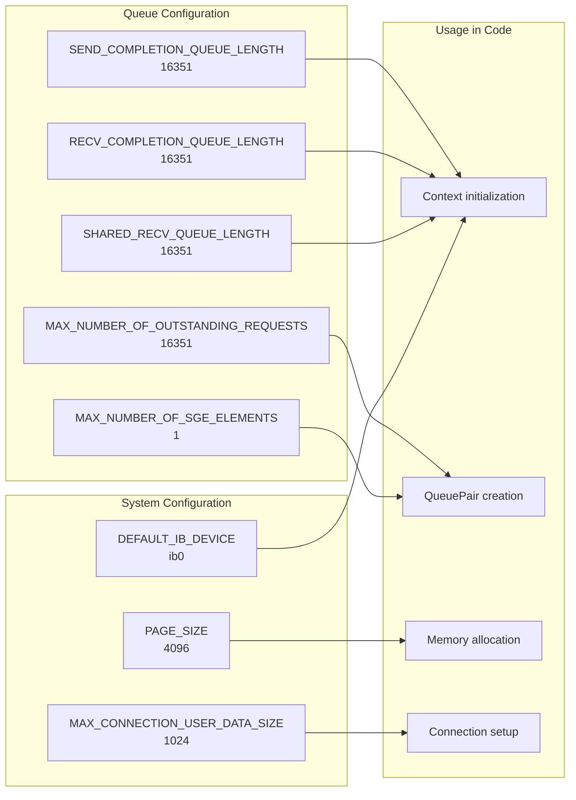
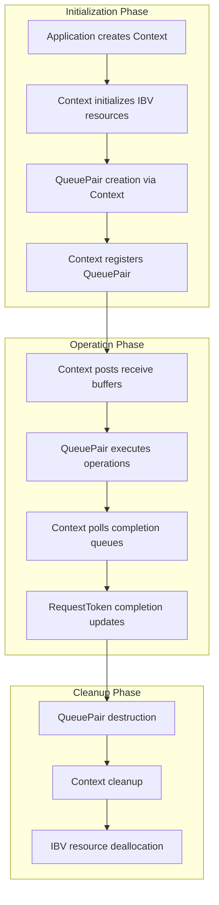

<!-- source: DeepWiki mcp.deepwiki.com · repo claudebarthels/infinity · page 3 Core Architecture · fetched 2026-11-11 -->

# Core Architecture

Relevant source files

The following files were used as context for generating this wiki page:

- [src/infinity/core/Configuration.h](src/infinity/core/Configuration.h)
- [src/infinity/core/Context.cpp](src/infinity/core/Context.cpp)
- [src/infinity/queues/QueuePair.cpp](src/infinity/queues/QueuePair.cpp)
- [src/infinity/queues/QueuePair.h](src/infinity/queues/QueuePair.h)

This document explains the fundamental architecture and design principles of the Infinity RDMA library. It covers the core components that provide the foundation for all RDMA operations, including resource management, communication endpoints, and the abstraction layer over InfiniBand Verbs.

For specific details about memory management, see [Memory Management](#4). For connection establishment procedures, see [Connection Management](#3.3). For detailed API documentation, see [API Reference](#7).

## Architecture Overview

The Infinity library follows a layered architecture that abstracts InfiniBand Verbs complexity while maintaining high performance. The core consists of three primary components working together to provide RDMA functionality.

Sources: [src/infinity/core/Context.cpp:1-225](), [src/infinity/queues/QueuePair.cpp:1-590](), [src/infinity/core/Configuration.h:1-55]()

## Core Components

The core architecture consists of several key components that work together to provide RDMA functionality:

| Component | Class | Purpose | Key Methods |
|-----------|-------|---------|-------------|
| Resource Manager | `infinity::core::Context` | Manages InfiniBand resources and device context | `postReceiveBuffer()`, `receive()`, `pollSendCompletionQueue()` |
| Communication Endpoint | `infinity::queues::QueuePair` | Handles RDMA operations and queue pair management | `send()`, `write()`, `read()`, `activate()` |
| Configuration | `infinity::core::Configuration` | Defines system constants and limits | Static constants for queue lengths and limits |
| Operation Control | `infinity::queues::OperationFlags` | Controls operation behavior flags | `ibvFlags()` |

Sources: [src/infinity/core/Context.cpp:31-74](), [src/infinity/queues/QueuePair.cpp:38-75](), [src/infinity/core/Configuration.h:17-49]()

## Context Resource Management

The `Context` class serves as the central resource manager, initializing and managing all InfiniBand resources. It abstracts the complexity of InfiniBand device management and provides a unified interface for resource allocation.

The Context constructor initializes InfiniBand resources in a specific order, ensuring proper dependency management between components.

Sources: [src/infinity/core/Context.cpp:31-74](), [src/infinity/core/Context.h:1-100]()

## QueuePair Architecture

The `QueuePair` class implements the primary communication interface, providing methods for all RDMA operations. It maintains state for connection management and operation execution.

The QueuePair follows the InfiniBand state machine, transitioning through INIT, RTR (Ready to Receive), and RTS (Ready to Send) states before becoming operational.

Sources: [src/infinity/queues/QueuePair.cpp:38-123](), [src/infinity/queues/QueuePair.h:44-153]()

## Operation Flow Architecture

RDMA operations follow a consistent pattern from initiation to completion, involving work request creation, submission, and completion handling.

All operations follow this pattern, with variations in the work request structure based on the operation type (send, write, read, atomic).

Sources: [src/infinity/queues/QueuePair.cpp:241-282](), [src/infinity/core/Context.cpp:169-189]()

## Configuration and Constants

The `Configuration` class defines system-wide constants that control resource allocation and operational limits throughout the library.

These constants ensure consistent resource allocation and provide tuneable parameters for different deployment scenarios.

Sources: [src/infinity/core/Configuration.h:17-49]()

## Component Interactions

The core components interact through well-defined interfaces, with the Context serving as the central coordinator for all InfiniBand resources.

This interaction pattern ensures proper resource management and maintains the abstraction layer while providing high-performance RDMA operations.

Sources: [src/infinity/core/Context.cpp:31-100](), [src/infinity/queues/QueuePair.cpp:38-87](), [src/infinity/core/Context.cpp:191-193]()

---

