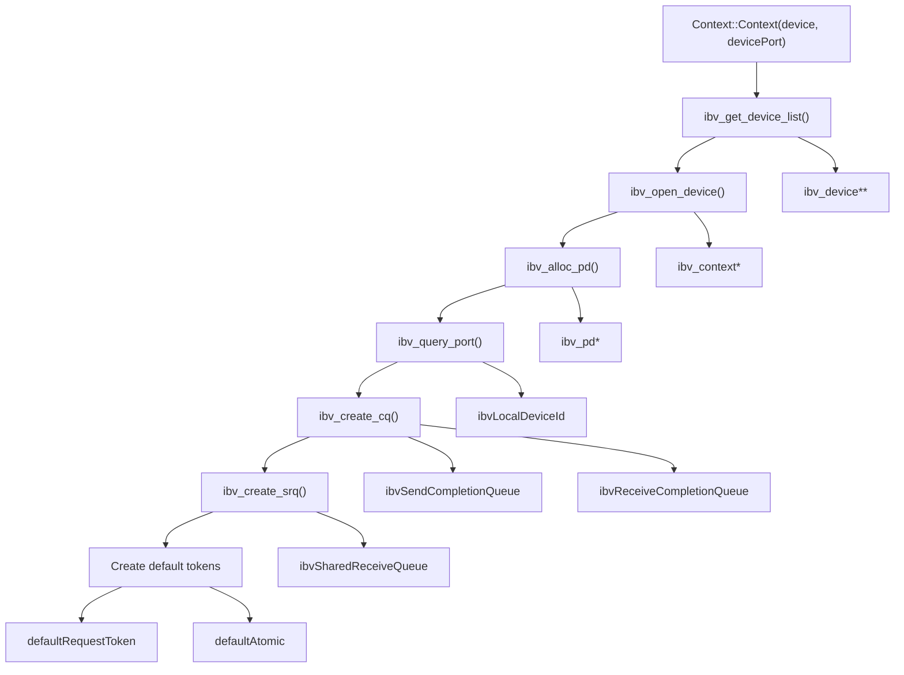
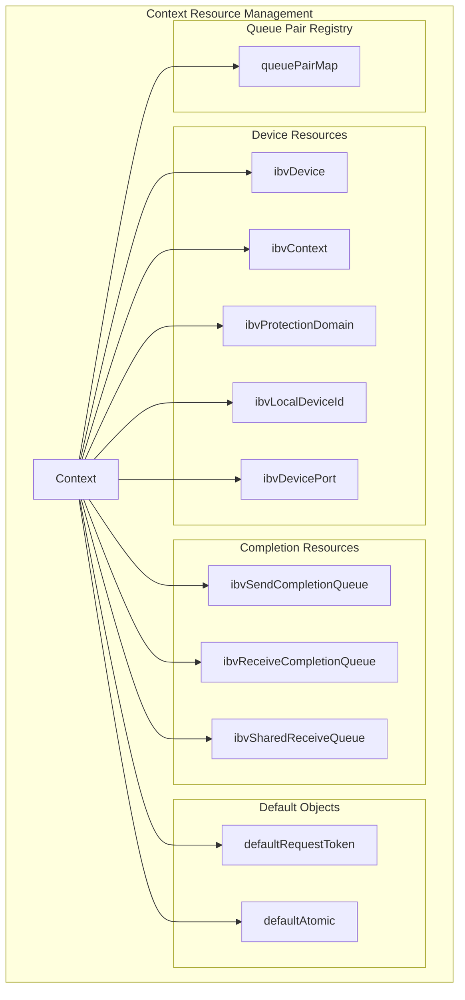
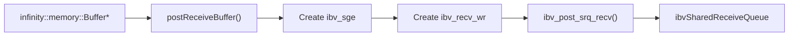
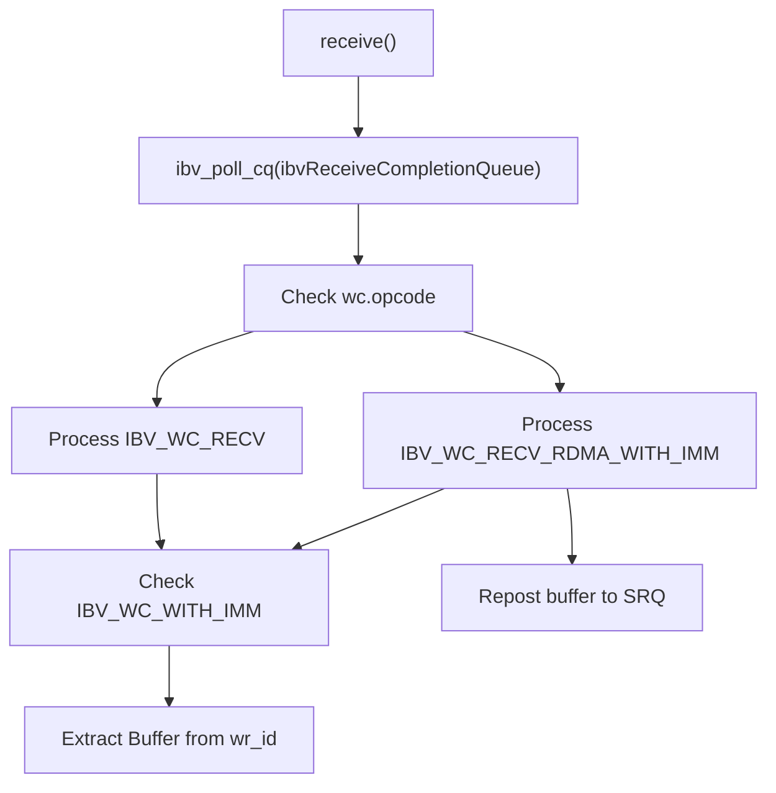
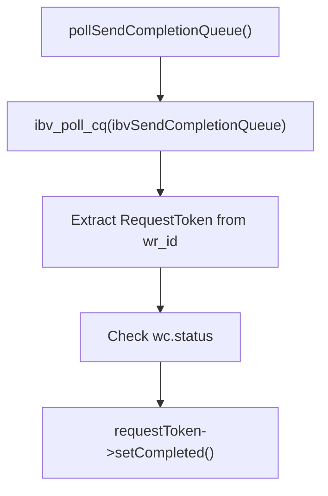
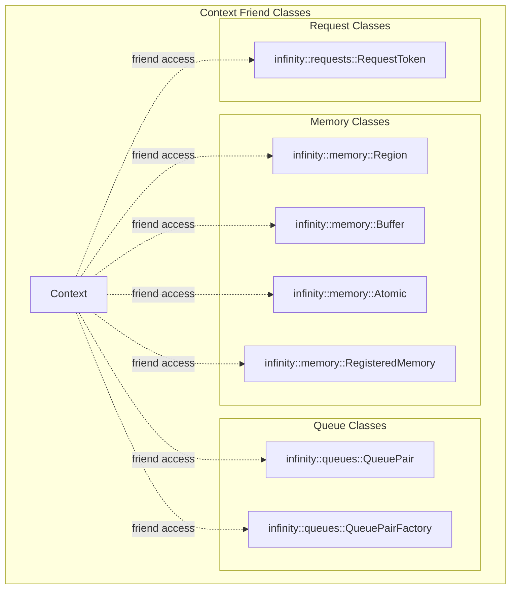
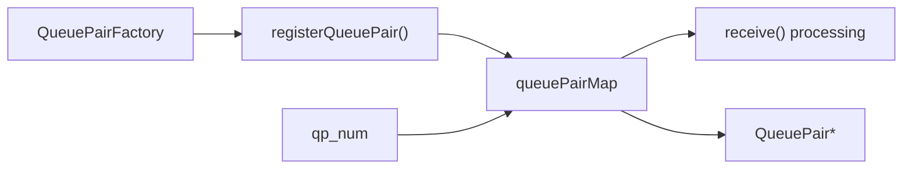
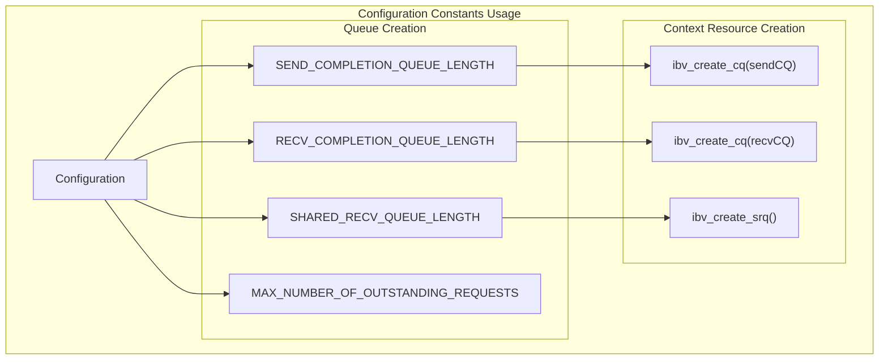

<!-- source: DeepWiki mcp.deepwiki.com · repo claudebarthels/infinity · page 3.1 Context and Configuration · fetched 2026-11-11 -->

# Context and Configuration

Relevant source files

The following files were used as context for generating this wiki page:

- [src/infinity/core/Configuration.h](src/infinity/core/Configuration.h)
- [src/infinity/core/Context.cpp](src/infinity/core/Context.cpp)
- [src/infinity/core/Context.h](src/infinity/core/Context.h)

This section covers the core infrastructure of the Infinity RDMA library, focusing on the `Context` class that manages InfiniBand resources and the `Configuration` class that provides system-wide constants. The Context serves as the central coordinator for all RDMA operations, managing device initialization, resource allocation, and completion handling.

For information about how Context integrates with queue pair management, see [Connection Management](#3.3). For details about how Context handles memory registration, see [Memory Registration](#4.1).

## Configuration System

The `Configuration` class provides static constants that define system-wide limits and settings for the Infinity library. These constants are used throughout the system to configure InfiniBand resources and ensure consistent behavior.

### Queue Configuration Constants

The configuration defines several key limits for queue management:

| Constant | Value | Purpose |
|----------|-------|---------|
| `SEND_COMPLETION_QUEUE_LENGTH` | 16351 | Maximum entries in send completion queue |
| `RECV_COMPLETION_QUEUE_LENGTH` | 16351 | Maximum entries in receive completion queue |
| `SHARED_RECV_QUEUE_LENGTH` | 16351 | Maximum entries in shared receive queue |
| `MAX_NUMBER_OF_OUTSTANDING_REQUESTS` | 16351 | Maximum concurrent outstanding requests |
| `MAX_NUMBER_OF_SGE_ELEMENTS` | 1 | Maximum scatter-gather elements per operation |

### System Configuration Constants

| Constant | Value | Purpose |
|----------|-------|---------|
| `PAGE_SIZE` | 4096 | Memory alignment for registered regions |
| `MAX_CONNECTION_USER_DATA_SIZE` | 1024 | Maximum user data in connection establishment |
| `DEFAULT_IB_DEVICE` | "ib0" | Default InfiniBand device name |

Sources: [src/infinity/core/Configuration.h:21-48]()

## Context Class Architecture

The `Context` class serves as the central resource manager for the Infinity library, handling InfiniBand device initialization, resource allocation, and completion processing.

### Context Initialization Flow

Sources: [src/infinity/core/Context.cpp:31-74]()

### InfiniBand Resource Management

The Context manages several key InfiniBand resources:

Sources: [src/infinity/core/Context.h:139-159]()

## Core Context Operations

### Receive Buffer Management

The Context provides methods for managing receive buffers through the shared receive queue:

The `postReceiveBuffer()` method registers a buffer with the shared receive queue, making it available for incoming messages.

Sources: [src/infinity/core/Context.cpp:102-127]()

### Completion Processing

The Context handles completion processing through two main methods:

#### Receive Completion Processing

#### Send Completion Processing

Sources: [src/infinity/core/Context.cpp:129-189]()

## Context Integration with Other Components

The Context class integrates with various other components in the system through friend relationships and shared resources:

### Friend Class Relationships

### Queue Pair Registration

The Context maintains a registry of active queue pairs to support completion processing:

Sources: [src/infinity/core/Context.h:52-58](), [src/infinity/core/Context.cpp:191-193]()

## Configuration Usage Throughout the System

The Configuration constants are used throughout the Context initialization and resource management:

The configuration ensures consistent limits across the system and provides a central location for tuning performance parameters.

Sources: [src/infinity/core/Context.cpp:58-67](), [src/infinity/core/Configuration.h:25-35]()

---

