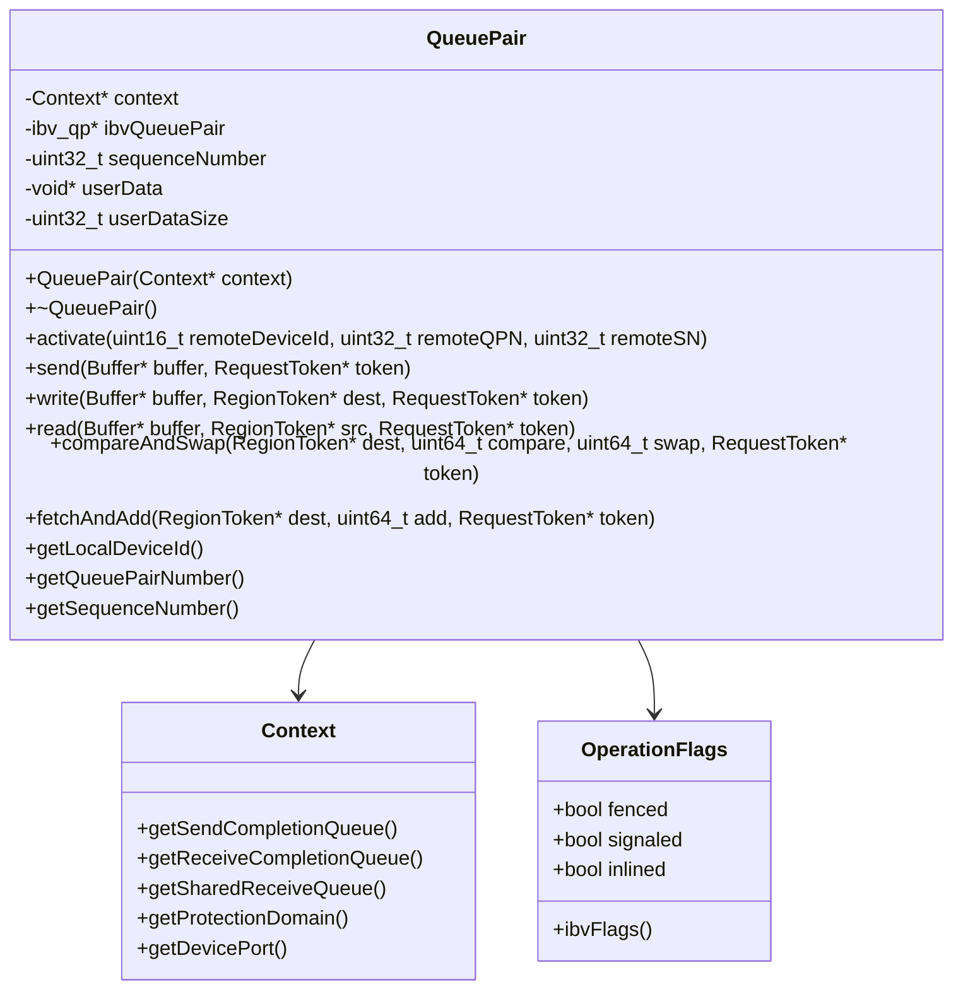
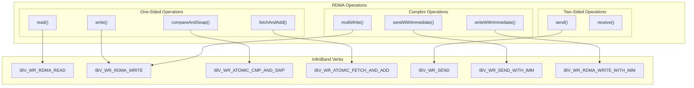
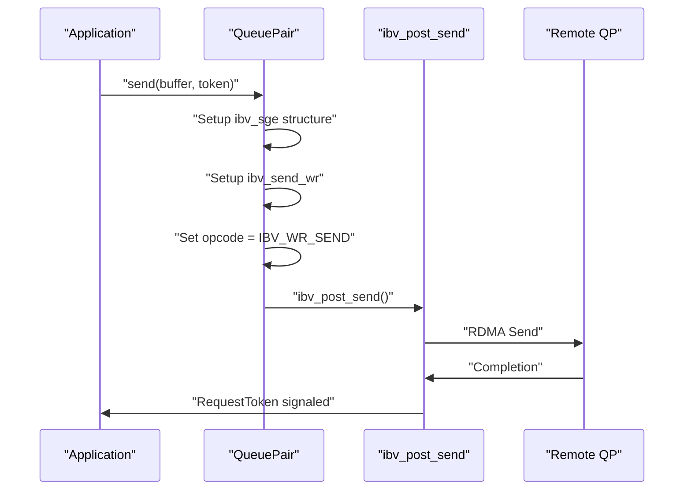
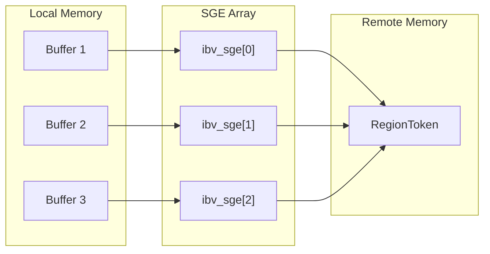
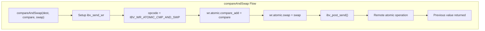
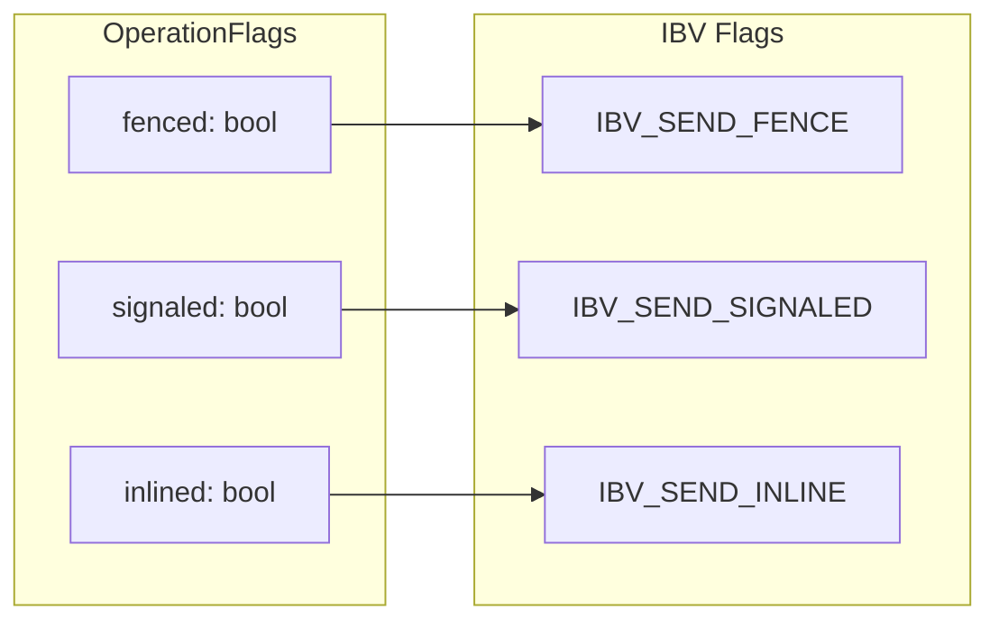
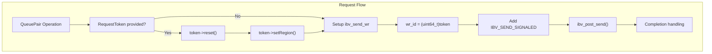

<!-- source: DeepWiki mcp.deepwiki.com · repo claudebarthels/infinity · page 3.2 QueuePair Operations · fetched 2026-11-11 -->

# QueuePair Operations

Relevant source files

The following files were used as context for generating this wiki page:

- [src/infinity/queues/QueuePair.cpp](src/infinity/queues/QueuePair.cpp)
- [src/infinity/queues/QueuePair.h](src/infinity/queues/QueuePair.h)

This document covers the `QueuePair` class and its RDMA operations including read, write, send, and atomic operations. The `QueuePair` class serves as the primary interface for performing remote direct memory access operations over InfiniBand connections.

For information about establishing connections and queue pair creation, see [Connection Management](#3.3). For details about memory management and buffer registration, see [Memory Management](#4). For request tracking and completion handling, see [Request Management](#5).

## Overview

The `QueuePair` class provides a high-level C++ interface to InfiniBand queue pairs, encapsulating the complexity of the underlying `ibv_qp` structures. It supports both one-sided operations (read, write, atomic) and two-sided operations (send).

### QueuePair Class Structure

Sources: [src/infinity/queues/QueuePair.h:44-153](), [src/infinity/queues/QueuePair.cpp:38-75]()

### Operation Types

RDMA operations are categorized into distinct types based on their communication patterns and semantics:

Sources: [src/infinity/queues/QueuePair.cpp:145-587]()

## Basic Operations

### Send Operations

The `send()` method implements two-sided communication, requiring a corresponding receive operation on the remote side. Multiple overloads provide flexibility in specifying data size and offsets.

| Method Signature | Description |
|------------------|-------------|
| `send(Buffer* buffer, RequestToken* token)` | Send entire buffer |
| `send(Buffer* buffer, uint32_t sizeInBytes, RequestToken* token)` | Send partial buffer |
| `send(Buffer* buffer, uint64_t localOffset, uint32_t sizeInBytes, OperationFlags flags, RequestToken* token)` | Send with offset and flags |

Sources: [src/infinity/queues/QueuePair.cpp:145-189](), [src/infinity/queues/QueuePair.h:95-98]()

### Write Operations

The `write()` method performs one-sided remote memory writes, directly placing data into remote memory without CPU involvement on the remote side.

| Method Signature | Description |
|------------------|-------------|
| `write(Buffer* buffer, RegionToken* destination, RequestToken* token)` | Write entire buffer |
| `write(Buffer* buffer, RegionToken* destination, uint32_t sizeInBytes, RequestToken* token)` | Write partial buffer |
| `write(Buffer* buffer, uint64_t localOffset, RegionToken* destination, uint64_t remoteOffset, uint32_t sizeInBytes, OperationFlags flags, RequestToken* token)` | Write with offsets and flags |

Sources: [src/infinity/queues/QueuePair.cpp:231-282](), [src/infinity/queues/QueuePair.h:100-104]()

### Read Operations

The `read()` method performs one-sided remote memory reads, fetching data from remote memory into local buffers.

| Method Signature | Description |
|------------------|-------------|
| `read(Buffer* buffer, RegionToken* source, RequestToken* token)` | Read entire buffer |
| `read(Buffer* buffer, RegionToken* source, uint32_t sizeInBytes, RequestToken* token)` | Read partial buffer |
| `read(Buffer* buffer, uint64_t localOffset, RegionToken* source, uint64_t remoteOffset, uint32_t sizeInBytes, OperationFlags flags, RequestToken* token)` | Read with offsets and flags |

Sources: [src/infinity/queues/QueuePair.cpp:436-487](), [src/infinity/queues/QueuePair.h:106-110]()

## Complex Operations

### Multi-Write Operations

The `multiWrite()` method enables scatter-gather operations, writing multiple local buffers to a single remote memory region in one operation.

Sources: [src/infinity/queues/QueuePair.cpp:329-379](), [src/infinity/queues/QueuePair.h:118-119]()

### Immediate Value Operations

Operations with immediate values (`sendWithImmediate()`, `writeWithImmediate()`) deliver a 32-bit immediate value alongside the data transfer, enabling efficient notification mechanisms.

Sources: [src/infinity/queues/QueuePair.cpp:191-229](), [src/infinity/queues/QueuePair.cpp:284-327]()

## Atomic Operations

### Compare-and-Swap

The `compareAndSwap()` method implements atomic compare-and-swap operations on remote memory, fundamental for lock-free synchronization.

Sources: [src/infinity/queues/QueuePair.cpp:489-531](), [src/infinity/queues/QueuePair.h:136-138]()

### Fetch-and-Add

The `fetchAndAdd()` method implements atomic fetch-and-add operations, returning the previous value while atomically adding a specified value.

Sources: [src/infinity/queues/QueuePair.cpp:532-572](), [src/infinity/queues/QueuePair.h:139-141]()

## Operation Flags and Configuration

### OperationFlags Structure

The `OperationFlags` class controls various aspects of RDMA operations:

| Flag | IBV Equivalent | Description |
|------|----------------|-------------|
| `fenced` | `IBV_SEND_FENCE` | Ensures ordering with previous operations |
| `signaled` | `IBV_SEND_SIGNALED` | Generate completion notification |
| `inlined` | `IBV_SEND_INLINE` | Inline data in work request |

Sources: [src/infinity/queues/QueuePair.cpp:24-36](), [src/infinity/queues/QueuePair.h:29-42]()

### Queue Pair Configuration

Queue pairs are configured during construction with specific capabilities and attributes:

| Parameter | Configuration Source | Description |
|-----------|---------------------|-------------|
| `max_send_wr` | `Configuration::SEND_COMPLETION_QUEUE_LENGTH` | Maximum send work requests |
| `max_recv_wr` | `Configuration::RECV_COMPLETION_QUEUE_LENGTH` | Maximum receive work requests |
| `max_send_sge` | `Configuration::MAX_NUMBER_OF_SGE_ELEMENTS` | Maximum scatter-gather elements |
| `qp_type` | `IBV_QPT_RC` | Reliable Connection type |

Sources: [src/infinity/queues/QueuePair.cpp:41-55]()

## Request Token Integration

All operations support optional `RequestToken` parameters for asynchronous completion tracking. When provided, tokens are automatically configured and signaled upon operation completion.

Sources: [src/infinity/queues/QueuePair.cpp:156-159](), [src/infinity/queues/QueuePair.cpp:179-181]()

---

