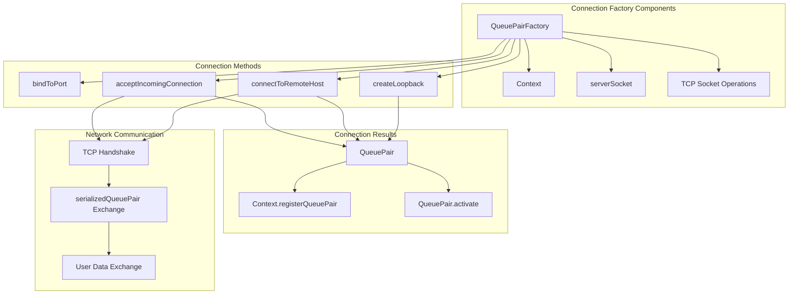
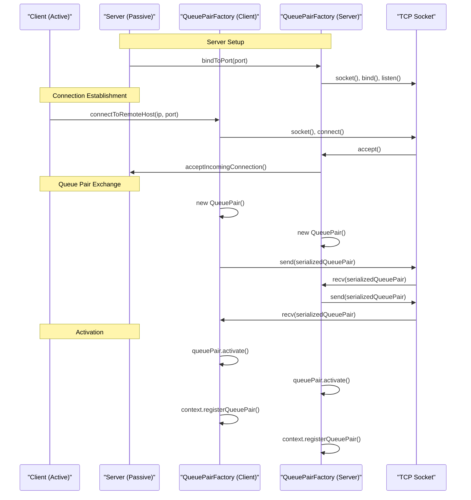
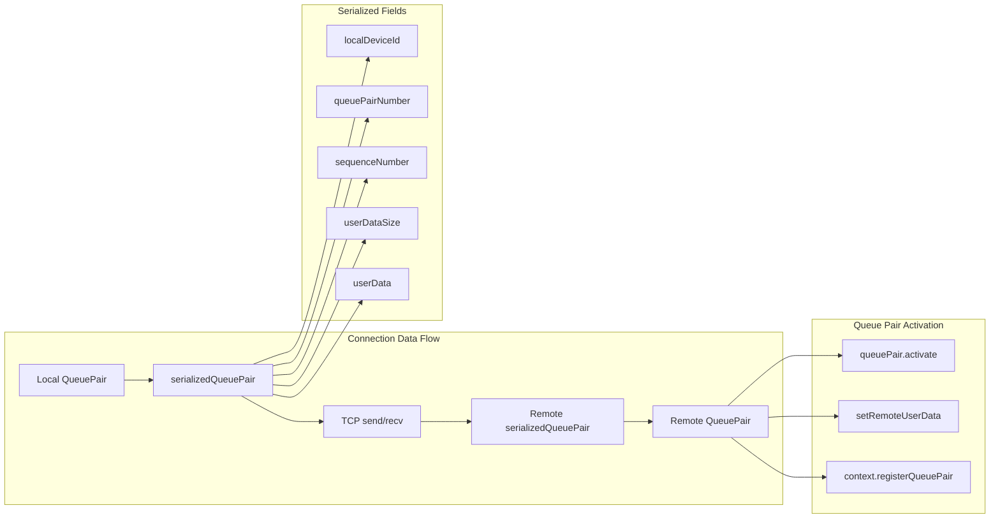
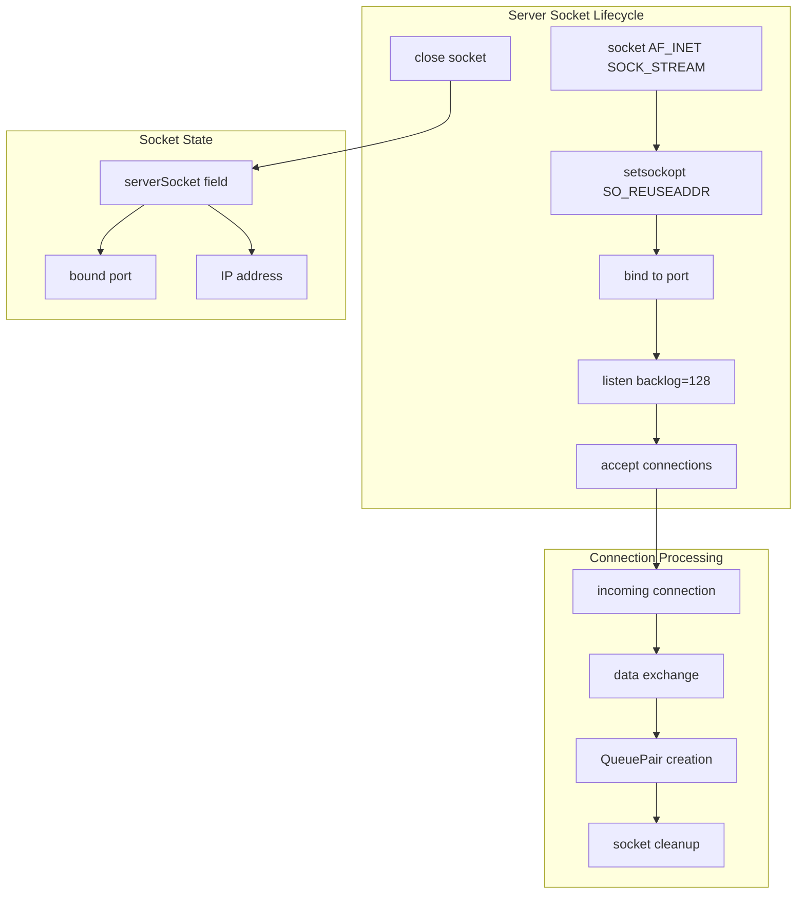
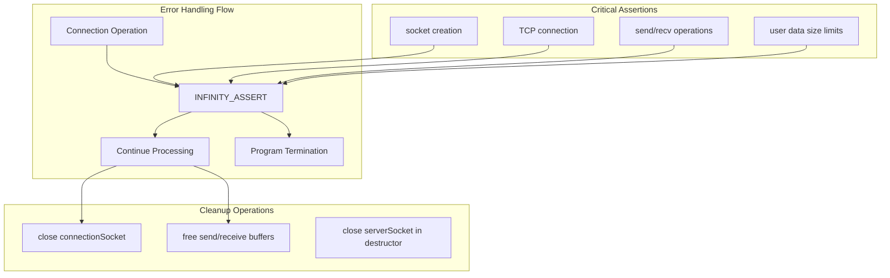

<!-- source: DeepWiki mcp.deepwiki.com · repo claudebarthels/infinity · page 3.3 Connection Management · fetched 2026-11-11 -->

# Connection Management

Relevant source files

The following files were used as context for generating this wiki page:

- [src/infinity/queues/QueuePairFactory.cpp](src/infinity/queues/QueuePairFactory.cpp)
- [src/infinity/queues/QueuePairFactory.h](src/infinity/queues/QueuePairFactory.h)

Connection Management in the Infinity library handles the establishment and lifecycle of RDMA connections between nodes. This system is implemented through the `QueuePairFactory` class, which provides three connection modes: remote host connections, incoming connection acceptance, and loopback connections. The connection process involves a TCP handshake phase followed by InfiniBand queue pair activation.

For information about the actual RDMA operations performed on established connections, see [QueuePair Operations](#3.2). For details on the underlying context and resource management, see [Context and Configuration](#3.1).

## Connection Factory Architecture

The `QueuePairFactory` class serves as the central component for connection management, providing factory methods to create and configure `QueuePair` instances for different connection scenarios.

Sources: [src/infinity/queues/QueuePairFactory.h:21-53](), [src/infinity/queues/QueuePairFactory.cpp:33-38]()

## Connection Types

The `QueuePairFactory` supports three distinct connection patterns, each designed for different use cases and network topologies.

### Remote Host Connections

**Active Connection (`connectToRemoteHost`)**
The active side initiates connections to remote hosts by specifying the target IP address and port. This method creates a TCP socket, connects to the remote server, and exchanges queue pair information.

**Passive Connection (`acceptIncomingConnection`)**
The passive side listens for incoming connections after binding to a specific port using `bindToPort`. This method accepts TCP connections and participates in the queue pair information exchange.

### Loopback Connections

**Local Loopback (`createLoopback`)**
Creates a queue pair that connects to itself, useful for testing and local communication scenarios. This bypasses the TCP handshake phase entirely.

Sources: [src/infinity/queues/QueuePairFactory.cpp:118-169](), [src/infinity/queues/QueuePairFactory.cpp:74-116](), [src/infinity/queues/QueuePairFactory.cpp:171-181]()

## Connection Data Exchange

The connection establishment process uses a standardized data structure to exchange queue pair information between nodes. This ensures both sides have the necessary information to activate their respective queue pairs.

### Serialized Queue Pair Format

The `serializedQueuePair` structure contains all essential information needed for queue pair activation:

| Field | Type | Description |
|-------|------|-------------|
| `localDeviceId` | `uint16_t` | InfiniBand device identifier |
| `queuePairNumber` | `uint32_t` | Queue pair number from IBV |
| `sequenceNumber` | `uint32_t` | Sequence number for ordering |
| `userDataSize` | `uint32_t` | Size of application-specific data |
| `userData` | `char[]` | Application-specific payload |

Sources: [src/infinity/queues/QueuePairFactory.cpp:23-31](), [src/infinity/queues/QueuePairFactory.cpp:91-96](), [src/infinity/queues/QueuePairFactory.cpp:105-108]()

## Server Socket Management

The `QueuePairFactory` manages server-side connections through TCP socket operations. The `bindToPort` method configures the server socket with appropriate options for reliable connection handling.

### Socket Configuration

The server socket is configured with the following properties:
- **Address Family**: `AF_INET` (IPv4)
- **Socket Type**: `SOCK_STREAM` (TCP)
- **Socket Option**: `SO_REUSEADDR` for address reuse
- **Listen Backlog**: 128 pending connections

Sources: [src/infinity/queues/QueuePairFactory.cpp:48-72](), [src/infinity/queues/QueuePairFactory.cpp:40-46]()

## Connection Lifecycle and Error Handling

The connection management system implements comprehensive error checking and resource cleanup to ensure robust operation in production environments.

### Resource Management

Each connection method follows a consistent pattern for resource allocation and cleanup:

1. **Allocation**: Create serialization buffers using `calloc`
2. **Connection**: Establish TCP connection with error checking
3. **Exchange**: Send and receive queue pair information
4. **Activation**: Configure and activate the queue pair
5. **Registration**: Register the queue pair with the context
6. **Cleanup**: Close sockets and free allocated memory

### Error Handling

The system uses `INFINITY_ASSERT` macros for critical error conditions:

| Error Condition | Location | Description |
|----------------|----------|-------------|
| Socket creation failure | Socket operations | Cannot create TCP socket |
| Connection failure | `connectToRemoteHost` | Cannot connect to remote host |
| Data size validation | User data | User data exceeds maximum size |
| Send/receive errors | TCP operations | Incomplete data transmission |

Sources: [src/infinity/queues/QueuePairFactory.cpp:110-113](), [src/infinity/queues/QueuePairFactory.cpp:163-166](), [src/infinity/queues/QueuePairFactory.cpp:76-77]()

---

