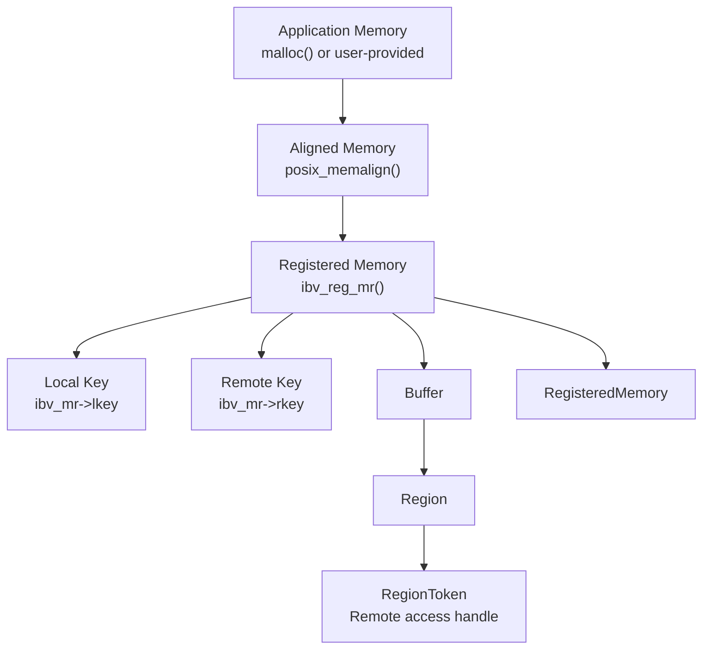
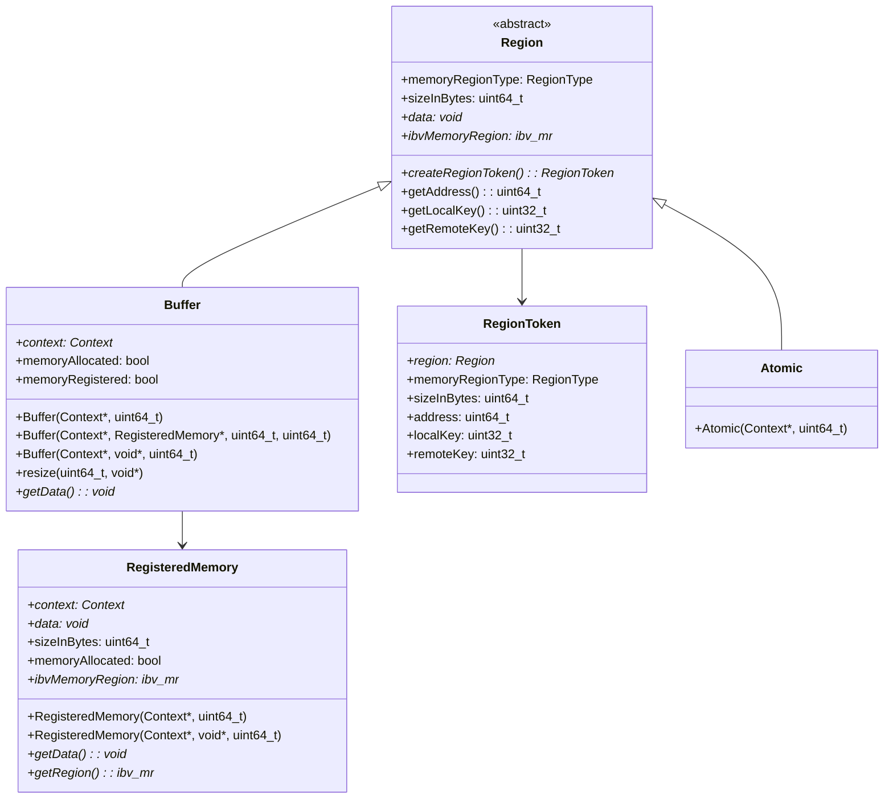
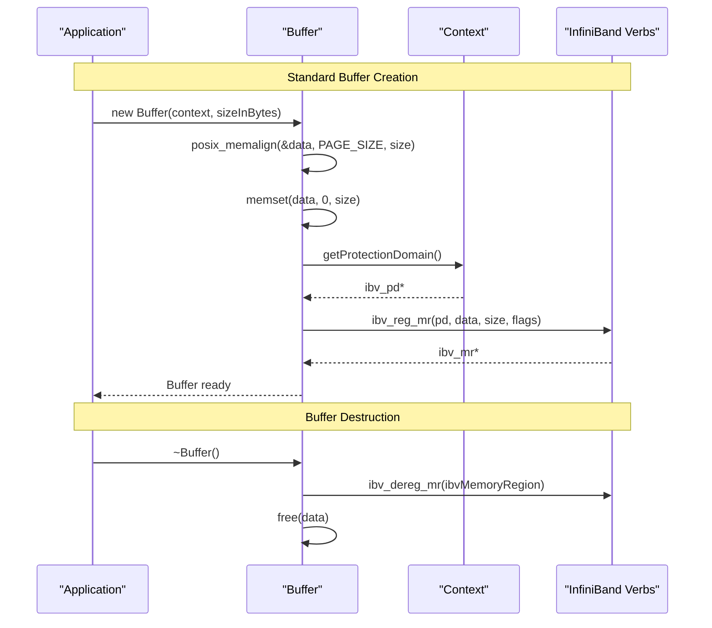
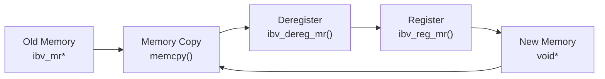
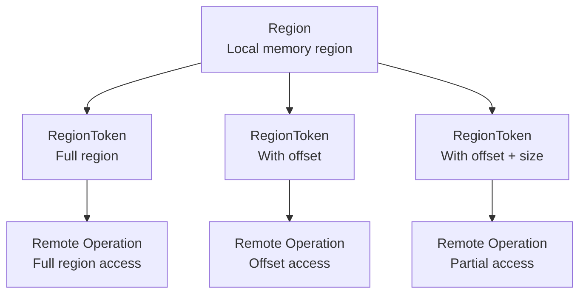
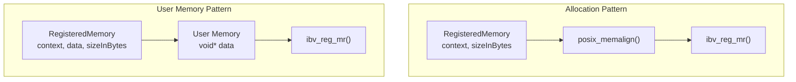
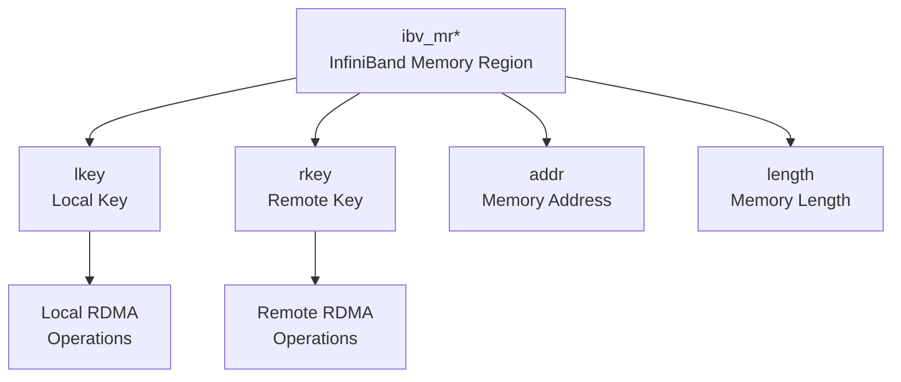
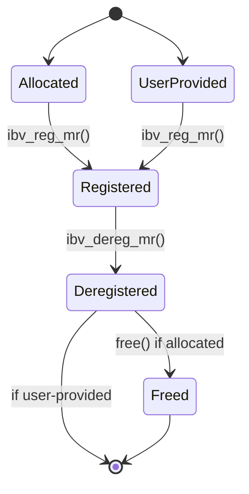

<!-- source: DeepWiki mcp.deepwiki.com · repo claudebarthels/infinity · page 4 Memory Management · fetched 2026-11-11 -->

# Memory Management

Relevant source files

The following files were used as context for generating this wiki page:

- [src/infinity/memory/Buffer.cpp](src/infinity/memory/Buffer.cpp)
- [src/infinity/memory/Region.cpp](src/infinity/memory/Region.cpp)
- [src/infinity/memory/RegisteredMemory.cpp](src/infinity/memory/RegisteredMemory.cpp)

The Memory Management subsystem provides high-level abstractions for managing memory regions that can be accessed via RDMA operations. This system handles memory allocation, registration with InfiniBand Verbs, and provides safe wrappers for both local and remote memory access patterns.

This document covers the core memory management classes and their relationships. For information about atomic operations on memory, see [Atomic Operations](#4.4). For details about remote memory access patterns, see [Remote Memory Access](#4.3).

## Memory Registration Overview

The Infinity library requires memory to be registered with InfiniBand before it can be used in RDMA operations. The registration process involves calling `ibv_reg_mr()` to create an InfiniBand memory region (`ibv_mr`) that provides both local and remote access keys.

### Memory Registration Flow

Sources: [src/infinity/memory/Buffer.cpp:28-35](), [src/infinity/memory/RegisteredMemory.cpp:26-33]()

## Class Hierarchy and Relationships

The memory management system consists of several interconnected classes that provide different levels of abstraction:

### Core Memory Classes

Sources: [src/infinity/memory/Region.cpp:17-60](), [src/infinity/memory/Buffer.cpp:22-81](), [src/infinity/memory/RegisteredMemory.cpp:20-77]()

## Buffer Management

The `Buffer` class provides the primary interface for managing memory regions used in RDMA operations. It supports three construction patterns:

### Buffer Construction Patterns

| Constructor | Memory Source | Registration | Use Case |
|-------------|---------------|--------------|----------|
| `Buffer(Context*, uint64_t)` | Library allocated | Library managed | Standard data buffers |
| `Buffer(Context*, RegisteredMemory*, uint64_t, uint64_t)` | Existing registered memory | External | Sub-regions of larger memory |
| `Buffer(Context*, void*, uint64_t)` | User provided | Library managed | Integration with existing memory |

### Memory Allocation and Registration

The Buffer class uses `posix_memalign()` to ensure memory is aligned to page boundaries as required by InfiniBand. Memory is registered with access flags `IBV_ACCESS_REMOTE_WRITE | IBV_ACCESS_LOCAL_WRITE | IBV_ACCESS_REMOTE_READ`.

Sources: [src/infinity/memory/Buffer.cpp:22-40](), [src/infinity/memory/Buffer.cpp:72-81]()

### Buffer Resizing

The `resize()` method allows dynamic resizing of registered memory regions:

Sources: [src/infinity/memory/Buffer.cpp:87-110]()

## Region and RegionToken System

The `Region` class provides a base abstraction for memory regions, while `RegionToken` objects enable remote access to these regions.

### Region Types

The system supports different types of memory regions through the `RegionType` enumeration:

- `BUFFER`: Standard data transfer regions
- `ATOMIC`: Regions for atomic operations
- `UNKNOWN`: Unspecified region type

### RegionToken Creation

The `Region` class provides three methods for creating `RegionToken` objects:

- `createRegionToken()`: Creates a token for the entire region
- `createRegionToken(uint64_t offset)`: Creates a token starting at an offset
- `createRegionToken(uint64_t offset, uint64_t size)`: Creates a token for a specific sub-region

Sources: [src/infinity/memory/Region.cpp:21-31]()

## RegisteredMemory Class

The `RegisteredMemory` class provides a lower-level interface for memory registration without the additional abstractions of the `Buffer` class.

### RegisteredMemory vs Buffer

| Feature | RegisteredMemory | Buffer |
|---------|------------------|--------|
| Inheritance | Standalone class | Inherits from Region |
| Token Creation | No | Yes (via Region) |
| Resizing | No | Yes |
| Use Case | Memory pool management | Direct RDMA operations |

### Memory Registration Patterns

Sources: [src/infinity/memory/RegisteredMemory.cpp:20-47]()

## Integration with InfiniBand Verbs

The memory management system integrates closely with InfiniBand Verbs through the `ibv_mr` structure:

### Memory Region Properties

### Access Flags

All memory regions are registered with the following access flags:

- `IBV_ACCESS_LOCAL_WRITE`: Allows local write operations
- `IBV_ACCESS_REMOTE_WRITE`: Allows remote write operations
- `IBV_ACCESS_REMOTE_READ`: Allows remote read operations

Sources: [src/infinity/memory/Buffer.cpp:33-34](), [src/infinity/memory/RegisteredMemory.cpp:31-32]()

## Memory Lifecycle Management

The memory management system carefully tracks memory allocation and registration to ensure proper cleanup:

### Lifecycle Tracking

The system uses boolean flags (`memoryAllocated`, `memoryRegistered`) to track ownership and ensure proper cleanup in destructors.

Sources: [src/infinity/memory/Buffer.cpp:37-38](), [src/infinity/memory/Buffer.cpp:72-81](), [src/infinity/memory/RegisteredMemory.cpp:50-57]()

---

