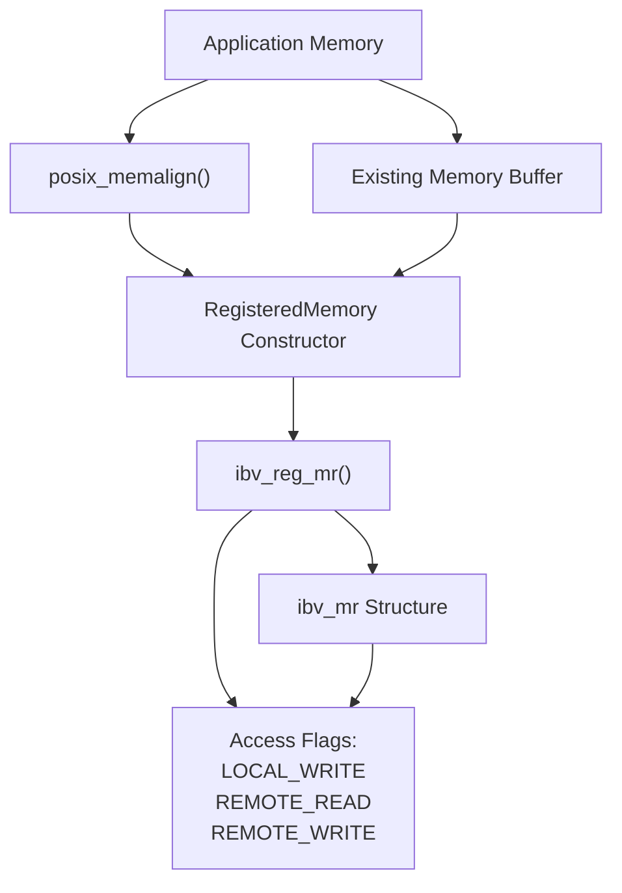
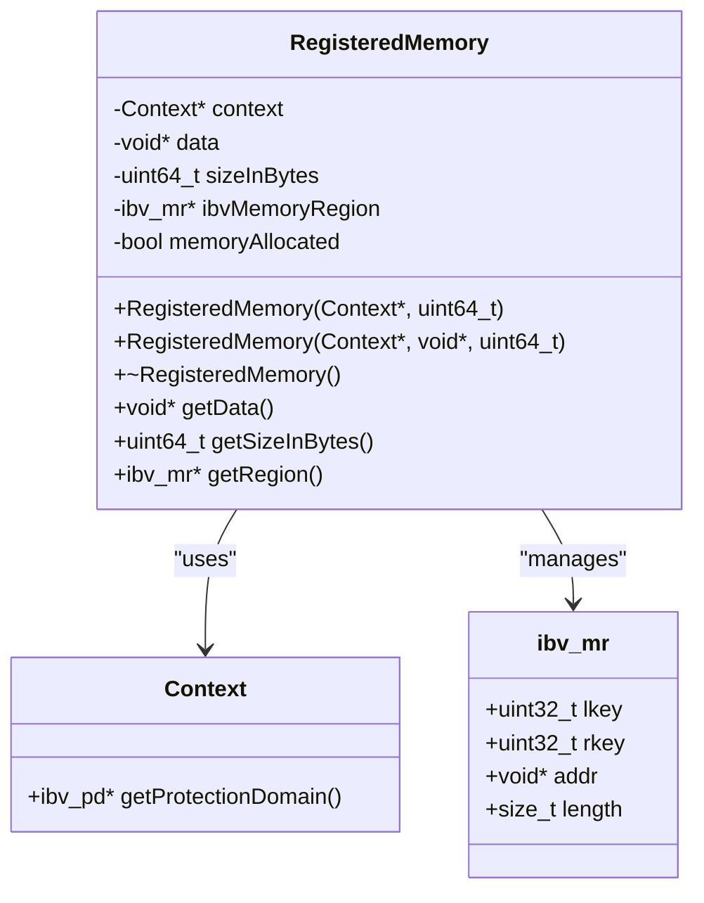
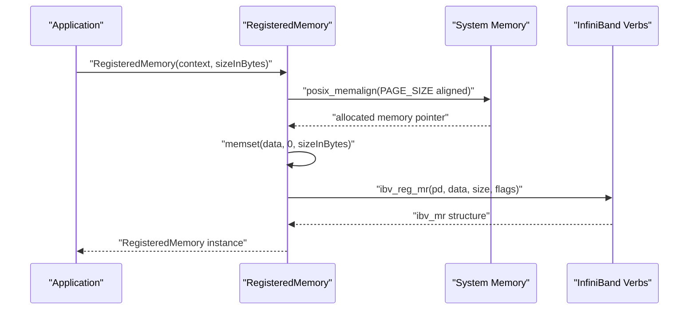
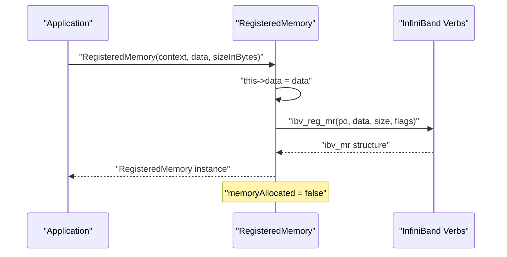
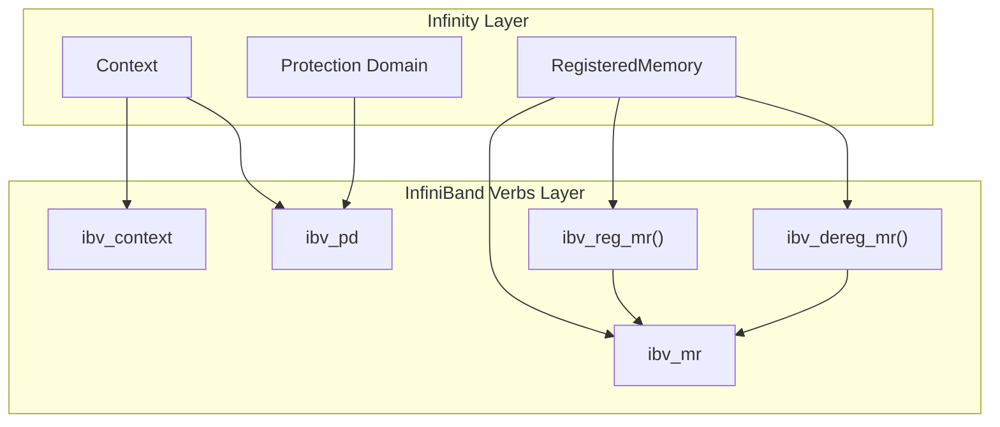
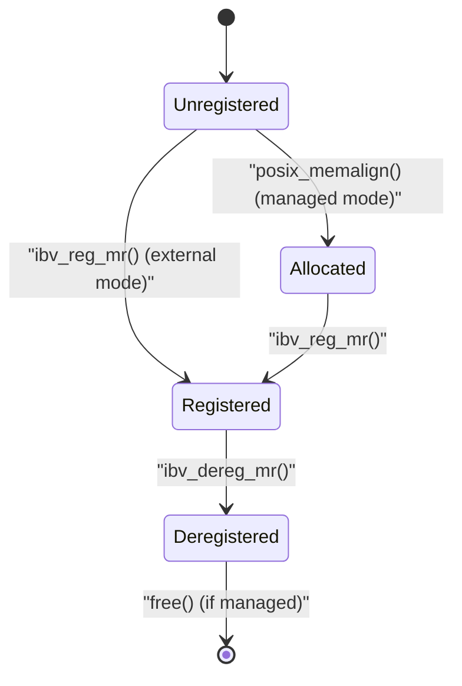

<!-- source: DeepWiki mcp.deepwiki.com · repo claudebarthels/infinity · page 4.1 Memory Registration · fetched 2026-11-11 -->

# Memory Registration

Relevant source files

The following files were used as context for generating this wiki page:

- [src/infinity/memory/RegisteredMemory.cpp](src/infinity/memory/RegisteredMemory.cpp)
- [src/infinity/memory/RegisteredMemory.h](src/infinity/memory/RegisteredMemory.h)

## Purpose and Scope

This document covers the memory registration system in the Infinity library, which enables application memory to be used with InfiniBand RDMA operations. Memory registration is a prerequisite for all RDMA operations, as it provides the InfiniBand hardware with the necessary metadata to access memory regions directly.

For information about higher-level memory abstractions that use registered memory, see [Buffers and Regions](#4.2). For details about how registered memory is used in remote operations, see [Remote Memory Access](#4.3).

## Overview

Memory registration in InfiniBand involves registering application memory with the InfiniBand Verbs layer to enable hardware-accelerated memory access. The Infinity library provides the `RegisteredMemory` class as a C++ abstraction over the InfiniBand Verbs memory registration API.

### Memory Registration Process

**Memory Registration Flow Diagram**

Sources: [src/infinity/memory/RegisteredMemory.cpp:20-47]()

## RegisteredMemory Class Architecture

The `RegisteredMemory` class provides two registration modes and manages the complete lifecycle of registered memory regions.

### Class Structure

**RegisteredMemory Class Relationships**

Sources: [src/infinity/memory/RegisteredMemory.h:17-45]()

## Memory Registration Modes

The `RegisteredMemory` class supports two distinct registration modes:

### Mode 1: Managed Memory Allocation

**Managed Memory Registration Sequence**

In this mode, `RegisteredMemory` handles memory allocation internally using `posix_memalign()` with `PAGE_SIZE` alignment and zeros the allocated memory.

Sources: [src/infinity/memory/RegisteredMemory.cpp:20-34]()

### Mode 2: External Memory Registration

**External Memory Registration Sequence**

In this mode, the application provides an existing memory buffer, and `RegisteredMemory` registers it without taking ownership of the memory allocation.

Sources: [src/infinity/memory/RegisteredMemory.cpp:36-47]()

## Access Flags and Permissions

All memory registered through `RegisteredMemory` uses a consistent set of access flags:

| Flag | Purpose |
|------|---------|
| `IBV_ACCESS_LOCAL_WRITE` | Enables local write operations |
| `IBV_ACCESS_REMOTE_READ` | Enables remote read operations via RDMA |
| `IBV_ACCESS_REMOTE_WRITE` | Enables remote write operations via RDMA |

These flags are combined using bitwise OR and applied to all registered memory regions, providing comprehensive access for both local and remote RDMA operations.

Sources: [src/infinity/memory/RegisteredMemory.cpp:31-32](), [src/infinity/memory/RegisteredMemory.cpp:44-45]()

## Integration with InfiniBand Verbs

The `RegisteredMemory` class interfaces directly with the InfiniBand Verbs API:

### Key InfiniBand Verbs Integration Points

**InfiniBand Verbs Integration Architecture**

Sources: [src/infinity/memory/RegisteredMemory.cpp:31-33](), [src/infinity/memory/RegisteredMemory.cpp:44-46]()

## Memory Lifecycle Management

The `RegisteredMemory` class manages the complete lifecycle of registered memory:

### Registration Process

1. **Memory Allocation** (if using managed mode): Allocate page-aligned memory using `posix_memalign()`
2. **Memory Initialization** (if using managed mode): Zero the allocated memory with `memset()`
3. **InfiniBand Registration**: Register memory with `ibv_reg_mr()` using the context's protection domain
4. **Validation**: Assert successful registration with `INFINITY_ASSERT`

### Deregistration Process

1. **InfiniBand Deregistration**: Call `ibv_dereg_mr()` to unregister the memory region
2. **Memory Cleanup** (if using managed mode): Free the allocated memory using `free()`

**Memory Registration Lifecycle**

Sources: [src/infinity/memory/RegisteredMemory.cpp:20-58]()

## Public Interface Methods

The `RegisteredMemory` class provides three key accessor methods:

| Method | Return Type | Purpose |
|--------|-------------|---------|
| `getData()` | `void*` | Returns pointer to the registered memory buffer |
| `getSizeInBytes()` | `uint64_t` | Returns the size of the registered memory region |
| `getRegion()` | `ibv_mr*` | Returns the InfiniBand memory region structure |

These methods provide controlled access to the underlying memory and InfiniBand structures while maintaining encapsulation of the registration details.

Sources: [src/infinity/memory/RegisteredMemory.h:25-29](), [src/infinity/memory/RegisteredMemory.cpp:60-76]()

---

