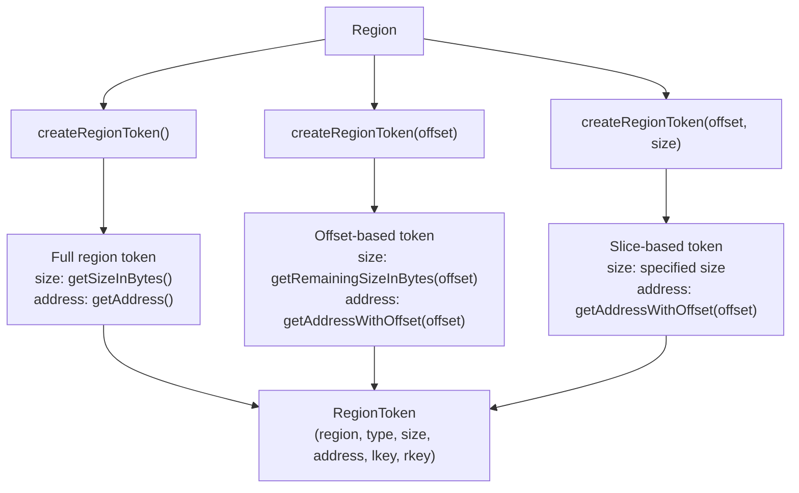
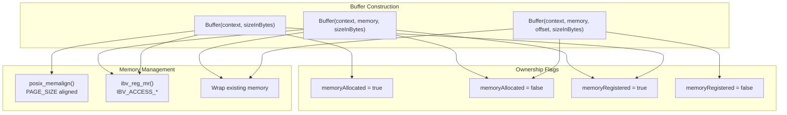
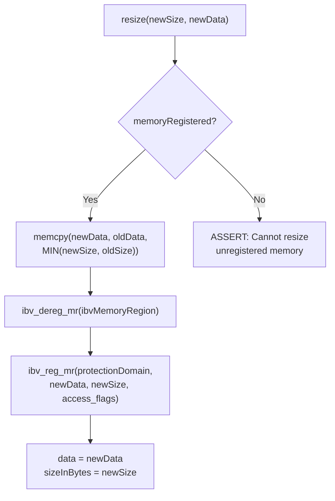
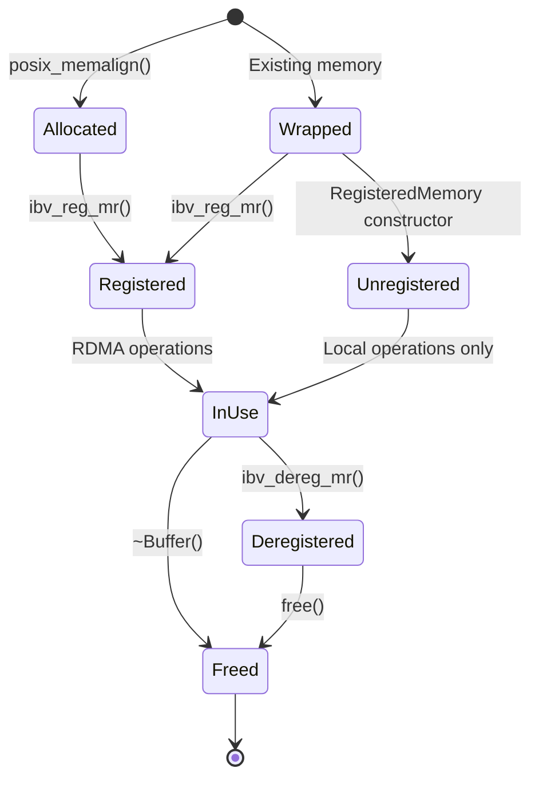
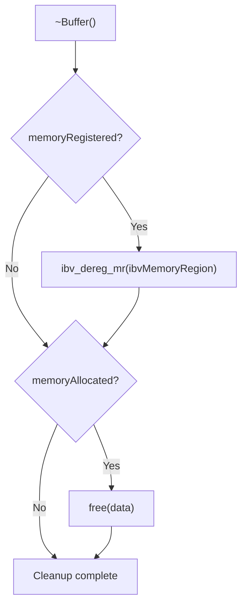

<!-- source: DeepWiki mcp.deepwiki.com · repo claudebarthels/infinity · page 4.2 Buffers and Regions · fetched 2026-11-11 -->

# Buffers and Regions

<details>
<summary>Relevant source files</summary>

The following files were used as context for generating this wiki page:

- [src/infinity/memory/Buffer.cpp](src/infinity/memory/Buffer.cpp)
- [src/infinity/memory/Buffer.h](src/infinity/memory/Buffer.h)
- [src/infinity/memory/Region.cpp](src/infinity/memory/Region.cpp)
- [src/infinity/memory/Region.h](src/infinity/memory/Region.h)

</details>


This document covers the memory management abstractions provided by the `Region` and `Buffer` classes in the Infinity RDMA library. These classes provide high-level wrappers around InfiniBand memory regions, handling memory allocation, registration, and access control for RDMA operations.

For information about memory registration mechanics, see [Memory Registration](#4.1). For details about remote memory access tokens, see [Remote Memory Access](#4.3). For atomic memory operations, see [Atomic Operations](#4.4).

## Class Hierarchy and Relationships

The memory management system is built around a base `Region` class that provides common functionality for all memory regions, with `Buffer` as the primary concrete implementation for general-purpose data storage.

```mermaid
classDiagram
    class Region {
        <<abstract>>
        #Context* context
        #RegionType memoryRegionType
        #ibv_mr* ibvMemoryRegion
        #void* data
        #uint64_t sizeInBytes
        +createRegionToken() RegionToken*
        +createRegionToken(offset) RegionToken*
        +createRegionToken(offset, size) RegionToken*
        +getSizeInBytes() uint64_t
        +getAddress() uint64_t
        +getLocalKey() uint32_t
        +getRemoteKey() uint32_t
    }
    
    class Buffer {
        #bool memoryRegistered
        #bool memoryAllocated
        +Buffer(context, sizeInBytes)
        +Buffer(context, memory, offset, sizeInBytes)
        +Buffer(context, memory, sizeInBytes)
        +getData() void*
        +resize(newSize, newData) void
    }
    
    class RegionToken {
        +RegionToken(region, type, size, address, lkey, rkey)
    }
    
    class Context {
        +getProtectionDomain() ibv_pd*
    }
    
    Region <|-- Buffer
    Region ..> RegionToken : creates
    Region --> Context : uses
    Region --> "ibv_mr" : wraps
```

Sources: [src/infinity/memory/Region.h:23-54](), [src/infinity/memory/Buffer.h:19-39]()

## Region Base Class

The `Region` class serves as the abstract base for all memory regions in the Infinity library. It encapsulates the common functionality needed to manage InfiniBand memory regions.

### Core Functionality

| Method | Purpose | Returns |
|--------|---------|---------|
| `createRegionToken()` | Creates token for entire region | `RegionToken*` |
| `createRegionToken(offset)` | Creates token for region subset starting at offset | `RegionToken*` |
| `createRegionToken(offset, size)` | Creates token for specific region slice | `RegionToken*` |
| `getSizeInBytes()` | Returns total region size | `uint64_t` |
| `getAddress()` | Returns base memory address | `uint64_t` |
| `getLocalKey()` | Returns InfiniBand local key | `uint32_t` |
| `getRemoteKey()` | Returns InfiniBand remote key | `uint32_t` |

### Region Token Creation

The `Region` class provides three overloaded methods for creating `RegionToken` objects that represent portions of the memory region:



Sources: [src/infinity/memory/Region.cpp:21-31](), [src/infinity/memory/Region.h:29-31]()

## Buffer Implementation

The `Buffer` class extends `Region` to provide concrete memory management with three distinct construction patterns for different memory ownership scenarios.

### Construction Patterns



Sources: [src/infinity/memory/Buffer.cpp:22-70](), [src/infinity/memory/Buffer.h:23-25]()

### Memory Registration Details

The `Buffer` class handles InfiniBand memory registration with specific access flags:

| Access Flag | Purpose |
|-------------|---------|
| `IBV_ACCESS_REMOTE_WRITE` | Allows remote write operations |
| `IBV_ACCESS_LOCAL_WRITE` | Allows local write operations |
| `IBV_ACCESS_REMOTE_READ` | Allows remote read operations |

### Buffer Operations

The `Buffer` class provides additional operations beyond the base `Region` functionality:

#### Data Access
- `getData()` - Returns `void*` pointer to the buffer data [src/infinity/memory/Buffer.cpp:83-85]()

#### Dynamic Resizing
- `resize(newSize, newData)` - Resizes registered memory region [src/infinity/memory/Buffer.cpp:87-110]()



Sources: [src/infinity/memory/Buffer.cpp:87-110]()

## Memory Lifecycle Management

The memory lifecycle in the Buffer and Region system follows a clear pattern of allocation, registration, usage, and cleanup:



### Cleanup Responsibilities

The `Buffer` destructor handles cleanup based on ownership flags:



Sources: [src/infinity/memory/Buffer.cpp:72-81]()

## Integration with InfiniBand Verbs

Both `Region` and `Buffer` classes integrate directly with InfiniBand Verbs through the `ibv_mr` structure:

| IBV Component | Purpose | Accessed Via |
|---------------|---------|--------------|
| `ibv_mr->lkey` | Local memory key for local operations | `getLocalKey()` |
| `ibv_mr->rkey` | Remote memory key for remote operations | `getRemoteKey()` |
| `ibv_mr->addr` | Registered memory address | Wrapped in `data` pointer |
| `ibv_mr->length` | Registered memory size | Stored in `sizeInBytes` |

The registration process connects application memory to the InfiniBand hardware through the protection domain obtained from the `Context` object.

Sources: [src/infinity/memory/Region.cpp:53-59](), [src/infinity/memory/Buffer.cpp:33-35]()

---

