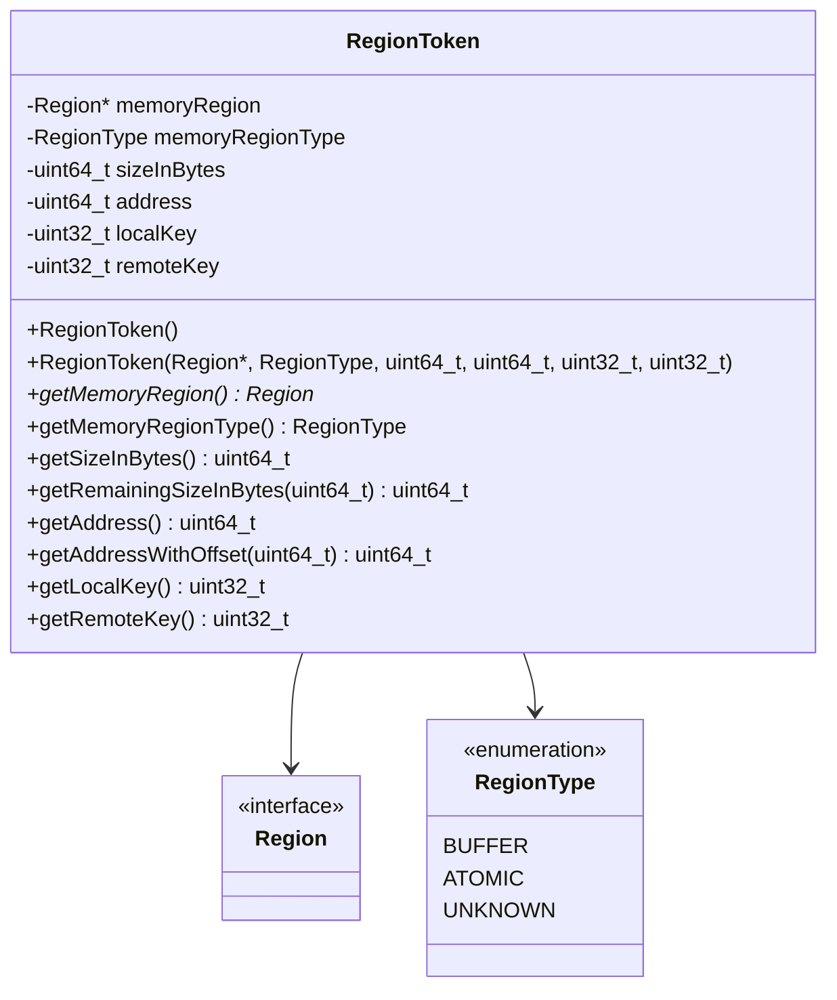
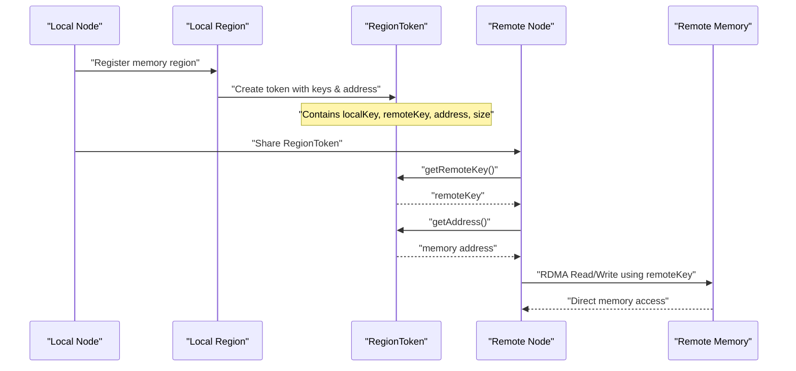
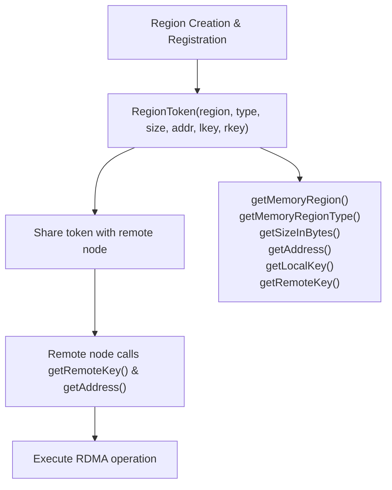

<!-- source: DeepWiki mcp.deepwiki.com · repo claudebarthels/infinity · page 4.3 Remote Memory Access · fetched 2026-11-11 -->

# Remote Memory Access

<details>
<summary>Relevant source files</summary>

The following files were used as context for generating this wiki page:

- [src/infinity/memory/RegionToken.cpp](src/infinity/memory/RegionToken.cpp)
- [src/infinity/memory/RegionToken.h](src/infinity/memory/RegionToken.h)
- [src/infinity/memory/RegionType.h](src/infinity/memory/RegionType.h)

</details>


## Purpose and Scope

This document covers the remote memory access mechanisms in the Infinity RDMA library, specifically focusing on the `RegionToken` class and how it enables remote nodes to access memory regions. The `RegionToken` serves as a handle containing the necessary addressing and access control information for RDMA operations.

For information about memory registration and the underlying `Region` class, see [Memory Registration](#4.1) and [Buffers and Regions](#4.2). For details about atomic memory operations, see [Atomic Operations](#4.4). For information about how remote memory access is initiated through RDMA operations, see [QueuePair Operations](#3.2).

## Overview

Remote memory access in RDMA allows a node to directly read from or write to memory on a remote node without involving the remote node's CPU. The Infinity library facilitates this through the `RegionToken` class, which encapsulates all the information needed for remote memory access operations.

### RegionToken Architecture

The `RegionToken` class serves as a lightweight handle that contains the essential information for accessing a memory region remotely. It acts as a bridge between the local memory registration system and remote access operations.

**RegionToken Class Structure**



Sources: [src/infinity/memory/RegionToken.h:19-46](), [src/infinity/memory/RegionType.h:15]()

## Key Components

### Memory Addressing

The `RegionToken` maintains two critical address-related fields:

- **address**: The virtual address of the memory region ([src/infinity/memory/RegionToken.h:42]())
- **sizeInBytes**: The total size of the accessible memory region ([src/infinity/memory/RegionToken.h:41]())

The class provides methods for address calculation with offsets:
- `getAddressWithOffset(uint64_t offset)` returns the address plus the specified offset ([src/infinity/memory/RegionToken.cpp:58-60]())
- `getRemainingSizeInBytes(uint64_t offset)` calculates remaining accessible bytes from an offset ([src/infinity/memory/RegionToken.cpp:50-52]())

### Access Keys

RDMA operations require two types of keys for memory access control:

| Key Type | Purpose | Usage |
|----------|---------|-------|
| **localKey** | Local access operations | Used by the local node for memory access |
| **remoteKey** | Remote access operations | Shared with remote nodes for RDMA operations |

The `localKey` is accessed via `getLocalKey()` ([src/infinity/memory/RegionToken.cpp:62-64]()) and the `remoteKey` via `getRemoteKey()` ([src/infinity/memory/RegionToken.cpp:66-68]()).

### Region Types

The `RegionToken` supports different types of memory regions as defined in the `RegionType` enumeration:

- **BUFFER**: Standard data buffer regions
- **ATOMIC**: Regions supporting atomic operations  
- **UNKNOWN**: Unspecified or error state

Sources: [src/infinity/memory/RegionType.h:15](), [src/infinity/memory/RegionToken.h:40]()

## Remote Memory Access Flow

The following diagram illustrates how `RegionToken` facilitates remote memory access:

**Remote Memory Access Process**



Sources: [src/infinity/memory/RegionToken.cpp:26-36](), [src/infinity/memory/RegionToken.cpp:66-68]()

## Token Construction and Usage

### Default Construction

The `RegionToken` provides a default constructor that initializes all fields to safe default values:

```cpp
RegionToken()
```

This creates a token with `NULL` memory region, `UNKNOWN` type, and zero values for size, address, and keys ([src/infinity/memory/RegionToken.cpp:14-24]()).

### Parameterized Construction

For active memory regions, the parameterized constructor is used:

```cpp
RegionToken(Region *memoryRegion, RegionType memoryRegionType, 
           uint64_t sizeInBytes, uint64_t address, 
           uint32_t localKey, uint32_t remoteKey)
```

This constructor initializes all fields with the provided values for immediate use in RDMA operations ([src/infinity/memory/RegionToken.cpp:26-36]()).

### Access Pattern Example

**Typical RegionToken Usage Pattern**



Sources: [src/infinity/memory/RegionToken.cpp:26-36](), [src/infinity/memory/RegionToken.cpp:38-68]()

## Integration with Memory System

The `RegionToken` integrates with the broader memory management system by maintaining a reference to the underlying `Region` object. This allows:

- Access to the original memory region through `getMemoryRegion()` ([src/infinity/memory/RegionToken.cpp:38-40]())
- Type information through `getMemoryRegionType()` ([src/infinity/memory/RegionToken.cpp:42-44]())
- Size and address calculations for partial region access

The token serves as a lightweight proxy that can be safely shared between nodes without exposing the full `Region` object, providing both security and efficiency for remote memory access operations.

Sources: [src/infinity/memory/RegionToken.h:39](), [src/infinity/memory/RegionToken.cpp:38-44]()

---

