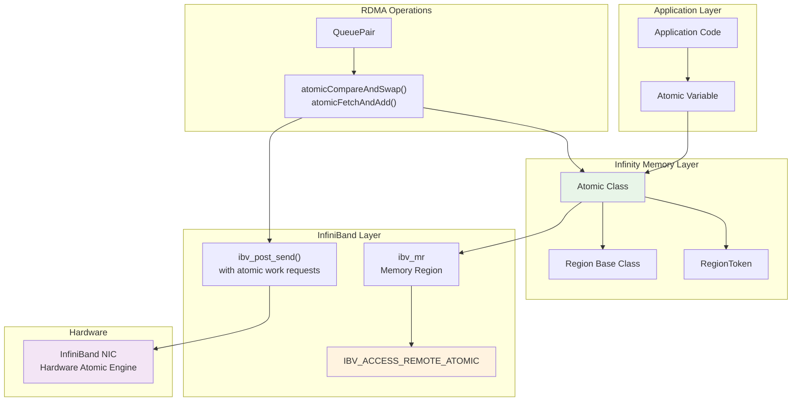
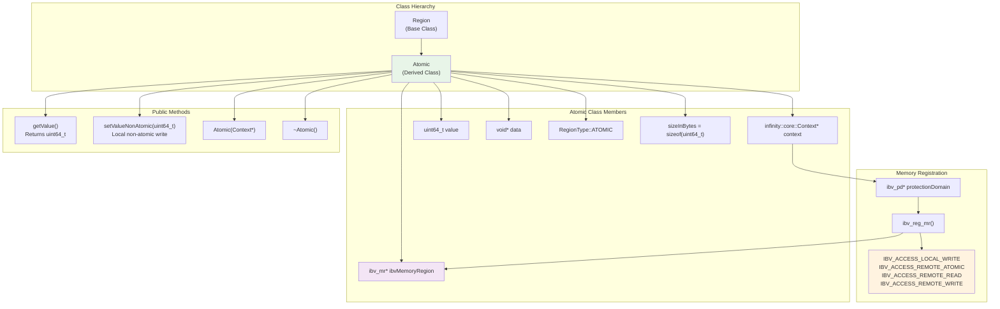
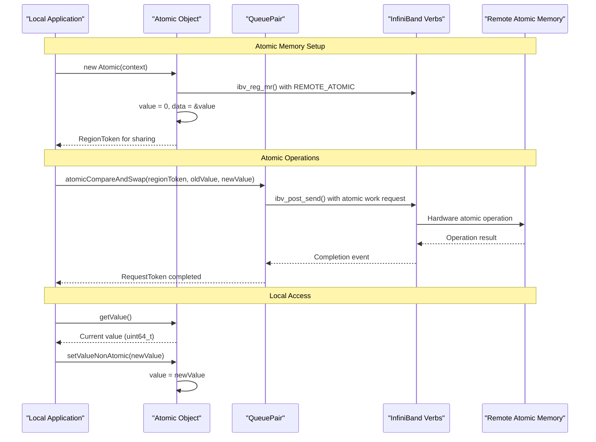

<!-- source: DeepWiki mcp.deepwiki.com · repo claudebarthels/infinity · page 4.4 Atomic Operations · fetched 2026-11-11 -->

# Atomic Operations

<details>
<summary>Relevant source files</summary>

The following files were used as context for generating this wiki page:

- [src/infinity/memory/Atomic.cpp](src/infinity/memory/Atomic.cpp)
- [src/infinity/memory/Atomic.h](src/infinity/memory/Atomic.h)

</details>


## Purpose and Scope

This document covers the atomic operations subsystem in the Infinity RDMA library, which provides support for hardware-accelerated atomic memory operations over InfiniBand. The `Atomic` class enables remote nodes to perform atomic read-modify-write operations on shared memory locations, supporting synchronization primitives and concurrent data structures in distributed applications.

For general memory management concepts, see [Memory Management](#4). For details on how atomic memory regions are created and managed, see [Memory Registration](#4.1) and [Buffers and Regions](#4.2). For information on how atomic operations are invoked through QueuePair, see [QueuePair Operations](#3.2).

## Architecture Overview

The atomic operations system in Infinity provides a high-level abstraction over InfiniBand's hardware atomic capabilities. The system centers around the `Atomic` class, which represents a single 64-bit atomic variable that can be accessed remotely by multiple nodes in an RDMA cluster.

**Atomic Operations Architecture**


Sources: [src/infinity/memory/Atomic.h:1-44](), [src/infinity/memory/Atomic.cpp:1-51]()

## The Atomic Class

The `Atomic` class inherits from `Region` and provides a specialized memory region for atomic operations. It manages a single 64-bit unsigned integer value that can be accessed atomically by remote nodes through RDMA operations.

**Atomic Class Structure**


Sources: [src/infinity/memory/Atomic.h:21-39](), [src/infinity/memory/Atomic.cpp:16-29]()

### Key Features

The `Atomic` class provides the following characteristics:

| Feature | Description | Implementation |
|---------|-------------|----------------|
| **Fixed Size** | Always 64-bit unsigned integer | `sizeInBytes = sizeof(uint64_t)` |
| **Memory Registration** | Registered with atomic access permissions | `IBV_ACCESS_REMOTE_ATOMIC` flag |
| **Initialization** | Value initialized to 0 | `this->value = 0` |
| **Remote Access** | Accessible by remote nodes for atomic operations | `RegionType::ATOMIC` |
| **Local Access** | Non-atomic local read/write methods | `getValue()`, `setValueNonAtomic()` |

### Memory Registration Process

The atomic memory region is registered with specific access flags that enable remote atomic operations:

```cpp
this->ibvMemoryRegion = ibv_reg_mr(
    this->context->getProtectionDomain(), 
    &(this->value), 
    this->sizeInBytes,
    IBV_ACCESS_LOCAL_WRITE | IBV_ACCESS_REMOTE_ATOMIC | 
    IBV_ACCESS_REMOTE_READ | IBV_ACCESS_REMOTE_WRITE
);
```

The access flags enable:
- `IBV_ACCESS_LOCAL_WRITE`: Local write access
- `IBV_ACCESS_REMOTE_ATOMIC`: Remote atomic operations
- `IBV_ACCESS_REMOTE_READ`: Remote read access
- `IBV_ACCESS_REMOTE_WRITE`: Remote write access

Sources: [src/infinity/memory/Atomic.cpp:25-26]()

## Integration with RDMA Operations

The `Atomic` class works in conjunction with the `QueuePair` class to enable remote atomic operations. While the `Atomic` class provides the memory storage, the actual atomic operations are performed through QueuePair methods.

**Atomic Operations Flow**


Sources: [src/infinity/memory/Atomic.cpp:31-41]()

## Usage Patterns

### Basic Atomic Variable Creation

```cpp
// Create atomic variable
infinity::memory::Atomic* atomicVar = new infinity::memory::Atomic(context);

// Get initial value (0)
uint64_t currentValue = atomicVar->getValue();

// Set value locally (non-atomic)
atomicVar->setValueNonAtomic(42);

// Share with remote nodes via RegionToken
infinity::memory::RegionToken* token = atomicVar->createRegionToken();
```

### Remote Atomic Operations

Remote atomic operations are performed through the `QueuePair` class methods:

- `atomicCompareAndSwap()`: Atomic compare-and-swap operation
- `atomicFetchAndAdd()`: Atomic fetch-and-add operation

These operations work with the `RegionToken` created from the `Atomic` object to perform hardware-accelerated atomic operations across the network.

### Memory Management

The `Atomic` class handles memory registration and cleanup automatically:

- **Construction**: Registers memory with InfiniBand with atomic access permissions
- **Destruction**: Automatically deregisters memory using `ibv_dereg_mr()`

Sources: [src/infinity/memory/Atomic.cpp:44-47]()

## Implementation Details

### Memory Layout

The `Atomic` class uses a simple memory layout:
- Single `uint64_t value` member variable
- `data` pointer points to the `value` member
- Memory region size is exactly `sizeof(uint64_t)` (8 bytes)

### Thread Safety

The `Atomic` class provides:
- **Thread-safe remote access**: Hardware atomic operations ensure atomicity across nodes
- **Non-atomic local access**: Local `getValue()` and `setValueNonAtomic()` methods are not thread-safe for local concurrent access

### Performance Considerations

- Hardware atomic operations provide high performance with low latency
- Operations bypass CPU involvement on remote nodes
- Fixed 64-bit size optimizes for common atomic use cases
- Direct memory registration avoids unnecessary copying

Sources: [src/infinity/memory/Atomic.cpp:16-29](), [src/infinity/memory/Atomic.h:21-39]()

---

