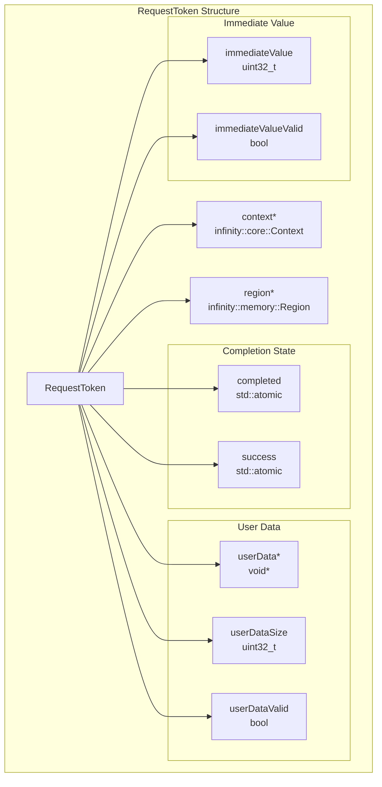
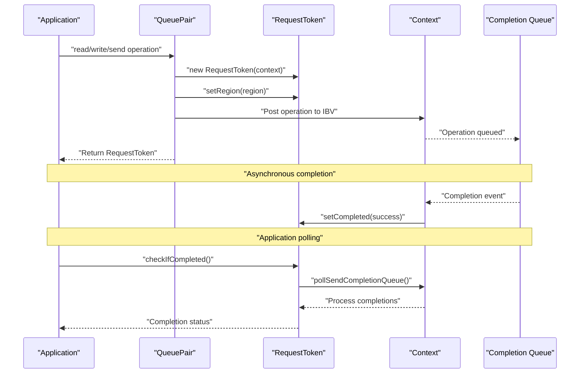
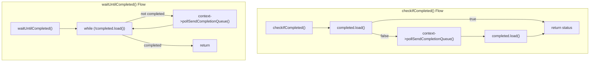
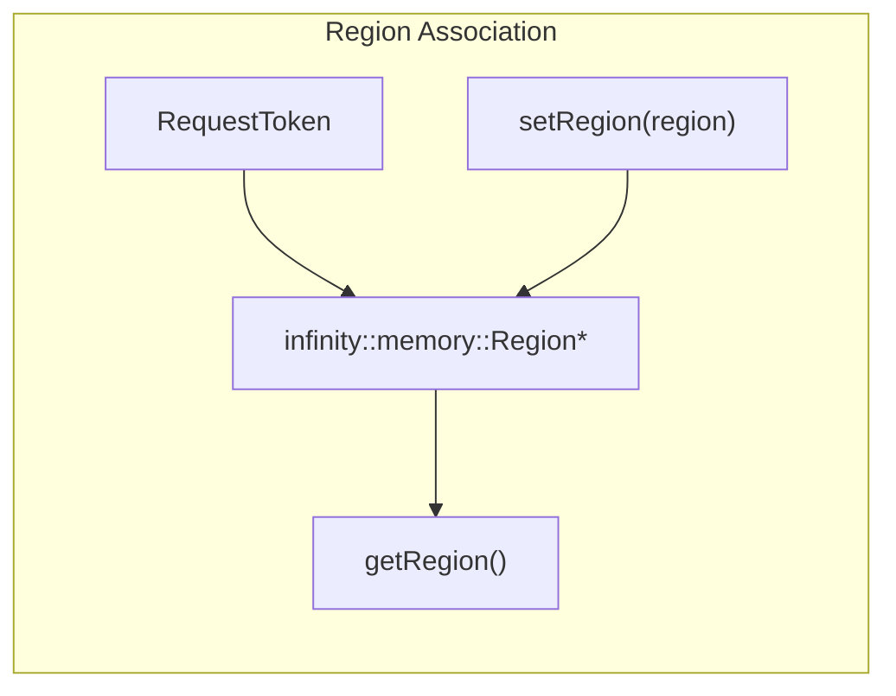
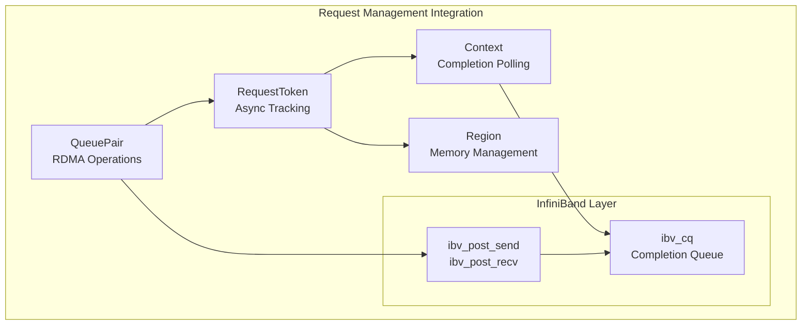
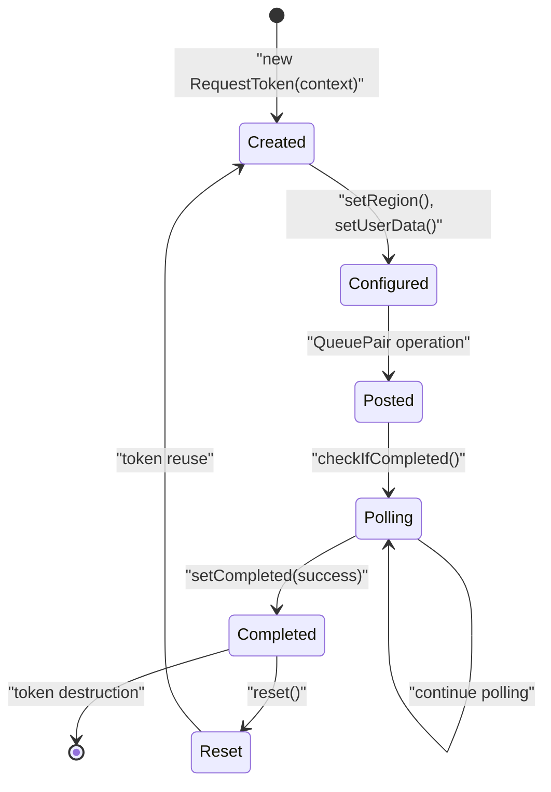

<!-- source: DeepWiki mcp.deepwiki.com · repo claudebarthels/infinity · page 5 Request Management · fetched 2026-11-11 -->

# Request Management

Relevant source files

The following files were used as context for generating this wiki page:

- [src/infinity/requests/RequestToken.cpp](src/infinity/requests/RequestToken.cpp)
- [src/infinity/requests/RequestToken.h](src/infinity/requests/RequestToken.h)

## Purpose and Scope

The Request Management subsystem provides asynchronous operation tracking for RDMA operations in the Infinity library. It centers around the `RequestToken` class, which serves as a handle for tracking the completion status and results of non-blocking RDMA operations such as read, write, send, and atomic operations.

For information about the RDMA operations that generate these tokens, see [QueuePair Operations](#3.2). For details on the memory regions associated with requests, see [Memory Management](#4).

## RequestToken Class Overview

The `RequestToken` class provides a unified interface for tracking asynchronous RDMA operations. Each token represents a single pending operation and maintains state information about its completion status, success/failure, and associated data.

### Core Components

**Sources:** [src/infinity/requests/RequestToken.h:21-62]()

### Key Methods

| Method | Purpose | Blocking |
|--------|---------|----------|
| `setCompleted(bool success)` | Mark operation as completed | No |
| `checkIfCompleted()` | Check completion status | No |
| `waitUntilCompleted()` | Block until operation completes | Yes |
| `wasSuccessful()` | Get operation result | No |
| `reset()` | Reset token for reuse | No |

**Sources:** [src/infinity/requests/RequestToken.h:32-36](), [src/infinity/requests/RequestToken.cpp:26-59]()

## Asynchronous Operation Tracking

The `RequestToken` uses atomic variables to provide thread-safe tracking of operation completion. The completion polling mechanism integrates with the InfiniBand completion queue system through the `Context` class.

### Completion Flow

**Sources:** [src/infinity/requests/RequestToken.cpp:31-44]()

### Completion Checking Methods

The `RequestToken` provides two approaches for checking completion:

1. **Non-blocking Check**: `checkIfCompleted()` polls the completion queue once and returns the current status
2. **Blocking Wait**: `waitUntilCompleted()` continuously polls until the operation completes

**Sources:** [src/infinity/requests/RequestToken.cpp:31-44]()

## Data Management Features

The `RequestToken` supports additional data management features for enhanced operation tracking and result handling.

### User Data Association

Applications can associate arbitrary data with requests using the user data mechanism:

| Method | Purpose |
|--------|---------|
| `setUserData(void* userData, uint32_t userDataSize)` | Attach user data to request |
| `getUserData()` | Retrieve user data pointer |
| `hasUserData()` | Check if user data is present |
| `getUserDataSize()` | Get size of user data |

**Sources:** [src/infinity/requests/RequestToken.cpp:69-85]()

### Immediate Value Support

For operations that support immediate values (such as RDMA send with immediate), the token can store and retrieve these values:

| Method | Purpose |
|--------|---------|
| `setImmediateValue(uint32_t immediateValue)` | Store immediate value |
| `getImmediateValue()` | Retrieve immediate value |
| `hasImmediateValue()` | Check if immediate value is present |

**Sources:** [src/infinity/requests/RequestToken.cpp:87-98]()

### Memory Region Association

Each token can be associated with a specific memory region involved in the operation:

**Sources:** [src/infinity/requests/RequestToken.cpp:61-67]()

## Integration with Core Components

The `RequestToken` integrates closely with other Infinity components to provide comprehensive request management.

### Component Integration

**Sources:** [src/infinity/requests/RequestToken.h:15-16](), [src/infinity/requests/RequestToken.cpp:14-24]()

### Token Lifecycle

**Sources:** [src/infinity/requests/RequestToken.cpp:50-59]()

## Thread Safety

The `RequestToken` implementation uses atomic operations for thread-safe completion status tracking. The `completed` and `success` flags are implemented as `std::atomic<bool>` to ensure safe concurrent access between the completion processing thread and application threads.

**Sources:** [src/infinity/requests/RequestToken.h:52-53]()

---

