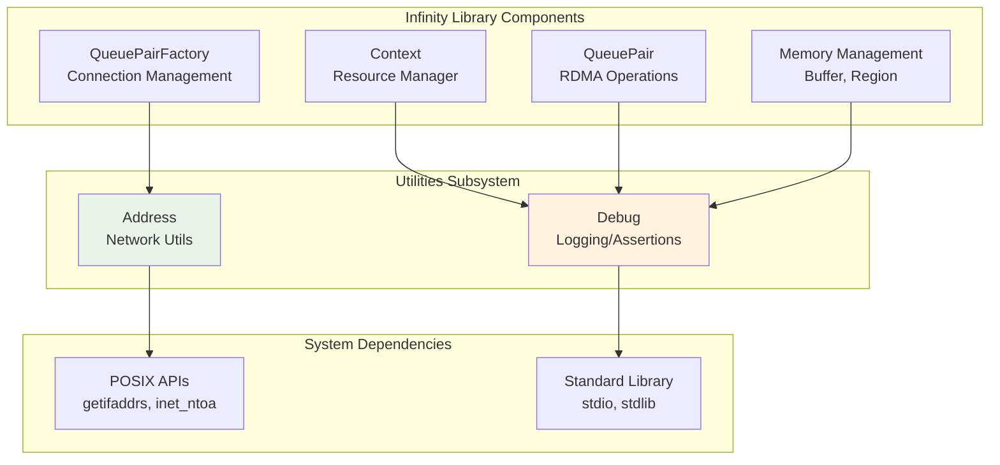
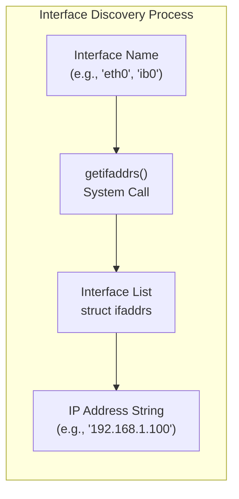
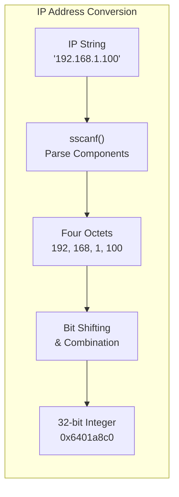
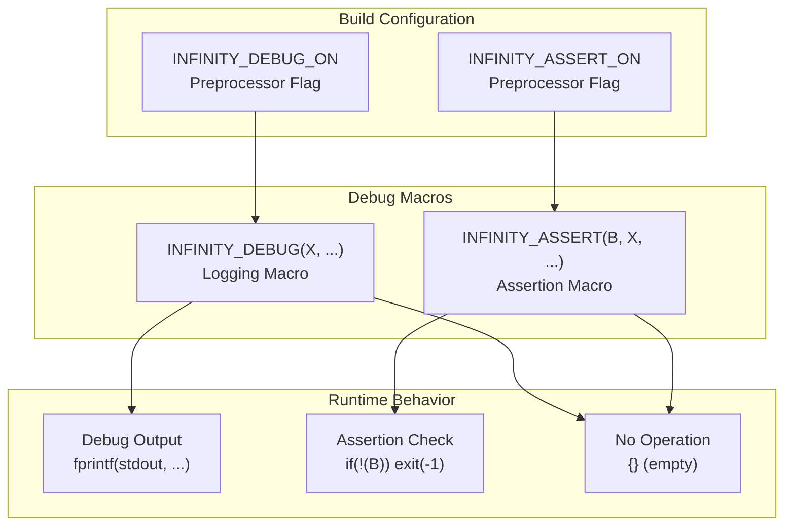

<!-- source: DeepWiki mcp.deepwiki.com · repo claudebarthels/infinity · page 6 Utilities · fetched 2026-11-11 -->

# Utilities

Relevant source files

The following files were used as context for generating this wiki page:

- [src/infinity/utils/Address.cpp](src/infinity/utils/Address.cpp)
- [src/infinity/utils/Debug.h](src/infinity/utils/Debug.h)

The Utilities subsystem provides essential support functions for network address management and debugging throughout the Infinity RDMA library. This page covers the helper classes and macros that enable core functionality like network interface discovery, IP address conversion, and development-time debugging support.

For comprehensive API documentation of all utility classes and methods, see [API Reference](#7). For information about the core library architecture that these utilities support, see [Core Architecture](#3).

## Overview

The utilities subsystem consists of two main components organized within the `infinity::utils` namespace:

| Component | Purpose | Key Features |
|-----------|---------|--------------|
| Address Management | Network address utilities | Interface IP discovery, address format conversion |
| Debug Support | Development and debugging aids | Conditional logging, assertion macros |

*Sources: [src/infinity/utils/Address.cpp:1-59](), [src/infinity/utils/Debug.h:1-28]()*

## Address Management

The `Address` class provides utilities for network interface management and IP address format conversion, essential for establishing RDMA connections across network nodes.

### Network Interface Discovery

The `getIpAddressOfInterface` function retrieves the IPv4 address of a specified network interface:

The function iterates through all available network interfaces, filtering for IPv4 addresses that match the specified interface name. It performs case-insensitive matching and allocates memory for the returned IP address string.

*Sources: [src/infinity/utils/Address.cpp:23-47]()*

### IP Address Format Conversion

The `getIpAddressAsUint32` function converts dotted decimal IP address strings to 32-bit unsigned integers:

The conversion process parses the IP address into four numerical components, then combines them using bit shifting to create a single 32-bit value suitable for network operations.

*Sources: [src/infinity/utils/Address.cpp:49-55]()*

## Debug Support

The Debug subsystem provides conditional compilation macros for development-time logging and runtime assertions, enabling developers to control debugging output without performance impact in production builds.

### Conditional Compilation System

### Debug Logging

The `INFINITY_DEBUG` macro provides printf-style logging that can be enabled or disabled at compile time:

- **Enabled**: Outputs formatted messages to stdout with immediate flushing
- **Disabled**: Compiles to empty statements with no runtime overhead

*Sources: [src/infinity/utils/Debug.h:15-19]()*

### Assertion System

The `INFINITY_ASSERT` macro provides conditional assertion checking:

- **Enabled**: Evaluates boolean condition and terminates program with error message if false
- **Disabled**: Compiles to empty statements for production builds

The assertion system is used throughout the library to validate critical conditions like successful system calls and proper resource initialization.

*Sources: [src/infinity/utils/Debug.h:21-25]()*

## Integration with Core Components

The utilities subsystem integrates seamlessly with other library components:

| Component | Address Usage | Debug Usage |
|-----------|---------------|-------------|
| `QueuePairFactory` | Interface IP discovery for connection establishment | Connection setup assertions |
| `Context` | N/A | Resource initialization validation |
| `QueuePair` | N/A | Operation parameter validation |
| `Memory` subsystem | N/A | Buffer allocation and registration checks |

The utilities provide foundational support that enables reliable network operations and development-time debugging across the entire Infinity library architecture.

*Sources: [src/infinity/utils/Address.cpp:1-59](), [src/infinity/utils/Debug.h:1-28]()*

---

