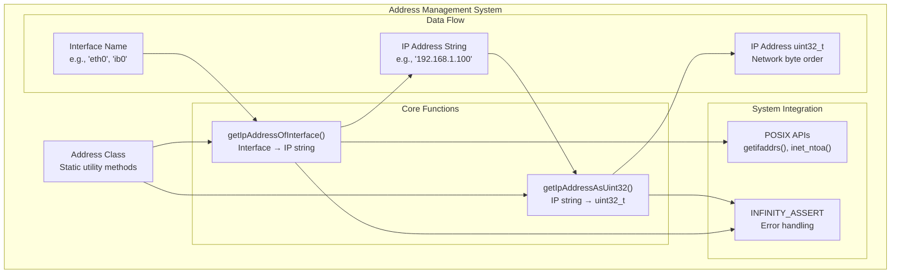
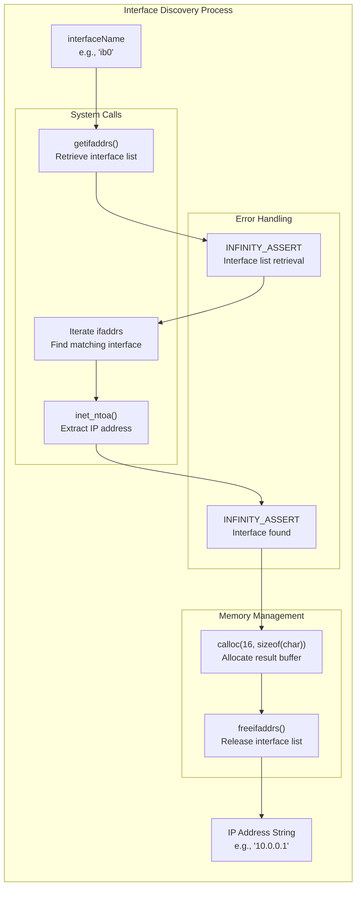
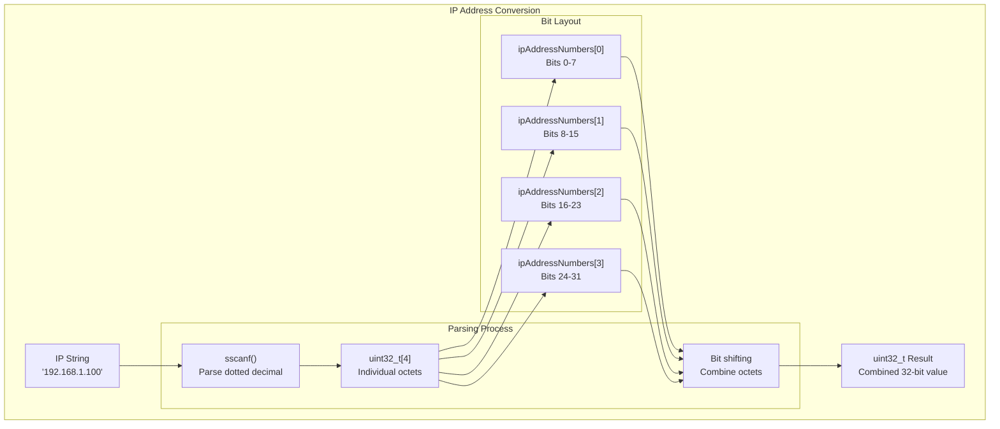

<!-- source: DeepWiki mcp.deepwiki.com · repo claudebarthels/infinity · page 6.1 Address Management · fetched 2026-11-11 -->

# Address Management

<details>
<summary>Relevant source files</summary>

The following files were used as context for generating this wiki page:

- [src/infinity/utils/Address.cpp](src/infinity/utils/Address.cpp)
- [src/infinity/utils/Address.h](src/infinity/utils/Address.h)

</details>


## Purpose and Scope

The Address Management system provides network address utilities for the Infinity RDMA library. This system handles IP address resolution from network interfaces and format conversions required for RDMA operations. The `Address` class serves as a utility component that enables applications to discover and manipulate network addresses when establishing RDMA connections.

For information about connection establishment using these addresses, see [Connection Management](#3.3). For details on the broader utility framework, see [Utilities](#6).

## Overview

The Address Management system consists of a single utility class that provides static methods for network address operations. The system focuses on IPv4 address handling and interface discovery using standard POSIX networking APIs.



**Sources:** [src/infinity/utils/Address.h:17-24](), [src/infinity/utils/Address.cpp:20-58]()

## Network Interface Discovery

The `getIpAddressOfInterface()` method discovers the IPv4 address associated with a specific network interface. This functionality is essential for RDMA applications that need to bind to specific network adapters.

| Method | Parameters | Return Type | Description |
|--------|------------|-------------|-------------|
| `getIpAddressOfInterface` | `const char* interfaceName` | `char*` | Returns IP address string for the specified interface |



The implementation performs the following steps:

1. **Interface List Retrieval**: Uses `getifaddrs()` to obtain the complete list of network interfaces
2. **Interface Matching**: Iterates through interfaces using case-insensitive comparison with `strcasecmp()`
3. **Address Extraction**: Extracts IPv4 addresses from `AF_INET` family interfaces using `inet_ntoa()`
4. **Memory Management**: Allocates a 16-byte buffer for the result and properly frees system resources

**Sources:** [src/infinity/utils/Address.cpp:23-47]()

## IP Address Conversion

The `getIpAddressAsUint32()` method converts IPv4 address strings to 32-bit unsigned integers. This conversion is often required for network operations and binary protocol handling.



The conversion process uses bit manipulation to pack the four octets into a single 32-bit integer:

```
Result = octet0 | (octet1 << 8) | (octet2 << 16) | (octet3 << 24)
```

Note that the parsing order in `sscanf()` is reversed (reading octets 3,2,1,0) to account for the bit shifting pattern used in the final combination.

**Sources:** [src/infinity/utils/Address.cpp:49-55]()

## Integration with RDMA Operations

The Address utilities integrate with the broader Infinity RDMA framework by providing network address resolution capabilities needed for connection establishment and device identification.

```mermaid
graph TB
    subgraph "RDMA Integration Context"
        subgraph "Application Layer"
            RDMAApp["RDMA Application"]
            ConnectionSetup["Connection Setup"]
        end
        
        subgraph "Infinity Core"
            Context["Context<br/>Resource manager"]
            QueuePairFactory["QueuePairFactory<br/>Connection factory"]
        end
        
        subgraph "Address Management"
            AddressClass["Address Class"]
            InterfaceDiscovery["Interface Discovery"]
            AddressConversion["Address Conversion"]
        end
        
        subgraph "System Resources"
            NetworkInterface["Network Interface<br/>e.g., ib0, eth0"]
            IPAddress["IP Address<br/>IPv4 format"]
            InfiniBandDevice["InfiniBand Device<br/>RDMA hardware"]
        end
    end
    
    RDMAApp --> ConnectionSetup
    ConnectionSetup --> QueuePairFactory
    QueuePairFactory --> Context
    Context --> AddressClass
    
    AddressClass --> InterfaceDiscovery
    AddressClass --> AddressConversion
    
    InterfaceDiscovery --> NetworkInterface
    NetworkInterface --> IPAddress
    IPAddress --> InfiniBandDevice
```



Common usage patterns include:

1. **Interface Selection**: Applications use `getIpAddressOfInterface()` to discover IP addresses for specific InfiniBand or Ethernet interfaces
2. **Address Format Conversion**: The `getIpAddressAsUint32()` method converts string addresses to binary format for protocol operations
3. **Connection Establishment**: Address utilities support the connection handshake process by providing properly formatted network addresses

**Sources:** [src/infinity/utils/Address.h:21-22](), [src/infinity/utils/Address.cpp:1-58]()

## Error Handling and Assertions

The Address Management system uses the Infinity assertion framework for robust error handling. All critical operations include validation checks to ensure proper system behavior.

| Operation | Assertion Check | Error Condition |
|-----------|----------------|-----------------|
| Interface list retrieval | `returnValue != -1` | `getifaddrs()` failure |
| Interface discovery | `ifa != NULL` | Interface not found |

The system provides meaningful error messages that include the failed interface name and operation context, facilitating debugging in RDMA applications.

**Sources:** [src/infinity/utils/Address.cpp:30](), [src/infinity/utils/Address.cpp:41](), [src/infinity/utils/Debug.h:18]()

---

