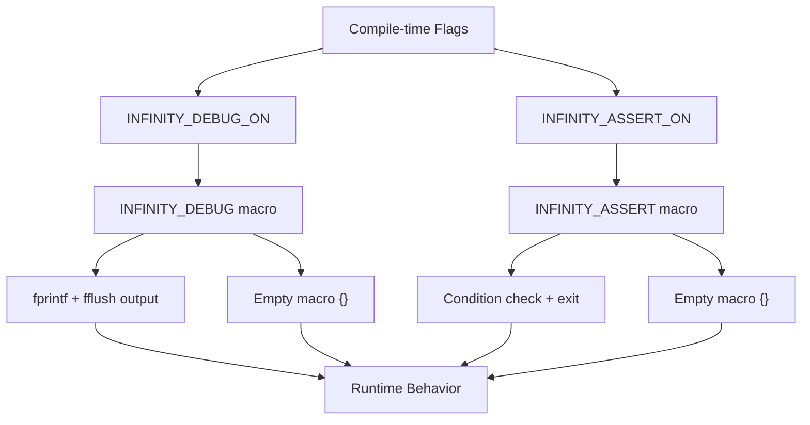
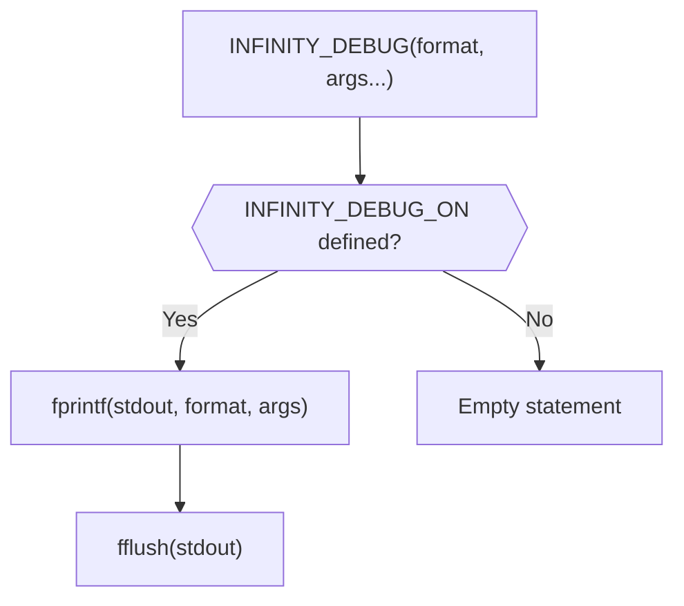
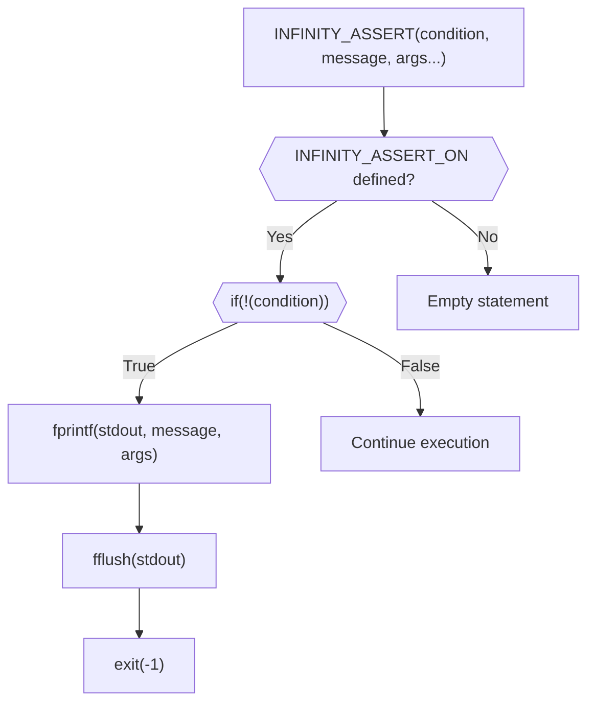

<!-- source: DeepWiki mcp.deepwiki.com · repo claudebarthels/infinity · page 6.2 Debug Support · fetched 2026-11-11 -->

# Debug Support

<details>
<summary>Relevant source files</summary>

The following files were used as context for generating this wiki page:

- [src/infinity/utils/Debug.h](src/infinity/utils/Debug.h)

</details>


The debug support system provides essential debugging and assertion utilities for the Infinity RDMA library. This system consists of compile-time configurable macros that enable debug output and runtime assertions throughout the codebase. The debug utilities are designed to be lightweight and can be completely disabled in production builds with no runtime overhead.

For information about other utility functions like network address handling, see [Address Management](#6.1).

## Debug System Architecture

The debug support system is implemented as a set of preprocessor macros that provide conditional compilation of debug code. The system offers two primary debugging features: debug output and runtime assertions.



**Sources:** [src/infinity/utils/Debug.h:1-28]()

## Debug Output Macro

The `INFINITY_DEBUG` macro provides conditional debug output throughout the library. When `INFINITY_DEBUG_ON` is defined during compilation, debug messages are printed to stdout and immediately flushed.

### Implementation Details

| State | Macro Definition | Behavior |
|-------|------------------|----------|
| Enabled | `#define INFINITY_DEBUG(X, ...) {fprintf(stdout, X, ##__VA_ARGS__); fflush(stdout);}` | Outputs formatted message to stdout |
| Disabled | `#define INFINITY_DEBUG(X, ...) {}` | No operation, zero overhead |

The macro accepts variable arguments using the `##__VA_ARGS__` syntax, allowing printf-style formatting:



**Sources:** [src/infinity/utils/Debug.h:15-19]()

## Assertion Macro

The `INFINITY_ASSERT` macro provides runtime assertion checking that can be disabled for production builds. When enabled, failed assertions print an error message and terminate the program.

### Implementation Details

| State | Macro Definition | Behavior |
|-------|------------------|----------|
| Enabled | `#define INFINITY_ASSERT(B, X, ...) {if(!(B)) {fprintf(stdout, X, ##__VA_ARGS__); fflush(stdout); exit(-1);}}` | Checks condition, prints message and exits on failure |
| Disabled | `#define INFINITY_ASSERT(B, X, ...) {}` | No operation, zero overhead |

The assertion macro takes a boolean condition and optional error message with arguments:



**Sources:** [src/infinity/utils/Debug.h:21-25]()

## Compilation Configuration

The debug system is controlled by two preprocessor definitions that must be set during compilation:

| Flag | Purpose | Effect When Defined |
|------|---------|-------------------|
| `INFINITY_DEBUG_ON` | Enables debug output | `INFINITY_DEBUG` macro prints messages |
| `INFINITY_ASSERT_ON` | Enables assertions | `INFINITY_ASSERT` macro performs runtime checks |

These flags are typically set via compiler command-line options:

```bash
# Enable debug output
g++ -DINFINITY_DEBUG_ON ...

# Enable assertions  
g++ -DINFINITY_ASSERT_ON ...

# Enable both
g++ -DINFINITY_DEBUG_ON -DINFINITY_ASSERT_ON ...
```

For production builds, both flags should be omitted to eliminate all debug overhead.

**Sources:** [src/infinity/utils/Debug.h:15-25]()

## Usage Throughout the Library

The debug macros are included via the main header file and used throughout the Infinity library codebase for:

- **Debug Output**: Tracing execution flow, logging operation parameters, and debugging RDMA operations
- **Assertions**: Validating preconditions, checking return values, and ensuring system state consistency

The debug system integrates with the broader Infinity architecture by providing diagnostics for:
- Context initialization and resource management
- QueuePair operations and state transitions  
- Memory registration and buffer management
- Request processing and completion handling

**Sources:** [src/infinity/utils/Debug.h:1-28]()

---

