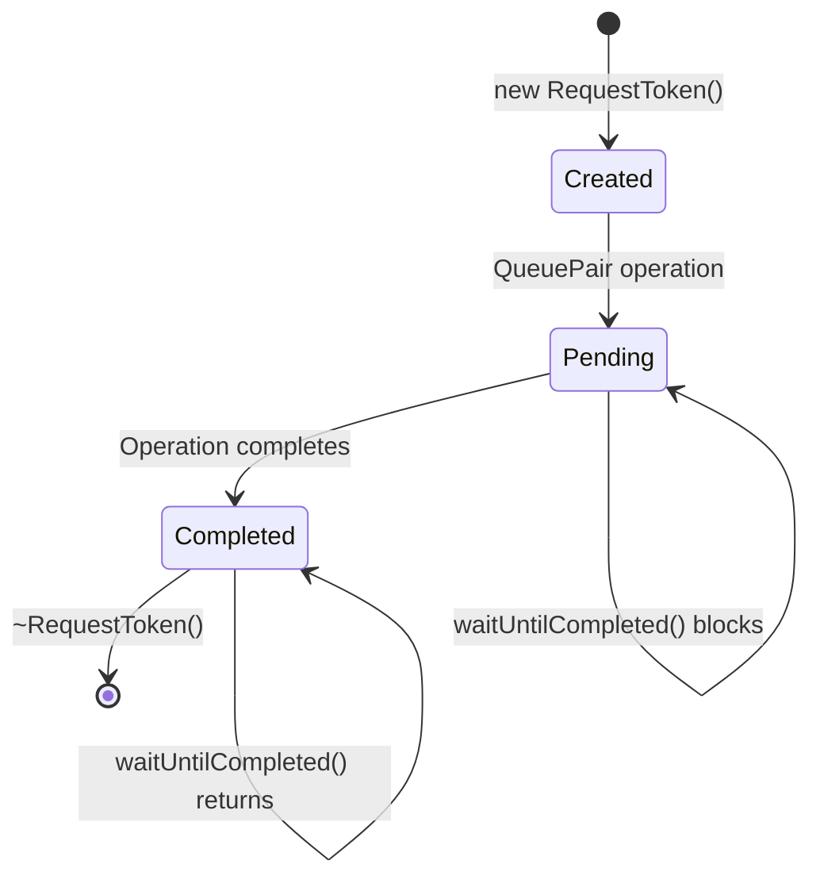
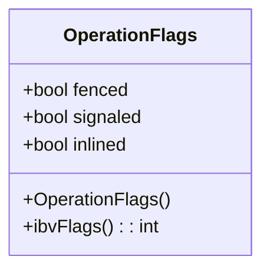
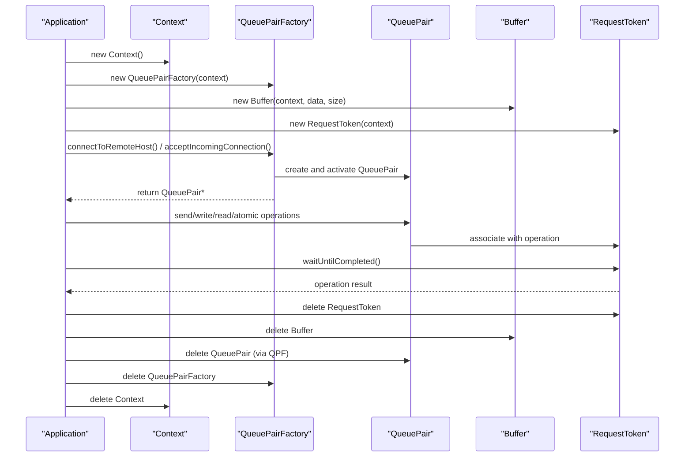

<!-- source: DeepWiki mcp.deepwiki.com · repo claudebarthels/infinity · page 7 API Reference · fetched 2026-11-11 -->

# API Reference

<details>
<summary>Relevant source files</summary>

The following files were used as context for generating this wiki page:

- [src/infinity/infinity.h](src/infinity/infinity.h)
- [src/infinity/queues/QueuePair.cpp](src/infinity/queues/QueuePair.cpp)
- [src/infinity/queues/QueuePair.h](src/infinity/queues/QueuePair.h)

</details>


This document provides comprehensive API documentation for all public classes and methods in the Infinity RDMA library. The API enables high-performance RDMA operations over InfiniBand networks through a simplified C++ interface.

For architectural concepts and design principles, see [Core Architecture](#3). For memory management concepts, see [Memory Management](#4). For practical usage examples, see [Getting Started](#2).

## Core API Classes

The Infinity library centers around several key classes that manage RDMA resources and operations:

```mermaid
classDiagram
    class Context {
        +Context()
        +~Context()
        +getLocalDeviceId() : uint16_t
        +getDevicePort() : uint8_t
        +getProtectionDomain() : ibv_pd*
        +getSendCompletionQueue() : ibv_cq*
        +getReceiveCompletionQueue() : ibv_cq*
        +getSharedReceiveQueue() : ibv_srq*
        +defaultAtomic : Atomic*
    }
    
    class QueuePairFactory {
        +QueuePairFactory(Context*)
        +~QueuePairFactory()
        +connectToRemoteHost(char*, uint16_t) : QueuePair*
        +acceptIncomingConnection() : QueuePair*
        +bindToPort(uint16_t)
    }
    
    class QueuePair {
        +QueuePair(Context*)
        +~QueuePair()
        +getLocalDeviceId() : uint16_t
        +getQueuePairNumber() : uint32_t
        +getSequenceNumber() : uint32_t
        +send(Buffer*, RequestToken*)
        +write(Buffer*, RegionToken*, RequestToken*)
        +read(Buffer*, RegionToken*, RequestToken*)
        +compareAndSwap(RegionToken*, uint64_t, uint64_t, RequestToken*)
        +fetchAndAdd(RegionToken*, uint64_t, RequestToken*)
    }
    
    Context ||--o{ QueuePairFactory : "manages"
    QueuePairFactory ||--o{ QueuePair : "creates"
    Context ||--o{ QueuePair : "provides resources"
```

### Context

The `Context` class manages all InfiniBand resources and serves as the central coordinator for RDMA operations.

**Key Methods:**
- `Context()` - Initializes InfiniBand device and creates protection domain, completion queues
- `getLocalDeviceId()` - Returns local device identifier for queue pair activation
- `getProtectionDomain()` - Returns InfiniBand protection domain for memory registration
- `getSendCompletionQueue()` / `getReceiveCompletionQueue()` - Returns completion queues for operation tracking

### QueuePairFactory

The `QueuePairFactory` class handles connection establishment and queue pair creation.

**Key Methods:**
- `QueuePairFactory(Context*)` - Creates factory with specified context
- `connectToRemoteHost(char* hostname, uint16_t port)` - Establishes outgoing connection
- `acceptIncomingConnection()` - Accepts incoming connection requests
- `bindToPort(uint16_t port)` - Binds factory to listen on specified port

### QueuePair

The `QueuePair` class provides the main RDMA operation interface.

**Key Methods:**
- `getQueuePairNumber()` - Returns queue pair number for connection handshake
- `getSequenceNumber()` - Returns sequence number for connection setup
- Operation methods (detailed in Queue Operations section)

Sources: [src/infinity/infinity.h:1-26](), [src/infinity/queues/QueuePair.h:44-158]()

## Memory Management API

The memory management API provides abstractions for RDMA memory registration and access:

```mermaid
classDiagram
    class Buffer {
        +Buffer(Context*, void*, uint64_t)
        +~Buffer()
        +getAddress() : uint64_t
        +getSizeInBytes() : uint64_t
        +getLocalKey() : uint32_t
        +getRemainingSizeInBytes(uint64_t) : uint64_t
        +getData() : void*
        +createRegionToken() : RegionToken*
    }
    
    class RegionToken {
        +RegionToken(uint64_t, uint32_t, uint64_t)
        +~RegionToken()
        +getAddress() : uint64_t
        +getRemoteKey() : uint32_t
        +getSizeInBytes() : uint64_t
        +getRemainingSizeInBytes(uint64_t) : uint64_t
    }
    
    class Atomic {
        +Atomic(Context*)
        +~Atomic()
        +getAddress() : uint64_t
        +getSizeInBytes() : uint64_t
        +getLocalKey() : uint32_t
        +getValue() : uint64_t
    }
    
    class RegisteredMemory {
        +RegisteredMemory(Context*, void*, uint64_t, MemoryRegionType)
        +~RegisteredMemory()
        +getAddress() : uint64_t
        +getSizeInBytes() : uint64_t
        +getLocalKey() : uint32_t
        +getRemoteKey() : uint32_t
        +createRegion() : Region*
    }
    
    Buffer --|> RegisteredMemory : "extends"
    Atomic --|> RegisteredMemory : "extends"
    RegisteredMemory ||--o RegionToken : "creates"
```

### Buffer

The `Buffer` class represents local memory regions registered for RDMA operations.

**Key Methods:**
- `Buffer(Context*, void*, uint64_t)` - Creates buffer from memory pointer and size
- `getAddress()` - Returns memory address as uint64_t
- `getSizeInBytes()` - Returns total buffer size
- `getLocalKey()` - Returns local memory key for local operations
- `createRegionToken()` - Creates token for remote access to this buffer

### RegionToken

The `RegionToken` class represents remote memory regions for RDMA access.

**Key Methods:**
- `RegionToken(uint64_t address, uint32_t remoteKey, uint64_t size)` - Creates token with remote memory info
- `getAddress()` - Returns remote memory address
- `getRemoteKey()` - Returns remote memory key for RDMA operations
- `getRemainingSizeInBytes(uint64_t offset)` - Returns remaining size from offset

### Atomic

The `Atomic` class provides memory regions for atomic operations.

**Key Methods:**
- `Atomic(Context*)` - Creates 8-byte atomic memory region
- `getValue()` - Returns current atomic value as uint64_t

Sources: [src/infinity/infinity.h:14-19](), [src/infinity/queues/QueuePair.h:15-17]()

## Queue Operations API

The `QueuePair` class provides comprehensive RDMA operations through several method families:

```mermaid
flowchart TD
    QP["QueuePair"] --> Send["Send Operations"]
    QP --> Write["Write Operations"]
    QP --> Read["Read Operations"]
    QP --> Atomic["Atomic Operations"]
    
    Send --> send1["send(Buffer*, RequestToken*)"]
    Send --> send2["send(Buffer*, uint32_t, RequestToken*)"]
    Send --> send3["send(Buffer*, uint64_t, uint32_t, OperationFlags, RequestToken*)"]
    Send --> sendImm["sendWithImmediate(...)"]
    
    Write --> write1["write(Buffer*, RegionToken*, RequestToken*)"]
    Write --> write2["write(Buffer*, RegionToken*, uint32_t, RequestToken*)"]
    Write --> write3["write(Buffer*, uint64_t, RegionToken*, uint64_t, uint32_t, OperationFlags, RequestToken*)"]
    Write --> writeImm["writeWithImmediate(...)"]
    Write --> multiWrite["multiWrite(Buffer**, ...)"]
    
    Read --> read1["read(Buffer*, RegionToken*, RequestToken*)"]
    Read --> read2["read(Buffer*, RegionToken*, uint32_t, RequestToken*)"]
    Read --> read3["read(Buffer*, uint64_t, RegionToken*, uint64_t, uint32_t, OperationFlags, RequestToken*)"]
    
    Atomic --> cas1["compareAndSwap(RegionToken*, uint64_t, uint64_t, RequestToken*)"]
    Atomic --> cas2["compareAndSwap(RegionToken*, Atomic*, uint64_t, uint64_t, OperationFlags, RequestToken*)"]
    Atomic --> faa1["fetchAndAdd(RegionToken*, uint64_t, RequestToken*)"]
    Atomic --> faa2["fetchAndAdd(RegionToken*, Atomic*, uint64_t, OperationFlags, RequestToken*)"]
```



### Send Operations

Two-sided communication operations that require receiver to post receive requests:

- `send(Buffer*, RequestToken*)` - Send entire buffer contents
- `send(Buffer*, uint32_t, RequestToken*)` - Send specified number of bytes
- `send(Buffer*, uint64_t, uint32_t, OperationFlags, RequestToken*)` - Send with offset and flags
- `sendWithImmediate(Buffer*, uint64_t, uint32_t, uint32_t, OperationFlags, RequestToken*)` - Send with immediate data

### Write Operations

One-sided operations that write to remote memory without remote CPU involvement:

- `write(Buffer*, RegionToken*, RequestToken*)` - Write entire buffer to remote region
- `write(Buffer*, RegionToken*, uint32_t, RequestToken*)` - Write specified bytes
- `write(Buffer*, uint64_t, RegionToken*, uint64_t, uint32_t, OperationFlags, RequestToken*)` - Write with offsets and flags
- `writeWithImmediate(...)` - Write with immediate data notification
- `multiWrite(Buffer**, uint32_t*, uint64_t*, uint32_t, RegionToken*, uint64_t, OperationFlags, RequestToken*)` - Scatter-gather write

### Read Operations

One-sided operations that read from remote memory:

- `read(Buffer*, RegionToken*, RequestToken*)` - Read entire remote region
- `read(Buffer*, RegionToken*, uint32_t, RequestToken*)` - Read specified bytes
- `read(Buffer*, uint64_t, RegionToken*, uint64_t, uint32_t, OperationFlags, RequestToken*)` - Read with offsets and flags

### Atomic Operations

Atomic memory operations for synchronization:

- `compareAndSwap(RegionToken*, uint64_t compare, uint64_t swap, RequestToken*)` - Atomic compare-and-swap
- `fetchAndAdd(RegionToken*, uint64_t add, RequestToken*)` - Atomic fetch-and-add

Sources: [src/infinity/queues/QueuePair.h:91-142](), [src/infinity/queues/QueuePair.cpp:145-572]()

## Request Management API

The `RequestToken` class manages asynchronous operation completion:



### RequestToken

The `RequestToken` class tracks asynchronous RDMA operations.

**Key Methods:**
- `RequestToken(Context*)` - Creates new request token
- `waitUntilCompleted()` - Blocks until operation completes
- `checkIfCompleted()` - Non-blocking completion check
- `wasSuccessful()` - Returns operation success status
- `getRegion()` - Returns associated memory region
- `getImmediateValue()` - Returns immediate value (for operations with immediate data)

**Usage Pattern:**
```cpp
RequestToken* token = new RequestToken(context);
queuePair->write(buffer, remoteToken, token);
token->waitUntilCompleted();
if (token->wasSuccessful()) {
    // Operation completed successfully
}
delete token;
```

Sources: [src/infinity/infinity.h:22](), [src/infinity/queues/QueuePair.cpp:156-158]()

## Utility Classes

### OperationFlags

The `OperationFlags` class controls RDMA operation behavior:



**Properties:**
- `fenced` - Ensures ordering with respect to previous operations
- `signaled` - Forces completion notification
- `inlined` - Inlines small data in work request

**Methods:**
- `OperationFlags()` - Creates flags with all options disabled
- `ibvFlags()` - Converts to InfiniBand Verbs flags

### Address Utilities

Network address management utilities for connection establishment.

### Debug Support

Debugging macros and assertion utilities for development and troubleshooting.

Sources: [src/infinity/queues/QueuePair.h:29-42](), [src/infinity/queues/QueuePair.cpp:24-36](), [src/infinity/infinity.h:23-24]()

## Configuration

The `Configuration` class provides system-wide constants:

**Key Constants:**
- `SEND_COMPLETION_QUEUE_LENGTH` - Send completion queue size
- `RECV_COMPLETION_QUEUE_LENGTH` - Receive completion queue size  
- `MAX_NUMBER_OF_SGE_ELEMENTS` - Maximum scatter-gather elements
- `MAX_CONNECTION_USER_DATA_SIZE` - Maximum user data in connections

These constants control queue sizes, memory limits, and connection parameters throughout the library.

Sources: [src/infinity/infinity.h:13](), [src/infinity/queues/QueuePair.cpp:47-50]()

## API Usage Flow

The typical API usage follows this pattern:



This sequence shows the complete lifecycle from initialization through operation execution to cleanup.

Sources: [src/infinity/infinity.h:1-26](), [src/infinity/queues/QueuePair.cpp:38-87]()

---

