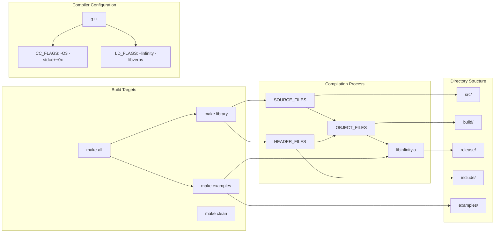

<!-- source: DeepWiki mcp.deepwiki.com · repo claudebarthels/infinity · page 8 Development · fetched 2026-11-11 -->

# Development

Relevant source files

The following files were used as context for generating this wiki page:

- [LICENSE.txt](LICENSE.txt)
- [Makefile](Makefile)

This page provides essential information for developers working on or with the Infinity RDMA library. It covers the development environment setup, code organization, build system, and contribution guidelines. For detailed build system information, see [Build System](#8.1). For licensing terms, see [License](#8.2).

## Development Environment

The Infinity library is designed for Linux systems with InfiniBand support. The development environment requires:

- **Compiler**: g++ with C++0x support
- **Dependencies**: InfiniBand Verbs library (`libverbs`)
- **Build Tools**: Make, ar (for static library creation)
- **Hardware**: InfiniBand network interface (for testing)

The library uses modern C++0x features and is optimized for performance with `-O3` optimization flags. Development should follow the existing code style and patterns established in the codebase.

Sources: [Makefile:15-17]()

## Code Organization

The Infinity library follows a modular architecture organized into distinct subsystems:

```mermaid
graph TB
    subgraph "Source Directory Structure"
        SrcRoot["src/infinity/"]
        
        subgraph "Core System"
            Context["core/Context.cpp"]
            Config["core/Configuration.h"]
        end
        
        subgraph "Memory Management"
            Atomic["memory/Atomic.cpp"]
            Buffer["memory/Buffer.cpp"]
            Region["memory/Region.cpp"]
            RegionToken["memory/RegionToken.cpp"]
            RegisteredMemory["memory/RegisteredMemory.cpp"]
            RegionType["memory/RegionType.h"]
        end
        
        subgraph "Communication Layer"
            QueuePair["queues/QueuePair.cpp"]
            QueuePairFactory["queues/QueuePairFactory.cpp"]
        end
        
        subgraph "Request Management"
            RequestToken["requests/RequestToken.cpp"]
        end
        
        subgraph "Utilities"
            Address["utils/Address.cpp"]
            Debug["utils/Debug.h"]
        end
        
        subgraph "Public API"
            MainHeader["infinity.h"]
        end
    end
    
    subgraph "Build Output"
        BuildDir["build/"]
        ReleaseDir["release/"]
        LibFile["libinfinity.a"]
    end
    
    subgraph "Examples"
        ReadWriteSend["examples/read-write-send.cpp"]
        SendPerformance["examples/send-performance.cpp"]
    end
    
    SrcRoot --> Context
    SrcRoot --> Config
    SrcRoot --> Atomic
    SrcRoot --> Buffer
    SrcRoot --> Region
    SrcRoot --> RegionToken
    SrcRoot --> RegisteredMemory
    SrcRoot --> QueuePair
    SrcRoot --> QueuePairFactory
    SrcRoot --> RequestToken
    SrcRoot --> Address
    SrcRoot --> MainHeader
    
    Context --> BuildDir
    BuildDir --> ReleaseDir
    ReleaseDir --> LibFile
    
    MainHeader --> ReadWriteSend
    MainHeader --> SendPerformance
```

The codebase maintains a clear separation between implementation files (`.cpp`) and headers (`.h`), with all public APIs accessible through the main `infinity.h` header file.

Sources: [Makefile:29-53]()

## Build System Architecture

The build system is designed for simplicity and modularity:

The build system supports incremental compilation and provides clean separation between source code, build artifacts, and release packages.

Sources: [Makefile:11-95]()

## Development Workflow

### Building the Library

The standard development workflow involves these make targets:

| Target | Purpose | Output |
|--------|---------|--------|
| `make library` | Build static library | `release/libinfinity.a` |
| `make examples` | Build example programs | `release/examples/` |
| `make all` | Build library and examples | Complete build |
| `make clean` | Remove build artifacts | Clean workspace |

### Object File Generation

The build system generates object files in the `build/` directory with the same structure as the source directory. Each source file is compiled with the include path set to the source root, allowing for consistent header inclusion patterns.

### Static Library Creation

The library is packaged as a static archive (`libinfinity.a`) using the `ar` utility. Header files are copied to the release directory and reorganized under an `include/` folder for distribution.

Sources: [Makefile:63-95]()

## Code Style and Patterns

### Header Organization

All public headers follow a consistent pattern:
- Class declarations in `.h` files
- Implementation in corresponding `.cpp` files
- Main API accessible through `infinity.h`

### Memory Management

The library employs RAII principles for managing InfiniBand resources:
- `Context` manages device context and protection domains
- `RegisteredMemory` handles memory region registration
- `Buffer` and `Region` provide high-level memory abstractions

### Error Handling

The library uses assertion-based error handling through the `Debug.h` utilities for development builds, with graceful degradation in release builds.

Sources: [Makefile:40-53]()

## Testing and Debugging

### Example Programs

The library provides two main example programs for testing and development:

1. **read-write-send**: Demonstrates basic RDMA operations
2. **send-performance**: Performance benchmarking tool

These examples serve as both documentation and integration tests for the library functionality.

### Debug Support

The `Debug.h` utility provides macros for:
- Assertions during development
- Logging and tracing capabilities
- Error reporting and diagnostics

Sources: [Makefile:91-92]()

## Contributing Guidelines

### Code Organization

When adding new functionality:
1. Place implementation files in the appropriate subsystem directory
2. Follow the existing naming conventions
3. Update the `Makefile` with new source files
4. Ensure headers are properly included in the header files list

### Dependencies

The library maintains minimal external dependencies:
- InfiniBand Verbs library (`libverbs`)
- Standard C++ library
- POSIX system calls for networking

New dependencies should be carefully evaluated and documented.

### Build Integration

New source files must be added to the `SOURCE_FILES` variable in the `Makefile`, and corresponding headers to the `HEADER_FILES` variable to ensure proper compilation and distribution.

Sources: [Makefile:29-38](), [Makefile:40-53]()

---

