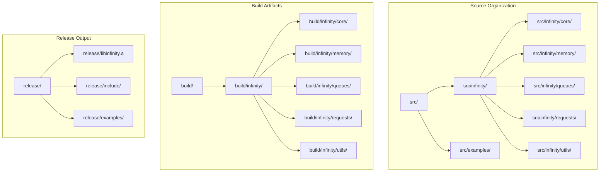
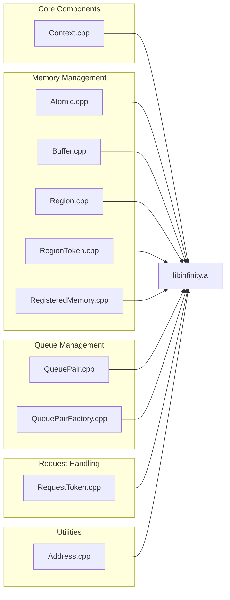
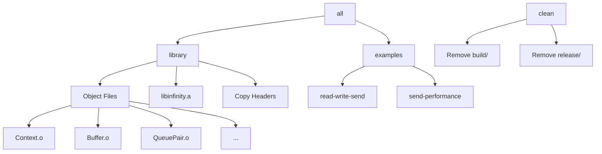
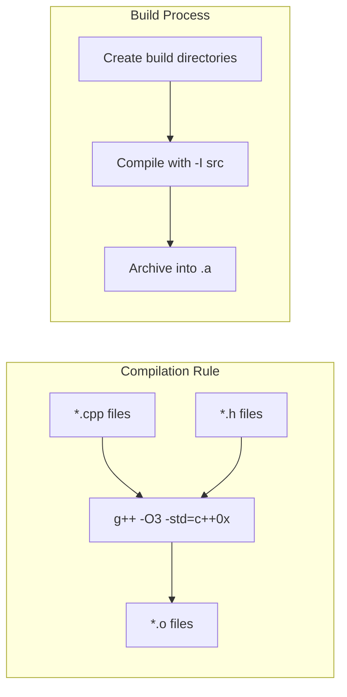

<!-- source: DeepWiki mcp.deepwiki.com · repo claudebarthels/infinity · page 8.1 Build System · fetched 2026-11-11 -->

# Build System

<details>
<summary>Relevant source files</summary>

The following files were used as context for generating this wiki page:

- [Makefile](Makefile)

</details>


The Infinity library uses a Makefile-based build system to compile the C++ RDMA library and example programs. This document covers the build configuration, targets, directory structure, and compilation process. The build system produces a static library (`libinfinity.a`) and executable examples for testing and demonstration.

For information about building and using the library, see [Building the Library](#2.1). For details on the project structure and API, see [Core Architecture](#3).

## Build Configuration

The build system is configured through variables defined at the top of the Makefile. The primary compiler is `g++` with C++11 support and optimization flags enabled.

### Compiler Settings

| Variable | Value | Purpose |
|----------|-------|---------|
| `CC` | `g++` | C++ compiler |
| `CC_FLAGS` | `-O3 -std=c++0x` | Optimization level 3, C++11 standard |
| `LD_FLAGS` | `-linfinity -libverbs` | Link against infinity and InfiniBand verbs libraries |
| `PROJECT_NAME` | `libinfinity` | Output library name |

The build system requires the InfiniBand verbs library (`libverbs`) as an external dependency, which provides the low-level RDMA functionality that Infinity abstracts.

Sources: [Makefile:15-17]()

## Directory Structure

The build system organizes files into a clear directory hierarchy that separates source code, build artifacts, and release outputs.



**Build Directory Structure**

The Makefile defines folder constants that organize the build process:

| Folder Variable | Path | Purpose |
|----------------|------|---------|
| `SOURCE_FOLDER` | `src` | Source code location |
| `BUILD_FOLDER` | `build` | Compiled object files |
| `RELEASE_FOLDER` | `release` | Final library and headers |
| `INCLUDE_FOLDER` | `include` | Header files for distribution |
| `EXAMPLES_FOLDER` | `examples` | Built example executables |

Sources: [Makefile:21-25]()

## Source Files and Headers

The build system explicitly lists all source files and headers to ensure complete compilation and proper dependency tracking.

### Source Files

The `SOURCE_FILES` variable defines all `.cpp` files that must be compiled:



**Source File Organization**

The source files are organized by functional area:
- **Core**: `Context.cpp` - Main resource management
- **Memory**: Five files handling memory registration and management
- **Queues**: `QueuePair.cpp` and `QueuePairFactory.cpp` for connections
- **Requests**: `RequestToken.cpp` for asynchronous operations
- **Utils**: `Address.cpp` for network utilities

Sources: [Makefile:29-38]()

### Header Files

The `HEADER_FILES` variable lists all headers that will be included in the distribution:

Key headers include:
- `infinity.h` - Main include file
- `Configuration.h` - System constants and settings
- `Debug.h` - Debug utilities
- `RegionType.h` - Memory region type definitions

Sources: [Makefile:40-53]()

## Build Targets

The Makefile provides several targets for different build scenarios and maintenance tasks.

### Primary Targets



**Target Descriptions**

| Target | Purpose | Dependencies |
|--------|---------|-------------|
| `all` | Build everything | `library`, `examples` |
| `library` | Create static library | Object files |
| `examples` | Build example programs | `library` |
| `clean` | Remove build artifacts | None |

Sources: [Makefile:63](), [Makefile:74-79](), [Makefile:89-92](), [Makefile:83-85]()

### Library Target

The `library` target creates the static library and prepares headers for distribution:

1. **Create Release Directory**: `mkdir -p $(RELEASE_FOLDER)`
2. **Archive Object Files**: `ar rvs $(RELEASE_FOLDER)/$(PROJECT_NAME).a $(OBJECT_FILES)`
3. **Copy Headers**: `cp --parents $(HEADER_FILES) $(RELEASE_FOLDER)`
4. **Reorganize Headers**: `mv $(RELEASE_FOLDER)/$(SOURCE_FOLDER)/ $(RELEASE_FOLDER)/$(INCLUDE_FOLDER)`

The final output is `release/libinfinity.a` with headers in `release/include/`.

Sources: [Makefile:74-79]()

### Examples Target

The `examples` target builds two demonstration programs:

1. **read-write-send**: Basic RDMA operations example
2. **send-performance**: Performance benchmarking tool

Both examples link against the static library and use the InfiniBand verbs library.

Sources: [Makefile:89-92]()

## Compilation Process

The build system uses pattern rules to compile source files into object files with proper dependency tracking.

### Object File Generation



**Compilation Command**

The pattern rule `$(BUILD_FOLDER)/%.o: $(SOURCE_FILES) $(HEADER_FILES)` compiles each source file:

```bash
$(CC) $(CC_FLAGS) -c $(SOURCE_FOLDER)/$*.cpp -I $(SOURCE_FOLDER) -o $(BUILD_FOLDER)/$*.o
```

This expands to:
```bash
g++ -O3 -std=c++0x -c src/path/to/file.cpp -I src -o build/path/to/file.o
```

The `-I src` flag ensures all headers can be found with their relative paths.

Sources: [Makefile:67-70]()

### Dependency Management

The build system ensures proper dependency tracking by:

1. **Explicit Dependencies**: All object files depend on both `$(SOURCE_FILES)` and `$(HEADER_FILES)`
2. **Directory Creation**: Build directories are created automatically using `mkdir -p`
3. **Clean Builds**: The `clean` target removes all build artifacts

This approach ensures that any header change triggers recompilation of all affected files.

Sources: [Makefile:57-59](), [Makefile:67-70]()

## Usage Examples

### Basic Build Commands

```bash
# Build everything (library + examples)
make all

# Build only the library
make library

# Build only examples (requires library)
make examples

# Clean all build artifacts
make clean
```

### Integration with Applications

After building, applications can link against the library:

```bash
# Compile application
g++ myapp.cpp -I release/include -L release -linfinity -libverbs -o myapp
```

The build system provides the necessary include path (`release/include`) and library file (`release/libinfinity.a`) for integration.

Sources: [Makefile:91-92]()

---

