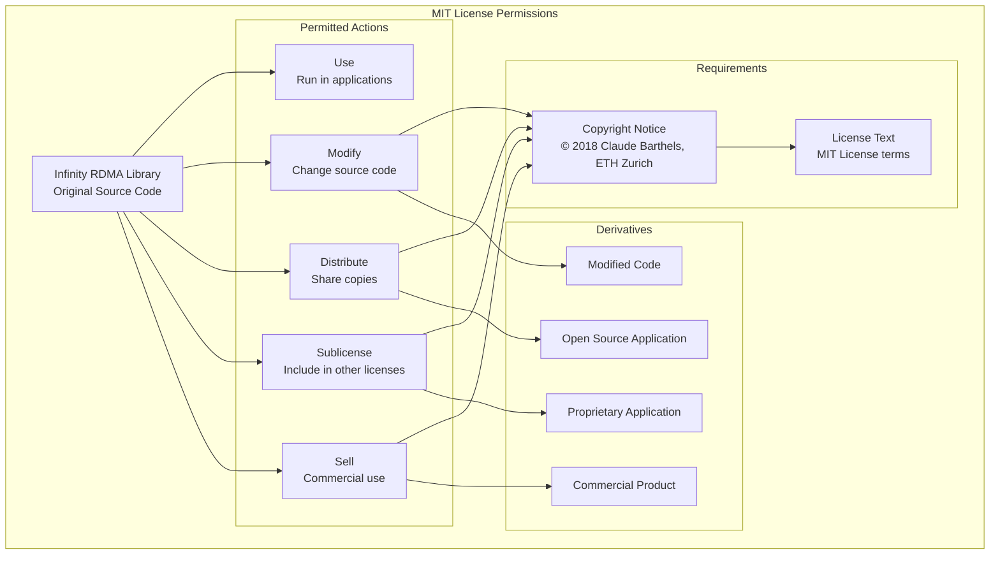
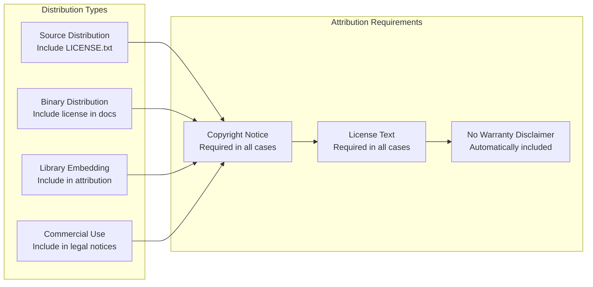

<!-- source: DeepWiki mcp.deepwiki.com · repo claudebarthels/infinity · page 8.2 License · fetched 2026-11-11 -->

# License

<details>
<summary>Relevant source files</summary>

The following files were used as context for generating this wiki page:

- [LICENSE.txt](LICENSE.txt)

</details>


This document provides the legal licensing terms and conditions for the Infinity RDMA library. It covers the copyright information, usage rights, distribution requirements, and liability disclaimers that apply to all users and developers of the library.

For information about the build system and development environment, see [Build System](#8.1).

## License Terms

The Infinity RDMA library is released under the MIT License, which is a permissive open-source license that allows for broad usage with minimal restrictions.

### Copyright and License Text

The complete license text is found in [LICENSE.txt:1-21]():

```
Copyright (c) 2018 Claude Barthels, ETH Zurich

Permission is hereby granted, free of charge, to any person obtaining a copy
of this software and associated documentation files (the "Software"), to deal
in the Software without restriction, including without limitation the rights
to use, copy, modify, merge, publish, distribute, sublicense, and/or sell
copies of the Software, and to permit persons to whom the Software is
furnished to do so, subject to the following conditions:

The above copyright notice and this permission notice shall be included in all
copies or substantial portions of the Software.

THE SOFTWARE IS PROVIDED "AS IS", WITHOUT WARRANTY OF ANY KIND, EXPRESS OR
IMPLIED, INCLUDING BUT NOT LIMITED TO THE WARRANTIES OF MERCHANTABILITY,
FITNESS FOR A PARTICULAR PURPOSE AND NONINFRINGEMENT. IN NO EVENT SHALL THE
AUTHORS OR COPYRIGHT HOLDERS BE LIABLE FOR ANY CLAIM, DAMAGES OR OTHER
LIABILITY, WHETHER IN AN ACTION OF CONTRACT, TORT OR OTHERWISE, ARISING FROM,
OUT OF OR IN CONNECTION WITH THE SOFTWARE OR THE USE OR OTHER DEALINGS IN THE
SOFTWARE.
```

**Sources:** [LICENSE.txt:1-21]()

## Usage Rights and Permissions

The MIT License grants users extensive rights to use, modify, and distribute the Infinity library:

| Permission | Description | Requirements |
|------------|-------------|--------------|
| **Use** | Run the software for any purpose | None |
| **Modify** | Change the source code | Include copyright notice |
| **Distribute** | Share copies of the software | Include copyright notice and license |
| **Sublicense** | Include in proprietary software | Include copyright notice |
| **Sell** | Commercialize the software | Include copyright notice |

### License Permissions Flow



**Sources:** [LICENSE.txt:4-9]()

## Attribution Requirements

The MIT License requires that the copyright notice and license text be included in all copies or substantial portions of the software. This applies to:

### Required Attribution Elements

1. **Copyright Notice**: `Copyright (c) 2018 Claude Barthels, ETH Zurich` from [LICENSE.txt:2]()
2. **License Permission Statement**: The full MIT License text from [LICENSE.txt:4-20]()

### Distribution Scenarios



**Sources:** [LICENSE.txt:11-12]()

## Warranty and Liability

The MIT License includes explicit warranty disclaimers and liability limitations:

### Warranty Disclaimer

The software is provided "AS IS" without warranty of any kind, including:
- **Express warranties**: No guarantees about functionality or performance
- **Implied warranties**: No warranties of merchantability or fitness for purpose
- **Non-infringement**: No guarantee that the software doesn't infringe third-party rights

### Liability Limitation

The copyright holders and contributors are not liable for:
- **Direct damages**: Immediate losses from using the software
- **Indirect damages**: Consequential or incidental damages
- **Contract claims**: Breach of contract allegations
- **Tort claims**: Negligence or other tort-based claims

This limitation applies regardless of the legal theory (contract, tort, or otherwise) as specified in [LICENSE.txt:16-20]().

**Sources:** [LICENSE.txt:14-20]()

## Practical Implications

### For Application Developers

When using the Infinity library in applications:
- Include the copyright notice and license in your application's legal documentation
- No need to release your application source code under MIT License
- Can distribute proprietary applications that use Infinity
- Must retain attribution even in modified versions

### For Library Distributors

When redistributing the Infinity library:
- Include the original `LICENSE.txt` file
- Maintain copyright notices in all source files
- Document any modifications made to the original code
- Ensure downstream users receive the same licensing rights

### For Commercial Users

The MIT License allows commercial use without restrictions:
- Can sell products containing the Infinity library
- Can modify the library for internal use
- Can create proprietary derivatives
- Only requirement is maintaining attribution

**Sources:** [LICENSE.txt:1-21]()