# Page: Overview

# Overview

<details>
<summary>Relevant source files</summary>

The following files were used as context for generating this wiki page:

- [README.md](README.md)
- [src/infinity/infinity.h](src/infinity/infinity.h)

</details>


This document provides an overview of the Infinity RDMA library, a C++ abstraction framework for InfiniBand Remote Direct Memory Access (RDMA) operations. This page covers the library's purpose, core architecture, and main components. For detailed information about building and using the library, see [Getting Started](#2). For comprehensive API documentation, see [API Reference](#7).

## Purpose and Scope

Infinity is a lightweight C++ library that provides a high-level, object-oriented abstraction over InfiniBand Verbs (ibVerbs). The library enables developers to build high-performance RDMA applications without dealing with the low-level complexities of the InfiniBand API. It supports both one-sided operations (read, write, atomic) and two-sided operations (send, receive) while maintaining the performance characteristics of native RDMA.

**Sources:** [README.md:1-3](), [src/infinity/infinity.h:1-7]()

## What is Infinity?

Infinity serves as a middleware layer between applications and the InfiniBand hardware, abstracting away the complexities of memory registration, queue pair management, and completion handling. The library is designed to significantly lower the barrier to RDMA programming while preserving the performance benefits of direct memory access.

The library provides:
- **Simplified API**: Object-oriented interface hiding ibVerbs complexity
- **Memory Management**: Automatic registration and region management
- **Connection Management**: Factory pattern for establishing RDMA connections
- **Request Tracking**: Asynchronous operation completion handling
- **Utilities**: Network address management and debugging support

**Sources:** [README.md:3-4](), [src/infinity/infinity.h:12-24]()

## Architecture Overview

The Infinity library follows a layered architecture where higher-level abstractions build upon lower-level InfiniBand primitives:

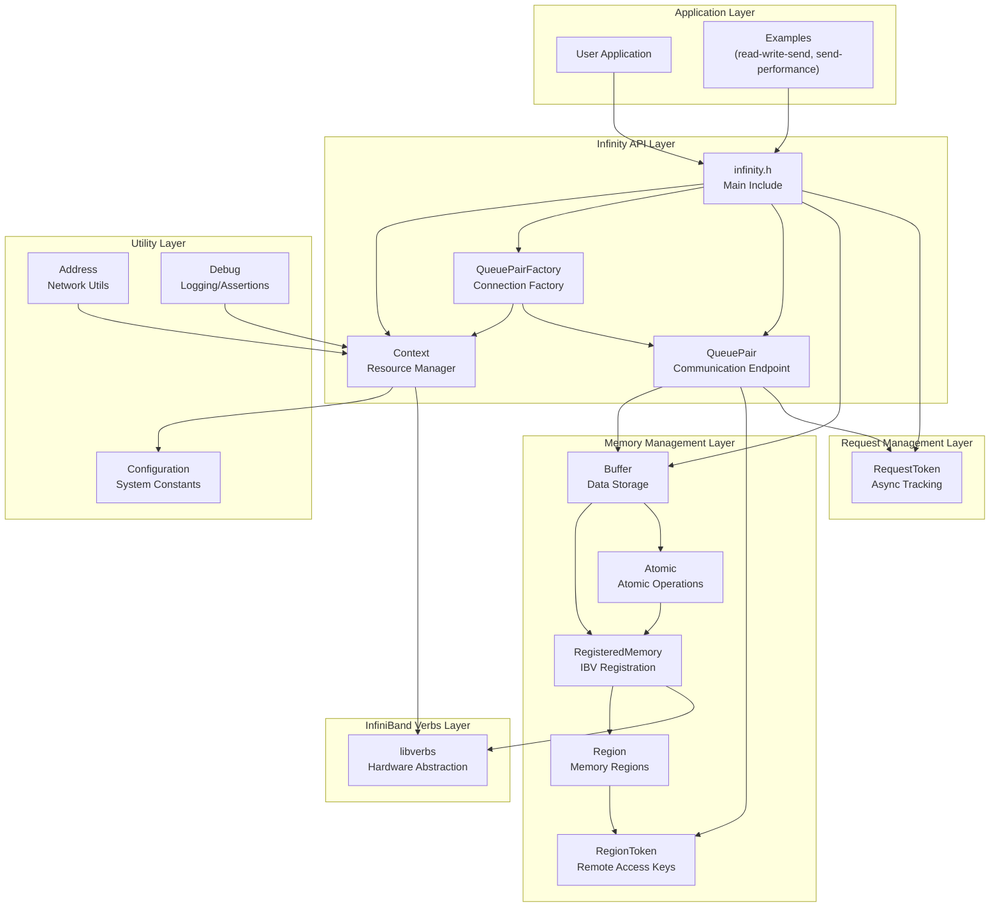

**Sources:** [src/infinity/infinity.h:12-24](), [README.md:17-23]()

## Core Components

The library consists of several key components organized into functional modules:

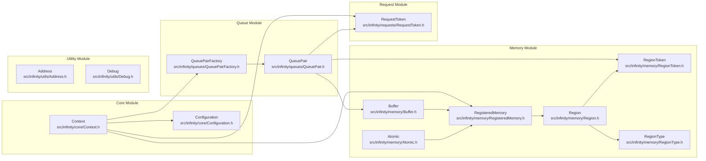

**Sources:** [src/infinity/infinity.h:12-24]()

## Key Components Description

| Component | Purpose | Key Functionality |
|-----------|---------|------------------|
| `Context` | Central resource manager | Manages InfiniBand context, protection domain, completion queues |
| `QueuePairFactory` | Connection establishment | Creates and manages RDMA connections to remote hosts |
| `QueuePair` | Communication endpoint | Performs RDMA operations (read, write, send, atomic) |
| `Buffer` | Memory management | High-level wrapper for registered memory regions |
| `RegionToken` | Remote access handle | Provides remote memory access credentials |
| `RequestToken` | Asynchronous tracking | Tracks completion of RDMA operations |
| `RegisteredMemory` | IBV integration | Handles InfiniBand memory registration |

**Sources:** [src/infinity/infinity.h:12-24]()

## Basic Usage Pattern

The typical usage pattern involves creating a context, establishing connections, registering memory, and performing RDMA operations:

```cpp
// Create context and establish connection
infinity::core::Context *context = new infinity::core::Context();
infinity::queues::QueuePairFactory *qpFactory = new infinity::queues::QueuePairFactory(context);
infinity::queues::QueuePair *qp = qpFactory->connectToRemoteHost(SERVER_IP, PORT_NUMBER);

// Register memory and perform operations
infinity::memory::Buffer *localBuffer = new infinity::memory::Buffer(context, BUFFER_SIZE);
infinity::memory::RegionToken *remoteBufferToken = new infinity::memory::RegionToken(REMOTE_BUFFER_INFO);
infinity::requests::RequestToken requestToken(context);

// Execute RDMA operations
qp->read(localBuffer, remoteBufferToken, &requestToken);
requestToken.waitUntilCompleted();
```

**Sources:** [README.md:17-44]()

## Operation Types

Infinity supports two categories of RDMA operations:

| Operation Type | Description | Components Used |
|---------------|-------------|-----------------|
| **One-sided** | Direct memory access without remote CPU involvement | `QueuePair::read()`, `QueuePair::write()`, `QueuePair::atomic()` |
| **Two-sided** | Message passing requiring remote participation | `QueuePair::send()`, `QueuePair::receive()` |

**Sources:** [README.md:3](), [README.md:31-42]()

## Performance Characteristics

The library is designed to maintain the performance characteristics of native RDMA while providing a simplified programming interface. It achieves this through:

- **Zero-copy operations**: Direct memory access without data copying
- **Asynchronous processing**: Non-blocking operation completion
- **Efficient memory registration**: Optimized memory region management
- **Minimal overhead**: Thin abstraction layer over ibVerbs

**Sources:** [README.md:3-4]()

---

# Page: Getting Started

# Getting Started

<details>
<summary>Relevant source files</summary>

The following files were used as context for generating this wiki page:

- [Makefile](Makefile)
- [src/examples/read-write-send.cpp](src/examples/read-write-send.cpp)

</details>


This page provides a practical introduction to building and using the Infinity RDMA library. It covers the essential steps to compile the library, understand its basic architecture, and run your first RDMA application.

The Infinity library is a C++ framework that provides high-level abstractions over InfiniBand Verbs for RDMA (Remote Direct Memory Access) operations. This page focuses on the practical aspects of getting started with development. For detailed information about the underlying architecture, see [Core Architecture](#3). For comprehensive API documentation, see [API Reference](#7).

## Prerequisites

Before building the Infinity library, ensure you have:

- A C++ compiler supporting C++0x standard (g++ recommended)
- InfiniBand development libraries (`libverbs`)
- Make build system
- InfiniBand hardware or software simulation environment

## Building the Library

The Infinity library uses a straightforward Makefile-based build system. The build process creates both a static library and example programs.

### Build Targets

The build system provides several targets:

| Target | Description | Output |
|--------|-------------|---------|
| `library` | Builds the static library | `release/libinfinity.a` |
| `examples` | Compiles example programs | `release/examples/` |
| `all` | Builds both library and examples | Complete build |
| `clean` | Removes build artifacts | Cleans build directories |

### Build Process

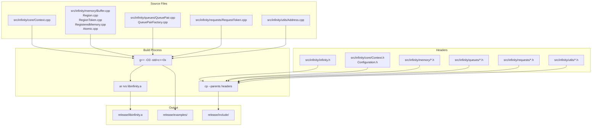

### Build Commands

To build the library:

```bash
make library
```

To build the examples:

```bash
make examples
```

To build everything:

```bash
make all
```

Sources: [Makefile:1-95]()

## Basic Usage Example

The `read-write-send.cpp` example demonstrates the fundamental RDMA operations supported by Infinity. This example implements a client-server pattern where the client performs read, write, and send operations on the server.

### Application Architecture

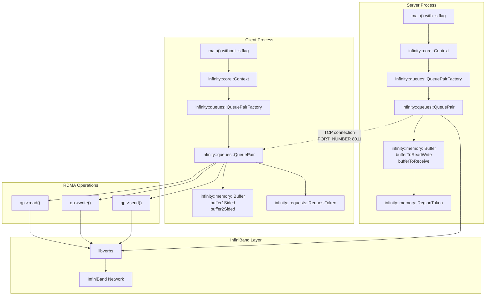

### Server Implementation

The server side performs these key operations:

1. **Context Initialization**: Creates the `infinity::core::Context` to manage InfiniBand resources
2. **Buffer Setup**: Allocates memory buffers for RDMA operations
3. **Connection Listening**: Binds to port 8011 and waits for incoming connections
4. **Message Reception**: Posts receive buffers and waits for incoming messages

Key server code sections:
- Context creation: [src/examples/read-write-send.cpp:44]()
- Buffer allocation: [src/examples/read-write-send.cpp:51-52]()
- Connection setup: [src/examples/read-write-send.cpp:59-60]()
- Message reception: [src/examples/read-write-send.cpp:63-64]()

### Client Implementation

The client side demonstrates the three primary RDMA operations:

1. **Connection Establishment**: Connects to the server using TCP handshake
2. **Remote Read**: Reads data from the server's memory buffer
3. **Remote Write**: Writes data to the server's memory buffer  
4. **Message Send**: Sends a message using two-sided operations

Key client code sections:
- Connection: [src/examples/read-write-send.cpp:73-74]()
- Read operation: [src/examples/read-write-send.cpp:82-84]()
- Write operation: [src/examples/read-write-send.cpp:86-88]()
- Send operation: [src/examples/read-write-send.cpp:90-92]()

### Running the Example

To run the basic example:

1. Start the server:
```bash
./release/examples/read-write-send -s
```

2. Start the client:
```bash
./release/examples/read-write-send
```

The server will display connection status and wait for the client message, while the client will perform the read, write, and send operations sequentially.

Sources: [src/examples/read-write-send.cpp:1-105]()

## Core Programming Pattern

The Infinity library follows a consistent programming pattern across all RDMA operations:

### Resource Management Flow

```mermaid
graph LR
    subgraph "Initialization"
        CreateContext["new Context()"]
        CreateFactory["new QueuePairFactory(context)"]
        CreateBuffers["new Buffer(context, size)"]
    end
    
    subgraph "Connection"
        ServerBind["bindToPort(PORT_NUMBER)"]
        ServerAccept["acceptIncomingConnection()"]
        ClientConnect["connectToRemoteHost()"]
    end
    
    subgraph "Operations"
        CreateToken["RequestToken(context)"]
        CallOperation["qp->read/write/send()"]
        WaitCompletion["requestToken.waitUntilCompleted()"]
    end
    
    subgraph "Cleanup"
        DeleteBuffers["delete buffers"]
        DeleteQP["delete qp"]
        DeleteFactory["delete qpFactory"]
        DeleteContext["delete context"]
    end
    
    CreateContext --> CreateFactory
    CreateFactory --> CreateBuffers
    CreateBuffers --> ServerBind
    CreateBuffers --> ClientConnect
    
    ServerBind --> ServerAccept
    ClientConnect --> CreateToken
    ServerAccept --> CreateToken
    
    CreateToken --> CallOperation
    CallOperation --> WaitCompletion
    WaitCompletion --> DeleteBuffers
    
    DeleteBuffers --> DeleteQP
    DeleteQP --> DeleteFactory
    DeleteFactory --> DeleteContext
```

### Memory Management

All RDMA operations require properly registered memory buffers:

- `Buffer` objects automatically handle InfiniBand memory registration
- `RegionToken` objects provide remote access handles for one-sided operations
- `RequestToken` objects track asynchronous operation completion

Sources: [src/examples/read-write-send.cpp:44-104]()

## Next Steps

After successfully building and running the basic example, you can:

1. **Explore Performance**: Run the performance testing example as described in [Performance Testing](#2.3)
2. **Understand Architecture**: Learn about the core components in [Core Architecture](#3)
3. **Memory Management**: Dive deeper into memory handling in [Memory Management](#4)
4. **Advanced Operations**: Explore atomic operations and advanced patterns in [Atomic Operations](#4.4)

The `read-write-send.cpp` example provides a foundation for understanding how to use the Infinity library. All production applications will follow similar patterns of context creation, connection establishment, buffer management, and operation execution.

Sources: [Makefile:89-93]()

---

# Page: Building the Library

# Building the Library

<details>
<summary>Relevant source files</summary>

The following files were used as context for generating this wiki page:

- [.gitignore](.gitignore)
- [Makefile](Makefile)

</details>


This document explains how to compile and build the Infinity library from source code. It covers the build system architecture, available build targets, and the compilation process that produces the static library and example programs.

For information about configuring and using the library after building, see [Basic Usage Example](#2.2). For detailed build system internals and development setup, see [Build System](#8.1).

## Prerequisites

The Infinity library requires the following dependencies to build:

- **C++ Compiler**: g++ with C++11 support (std=c++0x)
- **InfiniBand Verbs**: libverbs development libraries
- **Build Tools**: make utility
- **System**: POSIX-compatible environment

The build system uses specific compiler flags defined in [Makefile:16]():
- `-O3`: Optimization level 3 for performance
- `-std=c++0x`: C++11 standard support

## Build Process Overview

The build process follows a standard compile-link-archive pattern:

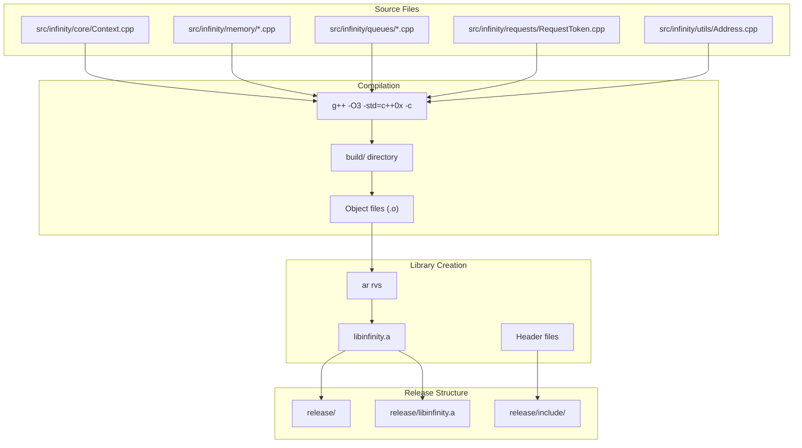

*Build Process Flow*

Sources: [Makefile:67-80]()

## Available Build Targets

The Makefile provides several build targets accessible through the `make` command:

| Target | Description | Output |
|--------|-------------|---------|
| `all` | Default target, builds library and examples | Static library + example binaries |
| `library` | Builds only the static library | `release/libinfinity.a` |
| `examples` | Builds example programs | `release/examples/` binaries |
| `clean` | Removes build artifacts | Cleans `build/` and `release/` |

### Library Target

The `library` target creates the static library through these steps:

1. **Compilation**: Source files are compiled to object files in `build/`
2. **Archiving**: Object files are archived into `release/libinfinity.a`
3. **Header Installation**: Header files are copied to `release/include/`

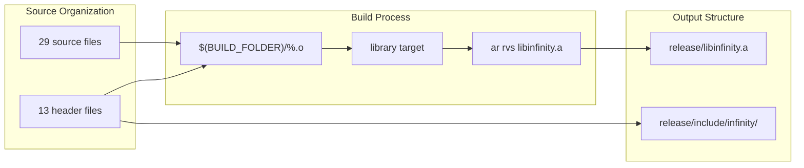

*Library Build Target Process*

Sources: [Makefile:74-80]()

### Examples Target

The `examples` target compiles demonstration programs that link against the library:

- **read-write-send**: Basic RDMA operations example
- **send-performance**: Performance benchmarking tool

The examples are compiled with linking flags `-linfinity -libverbs` and use the headers from `release/include/`.

Sources: [Makefile:89-93]()

## Build System Architecture

The build system is organized around several key directory structures and file patterns:

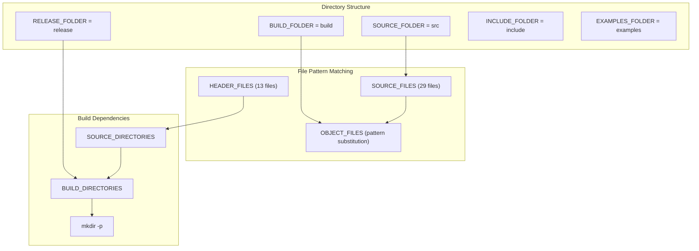

*Build System Directory and File Organization*

The build system uses pattern substitution to convert source paths to object file paths:
- Source: `$(SOURCE_FOLDER)/%.cpp`
- Object: `$(BUILD_FOLDER)/%.o`

Sources: [Makefile:21-26](), [Makefile:57-60]()

## Source File Organization

The library consists of source files organized by functional component:

```mermaid
graph TB
    subgraph "Core Components"
        CoreContext["infinity/core/Context.cpp"]
    end
    
    subgraph "Memory Management"
        MemAtomic["infinity/memory/Atomic.cpp"]
        MemBuffer["infinity/memory/Buffer.cpp"]
        MemRegion["infinity/memory/Region.cpp"]
        MemRegionToken["infinity/memory/RegionToken.cpp"]
        MemRegistered["infinity/memory/RegisteredMemory.cpp"]
    end
    
    subgraph "Queue Operations"
        QueuePair["infinity/queues/QueuePair.cpp"]
        QueueFactory["infinity/queues/QueuePairFactory.cpp"]
    end
    
    subgraph "Request Management"
        RequestToken["infinity/requests/RequestToken.cpp"]
    end
    
    subgraph "Utilities"
        UtilsAddress["infinity/utils/Address.cpp"]
    end
    
    subgraph "Compilation Target"
        LibInfinity["libinfinity.a"]
    end
    
    CoreContext --> LibInfinity
    MemAtomic --> LibInfinity
    MemBuffer --> LibInfinity
    MemRegion --> LibInfinity
    MemRegionToken --> LibInfinity
    MemRegistered --> LibInfinity
    QueuePair --> LibInfinity
    QueueFactory --> LibInfinity
    RequestToken --> LibInfinity
    UtilsAddress --> LibInfinity
```

*Source File to Library Mapping*

Sources: [Makefile:29-38]()

## Output Structure

After successful compilation, the `release/` directory contains:

```
release/
├── libinfinity.a          # Static library
├── include/               # Header files
│   └── infinity/
│       ├── infinity.h     # Main include
│       ├── core/
│       ├── memory/
│       ├── queues/
│       ├── requests/
│       └── utils/
└── examples/              # Example binaries (if built)
    ├── read-write-send
    └── send-performance
```

The header files are copied from `src/` to `release/include/` maintaining the directory structure for proper include paths.

## Dependencies and Linking

Applications using the library must link against:
- **libinfinity**: The compiled static library
- **libverbs**: InfiniBand Verbs library

The linking flags are defined as `LD_FLAGS = -linfinity -libverbs` in [Makefile:17]().

## Building the Library

To build the library:

```bash
# Build library only
make library

# Build library and examples
make all

# Build examples only (requires library to be built first)
make examples

# Clean build artifacts
make clean
```

The build process automatically creates necessary directories and handles dependencies between source files and headers.

Sources: [Makefile:63](), [Makefile:74-80](), [Makefile:89-93](), [Makefile:83-85]()

---

# Page: Basic Usage Example

# Basic Usage Example

<details>
<summary>Relevant source files</summary>

The following files were used as context for generating this wiki page:

- [src/examples/read-write-send.cpp](src/examples/read-write-send.cpp)

</details>


This page demonstrates the basic usage patterns of the Infinity RDMA library through a comprehensive example that showcases read, write, and send operations. The example illustrates both server-side and client-side implementations, covering one-sided RDMA operations (read/write) and two-sided operations (send/receive).

For information about building the library, see [Building the Library](#2.1). For performance testing and optimization, see [Performance Testing](#2.3). For detailed API documentation, see [API Reference](#7).

## Example Program Structure

The basic usage example is implemented in a single program that can operate as either a server or client based on command-line arguments. The program demonstrates the complete lifecycle of RDMA operations from connection setup to data transfer.

### Program Components and Classes

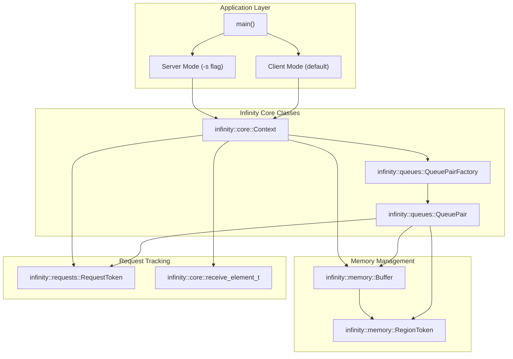

**Sources:** [src/examples/read-write-send.cpp:1-105]()

## Server-Side Operations

The server component demonstrates how to set up memory regions, accept connections, and receive messages. The server creates buffers for both one-sided operations (read/write) and two-sided operations (receive).

### Server Initialization and Setup

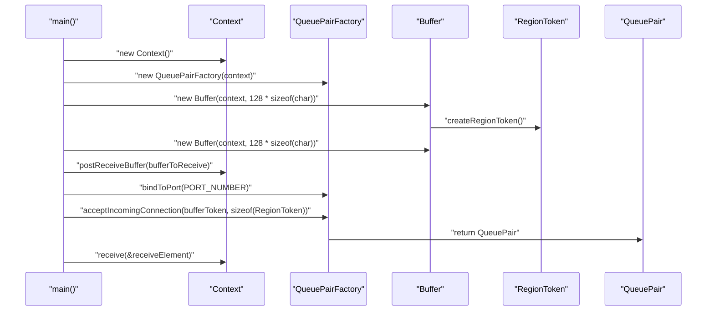

**Sources:** [src/examples/read-write-send.cpp:44-68]()

### Server Memory Management

| Buffer Type | Purpose | Size | Usage |
|-------------|---------|------|-------|
| `bufferToReadWrite` | Target for remote read/write operations | 128 bytes | Creates `RegionToken` for remote access |
| `bufferToReceive` | Destination for incoming messages | 128 bytes | Posted to receive queue |

The server creates two distinct buffers:
- A buffer for one-sided operations that gets exposed to the client via `RegionToken`
- A buffer for two-sided receive operations that gets posted to the receive queue

**Sources:** [src/examples/read-write-send.cpp:50-56]()

## Client-Side Operations

The client component demonstrates how to connect to a remote host and perform all three types of RDMA operations: read, write, and send. All operations use `RequestToken` for asynchronous completion tracking.

### Client Connection and Operation Flow

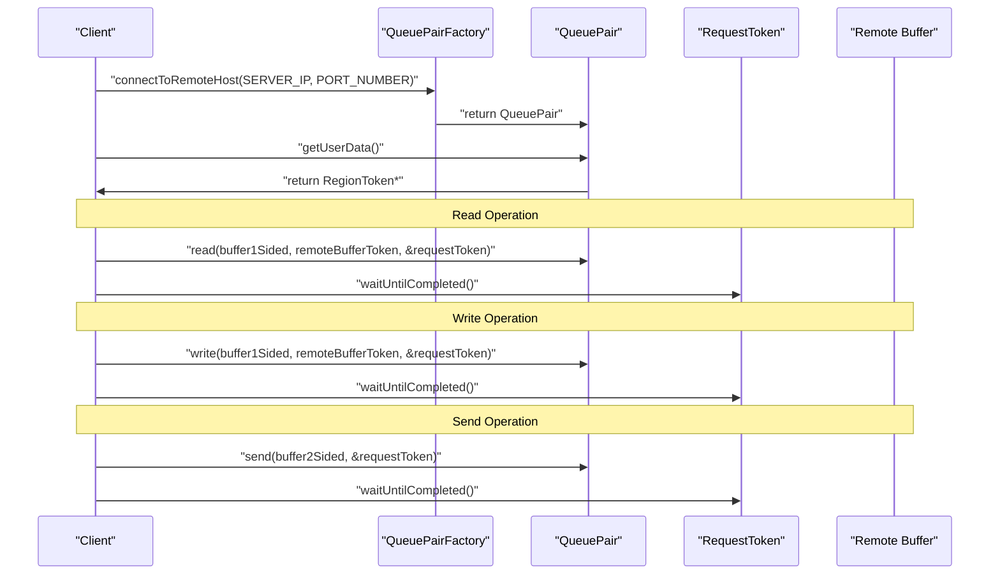

**Sources:** [src/examples/read-write-send.cpp:72-96]()

### Client Buffer Allocation

The client creates two separate buffers to demonstrate different operation types:

| Buffer | Purpose | Operations |
|--------|---------|------------|
| `buffer1Sided` | One-sided RDMA operations | `read()`, `write()` |
| `buffer2Sided` | Two-sided operations | `send()` |

**Sources:** [src/examples/read-write-send.cpp:78-79]()

## Key RDMA Operations

### One-Sided Operations

One-sided operations (`read` and `write`) operate directly on remote memory without involving the remote CPU. These operations require a `RegionToken` to specify the remote memory location.

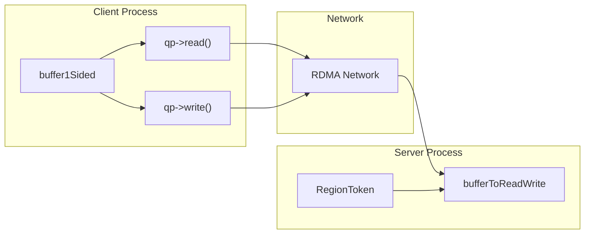

**Sources:** [src/examples/read-write-send.cpp:81-88]()

### Two-Sided Operations

Two-sided operations (`send` and `receive`) require participation from both the sender and receiver. The receiver must post receive buffers before the sender can send messages.

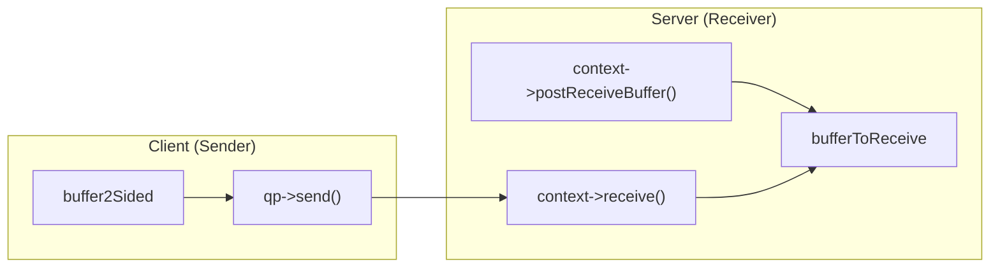

**Sources:** [src/examples/read-write-send.cpp:56-64](), [src/examples/read-write-send.cpp:90-92]()

## Request Completion Handling

All RDMA operations in the example use `RequestToken` for asynchronous completion tracking. This pattern allows for non-blocking operation initiation followed by explicit completion waiting.

### RequestToken Usage Pattern

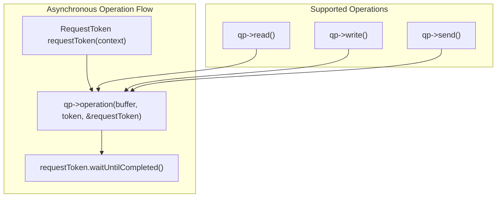

**Sources:** [src/examples/read-write-send.cpp:82-92]()

## Connection Management

The example demonstrates the complete connection lifecycle using `QueuePairFactory`:

### Server Connection Setup
1. Create `QueuePairFactory` instance
2. Bind to port using `bindToPort(PORT_NUMBER)`
3. Accept incoming connections with `acceptIncomingConnection()`
4. Exchange connection metadata (RegionToken)

### Client Connection Setup
1. Create `QueuePairFactory` instance
2. Connect to remote host using `connectToRemoteHost(SERVER_IP, PORT_NUMBER)`
3. Retrieve connection metadata using `getUserData()`

**Sources:** [src/examples/read-write-send.cpp:59-74]()

## Resource Management

The example demonstrates proper resource cleanup by explicitly deleting all allocated objects in the correct order:

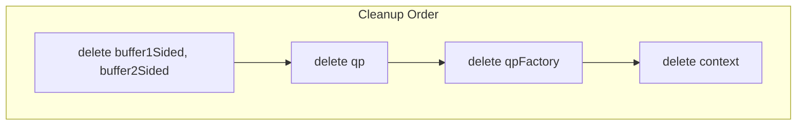

**Sources:** [src/examples/read-write-send.cpp:67-68](), [src/examples/read-write-send.cpp:94-101]()

---

# Page: Performance Testing

# Performance Testing

<details>
<summary>Relevant source files</summary>

The following files were used as context for generating this wiki page:

- [src/examples/send-performance.cpp](src/examples/send-performance.cpp)

</details>


## Purpose and Scope

This document explains how to use the Infinity library's performance testing capabilities to measure and optimize RDMA communication performance. The primary tool for performance testing is the `send-performance` example program, which measures message throughput and bandwidth across various message sizes using two-sided communication operations.

For information about basic usage patterns, see [Basic Usage Example](#2.2). For detailed information about the QueuePair operations being tested, see [QueuePair Operations](#3.2).

## Overview

The performance testing framework provides a client-server benchmark that measures send operation performance across different message sizes. The test systematically evaluates both message rate (messages per second) and bandwidth (MB/sec) to help identify optimal configurations for specific use cases.

## Test Structure

### Client-Server Architecture

The performance test operates as a client-server application where the client sends messages and measures performance while the server receives messages and provides synchronization feedback.

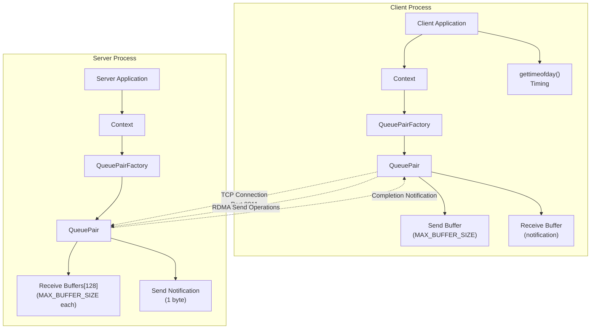

Sources: [src/examples/send-performance.cpp:51-66](), [src/examples/send-performance.cpp:109-115]()

### Configuration Constants

The performance test uses several key configuration parameters that can be modified to adjust test behavior:

| Parameter | Value | Purpose |
|-----------|-------|---------|
| `PORT_NUMBER` | 8011 | TCP port for initial connection |
| `SERVER_IP` | "192.0.0.1" | Server IP address (modify for remote testing) |
| `BUFFER_COUNT` | 128 | Number of pre-posted receive buffers |
| `MAX_BUFFER_SIZE` | 4096 | Maximum message size in bytes |
| `OPERATIONS_COUNT` | 1024 | Number of operations per message size |

Sources: [src/examples/send-performance.cpp:23-27]()

## Running the Performance Test

### Server Mode

Start the server component using the `-s` flag:

```bash
./send-performance -s
```

The server will:
1. Create receive buffers and post them to the shared receive queue
2. Bind to the specified port and wait for incoming connections
3. Accept the client connection and establish the queue pair
4. Receive messages across all test iterations
5. Send a completion notification to the client

### Client Mode

Start the client component without flags:

```bash
./send-performance
```

The client will:
1. Connect to the server at the specified IP and port
2. Create send and receive buffers
3. Send an initial warmup message
4. Execute the performance measurement loop
5. Wait for server completion notification

## Performance Measurement Process

### Message Size Progression

The test measures performance across exponentially increasing message sizes, starting from 1 byte and doubling until reaching `MAX_BUFFER_SIZE`:

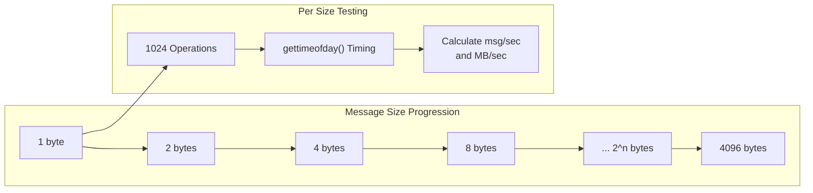

Sources: [src/examples/send-performance.cpp:75-91](), [src/examples/send-performance.cpp:122-158]()

### Measurement Algorithm

The client implements a precise timing mechanism to measure send performance:

1. **Warmup Phase**: Send an initial message to establish the connection and warm up the pipeline
2. **Measurement Loop**: For each message size, send `OPERATIONS_COUNT` messages with timing
3. **Synchronization**: Use `RequestToken` for flow control every `BUFFER_COUNT` messages
4. **Metric Calculation**: Compute message rate and bandwidth from elapsed time

The key measurement code uses `gettimeofday()` for microsecond precision timing:

```cpp
struct timeval start, stop;
gettimeofday(&start, NULL);
// Send operations
gettimeofday(&stop, NULL);
uint64_t time = timeDiff(stop, start);
```

Sources: [src/examples/send-performance.cpp:130-150](), [src/examples/send-performance.cpp:176-178]()

## Flow Control and Buffering

### Request Token Management

The test implements intelligent flow control to prevent overwhelming the receive side while maintaining high performance:

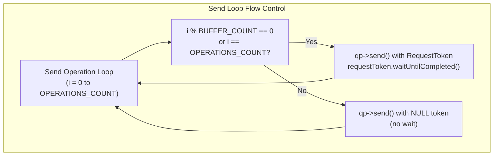

Sources: [src/examples/send-performance.cpp:133-145]()

### Buffer Management

The server pre-posts multiple receive buffers to ensure continuous message reception without blocking:

- **Receive Buffer Pool**: 128 buffers of `MAX_BUFFER_SIZE` each
- **Buffer Recycling**: Completed receive buffers are immediately re-posted
- **Flow Control**: Buffer count matches client-side flow control intervals

Sources: [src/examples/send-performance.cpp:57-62](), [src/examples/send-performance.cpp:85-88]()

## Performance Metrics

### Message Rate Calculation

Message rate is calculated as operations per second:

```
msgRate = (OPERATIONS_COUNT * 1,000,000) / time_in_microseconds
```

### Bandwidth Calculation

Bandwidth is calculated as effective data transfer rate:

```
bandwidth = (OPERATIONS_COUNT * messageSize) / (1024 * 1024) / (time_in_seconds)
```

### Output Format

The test outputs results in a tabular format for each message size:

```
Sending messages of size X bytes    Y.XXX msg/sec    Z.XXX MB/sec
```

Sources: [src/examples/send-performance.cpp:151-153]()

## Interpreting Results

### Performance Characteristics

- **Small Messages**: High message rates but low bandwidth due to protocol overhead
- **Large Messages**: Lower message rates but higher bandwidth due to payload efficiency
- **Optimal Point**: The message size that provides the best balance for your application

### System Factors

Performance results are influenced by:
- **Network Hardware**: InfiniBand adapter capabilities and link speed
- **CPU Performance**: Message processing and memory copy overhead
- **Memory Bandwidth**: Buffer allocation and data movement costs
- **System Load**: Competing processes and interrupt handling

### Troubleshooting

Common issues and solutions:
- **Low Performance**: Verify InfiniBand link is active and properly configured
- **Connection Failures**: Check firewall settings and network connectivity
- **Memory Issues**: Ensure sufficient memory for buffer allocation
- **Timing Inconsistencies**: Run multiple iterations and average results

Sources: [src/examples/send-performance.cpp:1-179]()

---

# Page: Core Architecture

# Core Architecture

<details>
<summary>Relevant source files</summary>

The following files were used as context for generating this wiki page:

- [src/infinity/core/Configuration.h](src/infinity/core/Configuration.h)
- [src/infinity/core/Context.cpp](src/infinity/core/Context.cpp)
- [src/infinity/queues/QueuePair.cpp](src/infinity/queues/QueuePair.cpp)
- [src/infinity/queues/QueuePair.h](src/infinity/queues/QueuePair.h)

</details>


This document explains the fundamental architecture and design principles of the Infinity RDMA library. It covers the core components that provide the foundation for all RDMA operations, including resource management, communication endpoints, and the abstraction layer over InfiniBand Verbs.

For specific details about memory management, see [Memory Management](#4). For connection establishment procedures, see [Connection Management](#3.3). For detailed API documentation, see [API Reference](#7).

## Architecture Overview

The Infinity library follows a layered architecture that abstracts InfiniBand Verbs complexity while maintaining high performance. The core consists of three primary components working together to provide RDMA functionality.

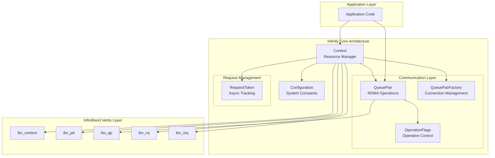

Sources: [src/infinity/core/Context.cpp:1-225](), [src/infinity/queues/QueuePair.cpp:1-590](), [src/infinity/core/Configuration.h:1-55]()

## Core Components

The core architecture consists of several key components that work together to provide RDMA functionality:

| Component | Class | Purpose | Key Methods |
|-----------|-------|---------|-------------|
| Resource Manager | `infinity::core::Context` | Manages InfiniBand resources and device context | `postReceiveBuffer()`, `receive()`, `pollSendCompletionQueue()` |
| Communication Endpoint | `infinity::queues::QueuePair` | Handles RDMA operations and queue pair management | `send()`, `write()`, `read()`, `activate()` |
| Configuration | `infinity::core::Configuration` | Defines system constants and limits | Static constants for queue lengths and limits |
| Operation Control | `infinity::queues::OperationFlags` | Controls operation behavior flags | `ibvFlags()` |

Sources: [src/infinity/core/Context.cpp:31-74](), [src/infinity/queues/QueuePair.cpp:38-75](), [src/infinity/core/Configuration.h:17-49]()

## Context Resource Management

The `Context` class serves as the central resource manager, initializing and managing all InfiniBand resources. It abstracts the complexity of InfiniBand device management and provides a unified interface for resource allocation.

```mermaid
graph TB
    subgraph "Context Initialization Flow"
        DeviceList["ibv_get_device_list()"]
        OpenDevice["ibv_open_device()"]
        ProtectionDomain["ibv_alloc_pd()"]
        CompletionQueues["ibv_create_cq()"]
        SharedReceiveQueue["ibv_create_srq()"]
        DefaultObjects["Default RequestToken & Atomic"]
    end
    
    subgraph "Context Resources"
        IBVContext["ibvContext<br/>Device Context"]
        IBVProtectionDomain["ibvProtectionDomain<br/>Memory Protection"]
        IBVSendCQ["ibvSendCompletionQueue<br/>Send Completions"]
        IBVRecvCQ["ibvReceiveCompletionQueue<br/>Receive Completions"]
        IBVSRQ["ibvSharedReceiveQueue<br/>Shared Receives"]
        QPMap["queuePairMap<br/>QP Registry"]
    end
    
    DeviceList --> OpenDevice
    OpenDevice --> ProtectionDomain
    ProtectionDomain --> CompletionQueues
    CompletionQueues --> SharedReceiveQueue
    SharedReceiveQueue --> DefaultObjects
    
    OpenDevice --> IBVContext
    ProtectionDomain --> IBVProtectionDomain
    CompletionQueues --> IBVSendCQ
    CompletionQueues --> IBVRecvCQ
    SharedReceiveQueue --> IBVSRQ
    DefaultObjects --> QPMap
```

The Context constructor initializes InfiniBand resources in a specific order, ensuring proper dependency management between components.

Sources: [src/infinity/core/Context.cpp:31-74](), [src/infinity/core/Context.h:1-100]()

## QueuePair Architecture

The `QueuePair` class implements the primary communication interface, providing methods for all RDMA operations. It maintains state for connection management and operation execution.

```mermaid
graph TB
    subgraph "QueuePair Lifecycle"
        Constructor["QueuePair(context)<br/>Create IBV QP"]
        InitState["IBV_QPS_INIT<br/>Set port and access flags"]
        RTRState["IBV_QPS_RTR<br/>Ready to Receive"]
        RTSState["IBV_QPS_RTS<br/>Ready to Send"]
        ActiveQP["Active QueuePair<br/>Ready for operations"]
    end
    
    subgraph "Operation Categories"
        TwoSided["Two-sided Operations<br/>send(), sendWithImmediate()"]
        OneSided["One-sided Operations<br/>write(), read()"]
        Atomic["Atomic Operations<br/>compareAndSwap(), fetchAndAdd()"]
        Complex["Complex Operations<br/>multiWrite(), multiWriteWithImmediate()"]
    end
    
    subgraph "InfiniBand Integration"
        IBVWorkRequest["ibv_send_wr<br/>Work Request"]
        IBVScatterGather["ibv_sge<br/>Scatter-Gather Element"]
        IBVPostSend["ibv_post_send()<br/>Submit Operation"]
    end
    
    Constructor --> InitState
    InitState --> RTRState
    RTRState --> RTSState
    RTSState --> ActiveQP
    
    ActiveQP --> TwoSided
    ActiveQP --> OneSided
    ActiveQP --> Atomic
    ActiveQP --> Complex
    
    TwoSided --> IBVWorkRequest
    OneSided --> IBVWorkRequest
    Atomic --> IBVWorkRequest
    Complex --> IBVWorkRequest
    
    IBVWorkRequest --> IBVScatterGather
    IBVScatterGather --> IBVPostSend
```

The QueuePair follows the InfiniBand state machine, transitioning through INIT, RTR (Ready to Receive), and RTS (Ready to Send) states before becoming operational.

Sources: [src/infinity/queues/QueuePair.cpp:38-123](), [src/infinity/queues/QueuePair.h:44-153]()

## Operation Flow Architecture

RDMA operations follow a consistent pattern from initiation to completion, involving work request creation, submission, and completion handling.

```mermaid
sequenceDiagram
    participant App as "Application"
    participant QP as "QueuePair"
    participant RT as "RequestToken"
    participant IBV as "InfiniBand Verbs"
    participant CQ as "Completion Queue"
    participant Context as "Context"
    
    App->>QP: "write(buffer, destination, requestToken)"
    QP->>RT: "reset(), setRegion(buffer)"
    
    Note over QP,IBV: Work Request Creation
    QP->>QP: "Create ibv_sge structure"
    QP->>QP: "Create ibv_send_wr structure"
    QP->>QP: "Set operation flags"
    
    QP->>IBV: "ibv_post_send(ibvQueuePair, &workRequest)"
    IBV-->>QP: "Return status"
    
    Note over IBV,Context: Asynchronous Completion
    IBV->>CQ: "Post completion event"
    Context->>CQ: "pollSendCompletionQueue()"
    CQ-->>Context: "ibv_wc completion"
    Context->>RT: "setCompleted(success)"
    
    App->>RT: "waitUntilCompleted()"
    RT-->>App: "Operation result"
```

All operations follow this pattern, with variations in the work request structure based on the operation type (send, write, read, atomic).

Sources: [src/infinity/queues/QueuePair.cpp:241-282](), [src/infinity/core/Context.cpp:169-189]()

## Configuration and Constants

The `Configuration` class defines system-wide constants that control resource allocation and operational limits throughout the library.

```mermaid
graph LR
    subgraph "Queue Configuration"
        SendCQLen["SEND_COMPLETION_QUEUE_LENGTH<br/>16351"]
        RecvCQLen["RECV_COMPLETION_QUEUE_LENGTH<br/>16351"]
        SRQLen["SHARED_RECV_QUEUE_LENGTH<br/>16351"]
        MaxOutstanding["MAX_NUMBER_OF_OUTSTANDING_REQUESTS<br/>16351"]
        MaxSGE["MAX_NUMBER_OF_SGE_ELEMENTS<br/>1"]
    end
    
    subgraph "System Configuration"
        PageSize["PAGE_SIZE<br/>4096"]
        UserDataSize["MAX_CONNECTION_USER_DATA_SIZE<br/>1024"]
        DefaultDevice["DEFAULT_IB_DEVICE<br/>ib0"]
    end
    
    subgraph "Usage in Code"
        ContextInit["Context initialization"]
        QueuePairInit["QueuePair creation"]
        MemoryAlloc["Memory allocation"]
        ConnectionSetup["Connection setup"]
    end
    
    SendCQLen --> ContextInit
    RecvCQLen --> ContextInit
    SRQLen --> ContextInit
    MaxOutstanding --> QueuePairInit
    MaxSGE --> QueuePairInit
    PageSize --> MemoryAlloc
    UserDataSize --> ConnectionSetup
    DefaultDevice --> ContextInit
```

These constants ensure consistent resource allocation and provide tuneable parameters for different deployment scenarios.

Sources: [src/infinity/core/Configuration.h:17-49]()

## Component Interactions

The core components interact through well-defined interfaces, with the Context serving as the central coordinator for all InfiniBand resources.

```mermaid
graph TB
    subgraph "Initialization Phase"
        AppInit["Application creates Context"]
        ContextInit["Context initializes IBV resources"]
        QPCreate["QueuePair creation via Context"]
        QPRegister["Context registers QueuePair"]
    end
    
    subgraph "Operation Phase"
        BufferPost["Context posts receive buffers"]
        OpExecute["QueuePair executes operations"]
        CompletionPoll["Context polls completion queues"]
        TokenUpdate["RequestToken completion updates"]
    end
    
    subgraph "Cleanup Phase"
        QPDestroy["QueuePair destruction"]
        ContextDestroy["Context cleanup"]
        IBVCleanup["IBV resource deallocation"]
    end
    
    AppInit --> ContextInit
    ContextInit --> QPCreate
    QPCreate --> QPRegister
    QPRegister --> BufferPost
    BufferPost --> OpExecute
    OpExecute --> CompletionPoll
    CompletionPoll --> TokenUpdate
    TokenUpdate --> QPDestroy
    QPDestroy --> ContextDestroy
    ContextDestroy --> IBVCleanup
```

This interaction pattern ensures proper resource management and maintains the abstraction layer while providing high-performance RDMA operations.

Sources: [src/infinity/core/Context.cpp:31-100](), [src/infinity/queues/QueuePair.cpp:38-87](), [src/infinity/core/Context.cpp:191-193]()

---

# Page: Context and Configuration

# Context and Configuration

<details>
<summary>Relevant source files</summary>

The following files were used as context for generating this wiki page:

- [src/infinity/core/Configuration.h](src/infinity/core/Configuration.h)
- [src/infinity/core/Context.cpp](src/infinity/core/Context.cpp)
- [src/infinity/core/Context.h](src/infinity/core/Context.h)

</details>


This section covers the core infrastructure of the Infinity RDMA library, focusing on the `Context` class that manages InfiniBand resources and the `Configuration` class that provides system-wide constants. The Context serves as the central coordinator for all RDMA operations, managing device initialization, resource allocation, and completion handling.

For information about how Context integrates with queue pair management, see [Connection Management](#3.3). For details about how Context handles memory registration, see [Memory Registration](#4.1).

## Configuration System

The `Configuration` class provides static constants that define system-wide limits and settings for the Infinity library. These constants are used throughout the system to configure InfiniBand resources and ensure consistent behavior.

### Queue Configuration Constants

The configuration defines several key limits for queue management:

| Constant | Value | Purpose |
|----------|-------|---------|
| `SEND_COMPLETION_QUEUE_LENGTH` | 16351 | Maximum entries in send completion queue |
| `RECV_COMPLETION_QUEUE_LENGTH` | 16351 | Maximum entries in receive completion queue |
| `SHARED_RECV_QUEUE_LENGTH` | 16351 | Maximum entries in shared receive queue |
| `MAX_NUMBER_OF_OUTSTANDING_REQUESTS` | 16351 | Maximum concurrent outstanding requests |
| `MAX_NUMBER_OF_SGE_ELEMENTS` | 1 | Maximum scatter-gather elements per operation |

### System Configuration Constants

| Constant | Value | Purpose |
|----------|-------|---------|
| `PAGE_SIZE` | 4096 | Memory alignment for registered regions |
| `MAX_CONNECTION_USER_DATA_SIZE` | 1024 | Maximum user data in connection establishment |
| `DEFAULT_IB_DEVICE` | "ib0" | Default InfiniBand device name |

Sources: [src/infinity/core/Configuration.h:21-48]()

## Context Class Architecture

The `Context` class serves as the central resource manager for the Infinity library, handling InfiniBand device initialization, resource allocation, and completion processing.

### Context Initialization Flow

```mermaid
graph TD
    Constructor["Context::Context(device, devicePort)"]
    GetDevices["ibv_get_device_list()"]
    OpenDevice["ibv_open_device()"]
    AllocPD["ibv_alloc_pd()"]
    QueryPort["ibv_query_port()"]
    CreateCQ["ibv_create_cq()"]
    CreateSRQ["ibv_create_srq()"]
    CreateTokens["Create default tokens"]
    
    Constructor --> GetDevices
    GetDevices --> OpenDevice
    OpenDevice --> AllocPD
    AllocPD --> QueryPort
    QueryPort --> CreateCQ
    CreateCQ --> CreateSRQ
    CreateSRQ --> CreateTokens
    
    GetDevices --> DeviceList["ibv_device**"]
    OpenDevice --> IBVContext["ibv_context*"]
    AllocPD --> IBVProtectionDomain["ibv_pd*"]
    QueryPort --> LocalDeviceId["ibvLocalDeviceId"]
    CreateCQ --> SendCQ["ibvSendCompletionQueue"]
    CreateCQ --> RecvCQ["ibvReceiveCompletionQueue"]
    CreateSRQ --> SharedRQ["ibvSharedReceiveQueue"]
    CreateTokens --> DefaultRequestToken["defaultRequestToken"]
    CreateTokens --> DefaultAtomic["defaultAtomic"]
```

Sources: [src/infinity/core/Context.cpp:31-74]()

### InfiniBand Resource Management

The Context manages several key InfiniBand resources:

```mermaid
graph TB
    subgraph "Context Resource Management"
        ContextClass["Context"]
        
        subgraph "Device Resources"
            IBVDevice["ibvDevice"]
            IBVContext["ibvContext"]
            IBVProtectionDomain["ibvProtectionDomain"]
            LocalDeviceId["ibvLocalDeviceId"]
            DevicePort["ibvDevicePort"]
        end
        
        subgraph "Completion Resources"
            SendCQ["ibvSendCompletionQueue"]
            RecvCQ["ibvReceiveCompletionQueue"]
            SharedRQ["ibvSharedReceiveQueue"]
        end
        
        subgraph "Default Objects"
            DefaultRequestToken["defaultRequestToken"]
            DefaultAtomic["defaultAtomic"]
        end
        
        subgraph "Queue Pair Registry"
            QueuePairMap["queuePairMap"]
        end
    end
    
    ContextClass --> IBVDevice
    ContextClass --> IBVContext
    ContextClass --> IBVProtectionDomain
    ContextClass --> LocalDeviceId
    ContextClass --> DevicePort
    ContextClass --> SendCQ
    ContextClass --> RecvCQ
    ContextClass --> SharedRQ
    ContextClass --> DefaultRequestToken
    ContextClass --> DefaultAtomic
    ContextClass --> QueuePairMap
```

Sources: [src/infinity/core/Context.h:139-159]()

## Core Context Operations

### Receive Buffer Management

The Context provides methods for managing receive buffers through the shared receive queue:

```mermaid
graph LR
    PostReceiveBuffer["postReceiveBuffer()"]
    CreateSGE["Create ibv_sge"]
    CreateWorkRequest["Create ibv_recv_wr"]
    PostToSRQ["ibv_post_srq_recv()"]
    
    PostReceiveBuffer --> CreateSGE
    CreateSGE --> CreateWorkRequest
    CreateWorkRequest --> PostToSRQ
    
    Buffer["infinity::memory::Buffer*"] --> PostReceiveBuffer
    PostToSRQ --> SharedReceiveQueue["ibvSharedReceiveQueue"]
```

The `postReceiveBuffer()` method registers a buffer with the shared receive queue, making it available for incoming messages.

Sources: [src/infinity/core/Context.cpp:102-127]()

### Completion Processing

The Context handles completion processing through two main methods:

#### Receive Completion Processing

```mermaid
graph TD
    ReceiveCall["receive()"]
    PollCQ["ibv_poll_cq(ibvReceiveCompletionQueue)"]
    CheckOpcode["Check wc.opcode"]
    
    ProcessRecv["Process IBV_WC_RECV"]
    ProcessRecvImm["Process IBV_WC_RECV_RDMA_WITH_IMM"]
    CheckImmediate["Check IBV_WC_WITH_IMM"]
    ExtractBuffer["Extract Buffer from wr_id"]
    RepostBuffer["Repost buffer to SRQ"]
    
    ReceiveCall --> PollCQ
    PollCQ --> CheckOpcode
    CheckOpcode --> ProcessRecv
    CheckOpcode --> ProcessRecvImm
    ProcessRecv --> CheckImmediate
    ProcessRecvImm --> CheckImmediate
    ProcessRecvImm --> RepostBuffer
    CheckImmediate --> ExtractBuffer
```

#### Send Completion Processing

```mermaid
graph TD
    PollSend["pollSendCompletionQueue()"]
    PollSendCQ["ibv_poll_cq(ibvSendCompletionQueue)"]
    ExtractToken["Extract RequestToken from wr_id"]
    CheckStatus["Check wc.status"]
    SetCompleted["requestToken->setCompleted()"]
    
    PollSend --> PollSendCQ
    PollSendCQ --> ExtractToken
    ExtractToken --> CheckStatus
    CheckStatus --> SetCompleted
```

Sources: [src/infinity/core/Context.cpp:129-189]()

## Context Integration with Other Components

The Context class integrates with various other components in the system through friend relationships and shared resources:

### Friend Class Relationships

```mermaid
graph TD
    subgraph "Context Friend Classes"
        Context["Context"]
        
        subgraph "Memory Classes"
            Region["infinity::memory::Region"]
            Buffer["infinity::memory::Buffer"]
            Atomic["infinity::memory::Atomic"]
            RegisteredMemory["infinity::memory::RegisteredMemory"]
        end
        
        subgraph "Queue Classes"
            QueuePair["infinity::queues::QueuePair"]
            QueuePairFactory["infinity::queues::QueuePairFactory"]
        end
        
        subgraph "Request Classes"
            RequestToken["infinity::requests::RequestToken"]
        end
    end
    
    Context -.->|"friend access"| Region
    Context -.->|"friend access"| Buffer
    Context -.->|"friend access"| Atomic
    Context -.->|"friend access"| RegisteredMemory
    Context -.->|"friend access"| QueuePair
    Context -.->|"friend access"| QueuePairFactory
    Context -.->|"friend access"| RequestToken
```

### Queue Pair Registration

The Context maintains a registry of active queue pairs to support completion processing:

```mermaid
graph LR
    QueuePairFactory["QueuePairFactory"]
    RegisterQP["registerQueuePair()"]
    QPMap["queuePairMap"]
    ReceiveProcessing["receive() processing"]
    
    QueuePairFactory --> RegisterQP
    RegisterQP --> QPMap
    QPMap --> ReceiveProcessing
    
    QPNumber["qp_num"] --> QPMap
    QPMap --> QueuePairPtr["QueuePair*"]
```

Sources: [src/infinity/core/Context.h:52-58](), [src/infinity/core/Context.cpp:191-193]()

## Configuration Usage Throughout the System

The Configuration constants are used throughout the Context initialization and resource management:

```mermaid
graph TD
    subgraph "Configuration Constants Usage"
        Config["Configuration"]
        
        subgraph "Queue Creation"
            SendCQLen["SEND_COMPLETION_QUEUE_LENGTH"]
            RecvCQLen["RECV_COMPLETION_QUEUE_LENGTH"]
            SRQLen["SHARED_RECV_QUEUE_LENGTH"]
            MaxOutstanding["MAX_NUMBER_OF_OUTSTANDING_REQUESTS"]
        end
        
        subgraph "Context Resource Creation"
            CreateSendCQ["ibv_create_cq(sendCQ)"]
            CreateRecvCQ["ibv_create_cq(recvCQ)"]
            CreateSRQ["ibv_create_srq()"]
        end
    end
    
    Config --> SendCQLen
    Config --> RecvCQLen
    Config --> SRQLen
    Config --> MaxOutstanding
    
    SendCQLen --> CreateSendCQ
    RecvCQLen --> CreateRecvCQ
    SRQLen --> CreateSRQ
```

The configuration ensures consistent limits across the system and provides a central location for tuning performance parameters.

Sources: [src/infinity/core/Context.cpp:58-67](), [src/infinity/core/Configuration.h:25-35]()

---

# Page: QueuePair Operations

# QueuePair Operations

<details>
<summary>Relevant source files</summary>

The following files were used as context for generating this wiki page:

- [src/infinity/queues/QueuePair.cpp](src/infinity/queues/QueuePair.cpp)
- [src/infinity/queues/QueuePair.h](src/infinity/queues/QueuePair.h)

</details>


This document covers the `QueuePair` class and its RDMA operations including read, write, send, and atomic operations. The `QueuePair` class serves as the primary interface for performing remote direct memory access operations over InfiniBand connections.

For information about establishing connections and queue pair creation, see [Connection Management](#3.3). For details about memory management and buffer registration, see [Memory Management](#4). For request tracking and completion handling, see [Request Management](#5).

## Overview

The `QueuePair` class provides a high-level C++ interface to InfiniBand queue pairs, encapsulating the complexity of the underlying `ibv_qp` structures. It supports both one-sided operations (read, write, atomic) and two-sided operations (send).

### QueuePair Class Structure

```mermaid
classDiagram
    class QueuePair {
        -Context* context
        -ibv_qp* ibvQueuePair
        -uint32_t sequenceNumber
        -void* userData
        -uint32_t userDataSize
        
        +QueuePair(Context* context)
        +~QueuePair()
        +activate(uint16_t remoteDeviceId, uint32_t remoteQPN, uint32_t remoteSN)
        +send(Buffer* buffer, RequestToken* token)
        +write(Buffer* buffer, RegionToken* dest, RequestToken* token)
        +read(Buffer* buffer, RegionToken* src, RequestToken* token)
        +compareAndSwap(RegionToken* dest, uint64_t compare, uint64_t swap, RequestToken* token)
        +fetchAndAdd(RegionToken* dest, uint64_t add, RequestToken* token)
        +getLocalDeviceId()
        +getQueuePairNumber()
        +getSequenceNumber()
    }
    
    class Context {
        +getSendCompletionQueue()
        +getReceiveCompletionQueue()
        +getSharedReceiveQueue()
        +getProtectionDomain()
        +getDevicePort()
    }
    
    class OperationFlags {
        +bool fenced
        +bool signaled
        +bool inlined
        +ibvFlags()
    }
    
    QueuePair --> Context
    QueuePair --> OperationFlags
```

Sources: [src/infinity/queues/QueuePair.h:44-153](), [src/infinity/queues/QueuePair.cpp:38-75]()

### Operation Types

RDMA operations are categorized into distinct types based on their communication patterns and semantics:

```mermaid
graph TB
    subgraph "RDMA Operations"
        subgraph "One-Sided Operations"
            read["read()"]
            write["write()"]
            atomic["compareAndSwap()"]
            fetchadd["fetchAndAdd()"]
        end
        
        subgraph "Two-Sided Operations"
            send["send()"]
            recv["receive()"]
        end
        
        subgraph "Complex Operations"
            multiwrite["multiWrite()"]
            sendimm["sendWithImmediate()"]
            writeimm["writeWithImmediate()"]
        end
    end
    
    subgraph "InfiniBand Verbs"
        ibv_rdma_read["IBV_WR_RDMA_READ"]
        ibv_rdma_write["IBV_WR_RDMA_WRITE"]
        ibv_atomic_cas["IBV_WR_ATOMIC_CMP_AND_SWP"]
        ibv_atomic_faa["IBV_WR_ATOMIC_FETCH_AND_ADD"]
        ibv_send["IBV_WR_SEND"]
        ibv_send_imm["IBV_WR_SEND_WITH_IMM"]
        ibv_write_imm["IBV_WR_RDMA_WRITE_WITH_IMM"]
    end
    
    read --> ibv_rdma_read
    write --> ibv_rdma_write
    atomic --> ibv_atomic_cas
    fetchadd --> ibv_atomic_faa
    send --> ibv_send
    sendimm --> ibv_send_imm
    writeimm --> ibv_write_imm
    multiwrite --> ibv_rdma_write
```

Sources: [src/infinity/queues/QueuePair.cpp:145-587]()

## Basic Operations

### Send Operations

The `send()` method implements two-sided communication, requiring a corresponding receive operation on the remote side. Multiple overloads provide flexibility in specifying data size and offsets.

| Method Signature | Description |
|------------------|-------------|
| `send(Buffer* buffer, RequestToken* token)` | Send entire buffer |
| `send(Buffer* buffer, uint32_t sizeInBytes, RequestToken* token)` | Send partial buffer |
| `send(Buffer* buffer, uint64_t localOffset, uint32_t sizeInBytes, OperationFlags flags, RequestToken* token)` | Send with offset and flags |

```mermaid
sequenceDiagram
    participant App as "Application"
    participant QP as "QueuePair"
    participant IBV as "ibv_post_send"
    participant Remote as "Remote QP"
    
    App->>QP: "send(buffer, token)"
    QP->>QP: "Setup ibv_sge structure"
    QP->>QP: "Setup ibv_send_wr"
    QP->>QP: "Set opcode = IBV_WR_SEND"
    QP->>IBV: "ibv_post_send()"
    IBV->>Remote: "RDMA Send"
    Remote->>IBV: "Completion"
    IBV->>App: "RequestToken signaled"
```

Sources: [src/infinity/queues/QueuePair.cpp:145-189](), [src/infinity/queues/QueuePair.h:95-98]()

### Write Operations

The `write()` method performs one-sided remote memory writes, directly placing data into remote memory without CPU involvement on the remote side.

| Method Signature | Description |
|------------------|-------------|
| `write(Buffer* buffer, RegionToken* destination, RequestToken* token)` | Write entire buffer |
| `write(Buffer* buffer, RegionToken* destination, uint32_t sizeInBytes, RequestToken* token)` | Write partial buffer |
| `write(Buffer* buffer, uint64_t localOffset, RegionToken* destination, uint64_t remoteOffset, uint32_t sizeInBytes, OperationFlags flags, RequestToken* token)` | Write with offsets and flags |

Sources: [src/infinity/queues/QueuePair.cpp:231-282](), [src/infinity/queues/QueuePair.h:100-104]()

### Read Operations

The `read()` method performs one-sided remote memory reads, fetching data from remote memory into local buffers.

| Method Signature | Description |
|------------------|-------------|
| `read(Buffer* buffer, RegionToken* source, RequestToken* token)` | Read entire buffer |
| `read(Buffer* buffer, RegionToken* source, uint32_t sizeInBytes, RequestToken* token)` | Read partial buffer |
| `read(Buffer* buffer, uint64_t localOffset, RegionToken* source, uint64_t remoteOffset, uint32_t sizeInBytes, OperationFlags flags, RequestToken* token)` | Read with offsets and flags |

Sources: [src/infinity/queues/QueuePair.cpp:436-487](), [src/infinity/queues/QueuePair.h:106-110]()

## Complex Operations

### Multi-Write Operations

The `multiWrite()` method enables scatter-gather operations, writing multiple local buffers to a single remote memory region in one operation.

```mermaid
graph LR
    subgraph "Local Memory"
        buf1["Buffer 1"]
        buf2["Buffer 2"]
        buf3["Buffer 3"]
    end
    
    subgraph "SGE Array"
        sge1["ibv_sge[0]"]
        sge2["ibv_sge[1]"]
        sge3["ibv_sge[2]"]
    end
    
    subgraph "Remote Memory"
        remote["RegionToken"]
    end
    
    buf1 --> sge1
    buf2 --> sge2
    buf3 --> sge3
    
    sge1 --> remote
    sge2 --> remote
    sge3 --> remote
```

Sources: [src/infinity/queues/QueuePair.cpp:329-379](), [src/infinity/queues/QueuePair.h:118-119]()

### Immediate Value Operations

Operations with immediate values (`sendWithImmediate()`, `writeWithImmediate()`) deliver a 32-bit immediate value alongside the data transfer, enabling efficient notification mechanisms.

Sources: [src/infinity/queues/QueuePair.cpp:191-229](), [src/infinity/queues/QueuePair.cpp:284-327]()

## Atomic Operations

### Compare-and-Swap

The `compareAndSwap()` method implements atomic compare-and-swap operations on remote memory, fundamental for lock-free synchronization.

```mermaid
graph TB
    subgraph "compareAndSwap Flow"
        start["compareAndSwap(dest, compare, swap)"]
        setup["Setup ibv_send_wr"]
        opcode["opcode = IBV_WR_ATOMIC_CMP_AND_SWP"]
        atomic["wr.atomic.compare_add = compare"]
        atomicswap["wr.atomic.swap = swap"]
        post["ibv_post_send()"]
        remote["Remote atomic operation"]
        result["Previous value returned"]
    end
    
    start --> setup
    setup --> opcode
    opcode --> atomic
    atomic --> atomicswap
    atomicswap --> post
    post --> remote
    remote --> result
```

Sources: [src/infinity/queues/QueuePair.cpp:489-531](), [src/infinity/queues/QueuePair.h:136-138]()

### Fetch-and-Add

The `fetchAndAdd()` method implements atomic fetch-and-add operations, returning the previous value while atomically adding a specified value.

Sources: [src/infinity/queues/QueuePair.cpp:532-572](), [src/infinity/queues/QueuePair.h:139-141]()

## Operation Flags and Configuration

### OperationFlags Structure

The `OperationFlags` class controls various aspects of RDMA operations:

| Flag | IBV Equivalent | Description |
|------|----------------|-------------|
| `fenced` | `IBV_SEND_FENCE` | Ensures ordering with previous operations |
| `signaled` | `IBV_SEND_SIGNALED` | Generate completion notification |
| `inlined` | `IBV_SEND_INLINE` | Inline data in work request |

```mermaid
graph LR
    subgraph "OperationFlags"
        fenced["fenced: bool"]
        signaled["signaled: bool"]
        inlined["inlined: bool"]
    end
    
    subgraph "IBV Flags"
        ibv_fence["IBV_SEND_FENCE"]
        ibv_signal["IBV_SEND_SIGNALED"]
        ibv_inline["IBV_SEND_INLINE"]
    end
    
    fenced --> ibv_fence
    signaled --> ibv_signal
    inlined --> ibv_inline
```

Sources: [src/infinity/queues/QueuePair.cpp:24-36](), [src/infinity/queues/QueuePair.h:29-42]()

### Queue Pair Configuration

Queue pairs are configured during construction with specific capabilities and attributes:

| Parameter | Configuration Source | Description |
|-----------|---------------------|-------------|
| `max_send_wr` | `Configuration::SEND_COMPLETION_QUEUE_LENGTH` | Maximum send work requests |
| `max_recv_wr` | `Configuration::RECV_COMPLETION_QUEUE_LENGTH` | Maximum receive work requests |
| `max_send_sge` | `Configuration::MAX_NUMBER_OF_SGE_ELEMENTS` | Maximum scatter-gather elements |
| `qp_type` | `IBV_QPT_RC` | Reliable Connection type |

Sources: [src/infinity/queues/QueuePair.cpp:41-55]()

## Request Token Integration

All operations support optional `RequestToken` parameters for asynchronous completion tracking. When provided, tokens are automatically configured and signaled upon operation completion.

```mermaid
graph TB
    subgraph "Request Flow"
        operation["QueuePair Operation"]
        token_check["RequestToken provided?"]
        token_setup["token->reset()"]
        token_region["token->setRegion()"]
        wr_setup["Setup ibv_send_wr"]
        wr_id["wr_id = (uint64_t)token"]
        signal_flag["Add IBV_SEND_SIGNALED"]
        post["ibv_post_send()"]
        completion["Completion handling"]
    end
    
    operation --> token_check
    token_check -->|Yes| token_setup
    token_check -->|No| wr_setup
    token_setup --> token_region
    token_region --> wr_setup
    wr_setup --> wr_id
    wr_id --> signal_flag
    signal_flag --> post
    post --> completion
```

Sources: [src/infinity/queues/QueuePair.cpp:156-159](), [src/infinity/queues/QueuePair.cpp:179-181]()

---

# Page: Connection Management

# Connection Management

<details>
<summary>Relevant source files</summary>

The following files were used as context for generating this wiki page:

- [src/infinity/queues/QueuePairFactory.cpp](src/infinity/queues/QueuePairFactory.cpp)
- [src/infinity/queues/QueuePairFactory.h](src/infinity/queues/QueuePairFactory.h)

</details>


Connection Management in the Infinity library handles the establishment and lifecycle of RDMA connections between nodes. This system is implemented through the `QueuePairFactory` class, which provides three connection modes: remote host connections, incoming connection acceptance, and loopback connections. The connection process involves a TCP handshake phase followed by InfiniBand queue pair activation.

For information about the actual RDMA operations performed on established connections, see [QueuePair Operations](#3.2). For details on the underlying context and resource management, see [Context and Configuration](#3.1).

## Connection Factory Architecture

The `QueuePairFactory` class serves as the central component for connection management, providing factory methods to create and configure `QueuePair` instances for different connection scenarios.

```mermaid
graph TB
    subgraph "Connection Factory Components"
        QPF[QueuePairFactory]
        Context[Context]
        ServerSocket[serverSocket]
        TCP[TCP Socket Operations]
    end
    
    subgraph "Connection Methods"
        BindToPort[bindToPort]
        AcceptIncoming[acceptIncomingConnection]
        ConnectToRemote[connectToRemoteHost]
        CreateLoopback[createLoopback]
    end
    
    subgraph "Connection Results"
        QP[QueuePair]
        Registration[Context.registerQueuePair]
        Activation[QueuePair.activate]
    end
    
    subgraph "Network Communication"
        TCPHandshake[TCP Handshake]
        DataExchange[serializedQueuePair Exchange]
        UserData[User Data Exchange]
    end
    
    QPF --> Context
    QPF --> ServerSocket
    QPF --> TCP
    
    QPF --> BindToPort
    QPF --> AcceptIncoming
    QPF --> ConnectToRemote
    QPF --> CreateLoopback
    
    AcceptIncoming --> QP
    ConnectToRemote --> QP
    CreateLoopback --> QP
    
    QP --> Registration
    QP --> Activation
    
    AcceptIncoming --> TCPHandshake
    ConnectToRemote --> TCPHandshake
    TCPHandshake --> DataExchange
    DataExchange --> UserData
```

Sources: [src/infinity/queues/QueuePairFactory.h:21-53](), [src/infinity/queues/QueuePairFactory.cpp:33-38]()

## Connection Types

The `QueuePairFactory` supports three distinct connection patterns, each designed for different use cases and network topologies.

### Remote Host Connections

**Active Connection (`connectToRemoteHost`)**
The active side initiates connections to remote hosts by specifying the target IP address and port. This method creates a TCP socket, connects to the remote server, and exchanges queue pair information.

**Passive Connection (`acceptIncomingConnection`)**
The passive side listens for incoming connections after binding to a specific port using `bindToPort`. This method accepts TCP connections and participates in the queue pair information exchange.

### Loopback Connections

**Local Loopback (`createLoopback`)**
Creates a queue pair that connects to itself, useful for testing and local communication scenarios. This bypasses the TCP handshake phase entirely.

```mermaid
sequenceDiagram
    participant Client as "Client (Active)"
    participant Server as "Server (Passive)"
    participant QPF_C as "QueuePairFactory (Client)"
    participant QPF_S as "QueuePairFactory (Server)"
    participant TCP as "TCP Socket"
    
    Note over Server,QPF_S: Server Setup
    Server->>QPF_S: bindToPort(port)
    QPF_S->>TCP: socket(), bind(), listen()
    
    Note over Client,Server: Connection Establishment
    Client->>QPF_C: connectToRemoteHost(ip, port)
    QPF_C->>TCP: socket(), connect()
    TCP->>QPF_S: accept()
    QPF_S->>Server: acceptIncomingConnection()
    
    Note over Client,Server: Queue Pair Exchange
    QPF_C->>QPF_C: new QueuePair()
    QPF_S->>QPF_S: new QueuePair()
    QPF_C->>TCP: send(serializedQueuePair)
    TCP->>QPF_S: recv(serializedQueuePair)
    QPF_S->>TCP: send(serializedQueuePair)
    TCP->>QPF_C: recv(serializedQueuePair)
    
    Note over Client,Server: Activation
    QPF_C->>QPF_C: queuePair.activate()
    QPF_S->>QPF_S: queuePair.activate()
    QPF_C->>QPF_C: context.registerQueuePair()
    QPF_S->>QPF_S: context.registerQueuePair()
```

Sources: [src/infinity/queues/QueuePairFactory.cpp:118-169](), [src/infinity/queues/QueuePairFactory.cpp:74-116](), [src/infinity/queues/QueuePairFactory.cpp:171-181]()

## Connection Data Exchange

The connection establishment process uses a standardized data structure to exchange queue pair information between nodes. This ensures both sides have the necessary information to activate their respective queue pairs.

### Serialized Queue Pair Format

The `serializedQueuePair` structure contains all essential information needed for queue pair activation:

| Field | Type | Description |
|-------|------|-------------|
| `localDeviceId` | `uint16_t` | InfiniBand device identifier |
| `queuePairNumber` | `uint32_t` | Queue pair number from IBV |
| `sequenceNumber` | `uint32_t` | Sequence number for ordering |
| `userDataSize` | `uint32_t` | Size of application-specific data |
| `userData` | `char[]` | Application-specific payload |

```mermaid
graph LR
    subgraph "Connection Data Flow"
        LocalQP[Local QueuePair]
        SerializedData[serializedQueuePair]
        TCPSend[TCP send/recv]
        RemoteSerial[Remote serializedQueuePair]
        RemoteQP[Remote QueuePair]
    end
    
    subgraph "Serialized Fields"
        DeviceID[localDeviceId]
        QPNumber[queuePairNumber] 
        SeqNumber[sequenceNumber]
        UserDataSize[userDataSize]
        UserData[userData]
    end
    
    subgraph "Queue Pair Activation"
        Activate[queuePair.activate]
        SetUserData[setRemoteUserData]
        Register[context.registerQueuePair]
    end
    
    LocalQP --> SerializedData
    SerializedData --> DeviceID
    SerializedData --> QPNumber
    SerializedData --> SeqNumber
    SerializedData --> UserDataSize
    SerializedData --> UserData
    
    SerializedData --> TCPSend
    TCPSend --> RemoteSerial
    RemoteSerial --> RemoteQP
    
    RemoteQP --> Activate
    RemoteQP --> SetUserData
    RemoteQP --> Register
```

Sources: [src/infinity/queues/QueuePairFactory.cpp:23-31](), [src/infinity/queues/QueuePairFactory.cpp:91-96](), [src/infinity/queues/QueuePairFactory.cpp:105-108]()

## Server Socket Management

The `QueuePairFactory` manages server-side connections through TCP socket operations. The `bindToPort` method configures the server socket with appropriate options for reliable connection handling.

### Socket Configuration

The server socket is configured with the following properties:
- **Address Family**: `AF_INET` (IPv4)
- **Socket Type**: `SOCK_STREAM` (TCP)
- **Socket Option**: `SO_REUSEADDR` for address reuse
- **Listen Backlog**: 128 pending connections

```mermaid
graph TB
    subgraph "Server Socket Lifecycle"
        Create[socket AF_INET SOCK_STREAM]
        SetOptions[setsockopt SO_REUSEADDR]
        Bind[bind to port]
        Listen[listen backlog=128]
        Accept[accept connections]
        Close[close socket]
    end
    
    subgraph "Socket State"
        ServerSocket[serverSocket field]
        Port[bound port]
        Address[IP address]
    end
    
    subgraph "Connection Processing"
        IncomingConn[incoming connection]
        Exchange[data exchange]
        QueuePairCreation[QueuePair creation]
        Cleanup[socket cleanup]
    end
    
    Create --> SetOptions
    SetOptions --> Bind
    Bind --> Listen
    Listen --> Accept
    
    ServerSocket --> Port
    ServerSocket --> Address
    
    Accept --> IncomingConn
    IncomingConn --> Exchange
    Exchange --> QueuePairCreation
    QueuePairCreation --> Cleanup
    
    Close --> ServerSocket
```

Sources: [src/infinity/queues/QueuePairFactory.cpp:48-72](), [src/infinity/queues/QueuePairFactory.cpp:40-46]()

## Connection Lifecycle and Error Handling

The connection management system implements comprehensive error checking and resource cleanup to ensure robust operation in production environments.

### Resource Management

Each connection method follows a consistent pattern for resource allocation and cleanup:

1. **Allocation**: Create serialization buffers using `calloc`
2. **Connection**: Establish TCP connection with error checking
3. **Exchange**: Send and receive queue pair information
4. **Activation**: Configure and activate the queue pair
5. **Registration**: Register the queue pair with the context
6. **Cleanup**: Close sockets and free allocated memory

### Error Handling

The system uses `INFINITY_ASSERT` macros for critical error conditions:

| Error Condition | Location | Description |
|----------------|----------|-------------|
| Socket creation failure | Socket operations | Cannot create TCP socket |
| Connection failure | `connectToRemoteHost` | Cannot connect to remote host |
| Data size validation | User data | User data exceeds maximum size |
| Send/receive errors | TCP operations | Incomplete data transmission |

```mermaid
graph TB
    subgraph "Error Handling Flow"
        Operation[Connection Operation]
        Check[INFINITY_ASSERT]
        Success[Continue Processing]
        Failure[Program Termination]
    end
    
    subgraph "Cleanup Operations"
        CloseSocket[close connectionSocket]
        FreeBuffers[free send/receive buffers]
        CloseServer[close serverSocket in destructor]
    end
    
    subgraph "Critical Assertions"
        SocketCreation[socket creation]
        ConnectionEstablishment[TCP connection]
        DataTransmission[send/recv operations]
        UserDataSize[user data size limits]
    end
    
    Operation --> Check
    Check --> Success
    Check --> Failure
    
    Success --> CloseSocket
    Success --> FreeBuffers
    
    SocketCreation --> Check
    ConnectionEstablishment --> Check
    DataTransmission --> Check
    UserDataSize --> Check
```

Sources: [src/infinity/queues/QueuePairFactory.cpp:110-113](), [src/infinity/queues/QueuePairFactory.cpp:163-166](), [src/infinity/queues/QueuePairFactory.cpp:76-77]()

---

# Page: Memory Management

# Memory Management

<details>
<summary>Relevant source files</summary>

The following files were used as context for generating this wiki page:

- [src/infinity/memory/Buffer.cpp](src/infinity/memory/Buffer.cpp)
- [src/infinity/memory/Region.cpp](src/infinity/memory/Region.cpp)
- [src/infinity/memory/RegisteredMemory.cpp](src/infinity/memory/RegisteredMemory.cpp)

</details>


The Memory Management subsystem provides high-level abstractions for managing memory regions that can be accessed via RDMA operations. This system handles memory allocation, registration with InfiniBand Verbs, and provides safe wrappers for both local and remote memory access patterns.

This document covers the core memory management classes and their relationships. For information about atomic operations on memory, see [Atomic Operations](#4.4). For details about remote memory access patterns, see [Remote Memory Access](#4.3).

## Memory Registration Overview

The Infinity library requires memory to be registered with InfiniBand before it can be used in RDMA operations. The registration process involves calling `ibv_reg_mr()` to create an InfiniBand memory region (`ibv_mr`) that provides both local and remote access keys.

### Memory Registration Flow

```mermaid
graph TD
    AppMem["Application Memory<br/>malloc() or user-provided"]
    Align["Aligned Memory<br/>posix_memalign()"]
    RegMem["Registered Memory<br/>ibv_reg_mr()"]
    LocalKey["Local Key<br/>ibv_mr->lkey"]
    RemoteKey["Remote Key<br/>ibv_mr->rkey"]
    
    AppMem --> Align
    Align --> RegMem
    RegMem --> LocalKey
    RegMem --> RemoteKey
    
    RegMem --> Buffer
    RegMem --> RegisteredMemory
    
    Buffer --> Region
    Region --> RegionToken["RegionToken<br/>Remote access handle"]
```

Sources: [src/infinity/memory/Buffer.cpp:28-35](), [src/infinity/memory/RegisteredMemory.cpp:26-33]()

## Class Hierarchy and Relationships

The memory management system consists of several interconnected classes that provide different levels of abstraction:

### Core Memory Classes

```mermaid
classDiagram
    class Region {
        <<abstract>>
        +memoryRegionType: RegionType
        +sizeInBytes: uint64_t
        +data: void*
        +ibvMemoryRegion: ibv_mr*
        +createRegionToken(): RegionToken*
        +getAddress(): uint64_t
        +getLocalKey(): uint32_t
        +getRemoteKey(): uint32_t
    }
    
    class Buffer {
        +context: Context*
        +memoryAllocated: bool
        +memoryRegistered: bool
        +Buffer(Context*, uint64_t)
        +Buffer(Context*, RegisteredMemory*, uint64_t, uint64_t)
        +Buffer(Context*, void*, uint64_t)
        +resize(uint64_t, void*)
        +getData(): void*
    }
    
    class RegisteredMemory {
        +context: Context*
        +data: void*
        +sizeInBytes: uint64_t
        +memoryAllocated: bool
        +ibvMemoryRegion: ibv_mr*
        +RegisteredMemory(Context*, uint64_t)
        +RegisteredMemory(Context*, void*, uint64_t)
        +getData(): void*
        +getRegion(): ibv_mr*
    }
    
    class RegionToken {
        +region: Region*
        +memoryRegionType: RegionType
        +sizeInBytes: uint64_t
        +address: uint64_t
        +localKey: uint32_t
        +remoteKey: uint32_t
    }
    
    class Atomic {
        +Atomic(Context*, uint64_t)
    }
    
    Region <|-- Buffer
    Region <|-- Atomic
    Region --> RegionToken
    Buffer --> RegisteredMemory
```

Sources: [src/infinity/memory/Region.cpp:17-60](), [src/infinity/memory/Buffer.cpp:22-81](), [src/infinity/memory/RegisteredMemory.cpp:20-77]()

## Buffer Management

The `Buffer` class provides the primary interface for managing memory regions used in RDMA operations. It supports three construction patterns:

### Buffer Construction Patterns

| Constructor | Memory Source | Registration | Use Case |
|-------------|---------------|--------------|----------|
| `Buffer(Context*, uint64_t)` | Library allocated | Library managed | Standard data buffers |
| `Buffer(Context*, RegisteredMemory*, uint64_t, uint64_t)` | Existing registered memory | External | Sub-regions of larger memory |
| `Buffer(Context*, void*, uint64_t)` | User provided | Library managed | Integration with existing memory |

### Memory Allocation and Registration

```mermaid
sequenceDiagram
    participant App as "Application"
    participant Buf as "Buffer"
    participant Ctx as "Context"
    participant IBV as "InfiniBand Verbs"
    
    Note over App,IBV: Standard Buffer Creation
    App->>Buf: new Buffer(context, sizeInBytes)
    Buf->>Buf: posix_memalign(&data, PAGE_SIZE, size)
    Buf->>Buf: memset(data, 0, size)
    Buf->>Ctx: getProtectionDomain()
    Ctx-->>Buf: ibv_pd*
    Buf->>IBV: ibv_reg_mr(pd, data, size, flags)
    IBV-->>Buf: ibv_mr*
    Buf-->>App: Buffer ready
    
    Note over App,IBV: Buffer Destruction
    App->>Buf: ~Buffer()
    Buf->>IBV: ibv_dereg_mr(ibvMemoryRegion)
    Buf->>Buf: free(data)
```

The Buffer class uses `posix_memalign()` to ensure memory is aligned to page boundaries as required by InfiniBand. Memory is registered with access flags `IBV_ACCESS_REMOTE_WRITE | IBV_ACCESS_LOCAL_WRITE | IBV_ACCESS_REMOTE_READ`.

Sources: [src/infinity/memory/Buffer.cpp:22-40](), [src/infinity/memory/Buffer.cpp:72-81]()

### Buffer Resizing

The `resize()` method allows dynamic resizing of registered memory regions:

```mermaid
graph LR
    OldMem["Old Memory<br/>ibv_mr*"]
    NewMem["New Memory<br/>void*"]
    Copy["Memory Copy<br/>memcpy()"]
    Dereg["Deregister<br/>ibv_dereg_mr()"]
    Reg["Register<br/>ibv_reg_mr()"]
    
    OldMem --> Copy
    NewMem --> Copy
    Copy --> Dereg
    Dereg --> Reg
    Reg --> NewMem
```

Sources: [src/infinity/memory/Buffer.cpp:87-110]()

## Region and RegionToken System

The `Region` class provides a base abstraction for memory regions, while `RegionToken` objects enable remote access to these regions.

### Region Types

The system supports different types of memory regions through the `RegionType` enumeration:

- `BUFFER`: Standard data transfer regions
- `ATOMIC`: Regions for atomic operations
- `UNKNOWN`: Unspecified region type

### RegionToken Creation

```mermaid
graph TD
    Region["Region<br/>Local memory region"]
    Token1["RegionToken<br/>Full region"]
    Token2["RegionToken<br/>With offset"]
    Token3["RegionToken<br/>With offset + size"]
    
    Region --> Token1
    Region --> Token2
    Region --> Token3
    
    Token1 --> RemoteOp1["Remote Operation<br/>Full region access"]
    Token2 --> RemoteOp2["Remote Operation<br/>Offset access"]
    Token3 --> RemoteOp3["Remote Operation<br/>Partial access"]
```

The `Region` class provides three methods for creating `RegionToken` objects:

- `createRegionToken()`: Creates a token for the entire region
- `createRegionToken(uint64_t offset)`: Creates a token starting at an offset
- `createRegionToken(uint64_t offset, uint64_t size)`: Creates a token for a specific sub-region

Sources: [src/infinity/memory/Region.cpp:21-31]()

## RegisteredMemory Class

The `RegisteredMemory` class provides a lower-level interface for memory registration without the additional abstractions of the `Buffer` class.

### RegisteredMemory vs Buffer

| Feature | RegisteredMemory | Buffer |
|---------|------------------|--------|
| Inheritance | Standalone class | Inherits from Region |
| Token Creation | No | Yes (via Region) |
| Resizing | No | Yes |
| Use Case | Memory pool management | Direct RDMA operations |

### Memory Registration Patterns

```mermaid
graph TB
    subgraph "Allocation Pattern"
        RegMem1["RegisteredMemory<br/>context, sizeInBytes"]
        Alloc1["posix_memalign()"]
        Reg1["ibv_reg_mr()"]
        
        RegMem1 --> Alloc1
        Alloc1 --> Reg1
    end
    
    subgraph "User Memory Pattern"
        RegMem2["RegisteredMemory<br/>context, data, sizeInBytes"]
        UserMem["User Memory<br/>void* data"]
        Reg2["ibv_reg_mr()"]
        
        RegMem2 --> UserMem
        UserMem --> Reg2
    end
```

Sources: [src/infinity/memory/RegisteredMemory.cpp:20-47]()

## Integration with InfiniBand Verbs

The memory management system integrates closely with InfiniBand Verbs through the `ibv_mr` structure:

### Memory Region Properties

```mermaid
graph TD
    IBVMr["ibv_mr*<br/>InfiniBand Memory Region"]
    LKey["lkey<br/>Local Key"]
    RKey["rkey<br/>Remote Key"]
    Addr["addr<br/>Memory Address"]
    Length["length<br/>Memory Length"]
    
    IBVMr --> LKey
    IBVMr --> RKey
    IBVMr --> Addr
    IBVMr --> Length
    
    LKey --> LocalOp["Local RDMA<br/>Operations"]
    RKey --> RemoteOp["Remote RDMA<br/>Operations"]
```

### Access Flags

All memory regions are registered with the following access flags:

- `IBV_ACCESS_LOCAL_WRITE`: Allows local write operations
- `IBV_ACCESS_REMOTE_WRITE`: Allows remote write operations
- `IBV_ACCESS_REMOTE_READ`: Allows remote read operations

Sources: [src/infinity/memory/Buffer.cpp:33-34](), [src/infinity/memory/RegisteredMemory.cpp:31-32]()

## Memory Lifecycle Management

The memory management system carefully tracks memory allocation and registration to ensure proper cleanup:

### Lifecycle Tracking

```mermaid
stateDiagram-v2
    [*] --> Allocated
    [*] --> UserProvided
    
    Allocated --> Registered : ibv_reg_mr()
    UserProvided --> Registered : ibv_reg_mr()
    
    Registered --> Deregistered : ibv_dereg_mr()
    Deregistered --> Freed : free() if allocated
    Deregistered --> [*] : if user-provided
    Freed --> [*]
```

The system uses boolean flags (`memoryAllocated`, `memoryRegistered`) to track ownership and ensure proper cleanup in destructors.

Sources: [src/infinity/memory/Buffer.cpp:37-38](), [src/infinity/memory/Buffer.cpp:72-81](), [src/infinity/memory/RegisteredMemory.cpp:50-57]()

---

# Page: Memory Registration

# Memory Registration

<details>
<summary>Relevant source files</summary>

The following files were used as context for generating this wiki page:

- [src/infinity/memory/RegisteredMemory.cpp](src/infinity/memory/RegisteredMemory.cpp)
- [src/infinity/memory/RegisteredMemory.h](src/infinity/memory/RegisteredMemory.h)

</details>


## Purpose and Scope

This document covers the memory registration system in the Infinity library, which enables application memory to be used with InfiniBand RDMA operations. Memory registration is a prerequisite for all RDMA operations, as it provides the InfiniBand hardware with the necessary metadata to access memory regions directly.

For information about higher-level memory abstractions that use registered memory, see [Buffers and Regions](#4.2). For details about how registered memory is used in remote operations, see [Remote Memory Access](#4.3).

## Overview

Memory registration in InfiniBand involves registering application memory with the InfiniBand Verbs layer to enable hardware-accelerated memory access. The Infinity library provides the `RegisteredMemory` class as a C++ abstraction over the InfiniBand Verbs memory registration API.

### Memory Registration Process

```mermaid
flowchart TD
    AppMemory["Application Memory"]
    Allocation["posix_memalign()"]
    ExistingMem["Existing Memory Buffer"]
    RegMem["RegisteredMemory Constructor"]
    IBVReg["ibv_reg_mr()"]
    IBVMemRegion["ibv_mr Structure"]
    AccessFlags["Access Flags:<br/>LOCAL_WRITE<br/>REMOTE_READ<br/>REMOTE_WRITE"]
    
    AppMemory --> Allocation
    AppMemory --> ExistingMem
    Allocation --> RegMem
    ExistingMem --> RegMem
    RegMem --> IBVReg
    IBVReg --> IBVMemRegion
    IBVReg --> AccessFlags
    
    IBVMemRegion --> AccessFlags
```

**Memory Registration Flow Diagram**

Sources: [src/infinity/memory/RegisteredMemory.cpp:20-47]()

## RegisteredMemory Class Architecture

The `RegisteredMemory` class provides two registration modes and manages the complete lifecycle of registered memory regions.

### Class Structure

```mermaid
classDiagram
    class RegisteredMemory {
        -Context* context
        -void* data
        -uint64_t sizeInBytes
        -ibv_mr* ibvMemoryRegion
        -bool memoryAllocated
        
        +RegisteredMemory(Context*, uint64_t)
        +RegisteredMemory(Context*, void*, uint64_t)
        +~RegisteredMemory()
        +void* getData()
        +uint64_t getSizeInBytes()
        +ibv_mr* getRegion()
    }
    
    class Context {
        +ibv_pd* getProtectionDomain()
    }
    
    class ibv_mr {
        +uint32_t lkey
        +uint32_t rkey
        +void* addr
        +size_t length
    }
    
    RegisteredMemory --> Context : "uses"
    RegisteredMemory --> ibv_mr : "manages"
```

**RegisteredMemory Class Relationships**

Sources: [src/infinity/memory/RegisteredMemory.h:17-45]()

## Memory Registration Modes

The `RegisteredMemory` class supports two distinct registration modes:

### Mode 1: Managed Memory Allocation

```mermaid
sequenceDiagram
    participant App as "Application"
    participant RegMem as "RegisteredMemory"
    participant System as "System Memory"
    participant IBV as "InfiniBand Verbs"
    
    App->>RegMem: "RegisteredMemory(context, sizeInBytes)"
    RegMem->>System: "posix_memalign(PAGE_SIZE aligned)"
    System-->>RegMem: "allocated memory pointer"
    RegMem->>RegMem: "memset(data, 0, sizeInBytes)"
    RegMem->>IBV: "ibv_reg_mr(pd, data, size, flags)"
    IBV-->>RegMem: "ibv_mr structure"
    RegMem-->>App: "RegisteredMemory instance"
```

**Managed Memory Registration Sequence**

In this mode, `RegisteredMemory` handles memory allocation internally using `posix_memalign()` with `PAGE_SIZE` alignment and zeros the allocated memory.

Sources: [src/infinity/memory/RegisteredMemory.cpp:20-34]()

### Mode 2: External Memory Registration

```mermaid
sequenceDiagram
    participant App as "Application"
    participant RegMem as "RegisteredMemory"
    participant IBV as "InfiniBand Verbs"
    
    App->>RegMem: "RegisteredMemory(context, data, sizeInBytes)"
    RegMem->>RegMem: "this->data = data"
    RegMem->>IBV: "ibv_reg_mr(pd, data, size, flags)"
    IBV-->>RegMem: "ibv_mr structure"
    RegMem-->>App: "RegisteredMemory instance"
    
    Note over RegMem: "memoryAllocated = false"
```

**External Memory Registration Sequence**

In this mode, the application provides an existing memory buffer, and `RegisteredMemory` registers it without taking ownership of the memory allocation.

Sources: [src/infinity/memory/RegisteredMemory.cpp:36-47]()

## Access Flags and Permissions

All memory registered through `RegisteredMemory` uses a consistent set of access flags:

| Flag | Purpose |
|------|---------|
| `IBV_ACCESS_LOCAL_WRITE` | Enables local write operations |
| `IBV_ACCESS_REMOTE_READ` | Enables remote read operations via RDMA |
| `IBV_ACCESS_REMOTE_WRITE` | Enables remote write operations via RDMA |

These flags are combined using bitwise OR and applied to all registered memory regions, providing comprehensive access for both local and remote RDMA operations.

Sources: [src/infinity/memory/RegisteredMemory.cpp:31-32](), [src/infinity/memory/RegisteredMemory.cpp:44-45]()

## Integration with InfiniBand Verbs

The `RegisteredMemory` class interfaces directly with the InfiniBand Verbs API:

### Key InfiniBand Verbs Integration Points

```mermaid
graph TB
    subgraph "Infinity Layer"
        Context["Context"]
        RegMem["RegisteredMemory"]
        ProtDomain["Protection Domain"]
    end
    
    subgraph "InfiniBand Verbs Layer"
        IBVContext["ibv_context"]
        IBVProtDomain["ibv_pd"]
        IBVMemRegion["ibv_mr"]
        IBVRegMR["ibv_reg_mr()"]
        IBVDeregMR["ibv_dereg_mr()"]
    end
    
    Context --> IBVContext
    Context --> IBVProtDomain
    RegMem --> IBVRegMR
    RegMem --> IBVDeregMR
    RegMem --> IBVMemRegion
    IBVRegMR --> IBVMemRegion
    IBVDeregMR --> IBVMemRegion
    
    ProtDomain --> IBVProtDomain
```

**InfiniBand Verbs Integration Architecture**

Sources: [src/infinity/memory/RegisteredMemory.cpp:31-33](), [src/infinity/memory/RegisteredMemory.cpp:44-46]()

## Memory Lifecycle Management

The `RegisteredMemory` class manages the complete lifecycle of registered memory:

### Registration Process

1. **Memory Allocation** (if using managed mode): Allocate page-aligned memory using `posix_memalign()`
2. **Memory Initialization** (if using managed mode): Zero the allocated memory with `memset()`
3. **InfiniBand Registration**: Register memory with `ibv_reg_mr()` using the context's protection domain
4. **Validation**: Assert successful registration with `INFINITY_ASSERT`

### Deregistration Process

1. **InfiniBand Deregistration**: Call `ibv_dereg_mr()` to unregister the memory region
2. **Memory Cleanup** (if using managed mode): Free the allocated memory using `free()`

```mermaid
stateDiagram-v2
    [*] --> Unregistered
    Unregistered --> Allocated : "posix_memalign() (managed mode)"
    Unregistered --> Registered : "ibv_reg_mr() (external mode)"
    Allocated --> Registered : "ibv_reg_mr()"
    Registered --> Deregistered : "ibv_dereg_mr()"
    Deregistered --> [*] : "free() (if managed)"
```

**Memory Registration Lifecycle**

Sources: [src/infinity/memory/RegisteredMemory.cpp:20-58]()

## Public Interface Methods

The `RegisteredMemory` class provides three key accessor methods:

| Method | Return Type | Purpose |
|--------|-------------|---------|
| `getData()` | `void*` | Returns pointer to the registered memory buffer |
| `getSizeInBytes()` | `uint64_t` | Returns the size of the registered memory region |
| `getRegion()` | `ibv_mr*` | Returns the InfiniBand memory region structure |

These methods provide controlled access to the underlying memory and InfiniBand structures while maintaining encapsulation of the registration details.

Sources: [src/infinity/memory/RegisteredMemory.h:25-29](), [src/infinity/memory/RegisteredMemory.cpp:60-76]()

---

# Page: Buffers and Regions

# Buffers and Regions

<details>
<summary>Relevant source files</summary>

The following files were used as context for generating this wiki page:

- [src/infinity/memory/Buffer.cpp](src/infinity/memory/Buffer.cpp)
- [src/infinity/memory/Buffer.h](src/infinity/memory/Buffer.h)
- [src/infinity/memory/Region.cpp](src/infinity/memory/Region.cpp)
- [src/infinity/memory/Region.h](src/infinity/memory/Region.h)

</details>


This document covers the memory management abstractions provided by the `Region` and `Buffer` classes in the Infinity RDMA library. These classes provide high-level wrappers around InfiniBand memory regions, handling memory allocation, registration, and access control for RDMA operations.

For information about memory registration mechanics, see [Memory Registration](#4.1). For details about remote memory access tokens, see [Remote Memory Access](#4.3). For atomic memory operations, see [Atomic Operations](#4.4).

## Class Hierarchy and Relationships

The memory management system is built around a base `Region` class that provides common functionality for all memory regions, with `Buffer` as the primary concrete implementation for general-purpose data storage.

```mermaid
classDiagram
    class Region {
        <<abstract>>
        #Context* context
        #RegionType memoryRegionType
        #ibv_mr* ibvMemoryRegion
        #void* data
        #uint64_t sizeInBytes
        +createRegionToken() RegionToken*
        +createRegionToken(offset) RegionToken*
        +createRegionToken(offset, size) RegionToken*
        +getSizeInBytes() uint64_t
        +getAddress() uint64_t
        +getLocalKey() uint32_t
        +getRemoteKey() uint32_t
    }
    
    class Buffer {
        #bool memoryRegistered
        #bool memoryAllocated
        +Buffer(context, sizeInBytes)
        +Buffer(context, memory, offset, sizeInBytes)
        +Buffer(context, memory, sizeInBytes)
        +getData() void*
        +resize(newSize, newData) void
    }
    
    class RegionToken {
        +RegionToken(region, type, size, address, lkey, rkey)
    }
    
    class Context {
        +getProtectionDomain() ibv_pd*
    }
    
    Region <|-- Buffer
    Region ..> RegionToken : creates
    Region --> Context : uses
    Region --> "ibv_mr" : wraps
```

Sources: [src/infinity/memory/Region.h:23-54](), [src/infinity/memory/Buffer.h:19-39]()

## Region Base Class

The `Region` class serves as the abstract base for all memory regions in the Infinity library. It encapsulates the common functionality needed to manage InfiniBand memory regions.

### Core Functionality

| Method | Purpose | Returns |
|--------|---------|---------|
| `createRegionToken()` | Creates token for entire region | `RegionToken*` |
| `createRegionToken(offset)` | Creates token for region subset starting at offset | `RegionToken*` |
| `createRegionToken(offset, size)` | Creates token for specific region slice | `RegionToken*` |
| `getSizeInBytes()` | Returns total region size | `uint64_t` |
| `getAddress()` | Returns base memory address | `uint64_t` |
| `getLocalKey()` | Returns InfiniBand local key | `uint32_t` |
| `getRemoteKey()` | Returns InfiniBand remote key | `uint32_t` |

### Region Token Creation

The `Region` class provides three overloaded methods for creating `RegionToken` objects that represent portions of the memory region:

```mermaid
flowchart TD
    Region["Region"] --> Token1["createRegionToken()"]
    Region --> Token2["createRegionToken(offset)"]
    Region --> Token3["createRegionToken(offset, size)"]
    
    Token1 --> Full["Full region token<br/>size: getSizeInBytes()<br/>address: getAddress()"]
    Token2 --> Offset["Offset-based token<br/>size: getRemainingSizeInBytes(offset)<br/>address: getAddressWithOffset(offset)"]
    Token3 --> Slice["Slice-based token<br/>size: specified size<br/>address: getAddressWithOffset(offset)"]
    
    Full --> RegionToken["RegionToken<br/>(region, type, size, address, lkey, rkey)"]
    Offset --> RegionToken
    Slice --> RegionToken
```

Sources: [src/infinity/memory/Region.cpp:21-31](), [src/infinity/memory/Region.h:29-31]()

## Buffer Implementation

The `Buffer` class extends `Region` to provide concrete memory management with three distinct construction patterns for different memory ownership scenarios.

### Construction Patterns

```mermaid
flowchart TD
    subgraph "Buffer Construction"
        Constructor1["Buffer(context, sizeInBytes)"]
        Constructor2["Buffer(context, memory, offset, sizeInBytes)"]
        Constructor3["Buffer(context, memory, sizeInBytes)"]
    end
    
    subgraph "Memory Management"
        Allocate["posix_memalign()<br/>PAGE_SIZE aligned"]
        Register["ibv_reg_mr()<br/>IBV_ACCESS_*"]
        Wrap["Wrap existing memory"]
    end
    
    subgraph "Ownership Flags"
        Allocated["memoryAllocated = true"]
        NotAllocated["memoryAllocated = false"]
        Registered["memoryRegistered = true"]
        NotRegistered["memoryRegistered = false"]
    end
    
    Constructor1 --> Allocate
    Constructor1 --> Register
    Constructor1 --> Allocated
    Constructor1 --> Registered
    
    Constructor2 --> Wrap
    Constructor2 --> NotAllocated
    Constructor2 --> NotRegistered
    
    Constructor3 --> Wrap
    Constructor3 --> Register
    Constructor3 --> NotAllocated
    Constructor3 --> Registered
```

Sources: [src/infinity/memory/Buffer.cpp:22-70](), [src/infinity/memory/Buffer.h:23-25]()

### Memory Registration Details

The `Buffer` class handles InfiniBand memory registration with specific access flags:

| Access Flag | Purpose |
|-------------|---------|
| `IBV_ACCESS_REMOTE_WRITE` | Allows remote write operations |
| `IBV_ACCESS_LOCAL_WRITE` | Allows local write operations |
| `IBV_ACCESS_REMOTE_READ` | Allows remote read operations |

### Buffer Operations

The `Buffer` class provides additional operations beyond the base `Region` functionality:

#### Data Access
- `getData()` - Returns `void*` pointer to the buffer data [src/infinity/memory/Buffer.cpp:83-85]()

#### Dynamic Resizing
- `resize(newSize, newData)` - Resizes registered memory region [src/infinity/memory/Buffer.cpp:87-110]()

```mermaid
flowchart TD
    ResizeCall["resize(newSize, newData)"]
    
    CheckRegistered{"memoryRegistered?"}
    
    DataCopy["memcpy(newData, oldData,<br/>MIN(newSize, oldSize))"]
    
    Deregister["ibv_dereg_mr(ibvMemoryRegion)"]
    
    Reregister["ibv_reg_mr(protectionDomain,<br/>newData, newSize, access_flags)"]
    
    UpdatePointers["data = newData<br/>sizeInBytes = newSize"]
    
    Error["ASSERT: Cannot resize<br/>unregistered memory"]
    
    ResizeCall --> CheckRegistered
    CheckRegistered -->|Yes| DataCopy
    CheckRegistered -->|No| Error
    DataCopy --> Deregister
    Deregister --> Reregister
    Reregister --> UpdatePointers
```

Sources: [src/infinity/memory/Buffer.cpp:87-110]()

## Memory Lifecycle Management

The memory lifecycle in the Buffer and Region system follows a clear pattern of allocation, registration, usage, and cleanup:

```mermaid
stateDiagram-v2
    [*] --> Allocated : posix_memalign()
    [*] --> Wrapped : Existing memory
    
    Allocated --> Registered : ibv_reg_mr()
    Wrapped --> Registered : ibv_reg_mr()
    Wrapped --> Unregistered : RegisteredMemory constructor
    
    Registered --> InUse : RDMA operations
    Unregistered --> InUse : Local operations only
    
    InUse --> Deregistered : ibv_dereg_mr()
    InUse --> Freed : ~Buffer()
    
    Deregistered --> Freed : free()
    Freed --> [*]
```

### Cleanup Responsibilities

The `Buffer` destructor handles cleanup based on ownership flags:

```mermaid
flowchart TD
    Destructor["~Buffer()"]
    
    CheckRegistered{"memoryRegistered?"}
    CheckAllocated{"memoryAllocated?"}
    
    Deregister["ibv_dereg_mr(ibvMemoryRegion)"]
    Free["free(data)"]
    
    End["Cleanup complete"]
    
    Destructor --> CheckRegistered
    CheckRegistered -->|Yes| Deregister
    CheckRegistered -->|No| CheckAllocated
    Deregister --> CheckAllocated
    CheckAllocated -->|Yes| Free
    CheckAllocated -->|No| End
    Free --> End
```

Sources: [src/infinity/memory/Buffer.cpp:72-81]()

## Integration with InfiniBand Verbs

Both `Region` and `Buffer` classes integrate directly with InfiniBand Verbs through the `ibv_mr` structure:

| IBV Component | Purpose | Accessed Via |
|---------------|---------|--------------|
| `ibv_mr->lkey` | Local memory key for local operations | `getLocalKey()` |
| `ibv_mr->rkey` | Remote memory key for remote operations | `getRemoteKey()` |
| `ibv_mr->addr` | Registered memory address | Wrapped in `data` pointer |
| `ibv_mr->length` | Registered memory size | Stored in `sizeInBytes` |

The registration process connects application memory to the InfiniBand hardware through the protection domain obtained from the `Context` object.

Sources: [src/infinity/memory/Region.cpp:53-59](), [src/infinity/memory/Buffer.cpp:33-35]()

---

# Page: Remote Memory Access

# Remote Memory Access

<details>
<summary>Relevant source files</summary>

The following files were used as context for generating this wiki page:

- [src/infinity/memory/RegionToken.cpp](src/infinity/memory/RegionToken.cpp)
- [src/infinity/memory/RegionToken.h](src/infinity/memory/RegionToken.h)
- [src/infinity/memory/RegionType.h](src/infinity/memory/RegionType.h)

</details>


## Purpose and Scope

This document covers the remote memory access mechanisms in the Infinity RDMA library, specifically focusing on the `RegionToken` class and how it enables remote nodes to access memory regions. The `RegionToken` serves as a handle containing the necessary addressing and access control information for RDMA operations.

For information about memory registration and the underlying `Region` class, see [Memory Registration](#4.1) and [Buffers and Regions](#4.2). For details about atomic memory operations, see [Atomic Operations](#4.4). For information about how remote memory access is initiated through RDMA operations, see [QueuePair Operations](#3.2).

## Overview

Remote memory access in RDMA allows a node to directly read from or write to memory on a remote node without involving the remote node's CPU. The Infinity library facilitates this through the `RegionToken` class, which encapsulates all the information needed for remote memory access operations.

### RegionToken Architecture

The `RegionToken` class serves as a lightweight handle that contains the essential information for accessing a memory region remotely. It acts as a bridge between the local memory registration system and remote access operations.

**RegionToken Class Structure**

```mermaid
classDiagram
    class RegionToken {
        -Region* memoryRegion
        -RegionType memoryRegionType
        -uint64_t sizeInBytes
        -uint64_t address
        -uint32_t localKey
        -uint32_t remoteKey
        +RegionToken()
        +RegionToken(Region*, RegionType, uint64_t, uint64_t, uint32_t, uint32_t)
        +getMemoryRegion() Region*
        +getMemoryRegionType() RegionType
        +getSizeInBytes() uint64_t
        +getRemainingSizeInBytes(uint64_t) uint64_t
        +getAddress() uint64_t
        +getAddressWithOffset(uint64_t) uint64_t
        +getLocalKey() uint32_t
        +getRemoteKey() uint32_t
    }
    
    class Region {
        <<interface>>
    }
    
    class RegionType {
        <<enumeration>>
        BUFFER
        ATOMIC
        UNKNOWN
    }
    
    RegionToken --> Region
    RegionToken --> RegionType
```

Sources: [src/infinity/memory/RegionToken.h:19-46](), [src/infinity/memory/RegionType.h:15]()

## Key Components

### Memory Addressing

The `RegionToken` maintains two critical address-related fields:

- **address**: The virtual address of the memory region ([src/infinity/memory/RegionToken.h:42]())
- **sizeInBytes**: The total size of the accessible memory region ([src/infinity/memory/RegionToken.h:41]())

The class provides methods for address calculation with offsets:
- `getAddressWithOffset(uint64_t offset)` returns the address plus the specified offset ([src/infinity/memory/RegionToken.cpp:58-60]())
- `getRemainingSizeInBytes(uint64_t offset)` calculates remaining accessible bytes from an offset ([src/infinity/memory/RegionToken.cpp:50-52]())

### Access Keys

RDMA operations require two types of keys for memory access control:

| Key Type | Purpose | Usage |
|----------|---------|-------|
| **localKey** | Local access operations | Used by the local node for memory access |
| **remoteKey** | Remote access operations | Shared with remote nodes for RDMA operations |

The `localKey` is accessed via `getLocalKey()` ([src/infinity/memory/RegionToken.cpp:62-64]()) and the `remoteKey` via `getRemoteKey()` ([src/infinity/memory/RegionToken.cpp:66-68]()).

### Region Types

The `RegionToken` supports different types of memory regions as defined in the `RegionType` enumeration:

- **BUFFER**: Standard data buffer regions
- **ATOMIC**: Regions supporting atomic operations  
- **UNKNOWN**: Unspecified or error state

Sources: [src/infinity/memory/RegionType.h:15](), [src/infinity/memory/RegionToken.h:40]()

## Remote Memory Access Flow

The following diagram illustrates how `RegionToken` facilitates remote memory access:

**Remote Memory Access Process**

```mermaid
sequenceDiagram
    participant LocalNode as "Local Node"
    participant LocalRegion as "Local Region"
    participant RegionToken as "RegionToken"
    participant RemoteNode as "Remote Node"
    participant RemoteMemory as "Remote Memory"
    
    LocalNode->>LocalRegion: "Register memory region"
    LocalRegion->>RegionToken: "Create token with keys & address"
    Note over RegionToken: "Contains localKey, remoteKey, address, size"
    
    LocalNode->>RemoteNode: "Share RegionToken"
    RemoteNode->>RegionToken: "getRemoteKey()"
    RegionToken-->>RemoteNode: "remoteKey"
    RemoteNode->>RegionToken: "getAddress()"
    RegionToken-->>RemoteNode: "memory address"
    
    RemoteNode->>RemoteMemory: "RDMA Read/Write using remoteKey"
    RemoteMemory-->>RemoteNode: "Direct memory access"
```

Sources: [src/infinity/memory/RegionToken.cpp:26-36](), [src/infinity/memory/RegionToken.cpp:66-68]()

## Token Construction and Usage

### Default Construction

The `RegionToken` provides a default constructor that initializes all fields to safe default values:

```cpp
RegionToken()
```

This creates a token with `NULL` memory region, `UNKNOWN` type, and zero values for size, address, and keys ([src/infinity/memory/RegionToken.cpp:14-24]()).

### Parameterized Construction

For active memory regions, the parameterized constructor is used:

```cpp
RegionToken(Region *memoryRegion, RegionType memoryRegionType, 
           uint64_t sizeInBytes, uint64_t address, 
           uint32_t localKey, uint32_t remoteKey)
```

This constructor initializes all fields with the provided values for immediate use in RDMA operations ([src/infinity/memory/RegionToken.cpp:26-36]()).

### Access Pattern Example

**Typical RegionToken Usage Pattern**

```mermaid
graph TD
    RegionCreation["Region Creation & Registration"]
    TokenCreation["RegionToken(region, type, size, addr, lkey, rkey)"]
    ShareToken["Share token with remote node"]
    RemoteAccess["Remote node calls getRemoteKey() & getAddress()"]
    RDMAOp["Execute RDMA operation"]
    
    RegionCreation --> TokenCreation
    TokenCreation --> ShareToken
    ShareToken --> RemoteAccess
    RemoteAccess --> RDMAOp
    
    TokenCreation --> GetMethods["getMemoryRegion()
    getMemoryRegionType()
    getSizeInBytes()
    getAddress()
    getLocalKey()
    getRemoteKey()"]
```

Sources: [src/infinity/memory/RegionToken.cpp:26-36](), [src/infinity/memory/RegionToken.cpp:38-68]()

## Integration with Memory System

The `RegionToken` integrates with the broader memory management system by maintaining a reference to the underlying `Region` object. This allows:

- Access to the original memory region through `getMemoryRegion()` ([src/infinity/memory/RegionToken.cpp:38-40]())
- Type information through `getMemoryRegionType()` ([src/infinity/memory/RegionToken.cpp:42-44]())
- Size and address calculations for partial region access

The token serves as a lightweight proxy that can be safely shared between nodes without exposing the full `Region` object, providing both security and efficiency for remote memory access operations.

Sources: [src/infinity/memory/RegionToken.h:39](), [src/infinity/memory/RegionToken.cpp:38-44]()

---

# Page: Atomic Operations

# Atomic Operations

<details>
<summary>Relevant source files</summary>

The following files were used as context for generating this wiki page:

- [src/infinity/memory/Atomic.cpp](src/infinity/memory/Atomic.cpp)
- [src/infinity/memory/Atomic.h](src/infinity/memory/Atomic.h)

</details>


## Purpose and Scope

This document covers the atomic operations subsystem in the Infinity RDMA library, which provides support for hardware-accelerated atomic memory operations over InfiniBand. The `Atomic` class enables remote nodes to perform atomic read-modify-write operations on shared memory locations, supporting synchronization primitives and concurrent data structures in distributed applications.

For general memory management concepts, see [Memory Management](#4). For details on how atomic memory regions are created and managed, see [Memory Registration](#4.1) and [Buffers and Regions](#4.2). For information on how atomic operations are invoked through QueuePair, see [QueuePair Operations](#3.2).

## Architecture Overview

The atomic operations system in Infinity provides a high-level abstraction over InfiniBand's hardware atomic capabilities. The system centers around the `Atomic` class, which represents a single 64-bit atomic variable that can be accessed remotely by multiple nodes in an RDMA cluster.

**Atomic Operations Architecture**
```mermaid
graph TB
    subgraph "Application Layer"
        App["Application Code"]
        AtomicVar["Atomic Variable"]
    end
    
    subgraph "Infinity Memory Layer"
        AtomicClass["Atomic Class"]
        RegionBase["Region Base Class"]
        RegionToken["RegionToken"]
    end
    
    subgraph "RDMA Operations"
        QueuePair["QueuePair"]
        AtomicOps["atomicCompareAndSwap()<br/>atomicFetchAndAdd()"]
    end
    
    subgraph "InfiniBand Layer"
        IBVMemoryRegion["ibv_mr<br/>Memory Region"]
        IBVAtomicAccess["IBV_ACCESS_REMOTE_ATOMIC"]
        IBVAtomicOps["ibv_post_send()<br/>with atomic work requests"]
    end
    
    subgraph "Hardware"
        InfiniBandNIC["InfiniBand NIC<br/>Hardware Atomic Engine"]
    end
    
    App --> AtomicVar
    AtomicVar --> AtomicClass
    AtomicClass --> RegionBase
    AtomicClass --> RegionToken
    
    QueuePair --> AtomicOps
    AtomicOps --> AtomicClass
    
    AtomicClass --> IBVMemoryRegion
    IBVMemoryRegion --> IBVAtomicAccess
    AtomicOps --> IBVAtomicOps
    
    IBVAtomicOps --> InfiniBandNIC
    
    style AtomicClass fill:#e8f5e8
    style IBVAtomicAccess fill:#fff3e0
    style InfiniBandNIC fill:#f3e5f5
```

Sources: [src/infinity/memory/Atomic.h:1-44](), [src/infinity/memory/Atomic.cpp:1-51]()

## The Atomic Class

The `Atomic` class inherits from `Region` and provides a specialized memory region for atomic operations. It manages a single 64-bit unsigned integer value that can be accessed atomically by remote nodes through RDMA operations.

**Atomic Class Structure**
```mermaid
graph TB
    subgraph "Class Hierarchy"
        Region["Region<br/>(Base Class)"]
        Atomic["Atomic<br/>(Derived Class)"]
    end
    
    subgraph "Atomic Class Members"
        Context["infinity::core::Context* context"]
        Value["uint64_t value"]
        Data["void* data"]
        IBVMemoryRegion["ibv_mr* ibvMemoryRegion"]
        MemoryRegionType["RegionType::ATOMIC"]
        SizeInBytes["sizeInBytes = sizeof(uint64_t)"]
    end
    
    subgraph "Memory Registration"
        ProtectionDomain["ibv_pd* protectionDomain"]
        AccessFlags["IBV_ACCESS_LOCAL_WRITE<br/>IBV_ACCESS_REMOTE_ATOMIC<br/>IBV_ACCESS_REMOTE_READ<br/>IBV_ACCESS_REMOTE_WRITE"]
        IBVRegMr["ibv_reg_mr()"]
    end
    
    subgraph "Public Methods"
        GetValue["getValue()<br/>Returns uint64_t"]
        SetValue["setValueNonAtomic(uint64_t)<br/>Local non-atomic write"]
        Constructor["Atomic(Context*)"]
        Destructor["~Atomic()"]
    end
    
    Region --> Atomic
    Atomic --> Context
    Atomic --> Value
    Atomic --> Data
    Atomic --> IBVMemoryRegion
    Atomic --> MemoryRegionType
    Atomic --> SizeInBytes
    
    Context --> ProtectionDomain
    ProtectionDomain --> IBVRegMr
    IBVRegMr --> AccessFlags
    IBVRegMr --> IBVMemoryRegion
    
    Atomic --> GetValue
    Atomic --> SetValue
    Atomic --> Constructor
    Atomic --> Destructor
    
    style Atomic fill:#e8f5e8
    style AccessFlags fill:#fff3e0
    style IBVMemoryRegion fill:#f3e5f5
```

Sources: [src/infinity/memory/Atomic.h:21-39](), [src/infinity/memory/Atomic.cpp:16-29]()

### Key Features

The `Atomic` class provides the following characteristics:

| Feature | Description | Implementation |
|---------|-------------|----------------|
| **Fixed Size** | Always 64-bit unsigned integer | `sizeInBytes = sizeof(uint64_t)` |
| **Memory Registration** | Registered with atomic access permissions | `IBV_ACCESS_REMOTE_ATOMIC` flag |
| **Initialization** | Value initialized to 0 | `this->value = 0` |
| **Remote Access** | Accessible by remote nodes for atomic operations | `RegionType::ATOMIC` |
| **Local Access** | Non-atomic local read/write methods | `getValue()`, `setValueNonAtomic()` |

### Memory Registration Process

The atomic memory region is registered with specific access flags that enable remote atomic operations:

```cpp
this->ibvMemoryRegion = ibv_reg_mr(
    this->context->getProtectionDomain(), 
    &(this->value), 
    this->sizeInBytes,
    IBV_ACCESS_LOCAL_WRITE | IBV_ACCESS_REMOTE_ATOMIC | 
    IBV_ACCESS_REMOTE_READ | IBV_ACCESS_REMOTE_WRITE
);
```

The access flags enable:
- `IBV_ACCESS_LOCAL_WRITE`: Local write access
- `IBV_ACCESS_REMOTE_ATOMIC`: Remote atomic operations
- `IBV_ACCESS_REMOTE_READ`: Remote read access
- `IBV_ACCESS_REMOTE_WRITE`: Remote write access

Sources: [src/infinity/memory/Atomic.cpp:25-26]()

## Integration with RDMA Operations

The `Atomic` class works in conjunction with the `QueuePair` class to enable remote atomic operations. While the `Atomic` class provides the memory storage, the actual atomic operations are performed through QueuePair methods.

**Atomic Operations Flow**
```mermaid
sequenceDiagram
    participant LocalApp as "Local Application"
    participant AtomicObj as "Atomic Object"
    participant QueuePair as "QueuePair"
    participant IBVerbs as "InfiniBand Verbs"
    participant RemoteMemory as "Remote Atomic Memory"
    
    Note over LocalApp,RemoteMemory: Atomic Memory Setup
    LocalApp->>AtomicObj: new Atomic(context)
    AtomicObj->>IBVerbs: ibv_reg_mr() with REMOTE_ATOMIC
    AtomicObj->>AtomicObj: value = 0, data = &value
    AtomicObj-->>LocalApp: RegionToken for sharing
    
    Note over LocalApp,RemoteMemory: Atomic Operations
    LocalApp->>QueuePair: atomicCompareAndSwap(regionToken, oldValue, newValue)
    QueuePair->>IBVerbs: ibv_post_send() with atomic work request
    IBVerbs->>RemoteMemory: Hardware atomic operation
    RemoteMemory-->>IBVerbs: Operation result
    IBVerbs-->>QueuePair: Completion event
    QueuePair-->>LocalApp: RequestToken completed
    
    Note over LocalApp,RemoteMemory: Local Access
    LocalApp->>AtomicObj: getValue()
    AtomicObj-->>LocalApp: Current value (uint64_t)
    LocalApp->>AtomicObj: setValueNonAtomic(newValue)
    AtomicObj->>AtomicObj: value = newValue
```

Sources: [src/infinity/memory/Atomic.cpp:31-41]()

## Usage Patterns

### Basic Atomic Variable Creation

```cpp
// Create atomic variable
infinity::memory::Atomic* atomicVar = new infinity::memory::Atomic(context);

// Get initial value (0)
uint64_t currentValue = atomicVar->getValue();

// Set value locally (non-atomic)
atomicVar->setValueNonAtomic(42);

// Share with remote nodes via RegionToken
infinity::memory::RegionToken* token = atomicVar->createRegionToken();
```

### Remote Atomic Operations

Remote atomic operations are performed through the `QueuePair` class methods:

- `atomicCompareAndSwap()`: Atomic compare-and-swap operation
- `atomicFetchAndAdd()`: Atomic fetch-and-add operation

These operations work with the `RegionToken` created from the `Atomic` object to perform hardware-accelerated atomic operations across the network.

### Memory Management

The `Atomic` class handles memory registration and cleanup automatically:

- **Construction**: Registers memory with InfiniBand with atomic access permissions
- **Destruction**: Automatically deregisters memory using `ibv_dereg_mr()`

Sources: [src/infinity/memory/Atomic.cpp:44-47]()

## Implementation Details

### Memory Layout

The `Atomic` class uses a simple memory layout:
- Single `uint64_t value` member variable
- `data` pointer points to the `value` member
- Memory region size is exactly `sizeof(uint64_t)` (8 bytes)

### Thread Safety

The `Atomic` class provides:
- **Thread-safe remote access**: Hardware atomic operations ensure atomicity across nodes
- **Non-atomic local access**: Local `getValue()` and `setValueNonAtomic()` methods are not thread-safe for local concurrent access

### Performance Considerations

- Hardware atomic operations provide high performance with low latency
- Operations bypass CPU involvement on remote nodes
- Fixed 64-bit size optimizes for common atomic use cases
- Direct memory registration avoids unnecessary copying

Sources: [src/infinity/memory/Atomic.cpp:16-29](), [src/infinity/memory/Atomic.h:21-39]()

---

# Page: Request Management

# Request Management

<details>
<summary>Relevant source files</summary>

The following files were used as context for generating this wiki page:

- [src/infinity/requests/RequestToken.cpp](src/infinity/requests/RequestToken.cpp)
- [src/infinity/requests/RequestToken.h](src/infinity/requests/RequestToken.h)

</details>


## Purpose and Scope

The Request Management subsystem provides asynchronous operation tracking for RDMA operations in the Infinity library. It centers around the `RequestToken` class, which serves as a handle for tracking the completion status and results of non-blocking RDMA operations such as read, write, send, and atomic operations.

For information about the RDMA operations that generate these tokens, see [QueuePair Operations](#3.2). For details on the memory regions associated with requests, see [Memory Management](#4).

## RequestToken Class Overview

The `RequestToken` class provides a unified interface for tracking asynchronous RDMA operations. Each token represents a single pending operation and maintains state information about its completion status, success/failure, and associated data.

### Core Components

```mermaid
graph TB
    subgraph "RequestToken Structure"
        RT[RequestToken]
        Context["context*<br/>infinity::core::Context"]
        Region["region*<br/>infinity::memory::Region"]
        
        subgraph "Completion State"
            Completed["completed<br/>std::atomic<bool>"]
            Success["success<br/>std::atomic<bool>"]
        end
        
        subgraph "User Data"
            UserData["userData*<br/>void*"]
            UserDataSize["userDataSize<br/>uint32_t"]
            UserDataValid["userDataValid<br/>bool"]
        end
        
        subgraph "Immediate Value"
            ImmediateValue["immediateValue<br/>uint32_t"]
            ImmediateValueValid["immediateValueValid<br/>bool"]
        end
    end
    
    RT --> Context
    RT --> Region
    RT --> Completed
    RT --> Success
    RT --> UserData
    RT --> UserDataSize
    RT --> UserDataValid
    RT --> ImmediateValue
    RT --> ImmediateValueValid
```

**Sources:** [src/infinity/requests/RequestToken.h:21-62]()

### Key Methods

| Method | Purpose | Blocking |
|--------|---------|----------|
| `setCompleted(bool success)` | Mark operation as completed | No |
| `checkIfCompleted()` | Check completion status | No |
| `waitUntilCompleted()` | Block until operation completes | Yes |
| `wasSuccessful()` | Get operation result | No |
| `reset()` | Reset token for reuse | No |

**Sources:** [src/infinity/requests/RequestToken.h:32-36](), [src/infinity/requests/RequestToken.cpp:26-59]()

## Asynchronous Operation Tracking

The `RequestToken` uses atomic variables to provide thread-safe tracking of operation completion. The completion polling mechanism integrates with the InfiniBand completion queue system through the `Context` class.

### Completion Flow

```mermaid
sequenceDiagram
    participant App as "Application"
    participant QP as "QueuePair"
    participant RT as "RequestToken"
    participant Ctx as "Context"
    participant CQ as "Completion Queue"
    
    App->>QP: "read/write/send operation"
    QP->>RT: "new RequestToken(context)"
    QP->>RT: "setRegion(region)"
    QP->>Ctx: "Post operation to IBV"
    Ctx-->>CQ: "Operation queued"
    QP-->>App: "Return RequestToken"
    
    Note over App,CQ: "Asynchronous completion"
    CQ-->>Ctx: "Completion event"
    Ctx->>RT: "setCompleted(success)"
    
    Note over App,CQ: "Application polling"
    App->>RT: "checkIfCompleted()"
    RT->>Ctx: "pollSendCompletionQueue()"
    Ctx-->>RT: "Process completions"
    RT-->>App: "Completion status"
```

**Sources:** [src/infinity/requests/RequestToken.cpp:31-44]()

### Completion Checking Methods

The `RequestToken` provides two approaches for checking completion:

1. **Non-blocking Check**: `checkIfCompleted()` polls the completion queue once and returns the current status
2. **Blocking Wait**: `waitUntilCompleted()` continuously polls until the operation completes

```mermaid
graph TD
    subgraph "checkIfCompleted() Flow"
        Check["checkIfCompleted()"]
        LoadCompleted["completed.load()"]
        PollCQ["context->pollSendCompletionQueue()"]
        LoadAgain["completed.load()"]
        ReturnStatus["return status"]
    end
    
    Check --> LoadCompleted
    LoadCompleted -->|"false"| PollCQ
    LoadCompleted -->|"true"| ReturnStatus
    PollCQ --> LoadAgain
    LoadAgain --> ReturnStatus
    
    subgraph "waitUntilCompleted() Flow"
        Wait["waitUntilCompleted()"]
        Loop["while (!completed.load())"]
        PollCQ2["context->pollSendCompletionQueue()"]
        Complete["return"]
    end
    
    Wait --> Loop
    Loop -->|"not completed"| PollCQ2
    PollCQ2 --> Loop
    Loop -->|"completed"| Complete
```

**Sources:** [src/infinity/requests/RequestToken.cpp:31-44]()

## Data Management Features

The `RequestToken` supports additional data management features for enhanced operation tracking and result handling.

### User Data Association

Applications can associate arbitrary data with requests using the user data mechanism:

| Method | Purpose |
|--------|---------|
| `setUserData(void* userData, uint32_t userDataSize)` | Attach user data to request |
| `getUserData()` | Retrieve user data pointer |
| `hasUserData()` | Check if user data is present |
| `getUserDataSize()` | Get size of user data |

**Sources:** [src/infinity/requests/RequestToken.cpp:69-85]()

### Immediate Value Support

For operations that support immediate values (such as RDMA send with immediate), the token can store and retrieve these values:

| Method | Purpose |
|--------|---------|
| `setImmediateValue(uint32_t immediateValue)` | Store immediate value |
| `getImmediateValue()` | Retrieve immediate value |
| `hasImmediateValue()` | Check if immediate value is present |

**Sources:** [src/infinity/requests/RequestToken.cpp:87-98]()

### Memory Region Association

Each token can be associated with a specific memory region involved in the operation:

```mermaid
graph LR
    subgraph "Region Association"
        RT["RequestToken"]
        Region["infinity::memory::Region*"]
        SetRegion["setRegion(region)"]
        GetRegion["getRegion()"]
    end
    
    RT --> Region
    SetRegion --> Region
    Region --> GetRegion
```

**Sources:** [src/infinity/requests/RequestToken.cpp:61-67]()

## Integration with Core Components

The `RequestToken` integrates closely with other Infinity components to provide comprehensive request management.

### Component Integration

```mermaid
graph TB
    subgraph "Request Management Integration"
        QP["QueuePair<br/>RDMA Operations"]
        RT["RequestToken<br/>Async Tracking"]
        Ctx["Context<br/>Completion Polling"]
        Region["Region<br/>Memory Management"]
        
        subgraph "InfiniBand Layer"
            IBV["ibv_post_send<br/>ibv_post_recv"]
            CQ["ibv_cq<br/>Completion Queue"]
        end
    end
    
    QP --> RT
    RT --> Ctx
    RT --> Region
    Ctx --> CQ
    QP --> IBV
    IBV --> CQ
```

**Sources:** [src/infinity/requests/RequestToken.h:15-16](), [src/infinity/requests/RequestToken.cpp:14-24]()

### Token Lifecycle

```mermaid
stateDiagram-v2
    [*] --> Created: "new RequestToken(context)"
    Created --> Configured: "setRegion(), setUserData()"
    Configured --> Posted: "QueuePair operation"
    Posted --> Polling: "checkIfCompleted()"
    Polling --> Completed: "setCompleted(success)"
    Polling --> Polling: "continue polling"
    Completed --> Reset: "reset()"
    Reset --> Created: "token reuse"
    Completed --> [*]: "token destruction"
```

**Sources:** [src/infinity/requests/RequestToken.cpp:50-59]()

## Thread Safety

The `RequestToken` implementation uses atomic operations for thread-safe completion status tracking. The `completed` and `success` flags are implemented as `std::atomic<bool>` to ensure safe concurrent access between the completion processing thread and application threads.

**Sources:** [src/infinity/requests/RequestToken.h:52-53]()

---

# Page: Utilities

# Utilities

<details>
<summary>Relevant source files</summary>

The following files were used as context for generating this wiki page:

- [src/infinity/utils/Address.cpp](src/infinity/utils/Address.cpp)
- [src/infinity/utils/Debug.h](src/infinity/utils/Debug.h)

</details>


The Utilities subsystem provides essential support functions for network address management and debugging throughout the Infinity RDMA library. This page covers the helper classes and macros that enable core functionality like network interface discovery, IP address conversion, and development-time debugging support.

For comprehensive API documentation of all utility classes and methods, see [API Reference](#7). For information about the core library architecture that these utilities support, see [Core Architecture](#3).

## Overview

The utilities subsystem consists of two main components organized within the `infinity::utils` namespace:

| Component | Purpose | Key Features |
|-----------|---------|--------------|
| Address Management | Network address utilities | Interface IP discovery, address format conversion |
| Debug Support | Development and debugging aids | Conditional logging, assertion macros |

```mermaid
graph TB
    subgraph "Infinity Library Components"
        Context["Context<br/>Resource Manager"]
        QueuePair["QueuePair<br/>RDMA Operations"]
        QueuePairFactory["QueuePairFactory<br/>Connection Management"]
        Memory["Memory Management<br/>Buffer, Region"]
    end
    
    subgraph "Utilities Subsystem"
        Address["Address<br/>Network Utils"]
        Debug["Debug<br/>Logging/Assertions"]
    end
    
    subgraph "System Dependencies"
        POSIX["POSIX APIs<br/>getifaddrs, inet_ntoa"]
        StdLib["Standard Library<br/>stdio, stdlib"]
    end
    
    QueuePairFactory --> Address
    Context --> Debug
    QueuePair --> Debug
    Memory --> Debug
    
    Address --> POSIX
    Debug --> StdLib
    
    style Address fill:#e8f5e8
    style Debug fill:#fff3e0
```

*Sources: [src/infinity/utils/Address.cpp:1-59](), [src/infinity/utils/Debug.h:1-28]()*

## Address Management

The `Address` class provides utilities for network interface management and IP address format conversion, essential for establishing RDMA connections across network nodes.

### Network Interface Discovery

The `getIpAddressOfInterface` function retrieves the IPv4 address of a specified network interface:

```mermaid
graph LR
    subgraph "Interface Discovery Process"
        InterfaceName["Interface Name<br/>(e.g., 'eth0', 'ib0')"]
        getifaddrs["getifaddrs()<br/>System Call"]
        InterfaceList["Interface List<br/>struct ifaddrs"]
        IPAddress["IP Address String<br/>(e.g., '192.168.1.100')"]
    end
    
    InterfaceName --> getifaddrs
    getifaddrs --> InterfaceList
    InterfaceList --> IPAddress
```

The function iterates through all available network interfaces, filtering for IPv4 addresses that match the specified interface name. It performs case-insensitive matching and allocates memory for the returned IP address string.

*Sources: [src/infinity/utils/Address.cpp:23-47]()*

### IP Address Format Conversion

The `getIpAddressAsUint32` function converts dotted decimal IP address strings to 32-bit unsigned integers:

```mermaid
graph LR
    subgraph "IP Address Conversion"
        IPString["IP String<br/>'192.168.1.100'"]
        sscanf["sscanf()<br/>Parse Components"]
        Components["Four Octets<br/>192, 168, 1, 100"]
        BitShift["Bit Shifting<br/>& Combination"]
        UInt32["32-bit Integer<br/>0x6401a8c0"]
    end
    
    IPString --> sscanf
    sscanf --> Components
    Components --> BitShift
    BitShift --> UInt32
```

The conversion process parses the IP address into four numerical components, then combines them using bit shifting to create a single 32-bit value suitable for network operations.

*Sources: [src/infinity/utils/Address.cpp:49-55]()*

## Debug Support

The Debug subsystem provides conditional compilation macros for development-time logging and runtime assertions, enabling developers to control debugging output without performance impact in production builds.

### Conditional Compilation System

```mermaid
graph TB
    subgraph "Build Configuration"
        DebugFlag["INFINITY_DEBUG_ON<br/>Preprocessor Flag"]
        AssertFlag["INFINITY_ASSERT_ON<br/>Preprocessor Flag"]
    end
    
    subgraph "Debug Macros"
        INFINITY_DEBUG["INFINITY_DEBUG(X, ...)<br/>Logging Macro"]
        INFINITY_ASSERT["INFINITY_ASSERT(B, X, ...)<br/>Assertion Macro"]
    end
    
    subgraph "Runtime Behavior"
        DebugOutput["Debug Output<br/>fprintf(stdout, ...)"]
        AssertCheck["Assertion Check<br/>if(!(B)) exit(-1)"]
        NoOp["No Operation<br/>{} (empty)"]
    end
    
    DebugFlag --> INFINITY_DEBUG
    AssertFlag --> INFINITY_ASSERT
    
    INFINITY_DEBUG --> DebugOutput
    INFINITY_DEBUG --> NoOp
    INFINITY_ASSERT --> AssertCheck
    INFINITY_ASSERT --> NoOp
```

### Debug Logging

The `INFINITY_DEBUG` macro provides printf-style logging that can be enabled or disabled at compile time:

- **Enabled**: Outputs formatted messages to stdout with immediate flushing
- **Disabled**: Compiles to empty statements with no runtime overhead

*Sources: [src/infinity/utils/Debug.h:15-19]()*

### Assertion System

The `INFINITY_ASSERT` macro provides conditional assertion checking:

- **Enabled**: Evaluates boolean condition and terminates program with error message if false
- **Disabled**: Compiles to empty statements for production builds

The assertion system is used throughout the library to validate critical conditions like successful system calls and proper resource initialization.

*Sources: [src/infinity/utils/Debug.h:21-25]()*

## Integration with Core Components

The utilities subsystem integrates seamlessly with other library components:

| Component | Address Usage | Debug Usage |
|-----------|---------------|-------------|
| `QueuePairFactory` | Interface IP discovery for connection establishment | Connection setup assertions |
| `Context` | N/A | Resource initialization validation |
| `QueuePair` | N/A | Operation parameter validation |
| `Memory` subsystem | N/A | Buffer allocation and registration checks |

The utilities provide foundational support that enables reliable network operations and development-time debugging across the entire Infinity library architecture.

*Sources: [src/infinity/utils/Address.cpp:1-59](), [src/infinity/utils/Debug.h:1-28]()*

---

# Page: Address Management

# Address Management

<details>
<summary>Relevant source files</summary>

The following files were used as context for generating this wiki page:

- [src/infinity/utils/Address.cpp](src/infinity/utils/Address.cpp)
- [src/infinity/utils/Address.h](src/infinity/utils/Address.h)

</details>


## Purpose and Scope

The Address Management system provides network address utilities for the Infinity RDMA library. This system handles IP address resolution from network interfaces and format conversions required for RDMA operations. The `Address` class serves as a utility component that enables applications to discover and manipulate network addresses when establishing RDMA connections.

For information about connection establishment using these addresses, see [Connection Management](#3.3). For details on the broader utility framework, see [Utilities](#6).

## Overview

The Address Management system consists of a single utility class that provides static methods for network address operations. The system focuses on IPv4 address handling and interface discovery using standard POSIX networking APIs.

```mermaid
graph TB
    subgraph "Address Management System"
        AddressClass["Address Class<br/>Static utility methods"]
        
        subgraph "Core Functions"
            GetInterface["getIpAddressOfInterface()<br/>Interface → IP string"]
            ConvertIP["getIpAddressAsUint32()<br/>IP string → uint32_t"]
        end
        
        subgraph "System Integration"
            POSIX["POSIX APIs<br/>getifaddrs(), inet_ntoa()"]
            Assert["INFINITY_ASSERT<br/>Error handling"]
        end
        
        subgraph "Data Flow"
            InterfaceName["Interface Name<br/>e.g., 'eth0', 'ib0'"]
            IPString["IP Address String<br/>e.g., '192.168.1.100'"]
            IPUint32["IP Address uint32_t<br/>Network byte order"]
        end
    end
    
    AddressClass --> GetInterface
    AddressClass --> ConvertIP
    
    GetInterface --> POSIX
    GetInterface --> Assert
    ConvertIP --> Assert
    
    InterfaceName --> GetInterface
    GetInterface --> IPString
    IPString --> ConvertIP
    ConvertIP --> IPUint32
```

**Sources:** [src/infinity/utils/Address.h:17-24](), [src/infinity/utils/Address.cpp:20-58]()

## Network Interface Discovery

The `getIpAddressOfInterface()` method discovers the IPv4 address associated with a specific network interface. This functionality is essential for RDMA applications that need to bind to specific network adapters.

| Method | Parameters | Return Type | Description |
|--------|------------|-------------|-------------|
| `getIpAddressOfInterface` | `const char* interfaceName` | `char*` | Returns IP address string for the specified interface |

```mermaid
graph LR
    subgraph "Interface Discovery Process"
        Input["interfaceName<br/>e.g., 'ib0'"]
        
        subgraph "System Calls"
            GetIfAddrs["getifaddrs()<br/>Retrieve interface list"]
            IterateInterfaces["Iterate ifaddrs<br/>Find matching interface"]
            ExtractAddress["inet_ntoa()<br/>Extract IP address"]
        end
        
        subgraph "Error Handling"
            AssertList["INFINITY_ASSERT<br/>Interface list retrieval"]
            AssertFound["INFINITY_ASSERT<br/>Interface found"]
        end
        
        subgraph "Memory Management"
            AllocateBuffer["calloc(16, sizeof(char))<br/>Allocate result buffer"]
            FreeIfAddrs["freeifaddrs()<br/>Release interface list"]
        end
        
        Output["IP Address String<br/>e.g., '10.0.0.1'"]
    end
    
    Input --> GetIfAddrs
    GetIfAddrs --> AssertList
    AssertList --> IterateInterfaces
    IterateInterfaces --> ExtractAddress
    ExtractAddress --> AssertFound
    AssertFound --> AllocateBuffer
    AllocateBuffer --> FreeIfAddrs
    FreeIfAddrs --> Output
```

The implementation performs the following steps:

1. **Interface List Retrieval**: Uses `getifaddrs()` to obtain the complete list of network interfaces
2. **Interface Matching**: Iterates through interfaces using case-insensitive comparison with `strcasecmp()`
3. **Address Extraction**: Extracts IPv4 addresses from `AF_INET` family interfaces using `inet_ntoa()`
4. **Memory Management**: Allocates a 16-byte buffer for the result and properly frees system resources

**Sources:** [src/infinity/utils/Address.cpp:23-47]()

## IP Address Conversion

The `getIpAddressAsUint32()` method converts IPv4 address strings to 32-bit unsigned integers. This conversion is often required for network operations and binary protocol handling.

```mermaid
graph TB
    subgraph "IP Address Conversion"
        InputString["IP String<br/>'192.168.1.100'"]
        
        subgraph "Parsing Process"
            SScanf["sscanf()<br/>Parse dotted decimal"]
            ByteArray["uint32_t[4]<br/>Individual octets"]
            BitShift["Bit shifting<br/>Combine octets"]
        end
        
        subgraph "Bit Layout"
            Octet0["ipAddressNumbers[0]<br/>Bits 0-7"]
            Octet1["ipAddressNumbers[1]<br/>Bits 8-15"]
            Octet2["ipAddressNumbers[2]<br/>Bits 16-23"]
            Octet3["ipAddressNumbers[3]<br/>Bits 24-31"]
        end
        
        OutputUint32["uint32_t Result<br/>Combined 32-bit value"]
    end
    
    InputString --> SScanf
    SScanf --> ByteArray
    ByteArray --> Octet0
    ByteArray --> Octet1
    ByteArray --> Octet2
    ByteArray --> Octet3
    
    Octet0 --> BitShift
    Octet1 --> BitShift
    Octet2 --> BitShift
    Octet3 --> BitShift
    
    BitShift --> OutputUint32
```

The conversion process uses bit manipulation to pack the four octets into a single 32-bit integer:

```
Result = octet0 | (octet1 << 8) | (octet2 << 16) | (octet3 << 24)
```

Note that the parsing order in `sscanf()` is reversed (reading octets 3,2,1,0) to account for the bit shifting pattern used in the final combination.

**Sources:** [src/infinity/utils/Address.cpp:49-55]()

## Integration with RDMA Operations

The Address utilities integrate with the broader Infinity RDMA framework by providing network address resolution capabilities needed for connection establishment and device identification.

```mermaid
graph TB
    subgraph "RDMA Integration Context"
        subgraph "Application Layer"
            RDMAApp["RDMA Application"]
            ConnectionSetup["Connection Setup"]
        end
        
        subgraph "Infinity Core"
            Context["Context<br/>Resource manager"]
            QueuePairFactory["QueuePairFactory<br/>Connection factory"]
        end
        
        subgraph "Address Management"
            AddressClass["Address Class"]
            InterfaceDiscovery["Interface Discovery"]
            AddressConversion["Address Conversion"]
        end
        
        subgraph "System Resources"
            NetworkInterface["Network Interface<br/>e.g., ib0, eth0"]
            IPAddress["IP Address<br/>IPv4 format"]
            InfiniBandDevice["InfiniBand Device<br/>RDMA hardware"]
        end
    end
    
    RDMAApp --> ConnectionSetup
    ConnectionSetup --> QueuePairFactory
    QueuePairFactory --> Context
    Context --> AddressClass
    
    AddressClass --> InterfaceDiscovery
    AddressClass --> AddressConversion
    
    InterfaceDiscovery --> NetworkInterface
    NetworkInterface --> IPAddress
    IPAddress --> InfiniBandDevice
```

Common usage patterns include:

1. **Interface Selection**: Applications use `getIpAddressOfInterface()` to discover IP addresses for specific InfiniBand or Ethernet interfaces
2. **Address Format Conversion**: The `getIpAddressAsUint32()` method converts string addresses to binary format for protocol operations
3. **Connection Establishment**: Address utilities support the connection handshake process by providing properly formatted network addresses

**Sources:** [src/infinity/utils/Address.h:21-22](), [src/infinity/utils/Address.cpp:1-58]()

## Error Handling and Assertions

The Address Management system uses the Infinity assertion framework for robust error handling. All critical operations include validation checks to ensure proper system behavior.

| Operation | Assertion Check | Error Condition |
|-----------|----------------|-----------------|
| Interface list retrieval | `returnValue != -1` | `getifaddrs()` failure |
| Interface discovery | `ifa != NULL` | Interface not found |

The system provides meaningful error messages that include the failed interface name and operation context, facilitating debugging in RDMA applications.

**Sources:** [src/infinity/utils/Address.cpp:30](), [src/infinity/utils/Address.cpp:41](), [src/infinity/utils/Debug.h:18]()

---

# Page: Debug Support

# Debug Support

<details>
<summary>Relevant source files</summary>

The following files were used as context for generating this wiki page:

- [src/infinity/utils/Debug.h](src/infinity/utils/Debug.h)

</details>


The debug support system provides essential debugging and assertion utilities for the Infinity RDMA library. This system consists of compile-time configurable macros that enable debug output and runtime assertions throughout the codebase. The debug utilities are designed to be lightweight and can be completely disabled in production builds with no runtime overhead.

For information about other utility functions like network address handling, see [Address Management](#6.1).

## Debug System Architecture

The debug support system is implemented as a set of preprocessor macros that provide conditional compilation of debug code. The system offers two primary debugging features: debug output and runtime assertions.

```mermaid
graph TB
    CompileTime["Compile-time Flags"]
    DebugFlag["INFINITY_DEBUG_ON"]
    AssertFlag["INFINITY_ASSERT_ON"]
    
    DebugMacro["INFINITY_DEBUG macro"]
    AssertMacro["INFINITY_ASSERT macro"]
    
    EnabledDebug["fprintf + fflush output"]
    DisabledDebug["Empty macro {}"]
    
    EnabledAssert["Condition check + exit"]
    DisabledAssert["Empty macro {}"]
    
    RuntimeBehavior["Runtime Behavior"]
    
    CompileTime --> DebugFlag
    CompileTime --> AssertFlag
    
    DebugFlag --> DebugMacro
    AssertFlag --> AssertMacro
    
    DebugMacro --> EnabledDebug
    DebugMacro --> DisabledDebug
    
    AssertMacro --> EnabledAssert
    AssertMacro --> DisabledAssert
    
    EnabledDebug --> RuntimeBehavior
    DisabledDebug --> RuntimeBehavior
    EnabledAssert --> RuntimeBehavior
    DisabledAssert --> RuntimeBehavior
```

**Sources:** [src/infinity/utils/Debug.h:1-28]()

## Debug Output Macro

The `INFINITY_DEBUG` macro provides conditional debug output throughout the library. When `INFINITY_DEBUG_ON` is defined during compilation, debug messages are printed to stdout and immediately flushed.

### Implementation Details

| State | Macro Definition | Behavior |
|-------|------------------|----------|
| Enabled | `#define INFINITY_DEBUG(X, ...) {fprintf(stdout, X, ##__VA_ARGS__); fflush(stdout);}` | Outputs formatted message to stdout |
| Disabled | `#define INFINITY_DEBUG(X, ...) {}` | No operation, zero overhead |

The macro accepts variable arguments using the `##__VA_ARGS__` syntax, allowing printf-style formatting:

```mermaid
flowchart TD
    MacroCall["INFINITY_DEBUG(format, args...)"]
    CompileCheck{{"INFINITY_DEBUG_ON defined?"}}
    
    PrintOutput["fprintf(stdout, format, args)"]
    FlushOutput["fflush(stdout)"]
    NoOperation["Empty statement"]
    
    MacroCall --> CompileCheck
    CompileCheck -->|Yes| PrintOutput
    CompileCheck -->|No| NoOperation
    
    PrintOutput --> FlushOutput
```

**Sources:** [src/infinity/utils/Debug.h:15-19]()

## Assertion Macro

The `INFINITY_ASSERT` macro provides runtime assertion checking that can be disabled for production builds. When enabled, failed assertions print an error message and terminate the program.

### Implementation Details

| State | Macro Definition | Behavior |
|-------|------------------|----------|
| Enabled | `#define INFINITY_ASSERT(B, X, ...) {if(!(B)) {fprintf(stdout, X, ##__VA_ARGS__); fflush(stdout); exit(-1);}}` | Checks condition, prints message and exits on failure |
| Disabled | `#define INFINITY_ASSERT(B, X, ...) {}` | No operation, zero overhead |

The assertion macro takes a boolean condition and optional error message with arguments:

```mermaid
flowchart TD
    AssertCall["INFINITY_ASSERT(condition, message, args...)"]
    CompileCheck{{"INFINITY_ASSERT_ON defined?"}}
    
    RuntimeCheck{{"if(!(condition))"}}
    PrintError["fprintf(stdout, message, args)"]
    FlushError["fflush(stdout)"]
    ExitProgram["exit(-1)"]
    Continue["Continue execution"]
    NoOperation["Empty statement"]
    
    AssertCall --> CompileCheck
    CompileCheck -->|Yes| RuntimeCheck
    CompileCheck -->|No| NoOperation
    
    RuntimeCheck -->|True| PrintError
    RuntimeCheck -->|False| Continue
    
    PrintError --> FlushError
    FlushError --> ExitProgram
```

**Sources:** [src/infinity/utils/Debug.h:21-25]()

## Compilation Configuration

The debug system is controlled by two preprocessor definitions that must be set during compilation:

| Flag | Purpose | Effect When Defined |
|------|---------|-------------------|
| `INFINITY_DEBUG_ON` | Enables debug output | `INFINITY_DEBUG` macro prints messages |
| `INFINITY_ASSERT_ON` | Enables assertions | `INFINITY_ASSERT` macro performs runtime checks |

These flags are typically set via compiler command-line options:

```bash
# Enable debug output
g++ -DINFINITY_DEBUG_ON ...

# Enable assertions  
g++ -DINFINITY_ASSERT_ON ...

# Enable both
g++ -DINFINITY_DEBUG_ON -DINFINITY_ASSERT_ON ...
```

For production builds, both flags should be omitted to eliminate all debug overhead.

**Sources:** [src/infinity/utils/Debug.h:15-25]()

## Usage Throughout the Library

The debug macros are included via the main header file and used throughout the Infinity library codebase for:

- **Debug Output**: Tracing execution flow, logging operation parameters, and debugging RDMA operations
- **Assertions**: Validating preconditions, checking return values, and ensuring system state consistency

The debug system integrates with the broader Infinity architecture by providing diagnostics for:
- Context initialization and resource management
- QueuePair operations and state transitions  
- Memory registration and buffer management
- Request processing and completion handling

**Sources:** [src/infinity/utils/Debug.h:1-28]()

---

# Page: API Reference

# API Reference

<details>
<summary>Relevant source files</summary>

The following files were used as context for generating this wiki page:

- [src/infinity/infinity.h](src/infinity/infinity.h)
- [src/infinity/queues/QueuePair.cpp](src/infinity/queues/QueuePair.cpp)
- [src/infinity/queues/QueuePair.h](src/infinity/queues/QueuePair.h)

</details>


This document provides comprehensive API documentation for all public classes and methods in the Infinity RDMA library. The API enables high-performance RDMA operations over InfiniBand networks through a simplified C++ interface.

For architectural concepts and design principles, see [Core Architecture](#3). For memory management concepts, see [Memory Management](#4). For practical usage examples, see [Getting Started](#2).

## Core API Classes

The Infinity library centers around several key classes that manage RDMA resources and operations:

```mermaid
classDiagram
    class Context {
        +Context()
        +~Context()
        +getLocalDeviceId() : uint16_t
        +getDevicePort() : uint8_t
        +getProtectionDomain() : ibv_pd*
        +getSendCompletionQueue() : ibv_cq*
        +getReceiveCompletionQueue() : ibv_cq*
        +getSharedReceiveQueue() : ibv_srq*
        +defaultAtomic : Atomic*
    }
    
    class QueuePairFactory {
        +QueuePairFactory(Context*)
        +~QueuePairFactory()
        +connectToRemoteHost(char*, uint16_t) : QueuePair*
        +acceptIncomingConnection() : QueuePair*
        +bindToPort(uint16_t)
    }
    
    class QueuePair {
        +QueuePair(Context*)
        +~QueuePair()
        +getLocalDeviceId() : uint16_t
        +getQueuePairNumber() : uint32_t
        +getSequenceNumber() : uint32_t
        +send(Buffer*, RequestToken*)
        +write(Buffer*, RegionToken*, RequestToken*)
        +read(Buffer*, RegionToken*, RequestToken*)
        +compareAndSwap(RegionToken*, uint64_t, uint64_t, RequestToken*)
        +fetchAndAdd(RegionToken*, uint64_t, RequestToken*)
    }
    
    Context ||--o{ QueuePairFactory : "manages"
    QueuePairFactory ||--o{ QueuePair : "creates"
    Context ||--o{ QueuePair : "provides resources"
```

### Context

The `Context` class manages all InfiniBand resources and serves as the central coordinator for RDMA operations.

**Key Methods:**
- `Context()` - Initializes InfiniBand device and creates protection domain, completion queues
- `getLocalDeviceId()` - Returns local device identifier for queue pair activation
- `getProtectionDomain()` - Returns InfiniBand protection domain for memory registration
- `getSendCompletionQueue()` / `getReceiveCompletionQueue()` - Returns completion queues for operation tracking

### QueuePairFactory

The `QueuePairFactory` class handles connection establishment and queue pair creation.

**Key Methods:**
- `QueuePairFactory(Context*)` - Creates factory with specified context
- `connectToRemoteHost(char* hostname, uint16_t port)` - Establishes outgoing connection
- `acceptIncomingConnection()` - Accepts incoming connection requests
- `bindToPort(uint16_t port)` - Binds factory to listen on specified port

### QueuePair

The `QueuePair` class provides the main RDMA operation interface.

**Key Methods:**
- `getQueuePairNumber()` - Returns queue pair number for connection handshake
- `getSequenceNumber()` - Returns sequence number for connection setup
- Operation methods (detailed in Queue Operations section)

Sources: [src/infinity/infinity.h:1-26](), [src/infinity/queues/QueuePair.h:44-158]()

## Memory Management API

The memory management API provides abstractions for RDMA memory registration and access:

```mermaid
classDiagram
    class Buffer {
        +Buffer(Context*, void*, uint64_t)
        +~Buffer()
        +getAddress() : uint64_t
        +getSizeInBytes() : uint64_t
        +getLocalKey() : uint32_t
        +getRemainingSizeInBytes(uint64_t) : uint64_t
        +getData() : void*
        +createRegionToken() : RegionToken*
    }
    
    class RegionToken {
        +RegionToken(uint64_t, uint32_t, uint64_t)
        +~RegionToken()
        +getAddress() : uint64_t
        +getRemoteKey() : uint32_t
        +getSizeInBytes() : uint64_t
        +getRemainingSizeInBytes(uint64_t) : uint64_t
    }
    
    class Atomic {
        +Atomic(Context*)
        +~Atomic()
        +getAddress() : uint64_t
        +getSizeInBytes() : uint64_t
        +getLocalKey() : uint32_t
        +getValue() : uint64_t
    }
    
    class RegisteredMemory {
        +RegisteredMemory(Context*, void*, uint64_t, MemoryRegionType)
        +~RegisteredMemory()
        +getAddress() : uint64_t
        +getSizeInBytes() : uint64_t
        +getLocalKey() : uint32_t
        +getRemoteKey() : uint32_t
        +createRegion() : Region*
    }
    
    Buffer --|> RegisteredMemory : "extends"
    Atomic --|> RegisteredMemory : "extends"
    RegisteredMemory ||--o RegionToken : "creates"
```

### Buffer

The `Buffer` class represents local memory regions registered for RDMA operations.

**Key Methods:**
- `Buffer(Context*, void*, uint64_t)` - Creates buffer from memory pointer and size
- `getAddress()` - Returns memory address as uint64_t
- `getSizeInBytes()` - Returns total buffer size
- `getLocalKey()` - Returns local memory key for local operations
- `createRegionToken()` - Creates token for remote access to this buffer

### RegionToken

The `RegionToken` class represents remote memory regions for RDMA access.

**Key Methods:**
- `RegionToken(uint64_t address, uint32_t remoteKey, uint64_t size)` - Creates token with remote memory info
- `getAddress()` - Returns remote memory address
- `getRemoteKey()` - Returns remote memory key for RDMA operations
- `getRemainingSizeInBytes(uint64_t offset)` - Returns remaining size from offset

### Atomic

The `Atomic` class provides memory regions for atomic operations.

**Key Methods:**
- `Atomic(Context*)` - Creates 8-byte atomic memory region
- `getValue()` - Returns current atomic value as uint64_t

Sources: [src/infinity/infinity.h:14-19](), [src/infinity/queues/QueuePair.h:15-17]()

## Queue Operations API

The `QueuePair` class provides comprehensive RDMA operations through several method families:

```mermaid
flowchart TD
    QP["QueuePair"] --> Send["Send Operations"]
    QP --> Write["Write Operations"]
    QP --> Read["Read Operations"]
    QP --> Atomic["Atomic Operations"]
    
    Send --> send1["send(Buffer*, RequestToken*)"]
    Send --> send2["send(Buffer*, uint32_t, RequestToken*)"]
    Send --> send3["send(Buffer*, uint64_t, uint32_t, OperationFlags, RequestToken*)"]
    Send --> sendImm["sendWithImmediate(...)"]
    
    Write --> write1["write(Buffer*, RegionToken*, RequestToken*)"]
    Write --> write2["write(Buffer*, RegionToken*, uint32_t, RequestToken*)"]
    Write --> write3["write(Buffer*, uint64_t, RegionToken*, uint64_t, uint32_t, OperationFlags, RequestToken*)"]
    Write --> writeImm["writeWithImmediate(...)"]
    Write --> multiWrite["multiWrite(Buffer**, ...)"]
    
    Read --> read1["read(Buffer*, RegionToken*, RequestToken*)"]
    Read --> read2["read(Buffer*, RegionToken*, uint32_t, RequestToken*)"]
    Read --> read3["read(Buffer*, uint64_t, RegionToken*, uint64_t, uint32_t, OperationFlags, RequestToken*)"]
    
    Atomic --> cas1["compareAndSwap(RegionToken*, uint64_t, uint64_t, RequestToken*)"]
    Atomic --> cas2["compareAndSwap(RegionToken*, Atomic*, uint64_t, uint64_t, OperationFlags, RequestToken*)"]
    Atomic --> faa1["fetchAndAdd(RegionToken*, uint64_t, RequestToken*)"]
    Atomic --> faa2["fetchAndAdd(RegionToken*, Atomic*, uint64_t, OperationFlags, RequestToken*)"]
```

### Send Operations

Two-sided communication operations that require receiver to post receive requests:

- `send(Buffer*, RequestToken*)` - Send entire buffer contents
- `send(Buffer*, uint32_t, RequestToken*)` - Send specified number of bytes
- `send(Buffer*, uint64_t, uint32_t, OperationFlags, RequestToken*)` - Send with offset and flags
- `sendWithImmediate(Buffer*, uint64_t, uint32_t, uint32_t, OperationFlags, RequestToken*)` - Send with immediate data

### Write Operations

One-sided operations that write to remote memory without remote CPU involvement:

- `write(Buffer*, RegionToken*, RequestToken*)` - Write entire buffer to remote region
- `write(Buffer*, RegionToken*, uint32_t, RequestToken*)` - Write specified bytes
- `write(Buffer*, uint64_t, RegionToken*, uint64_t, uint32_t, OperationFlags, RequestToken*)` - Write with offsets and flags
- `writeWithImmediate(...)` - Write with immediate data notification
- `multiWrite(Buffer**, uint32_t*, uint64_t*, uint32_t, RegionToken*, uint64_t, OperationFlags, RequestToken*)` - Scatter-gather write

### Read Operations

One-sided operations that read from remote memory:

- `read(Buffer*, RegionToken*, RequestToken*)` - Read entire remote region
- `read(Buffer*, RegionToken*, uint32_t, RequestToken*)` - Read specified bytes
- `read(Buffer*, uint64_t, RegionToken*, uint64_t, uint32_t, OperationFlags, RequestToken*)` - Read with offsets and flags

### Atomic Operations

Atomic memory operations for synchronization:

- `compareAndSwap(RegionToken*, uint64_t compare, uint64_t swap, RequestToken*)` - Atomic compare-and-swap
- `fetchAndAdd(RegionToken*, uint64_t add, RequestToken*)` - Atomic fetch-and-add

Sources: [src/infinity/queues/QueuePair.h:91-142](), [src/infinity/queues/QueuePair.cpp:145-572]()

## Request Management API

The `RequestToken` class manages asynchronous operation completion:

```mermaid
stateDiagram-v2
    [*] --> Created : new RequestToken()
    Created --> Pending : QueuePair operation
    Pending --> Completed : Operation completes
    Completed --> [*] : ~RequestToken()
    
    Pending --> Pending : waitUntilCompleted() blocks
    Completed --> Completed : waitUntilCompleted() returns
```

### RequestToken

The `RequestToken` class tracks asynchronous RDMA operations.

**Key Methods:**
- `RequestToken(Context*)` - Creates new request token
- `waitUntilCompleted()` - Blocks until operation completes
- `checkIfCompleted()` - Non-blocking completion check
- `wasSuccessful()` - Returns operation success status
- `getRegion()` - Returns associated memory region
- `getImmediateValue()` - Returns immediate value (for operations with immediate data)

**Usage Pattern:**
```cpp
RequestToken* token = new RequestToken(context);
queuePair->write(buffer, remoteToken, token);
token->waitUntilCompleted();
if (token->wasSuccessful()) {
    // Operation completed successfully
}
delete token;
```

Sources: [src/infinity/infinity.h:22](), [src/infinity/queues/QueuePair.cpp:156-158]()

## Utility Classes

### OperationFlags

The `OperationFlags` class controls RDMA operation behavior:

```mermaid
classDiagram
    class OperationFlags {
        +bool fenced
        +bool signaled
        +bool inlined
        +OperationFlags()
        +ibvFlags() : int
    }
```

**Properties:**
- `fenced` - Ensures ordering with respect to previous operations
- `signaled` - Forces completion notification
- `inlined` - Inlines small data in work request

**Methods:**
- `OperationFlags()` - Creates flags with all options disabled
- `ibvFlags()` - Converts to InfiniBand Verbs flags

### Address Utilities

Network address management utilities for connection establishment.

### Debug Support

Debugging macros and assertion utilities for development and troubleshooting.

Sources: [src/infinity/queues/QueuePair.h:29-42](), [src/infinity/queues/QueuePair.cpp:24-36](), [src/infinity/infinity.h:23-24]()

## Configuration

The `Configuration` class provides system-wide constants:

**Key Constants:**
- `SEND_COMPLETION_QUEUE_LENGTH` - Send completion queue size
- `RECV_COMPLETION_QUEUE_LENGTH` - Receive completion queue size  
- `MAX_NUMBER_OF_SGE_ELEMENTS` - Maximum scatter-gather elements
- `MAX_CONNECTION_USER_DATA_SIZE` - Maximum user data in connections

These constants control queue sizes, memory limits, and connection parameters throughout the library.

Sources: [src/infinity/infinity.h:13](), [src/infinity/queues/QueuePair.cpp:47-50]()

## API Usage Flow

The typical API usage follows this pattern:

```mermaid
sequenceDiagram
    participant App as "Application"
    participant Ctx as "Context"
    participant QPF as "QueuePairFactory"
    participant QP as "QueuePair"
    participant Buf as "Buffer"
    participant RT as "RequestToken"
    
    App->>Ctx: new Context()
    App->>QPF: new QueuePairFactory(context)
    App->>Buf: new Buffer(context, data, size)
    App->>RT: new RequestToken(context)
    
    App->>QPF: connectToRemoteHost() / acceptIncomingConnection()
    QPF->>QP: create and activate QueuePair
    QPF-->>App: return QueuePair*
    
    App->>QP: send/write/read/atomic operations
    QP->>RT: associate with operation
    
    App->>RT: waitUntilCompleted()
    RT-->>App: operation result
    
    App->>RT: delete RequestToken
    App->>Buf: delete Buffer
    App->>QP: delete QueuePair (via QPF)
    App->>QPF: delete QueuePairFactory
    App->>Ctx: delete Context
```

This sequence shows the complete lifecycle from initialization through operation execution to cleanup.

Sources: [src/infinity/infinity.h:1-26](), [src/infinity/queues/QueuePair.cpp:38-87]()

---

# Page: Development

# Development

<details>
<summary>Relevant source files</summary>

The following files were used as context for generating this wiki page:

- [LICENSE.txt](LICENSE.txt)
- [Makefile](Makefile)

</details>


This page provides essential information for developers working on or with the Infinity RDMA library. It covers the development environment setup, code organization, build system, and contribution guidelines. For detailed build system information, see [Build System](#8.1). For licensing terms, see [License](#8.2).

## Development Environment

The Infinity library is designed for Linux systems with InfiniBand support. The development environment requires:

- **Compiler**: g++ with C++0x support
- **Dependencies**: InfiniBand Verbs library (`libverbs`)
- **Build Tools**: Make, ar (for static library creation)
- **Hardware**: InfiniBand network interface (for testing)

The library uses modern C++0x features and is optimized for performance with `-O3` optimization flags. Development should follow the existing code style and patterns established in the codebase.

Sources: [Makefile:15-17]()

## Code Organization

The Infinity library follows a modular architecture organized into distinct subsystems:

```mermaid
graph TB
    subgraph "Source Directory Structure"
        SrcRoot["src/infinity/"]
        
        subgraph "Core System"
            Context["core/Context.cpp"]
            Config["core/Configuration.h"]
        end
        
        subgraph "Memory Management"
            Atomic["memory/Atomic.cpp"]
            Buffer["memory/Buffer.cpp"]
            Region["memory/Region.cpp"]
            RegionToken["memory/RegionToken.cpp"]
            RegisteredMemory["memory/RegisteredMemory.cpp"]
            RegionType["memory/RegionType.h"]
        end
        
        subgraph "Communication Layer"
            QueuePair["queues/QueuePair.cpp"]
            QueuePairFactory["queues/QueuePairFactory.cpp"]
        end
        
        subgraph "Request Management"
            RequestToken["requests/RequestToken.cpp"]
        end
        
        subgraph "Utilities"
            Address["utils/Address.cpp"]
            Debug["utils/Debug.h"]
        end
        
        subgraph "Public API"
            MainHeader["infinity.h"]
        end
    end
    
    subgraph "Build Output"
        BuildDir["build/"]
        ReleaseDir["release/"]
        LibFile["libinfinity.a"]
    end
    
    subgraph "Examples"
        ReadWriteSend["examples/read-write-send.cpp"]
        SendPerformance["examples/send-performance.cpp"]
    end
    
    SrcRoot --> Context
    SrcRoot --> Config
    SrcRoot --> Atomic
    SrcRoot --> Buffer
    SrcRoot --> Region
    SrcRoot --> RegionToken
    SrcRoot --> RegisteredMemory
    SrcRoot --> QueuePair
    SrcRoot --> QueuePairFactory
    SrcRoot --> RequestToken
    SrcRoot --> Address
    SrcRoot --> MainHeader
    
    Context --> BuildDir
    BuildDir --> ReleaseDir
    ReleaseDir --> LibFile
    
    MainHeader --> ReadWriteSend
    MainHeader --> SendPerformance
```

The codebase maintains a clear separation between implementation files (`.cpp`) and headers (`.h`), with all public APIs accessible through the main `infinity.h` header file.

Sources: [Makefile:29-53]()

## Build System Architecture

The build system is designed for simplicity and modularity:

```mermaid
graph LR
    subgraph "Build Targets"
        AllTarget["make all"]
        LibTarget["make library"]
        ExampleTarget["make examples"]
        CleanTarget["make clean"]
    end
    
    subgraph "Compilation Process"
        SourceFiles["SOURCE_FILES"]
        HeaderFiles["HEADER_FILES"]
        ObjectFiles["OBJECT_FILES"]
        StaticLib["libinfinity.a"]
    end
    
    subgraph "Compiler Configuration"
        CCFlags["CC_FLAGS: -O3 -std=c++0x"]
        LDFlags["LD_FLAGS: -linfinity -libverbs"]
        Compiler["g++"]
    end
    
    subgraph "Directory Structure"
        SourceFolder["src/"]
        BuildFolder["build/"]
        ReleaseFolder["release/"]
        IncludeFolder["include/"]
        ExamplesFolder["examples/"]
    end
    
    AllTarget --> LibTarget
    AllTarget --> ExampleTarget
    
    LibTarget --> SourceFiles
    LibTarget --> HeaderFiles
    SourceFiles --> ObjectFiles
    HeaderFiles --> ObjectFiles
    ObjectFiles --> StaticLib
    
    Compiler --> CCFlags
    Compiler --> LDFlags
    
    SourceFiles --> SourceFolder
    ObjectFiles --> BuildFolder
    StaticLib --> ReleaseFolder
    HeaderFiles --> IncludeFolder
    
    ExampleTarget --> StaticLib
    ExampleTarget --> ExamplesFolder
```

The build system supports incremental compilation and provides clean separation between source code, build artifacts, and release packages.

Sources: [Makefile:11-95]()

## Development Workflow

### Building the Library

The standard development workflow involves these make targets:

| Target | Purpose | Output |
|--------|---------|--------|
| `make library` | Build static library | `release/libinfinity.a` |
| `make examples` | Build example programs | `release/examples/` |
| `make all` | Build library and examples | Complete build |
| `make clean` | Remove build artifacts | Clean workspace |

### Object File Generation

The build system generates object files in the `build/` directory with the same structure as the source directory. Each source file is compiled with the include path set to the source root, allowing for consistent header inclusion patterns.

### Static Library Creation

The library is packaged as a static archive (`libinfinity.a`) using the `ar` utility. Header files are copied to the release directory and reorganized under an `include/` folder for distribution.

Sources: [Makefile:63-95]()

## Code Style and Patterns

### Header Organization

All public headers follow a consistent pattern:
- Class declarations in `.h` files
- Implementation in corresponding `.cpp` files
- Main API accessible through `infinity.h`

### Memory Management

The library employs RAII principles for managing InfiniBand resources:
- `Context` manages device context and protection domains
- `RegisteredMemory` handles memory region registration
- `Buffer` and `Region` provide high-level memory abstractions

### Error Handling

The library uses assertion-based error handling through the `Debug.h` utilities for development builds, with graceful degradation in release builds.

Sources: [Makefile:40-53]()

## Testing and Debugging

### Example Programs

The library provides two main example programs for testing and development:

1. **read-write-send**: Demonstrates basic RDMA operations
2. **send-performance**: Performance benchmarking tool

These examples serve as both documentation and integration tests for the library functionality.

### Debug Support

The `Debug.h` utility provides macros for:
- Assertions during development
- Logging and tracing capabilities
- Error reporting and diagnostics

Sources: [Makefile:91-92]()

## Contributing Guidelines

### Code Organization

When adding new functionality:
1. Place implementation files in the appropriate subsystem directory
2. Follow the existing naming conventions
3. Update the `Makefile` with new source files
4. Ensure headers are properly included in the header files list

### Dependencies

The library maintains minimal external dependencies:
- InfiniBand Verbs library (`libverbs`)
- Standard C++ library
- POSIX system calls for networking

New dependencies should be carefully evaluated and documented.

### Build Integration

New source files must be added to the `SOURCE_FILES` variable in the `Makefile`, and corresponding headers to the `HEADER_FILES` variable to ensure proper compilation and distribution.

Sources: [Makefile:29-38](), [Makefile:40-53]()

---

# Page: Build System

# Build System

<details>
<summary>Relevant source files</summary>

The following files were used as context for generating this wiki page:

- [Makefile](Makefile)

</details>


The Infinity library uses a Makefile-based build system to compile the C++ RDMA library and example programs. This document covers the build configuration, targets, directory structure, and compilation process. The build system produces a static library (`libinfinity.a`) and executable examples for testing and demonstration.

For information about building and using the library, see [Building the Library](#2.1). For details on the project structure and API, see [Core Architecture](#3).

## Build Configuration

The build system is configured through variables defined at the top of the Makefile. The primary compiler is `g++` with C++11 support and optimization flags enabled.

### Compiler Settings

| Variable | Value | Purpose |
|----------|-------|---------|
| `CC` | `g++` | C++ compiler |
| `CC_FLAGS` | `-O3 -std=c++0x` | Optimization level 3, C++11 standard |
| `LD_FLAGS` | `-linfinity -libverbs` | Link against infinity and InfiniBand verbs libraries |
| `PROJECT_NAME` | `libinfinity` | Output library name |

The build system requires the InfiniBand verbs library (`libverbs`) as an external dependency, which provides the low-level RDMA functionality that Infinity abstracts.

Sources: [Makefile:15-17]()

## Directory Structure

The build system organizes files into a clear directory hierarchy that separates source code, build artifacts, and release outputs.

```mermaid
graph TB
    subgraph "Source Organization"
        src["src/"]
        src_infinity["src/infinity/"]
        src_core["src/infinity/core/"]
        src_memory["src/infinity/memory/"]
        src_queues["src/infinity/queues/"]
        src_requests["src/infinity/requests/"]
        src_utils["src/infinity/utils/"]
        src_examples["src/examples/"]
    end
    
    subgraph "Build Artifacts"
        build["build/"]
        build_infinity["build/infinity/"]
        build_core["build/infinity/core/"]
        build_memory["build/infinity/memory/"]
        build_queues["build/infinity/queues/"]
        build_requests["build/infinity/requests/"]
        build_utils["build/infinity/utils/"]
    end
    
    subgraph "Release Output"
        release["release/"]
        lib_file["release/libinfinity.a"]
        include_folder["release/include/"]
        examples_folder["release/examples/"]
    end
    
    src --> src_infinity
    src_infinity --> src_core
    src_infinity --> src_memory
    src_infinity --> src_queues
    src_infinity --> src_requests
    src_infinity --> src_utils
    src --> src_examples
    
    build --> build_infinity
    build_infinity --> build_core
    build_infinity --> build_memory
    build_infinity --> build_queues
    build_infinity --> build_requests
    build_infinity --> build_utils
    
    release --> lib_file
    release --> include_folder
    release --> examples_folder
```

**Build Directory Structure**

The Makefile defines folder constants that organize the build process:

| Folder Variable | Path | Purpose |
|----------------|------|---------|
| `SOURCE_FOLDER` | `src` | Source code location |
| `BUILD_FOLDER` | `build` | Compiled object files |
| `RELEASE_FOLDER` | `release` | Final library and headers |
| `INCLUDE_FOLDER` | `include` | Header files for distribution |
| `EXAMPLES_FOLDER` | `examples` | Built example executables |

Sources: [Makefile:21-25]()

## Source Files and Headers

The build system explicitly lists all source files and headers to ensure complete compilation and proper dependency tracking.

### Source Files

The `SOURCE_FILES` variable defines all `.cpp` files that must be compiled:

```mermaid
graph LR
    subgraph "Core Components"
        Context["Context.cpp"]
    end
    
    subgraph "Memory Management"
        Atomic["Atomic.cpp"]
        Buffer["Buffer.cpp"]
        Region["Region.cpp"]
        RegionToken["RegionToken.cpp"]
        RegisteredMemory["RegisteredMemory.cpp"]
    end
    
    subgraph "Queue Management"
        QueuePair["QueuePair.cpp"]
        QueuePairFactory["QueuePairFactory.cpp"]
    end
    
    subgraph "Request Handling"
        RequestToken["RequestToken.cpp"]
    end
    
    subgraph "Utilities"
        Address["Address.cpp"]
    end
    
    Context --> libinfinity_a["libinfinity.a"]
    Atomic --> libinfinity_a
    Buffer --> libinfinity_a
    Region --> libinfinity_a
    RegionToken --> libinfinity_a
    RegisteredMemory --> libinfinity_a
    QueuePair --> libinfinity_a
    QueuePairFactory --> libinfinity_a
    RequestToken --> libinfinity_a
    Address --> libinfinity_a
```

**Source File Organization**

The source files are organized by functional area:
- **Core**: `Context.cpp` - Main resource management
- **Memory**: Five files handling memory registration and management
- **Queues**: `QueuePair.cpp` and `QueuePairFactory.cpp` for connections
- **Requests**: `RequestToken.cpp` for asynchronous operations
- **Utils**: `Address.cpp` for network utilities

Sources: [Makefile:29-38]()

### Header Files

The `HEADER_FILES` variable lists all headers that will be included in the distribution:

Key headers include:
- `infinity.h` - Main include file
- `Configuration.h` - System constants and settings
- `Debug.h` - Debug utilities
- `RegionType.h` - Memory region type definitions

Sources: [Makefile:40-53]()

## Build Targets

The Makefile provides several targets for different build scenarios and maintenance tasks.

### Primary Targets

```mermaid
graph TD
    all["all"]
    library["library"]
    examples["examples"]
    clean["clean"]
    
    all --> library
    all --> examples
    
    library --> object_files["Object Files"]
    library --> static_lib["libinfinity.a"]
    library --> headers["Copy Headers"]
    
    examples --> read_write_send["read-write-send"]
    examples --> send_performance["send-performance"]
    
    clean --> remove_build["Remove build/"]
    clean --> remove_release["Remove release/"]
    
    object_files --> Context_o["Context.o"]
    object_files --> Buffer_o["Buffer.o"]
    object_files --> QueuePair_o["QueuePair.o"]
    object_files --> more_objects["..."]
```

**Target Descriptions**

| Target | Purpose | Dependencies |
|--------|---------|-------------|
| `all` | Build everything | `library`, `examples` |
| `library` | Create static library | Object files |
| `examples` | Build example programs | `library` |
| `clean` | Remove build artifacts | None |

Sources: [Makefile:63](), [Makefile:74-79](), [Makefile:89-92](), [Makefile:83-85]()

### Library Target

The `library` target creates the static library and prepares headers for distribution:

1. **Create Release Directory**: `mkdir -p $(RELEASE_FOLDER)`
2. **Archive Object Files**: `ar rvs $(RELEASE_FOLDER)/$(PROJECT_NAME).a $(OBJECT_FILES)`
3. **Copy Headers**: `cp --parents $(HEADER_FILES) $(RELEASE_FOLDER)`
4. **Reorganize Headers**: `mv $(RELEASE_FOLDER)/$(SOURCE_FOLDER)/ $(RELEASE_FOLDER)/$(INCLUDE_FOLDER)`

The final output is `release/libinfinity.a` with headers in `release/include/`.

Sources: [Makefile:74-79]()

### Examples Target

The `examples` target builds two demonstration programs:

1. **read-write-send**: Basic RDMA operations example
2. **send-performance**: Performance benchmarking tool

Both examples link against the static library and use the InfiniBand verbs library.

Sources: [Makefile:89-92]()

## Compilation Process

The build system uses pattern rules to compile source files into object files with proper dependency tracking.

### Object File Generation

```mermaid
graph LR
    subgraph "Compilation Rule"
        cpp_files["*.cpp files"]
        h_files["*.h files"]
        compiler["g++ -O3 -std=c++0x"]
        object_files["*.o files"]
    end
    
    subgraph "Build Process"
        create_dirs["Create build directories"]
        compile_step["Compile with -I src"]
        link_step["Archive into .a"]
    end
    
    cpp_files --> compiler
    h_files --> compiler
    compiler --> object_files
    
    create_dirs --> compile_step
    compile_step --> link_step
```

**Compilation Command**

The pattern rule `$(BUILD_FOLDER)/%.o: $(SOURCE_FILES) $(HEADER_FILES)` compiles each source file:

```bash
$(CC) $(CC_FLAGS) -c $(SOURCE_FOLDER)/$*.cpp -I $(SOURCE_FOLDER) -o $(BUILD_FOLDER)/$*.o
```

This expands to:
```bash
g++ -O3 -std=c++0x -c src/path/to/file.cpp -I src -o build/path/to/file.o
```

The `-I src` flag ensures all headers can be found with their relative paths.

Sources: [Makefile:67-70]()

### Dependency Management

The build system ensures proper dependency tracking by:

1. **Explicit Dependencies**: All object files depend on both `$(SOURCE_FILES)` and `$(HEADER_FILES)`
2. **Directory Creation**: Build directories are created automatically using `mkdir -p`
3. **Clean Builds**: The `clean` target removes all build artifacts

This approach ensures that any header change triggers recompilation of all affected files.

Sources: [Makefile:57-59](), [Makefile:67-70]()

## Usage Examples

### Basic Build Commands

```bash
# Build everything (library + examples)
make all

# Build only the library
make library

# Build only examples (requires library)
make examples

# Clean all build artifacts
make clean
```

### Integration with Applications

After building, applications can link against the library:

```bash
# Compile application
g++ myapp.cpp -I release/include -L release -linfinity -libverbs -o myapp
```

The build system provides the necessary include path (`release/include`) and library file (`release/libinfinity.a`) for integration.

Sources: [Makefile:91-92]()

---

# Page: License

# License

<details>
<summary>Relevant source files</summary>

The following files were used as context for generating this wiki page:

- [LICENSE.txt](LICENSE.txt)

</details>


This document provides the legal licensing terms and conditions for the Infinity RDMA library. It covers the copyright information, usage rights, distribution requirements, and liability disclaimers that apply to all users and developers of the library.

For information about the build system and development environment, see [Build System](#8.1).

## License Terms

The Infinity RDMA library is released under the MIT License, which is a permissive open-source license that allows for broad usage with minimal restrictions.

### Copyright and License Text

The complete license text is found in [LICENSE.txt:1-21]():

```
Copyright (c) 2018 Claude Barthels, ETH Zurich

Permission is hereby granted, free of charge, to any person obtaining a copy
of this software and associated documentation files (the "Software"), to deal
in the Software without restriction, including without limitation the rights
to use, copy, modify, merge, publish, distribute, sublicense, and/or sell
copies of the Software, and to permit persons to whom the Software is
furnished to do so, subject to the following conditions:

The above copyright notice and this permission notice shall be included in all
copies or substantial portions of the Software.

THE SOFTWARE IS PROVIDED "AS IS", WITHOUT WARRANTY OF ANY KIND, EXPRESS OR
IMPLIED, INCLUDING BUT NOT LIMITED TO THE WARRANTIES OF MERCHANTABILITY,
FITNESS FOR A PARTICULAR PURPOSE AND NONINFRINGEMENT. IN NO EVENT SHALL THE
AUTHORS OR COPYRIGHT HOLDERS BE LIABLE FOR ANY CLAIM, DAMAGES OR OTHER
LIABILITY, WHETHER IN AN ACTION OF CONTRACT, TORT OR OTHERWISE, ARISING FROM,
OUT OF OR IN CONNECTION WITH THE SOFTWARE OR THE USE OR OTHER DEALINGS IN THE
SOFTWARE.
```

**Sources:** [LICENSE.txt:1-21]()

## Usage Rights and Permissions

The MIT License grants users extensive rights to use, modify, and distribute the Infinity library:

| Permission | Description | Requirements |
|------------|-------------|--------------|
| **Use** | Run the software for any purpose | None |
| **Modify** | Change the source code | Include copyright notice |
| **Distribute** | Share copies of the software | Include copyright notice and license |
| **Sublicense** | Include in proprietary software | Include copyright notice |
| **Sell** | Commercialize the software | Include copyright notice |

### License Permissions Flow

```mermaid
graph TB
    subgraph "MIT License Permissions"
        Source["Infinity RDMA Library<br/>Original Source Code"]
        
        subgraph "Permitted Actions"
            Use["Use<br/>Run in applications"]
            Modify["Modify<br/>Change source code"]
            Distribute["Distribute<br/>Share copies"]
            Sublicense["Sublicense<br/>Include in other licenses"]
            Sell["Sell<br/>Commercial use"]
        end
        
        subgraph "Requirements"
            CopyrightNotice["Copyright Notice<br/>© 2018 Claude Barthels, ETH Zurich"]
            LicenseText["License Text<br/>MIT License terms"]
        end
        
        subgraph "Derivatives"
            ModifiedCode["Modified Code"]
            PropietaryApp["Proprietary Application"]
            OpenSourceApp["Open Source Application"]
            CommercialProduct["Commercial Product"]
        end
    end
    
    Source --> Use
    Source --> Modify
    Source --> Distribute
    Source --> Sublicense
    Source --> Sell
    
    Modify --> CopyrightNotice
    Distribute --> CopyrightNotice
    Sublicense --> CopyrightNotice
    Sell --> CopyrightNotice
    
    CopyrightNotice --> LicenseText
    
    Modify --> ModifiedCode
    Sublicense --> PropietaryApp
    Distribute --> OpenSourceApp
    Sell --> CommercialProduct
```

**Sources:** [LICENSE.txt:4-9]()

## Attribution Requirements

The MIT License requires that the copyright notice and license text be included in all copies or substantial portions of the software. This applies to:

### Required Attribution Elements

1. **Copyright Notice**: `Copyright (c) 2018 Claude Barthels, ETH Zurich` from [LICENSE.txt:2]()
2. **License Permission Statement**: The full MIT License text from [LICENSE.txt:4-20]()

### Distribution Scenarios

```mermaid
graph LR
    subgraph "Distribution Types"
        SourceDist["Source Distribution<br/>Include LICENSE.txt"]
        BinaryDist["Binary Distribution<br/>Include license in docs"]
        LibraryEmbed["Library Embedding<br/>Include in attribution"]
        CommercialUse["Commercial Use<br/>Include in legal notices"]
    end
    
    subgraph "Attribution Requirements"
        CopyrightReq["Copyright Notice<br/>Required in all cases"]
        LicenseReq["License Text<br/>Required in all cases"]
        NoWarranty["No Warranty Disclaimer<br/>Automatically included"]
    end
    
    SourceDist --> CopyrightReq
    BinaryDist --> CopyrightReq
    LibraryEmbed --> CopyrightReq
    CommercialUse --> CopyrightReq
    
    CopyrightReq --> LicenseReq
    LicenseReq --> NoWarranty
```

**Sources:** [LICENSE.txt:11-12]()

## Warranty and Liability

The MIT License includes explicit warranty disclaimers and liability limitations:

### Warranty Disclaimer

The software is provided "AS IS" without warranty of any kind, including:
- **Express warranties**: No guarantees about functionality or performance
- **Implied warranties**: No warranties of merchantability or fitness for purpose
- **Non-infringement**: No guarantee that the software doesn't infringe third-party rights

### Liability Limitation

The copyright holders and contributors are not liable for:
- **Direct damages**: Immediate losses from using the software
- **Indirect damages**: Consequential or incidental damages
- **Contract claims**: Breach of contract allegations
- **Tort claims**: Negligence or other tort-based claims

This limitation applies regardless of the legal theory (contract, tort, or otherwise) as specified in [LICENSE.txt:16-20]().

**Sources:** [LICENSE.txt:14-20]()

## Practical Implications

### For Application Developers

When using the Infinity library in applications:
- Include the copyright notice and license in your application's legal documentation
- No need to release your application source code under MIT License
- Can distribute proprietary applications that use Infinity
- Must retain attribution even in modified versions

### For Library Distributors

When redistributing the Infinity library:
- Include the original `LICENSE.txt` file
- Maintain copyright notices in all source files
- Document any modifications made to the original code
- Ensure downstream users receive the same licensing rights

### For Commercial Users

The MIT License allows commercial use without restrictions:
- Can sell products containing the Infinity library
- Can modify the library for internal use
- Can create proprietary derivatives
- Only requirement is maintaining attribution

**Sources:** [LICENSE.txt:1-21]()