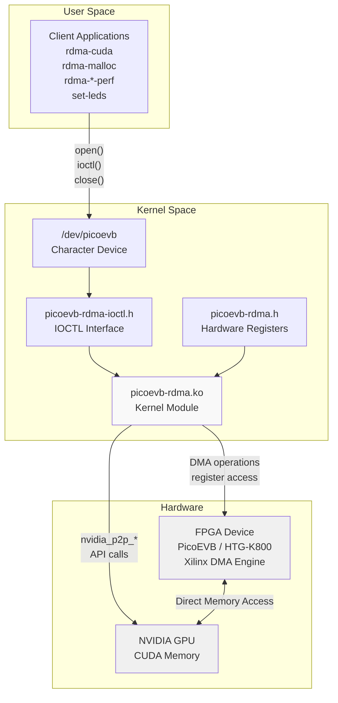
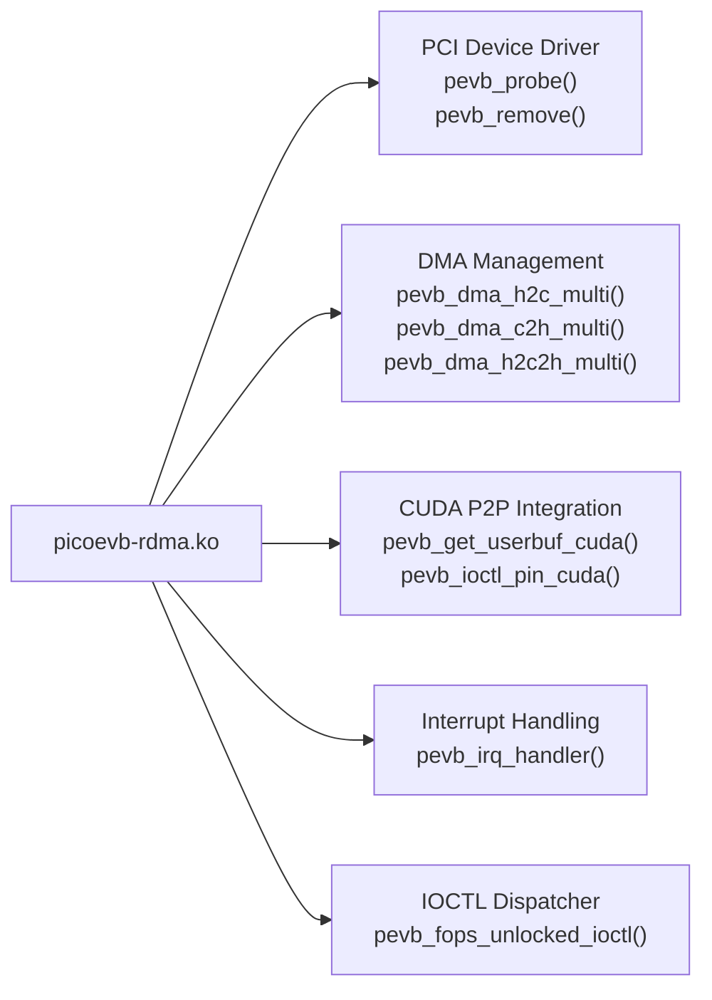
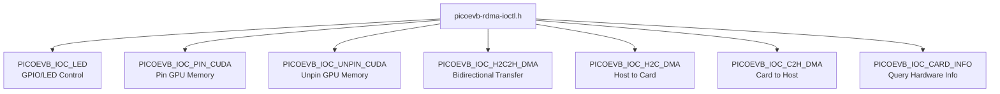
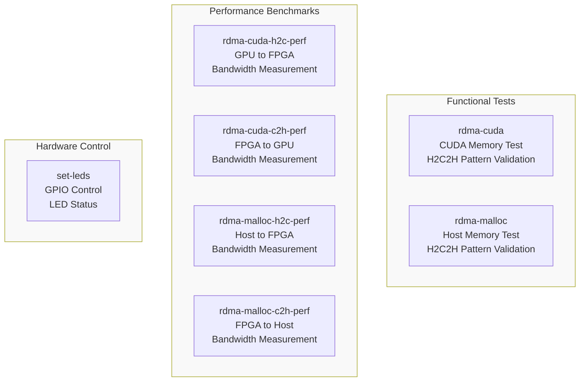
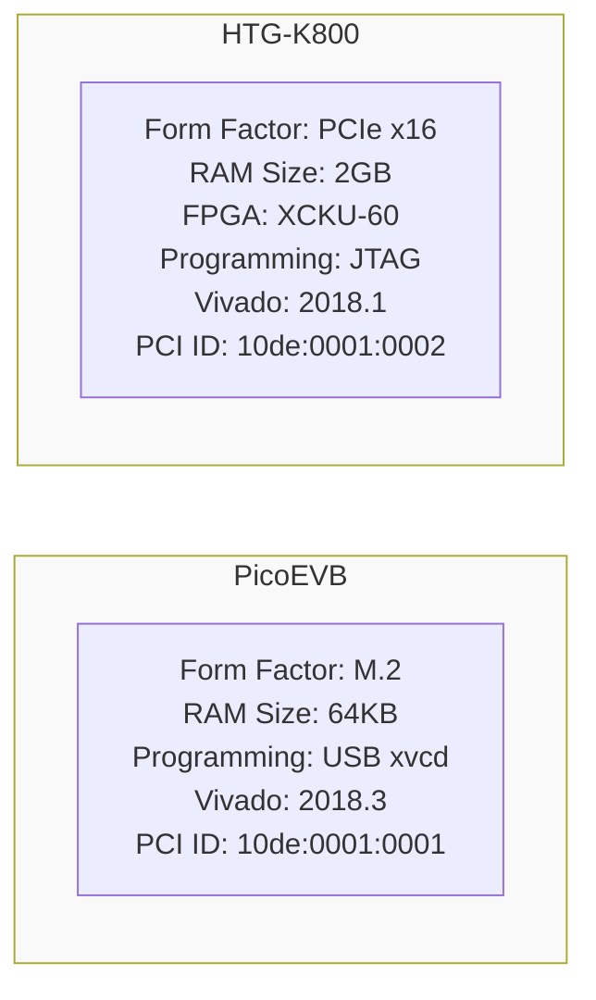
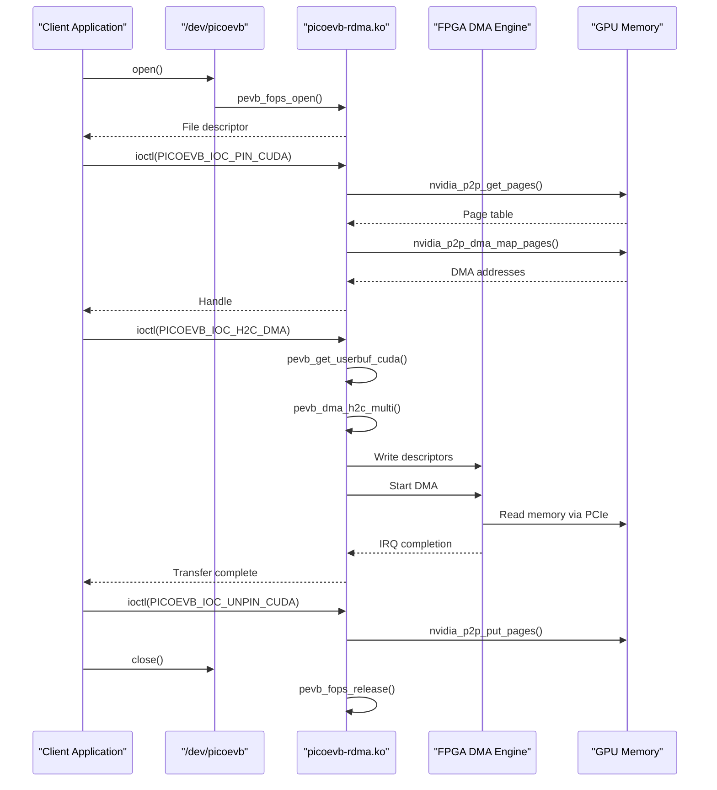
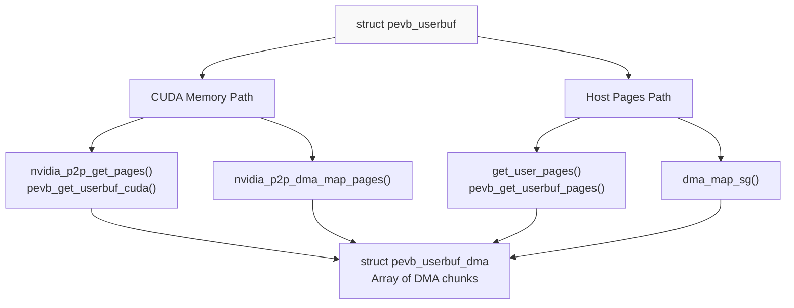

<!-- source: DeepWiki mcp.deepwiki.com · repo NVIDIA/jetson-rdma-picoevb · page 1.1 System Components · fetched 2026-11-11 -->

# System Components

Relevant source files

The following files were used as context for generating this wiki page:

- [README.md](README.md)
- [kernel-module/picoevb-rdma.c](kernel-module/picoevb-rdma.c)

This page enumerates the major components of the jetson-rdma-picoevb system and explains their roles and interactions. The system consists of three primary layers: a kernel-space driver module, user-space client applications, and FPGA hardware. These components work together to enable GPUDirect RDMA transfers between GPU memory and FPGA devices.

For hardware compatibility details and platform-specific requirements, see [Hardware Compatibility](#1.2). For architectural concepts and data flow patterns, see [System Architecture](#3).

---

## Component Architecture Overview

The following diagram shows the major components and their relationships:

**Sources:** [kernel-module/picoevb-rdma.c](), [kernel-module/picoevb-rdma-ioctl.h](), [README.md]()

---

## Kernel Module

### Overview

The `picoevb-rdma.ko` kernel module is the central component that orchestrates all system operations. It implements a PCI driver registered as `pevb_driver` and creates a character device at `/dev/picoevb`.

| Property | Value |
|----------|-------|
| Module Name | `picoevb-rdma` |
| Source File | `kernel-module/picoevb-rdma.c` |
| Device Node | `/dev/picoevb` |
| Driver Structure | `pevb_driver` |
| Device Class | `picoevb` |

### Core Responsibilities

1. **PCI Driver**: Manages the FPGA device lifecycle, including device discovery, resource allocation, and cleanup [kernel-module/picoevb-rdma.c:1138-1242]()

2. **DMA Orchestration**: Coordinates data transfers through the Xilinx DMA engine, handling descriptor creation and transfer chunking [kernel-module/picoevb-rdma.c:570-908]()

3. **CUDA P2P Bridge**: Interfaces with NVIDIA's P2P API to pin and map GPU memory for DMA access [kernel-module/picoevb-rdma.c:228-332]()

4. **Memory Management**: Handles both regular host memory (`get_user_pages()`) and CUDA memory (`nvidia_p2p_get_pages()`) [kernel-module/picoevb-rdma.c:417-527]()

5. **Interrupt Processing**: Services completion interrupts from the DMA engine [kernel-module/picoevb-rdma.c:529-568]()

### Key Data Structures

| Structure | Purpose | Location |
|-----------|---------|----------|
| `struct pevb` | Per-device state | [kernel-module/picoevb-rdma.c:56-71]() |
| `struct pevb_file` | Per-file descriptor state | [kernel-module/picoevb-rdma.c:73-77]() |
| `struct pevb_userbuf` | User buffer mapping information | [kernel-module/picoevb-rdma.c:95-117]() |
| `struct pevb_cuda_surface` | CUDA memory surface tracking | [kernel-module/picoevb-rdma.c:80-88]() |

**Sources:** [kernel-module/picoevb-rdma.c]()

---

## IOCTL Interface

The user-kernel interface is defined through IOCTL commands in `picoevb-rdma-ioctl.h`. This header file is shared between kernel and user space, providing the API contract.

### IOCTL Commands

### Data Structures

| Structure | IOCTL Command | Purpose |
|-----------|---------------|---------|
| `struct picoevb_rdma_pin_cuda` | `PICOEVB_IOC_PIN_CUDA` | Pin CUDA memory for DMA |
| `struct picoevb_rdma_unpin_cuda` | `PICOEVB_IOC_UNPIN_CUDA` | Unpin CUDA memory |
| `struct picoevb_rdma_h2c2h_dma` | `PICOEVB_IOC_H2C2H_DMA` | Bidirectional DMA parameters |
| `struct picoevb_rdma_h2c_dma` | `PICOEVB_IOC_H2C_DMA` | Host-to-card DMA parameters |
| `struct picoevb_rdma_c2h_dma` | `PICOEVB_IOC_C2H_DMA` | Card-to-host DMA parameters |
| `struct picoevb_rdma_card_info` | `PICOEVB_IOC_CARD_INFO` | Hardware information response |

The kernel module processes these commands through `pevb_fops_unlocked_ioctl()` [kernel-module/picoevb-rdma.c:1104-1129]().

**Sources:** [kernel-module/picoevb-rdma-ioctl.h](), [kernel-module/picoevb-rdma.c:1104-1129]()

---

## Client Applications

The user-space client applications demonstrate and benchmark the RDMA capabilities. They are organized into three categories:

### Application Suite Structure

### Functional Tests

**`rdma-cuda`**: Tests CUDA memory transfers with data integrity validation
- Allocates memory using `cudaHostAlloc()` (iGPU) or `cudaMalloc()` (dGPU)
- Performs H2C2H transfer through FPGA RAM
- Validates data patterns to ensure correctness
- Source: [client-applications/rdma-cuda.cu]()

**`rdma-malloc`**: Tests regular host memory transfers
- Allocates memory using `malloc()`
- Performs H2C2H transfer through FPGA RAM
- Validates data patterns
- Source: [client-applications/rdma-malloc.c]()

### Performance Benchmarks

The performance test applications measure unidirectional transfer bandwidth:

| Application | Direction | Memory Type | Metrics Reported |
|-------------|-----------|-------------|------------------|
| `rdma-cuda-h2c-perf` | Host → Card | GPU | MB/s throughput |
| `rdma-cuda-c2h-perf` | Card → Host | GPU | MB/s throughput |
| `rdma-malloc-h2c-perf` | Host → Card | Host | MB/s throughput |
| `rdma-malloc-c2h-perf` | Card → Host | Host | MB/s throughput |

Sources: [client-applications/rdma-cuda-c2h-perf.cu](), [client-applications/rdma-cuda-h2c-perf.cu](), [client-applications/rdma-malloc-c2h-perf.c](), [client-applications/rdma-malloc-h2c-perf.c]()

### Hardware Control Utilities

**`set-leds`**: Controls GPIO LEDs on the FPGA board
- Accepts a command-line parameter (0-7)
- Writes directly to GPIO registers
- Used for basic hardware validation
- Source: [client-applications/set-leds.c]()

**Sources:** [client-applications/rdma-cuda.cu](), [client-applications/rdma-malloc.c](), [client-applications/rdma-cuda-c2h-perf.cu](), [client-applications/set-leds.c]()

---

## FPGA Hardware

The system supports two FPGA boards with different capabilities:

### Supported Boards

### Hardware Capabilities

| Feature | PicoEVB | HTG-K800 |
|---------|---------|----------|
| FPGA RAM | 64KB | 2GB |
| Max Single Transfer | 64KB | Limited by DMA descriptor (28 bits word-aligned) |
| DMA Channels | 1 H2C, 1 C2H | 1 H2C, 1 C2H |
| BAR 0 (GPIO) | 4KB | 4KB |
| BAR 1 (DMA) | 64KB | 64KB |
| Driver Data | `drvdata_picoevb` | `drvdata_htg_k800` |

The kernel module identifies each board by PCI subsystem device ID and loads appropriate driver data [kernel-module/picoevb-rdma.c:1248-1269]().

### Xilinx DMA Engine

Both boards use a Xilinx scatter-gather DMA engine. The hardware interface is defined in `picoevb-rdma.h`:

**Key Register Blocks:**
- H2C (Host-to-Card) control and status registers
- C2H (Card-to-Host) control and status registers
- SGDMA descriptor management registers
- IRQ control and status registers

**DMA Descriptor Structure:** `struct xlnx_dma_desc` contains source address, destination address, length, and control flags [kernel-module/picoevb-rdma.h]().

**Sources:** [kernel-module/picoevb-rdma.c:1248-1269](), [kernel-module/picoevb-rdma.h](), [README.md:19-92]()

---

## Component Interaction Flow

### Typical Application Flow

### Memory Handling Paths

The kernel module supports two distinct memory paths:

Both paths converge to produce an array of DMA-mappable memory chunks (`struct pevb_userbuf_dma`) that the DMA engine can transfer [kernel-module/picoevb-rdma.c:90-117]().

**Sources:** [kernel-module/picoevb-rdma.c:137-217](), [kernel-module/picoevb-rdma.c:356-527](), [kernel-module/picoevb-rdma.c:729-908]()

---

## Build System Components

The repository includes platform-specific build scripts for all components:

### Kernel Module Build Scripts

| Script | Target Platform | Compilation Mode |
|--------|----------------|------------------|
| `build-for-jetson-drive-igpu-native.sh` | Jetson/Drive AGX Xavier | Native |
| `build-for-jetson-drive-igpu-on-pc.sh` | Jetson/Drive AGX Xavier | Cross-compile from x86 |
| `build-for-pc-native.sh` | x86 PC with dGPU | Native |

Location: [kernel-module/]()

### Client Application Build Scripts

| Script | Target Platform | CUDA Support |
|--------|----------------|--------------|
| `build-for-jetson-drive-igpu-native.sh` | Jetson/Drive AGX Xavier | `cudaHostAlloc()` unified memory |
| `build-for-jetson-drive-igpu-on-pc.sh` | Jetson/Drive AGX Xavier | Cross-compile (CUDA tests excluded) |
| `build-for-pc-native.sh` | x86 PC with dGPU | `cudaMalloc()` device memory |

Location: [client-applications/]()

The Makefile handles mixed compilation of `.cu` (CUDA) and `.c` (standard C) sources [client-applications/Makefile]().

### FPGA Build Scripts

| Script | Purpose |
|--------|---------|
| `git-to-project.sh` | Generate Vivado project from version control |
| `synthesize-fpga.sh` | Synthesize and implement FPGA design |
| `generate-cfgmem.sh` | Create configuration memory image |
| `program-fpga.sh` | Program FPGA via JTAG or xvcd |

Location: [fpga-picoevb/](), [fpga-htg-k800/]()

**Sources:** [kernel-module/build-for-jetson-drive-igpu-native.sh](), [client-applications/Makefile](), [fpga-picoevb/git-to-project.sh]()

---

## Summary

The jetson-rdma-picoevb system comprises three tightly integrated layers:

1. **Kernel Module** (`picoevb-rdma.ko`): The central orchestrator managing PCI operations, DMA transfers, CUDA P2P integration, and interrupt handling

2. **User Applications**: Functional tests, performance benchmarks, and utilities that exercise the kernel interface through IOCTL commands

3. **FPGA Hardware**: PicoEVB or HTG-K800 boards containing Xilinx DMA engines that perform direct memory access to GPU memory

These components communicate through well-defined interfaces: the IOCTL API (`picoevb-rdma-ioctl.h`) for user-kernel interaction, and the hardware register interface (`picoevb-rdma.h`) for kernel-hardware interaction. The system demonstrates GPUDirect RDMA by enabling zero-copy data transfers between CUDA memory and FPGA devices.

**Sources:** [kernel-module/picoevb-rdma.c](), [kernel-module/picoevb-rdma-ioctl.h](), [kernel-module/picoevb-rdma.h](), [README.md]()

---

