<!-- source: DeepWiki mcp.deepwiki.com · repo NVIDIA/jetson-rdma-picoevb · page 10 API Reference · fetched 2026-11-11 -->

# API Reference

<details>
<summary>Relevant source files</summary>

The following files were used as context for generating this wiki page:

- [kernel-module/picoevb-rdma-ioctl.h](kernel-module/picoevb-rdma-ioctl.h)
- [kernel-module/picoevb-rdma.h](kernel-module/picoevb-rdma.h)

</details>


## Purpose and Scope

This document provides a complete reference for the picoevb-rdma kernel module programming interface. It documents all IOCTL commands, data structures, flags, and constants required to develop user-space applications that perform DMA transfers between host memory, GPU memory, and FPGA hardware.

**Scope:**
- IOCTL command definitions and parameters
- Data structure layouts and field semantics
- Flag constants and bitfield values
- Hardware register definitions (for FPGA development)
- Memory pinning and DMA operation sequencing

For conceptual information about DMA operations and memory management, see [Data Transfer Patterns](#3.2) and [Memory Management](#3.3). For working code examples, see [Client Applications](#5). For building applications that use this API, see [Building Client Applications](#7.3).

---

## IOCTL Command Overview

The picoevb-rdma kernel module exposes seven IOCTL commands through the `/dev/picoevb` character device. These commands control memory pinning, DMA transfers, and hardware status.

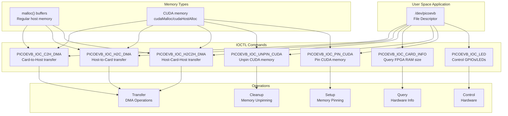

**IOCTL Command Categories:**

| Category | Commands | Purpose |
|----------|----------|---------|
| **Memory Management** | `PICOEVB_IOC_PIN_CUDA`<br/>`PICOEVB_IOC_UNPIN_CUDA` | Pin/unpin CUDA memory for DMA access |
| **DMA Operations** | `PICOEVB_IOC_H2C2H_DMA`<br/>`PICOEVB_IOC_H2C_DMA`<br/>`PICOEVB_IOC_C2H_DMA` | Execute data transfers |
| **Hardware Query** | `PICOEVB_IOC_CARD_INFO` | Query FPGA RAM size |
| **Hardware Control** | `PICOEVB_IOC_LED` | Control GPIO/LED outputs |

**Sources:** [kernel-module/picoevb-rdma-ioctl.h:77-83]()

---

## IOCTL Command Details

### PICOEVB_IOC_PIN_CUDA

Pins CUDA-managed memory (device or host) for DMA access. Returns a handle that must be used in subsequent DMA operations.

**Definition:**
```c
#define PICOEVB_IOC_PIN_CUDA _IOWR('P', 1, struct picoevb_rdma_pin_cuda)
```

**Structure:**
```c
struct picoevb_rdma_pin_cuda {
    /* In */
    __u64 va;      // Virtual address of CUDA memory
    __u64 size;    // Size in bytes
    /* Out */
    __u32 handle;  // Handle for subsequent DMA operations
};
```

**Parameters:**

| Field | Direction | Type | Description |
|-------|-----------|------|-------------|
| `va` | Input | `__u64` | Virtual address returned by `cudaMalloc()` or `cudaHostAlloc()` |
| `size` | Input | `__u64` | Size of memory region in bytes |
| `handle` | Output | `__u32` | Opaque handle used in DMA commands |

**Usage Pattern:**
1. Allocate CUDA memory using `cudaMalloc()` or `cudaHostAlloc()`
2. Open `/dev/picoevb`
3. Call `PICOEVB_IOC_PIN_CUDA` with memory address and size
4. Use returned handle in DMA operations
5. Call `PICOEVB_IOC_UNPIN_CUDA` before freeing CUDA memory

**Implementation Notes:**
- The kernel module uses `nvidia_p2p_get_pages()` to pin the memory
- Pages are mapped for DMA using `nvidia_p2p_dma_map_pages()`
- Handles are stored in the kernel and associated with the file descriptor
- Closing the file descriptor automatically unpins all memory

**Sources:** [kernel-module/picoevb-rdma-ioctl.h:19-25](), [kernel-module/picoevb-rdma-ioctl.h:78]()

---

### PICOEVB_IOC_UNPIN_CUDA

Unpins CUDA memory previously pinned with `PICOEVB_IOC_PIN_CUDA`. Must be called before freeing CUDA memory.

**Definition:**
```c
#define PICOEVB_IOC_UNPIN_CUDA _IOW('P', 2, struct picoevb_rdma_unpin_cuda)
```

**Structure:**
```c
struct picoevb_rdma_unpin_cuda {
    /* In */
    __u32 handle;  // Handle from IOC_PIN_CUDA
};
```

**Parameters:**

| Field | Direction | Type | Description |
|-------|-----------|------|-------------|
| `handle` | Input | `__u32` | Handle returned by `PICOEVB_IOC_PIN_CUDA` |

**Usage Pattern:**
1. Call after all DMA operations complete
2. Call before `cudaFree()` or freeing CUDA memory
3. Required even if file descriptor will be closed

**Implementation Notes:**
- Calls `nvidia_p2p_put_pages()` to unpin memory
- Invalidates the handle; subsequent use results in error
- Automatic cleanup occurs on file descriptor close

**Sources:** [kernel-module/picoevb-rdma-ioctl.h:27-30](), [kernel-module/picoevb-rdma-ioctl.h:79]()

---

### PICOEVB_IOC_H2C2H_DMA

Performs a bidirectional DMA transfer: host/GPU to FPGA RAM, then FPGA RAM to host/GPU. Uses FPGA RAM as intermediate buffer.

**Definition:**
```c
#define PICOEVB_IOC_H2C2H_DMA _IOWR('P', 3, struct picoevb_rdma_h2c2h_dma)
```

**Structure:**
```c
struct picoevb_rdma_h2c2h_dma {
    /* In */
    __u64 src;           // Source: pointer (malloc) or handle (CUDA)
    __u64 dst;           // Destination: pointer (malloc) or handle (CUDA)
    __u64 len;           // Transfer size in bytes
    __u64 flags;         // PICOEVB_H2C2H_DMA_FLAG_*
    /* Out */
    __u64 dma_time_ns;   // DMA duration in nanoseconds
};
```

**Parameters:**

| Field | Direction | Type | Description |
|-------|-----------|------|-------------|
| `src` | Input | `__u64` | Source address (pointer) or handle |
| `dst` | Input | `__u64` | Destination address (pointer) or handle |
| `len` | Input | `__u64` | Transfer size in bytes |
| `flags` | Input | `__u64` | Bitfield indicating memory types |
| `dma_time_ns` | Output | `__u64` | Measured DMA time in nanoseconds |

**Flags:**

| Flag | Value | Description |
|------|-------|-------------|
| `PICOEVB_H2C2H_DMA_FLAG_SRC_IS_CUDA` | `(1 << 0)` | Source is CUDA memory (use handle) |
| `PICOEVB_H2C2H_DMA_FLAG_DST_IS_CUDA` | `(1 << 1)` | Destination is CUDA memory (use handle) |

**Transfer Pattern:**

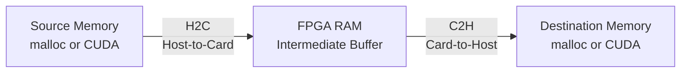

**Memory Type Combinations:**

| Source | Destination | `flags` Value |
|--------|-------------|---------------|
| `malloc()` | `malloc()` | `0x0` |
| `malloc()` | CUDA | `0x2` (DST_IS_CUDA) |
| CUDA | `malloc()` | `0x1` (SRC_IS_CUDA) |
| CUDA | CUDA | `0x3` (SRC_IS_CUDA \| DST_IS_CUDA) |

**Size Constraints:**
- Transfer size limited by FPGA RAM size (64KB PicoEVB, 2GB HTG-K800)
- For larger transfers, application must chunk the data
- Size must be 4-byte aligned for optimal performance

**Sources:** [kernel-module/picoevb-rdma-ioctl.h:32-44](), [kernel-module/picoevb-rdma-ioctl.h:80]()

---

### PICOEVB_IOC_H2C_DMA

Performs a unidirectional DMA transfer from host/GPU memory to FPGA RAM.

**Definition:**
```c
#define PICOEVB_IOC_H2C_DMA _IOWR('P', 5, struct picoevb_rdma_h2c_dma)
```

**Structure:**
```c
struct picoevb_rdma_h2c_dma {
    /* In */
    __u64 src;           // Source: pointer (malloc) or handle (CUDA)
    __u64 dst;           // FPGA RAM offset
    __u64 len;           // Transfer size in bytes
    __u64 flags;         // PICOEVB_H2C_DMA_FLAG_*
    /* Out */
    __u64 dma_time_ns;   // DMA duration in nanoseconds
};
```

**Parameters:**

| Field | Direction | Type | Description |
|-------|-----------|------|-------------|
| `src` | Input | `__u64` | Source address (pointer) or handle |
| `dst` | Input | `__u64` | FPGA RAM offset (0-based) |
| `len` | Input | `__u64` | Transfer size in bytes |
| `flags` | Input | `__u64` | Bitfield indicating memory type |
| `dma_time_ns` | Output | `__u64` | Measured DMA time in nanoseconds |

**Flags:**

| Flag | Value | Description |
|------|-------|-------------|
| `PICOEVB_H2C_DMA_FLAG_SRC_IS_CUDA` | `(1 << 0)` | Source is CUDA memory (use handle) |

**Transfer Pattern:**

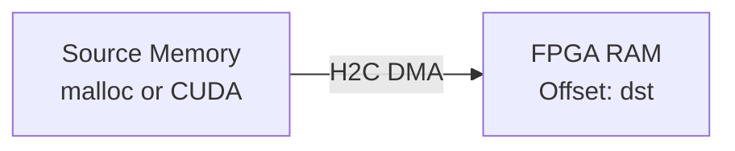

**Usage:**
- Write data to FPGA for processing
- Store data in FPGA RAM for multiple reads
- Initialize FPGA memory before Card-to-Host transfers

**Sources:** [kernel-module/picoevb-rdma-ioctl.h:51-62](), [kernel-module/picoevb-rdma-ioctl.h:82]()

---

### PICOEVB_IOC_C2H_DMA

Performs a unidirectional DMA transfer from FPGA RAM to host/GPU memory.

**Definition:**
```c
#define PICOEVB_IOC_C2H_DMA _IOWR('P', 6, struct picoevb_rdma_c2h_dma)
```

**Structure:**
```c
struct picoevb_rdma_c2h_dma {
    /* In */
    __u64 dst;           // Destination: pointer (malloc) or handle (CUDA)
    __u64 src;           // FPGA RAM offset
    __u64 len;           // Transfer size in bytes
    __u64 flags;         // PICOEVB_C2H_DMA_FLAG_*
    /* Out */
    __u64 dma_time_ns;   // DMA duration in nanoseconds
};
```

**Parameters:**

| Field | Direction | Type | Description |
|-------|-----------|------|-------------|
| `dst` | Input | `__u64` | Destination address (pointer) or handle |
| `src` | Input | `__u64` | FPGA RAM offset (0-based) |
| `len` | Input | `__u64` | Transfer size in bytes |
| `flags` | Input | `__u64` | Bitfield indicating memory type |
| `dma_time_ns` | Output | `__u64` | Measured DMA time in nanoseconds |

**Flags:**

| Flag | Value | Description |
|------|-------|-------------|
| `PICOEVB_C2H_DMA_FLAG_DST_IS_CUDA` | `(1 << 0)` | Destination is CUDA memory (use handle) |

**Transfer Pattern:**

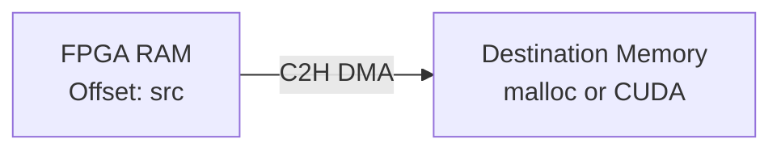

**Usage:**
- Read processed data from FPGA
- Read status or diagnostic information
- Retrieve data stored in FPGA RAM

**Sources:** [kernel-module/picoevb-rdma-ioctl.h:64-75](), [kernel-module/picoevb-rdma-ioctl.h:83]()

---

### PICOEVB_IOC_CARD_INFO

Queries FPGA hardware information, specifically the onboard RAM size.

**Definition:**
```c
#define PICOEVB_IOC_CARD_INFO _IOR('P', 4, struct picoevb_rdma_card_info)
```

**Structure:**
```c
struct picoevb_rdma_card_info {
    /* Out */
    __u64 fpga_ram_size;  // FPGA RAM size in bytes
};
```

**Parameters:**

| Field | Direction | Type | Description |
|-------|-----------|------|-------------|
| `fpga_ram_size` | Output | `__u64` | FPGA RAM size in bytes |

**Expected Values:**

| FPGA Board | RAM Size | Bytes |
|------------|----------|-------|
| PicoEVB | 64 KB | 65536 |
| HTG-K800 | 2 GB | 2147483648 |

**Usage:**
- Query before DMA operations to determine chunking strategy
- Validate transfer sizes against available RAM
- Adapt application behavior to hardware capabilities

**Sources:** [kernel-module/picoevb-rdma-ioctl.h:46-49](), [kernel-module/picoevb-rdma-ioctl.h:81]()

---

### PICOEVB_IOC_LED

Controls GPIO/LED outputs on the FPGA board.

**Definition:**
```c
#define PICOEVB_IOC_LED _IOW('P', 0, __u32)
```

**Parameters:**

| Parameter | Type | Description |
|-----------|------|-------------|
| `value` | `__u32` | Bitfield controlling LED states |

**Usage:**
- Test hardware connectivity
- Indicate application status
- Debug hardware issues

**Implementation:**
- Each bit controls one LED/GPIO
- Bit-to-LED mapping is FPGA-specific
- See `set-leds.c` for example usage

**Sources:** [kernel-module/picoevb-rdma-ioctl.h:77]()

---

## API Usage Patterns

### Pattern 1: CUDA Memory DMA Transfer

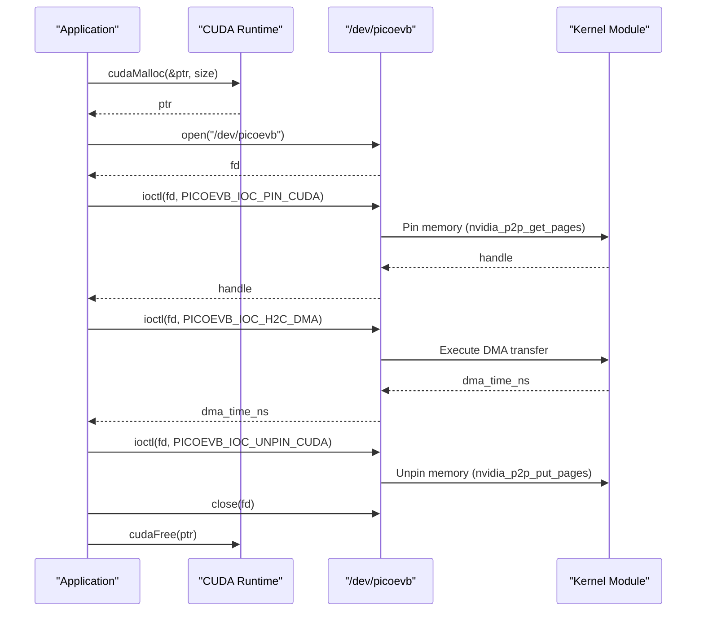

**Steps:**
1. Allocate CUDA memory
2. Open device file
3. Pin memory and obtain handle
4. Perform DMA operations using handle
5. Unpin memory
6. Close device and free CUDA memory

**Sources:** [kernel-module/picoevb-rdma-ioctl.h:19-30]()

---

### Pattern 2: malloc() Memory DMA Transfer

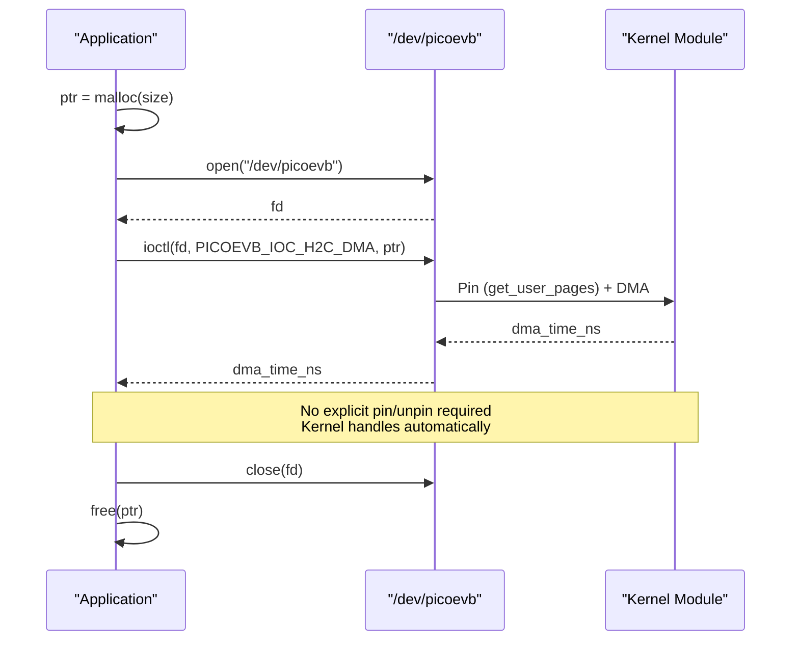

**Steps:**
1. Allocate host memory with `malloc()`
2. Open device file
3. Perform DMA operations directly with pointer
4. Close device and free memory

**Key Difference:**
- No explicit `PIN_CUDA`/`UNPIN_CUDA` calls required
- Kernel module handles pinning internally during DMA
- Simpler for non-CUDA applications

**Sources:** [kernel-module/picoevb-rdma-ioctl.h:51-75]()

---

### Pattern 3: Chunked Large Transfer

For transfers exceeding FPGA RAM size, applications must chunk the data:

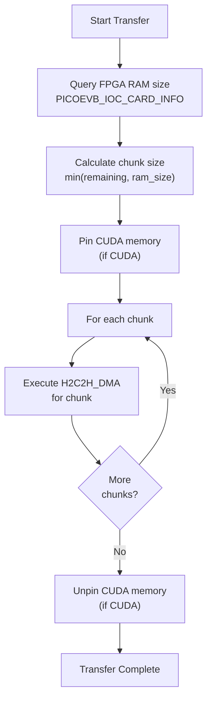

**Example Logic:**
```
fpga_ram_size = ioctl(PICOEVB_IOC_CARD_INFO)
total_size = transfer_size
offset = 0

while (offset < total_size) {
    chunk_size = min(total_size - offset, fpga_ram_size)
    
    h2c2h.src = src_handle (or src_ptr + offset)
    h2c2h.dst = dst_handle (or dst_ptr + offset)
    h2c2h.len = chunk_size
    
    ioctl(PICOEVB_IOC_H2C2H_DMA, &h2c2h)
    
    offset += chunk_size
}
```

**Sources:** [kernel-module/picoevb-rdma-ioctl.h:32-44](), [kernel-module/picoevb-rdma-ioctl.h:46-49]()

---

## Data Structure Field Reference

### Complete Field Semantics

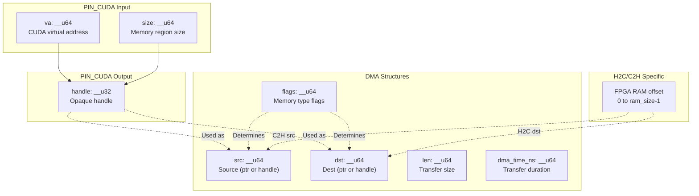

### Type Interpretation Table

| Field | Context | Value Type | Interpretation |
|-------|---------|------------|----------------|
| `src` | H2C2H, flags=0x0 | `void*` | malloc() pointer |
| `src` | H2C2H, flags=0x1 | `__u32` | CUDA handle |
| `src` | H2C_DMA, flags=0x0 | `void*` | malloc() pointer |
| `src` | H2C_DMA, flags=0x1 | `__u32` | CUDA handle |
| `src` | C2H_DMA | `__u64` | FPGA RAM offset |
| `dst` | H2C2H, flags=0x0 | `void*` | malloc() pointer |
| `dst` | H2C2H, flags=0x2 | `__u32` | CUDA handle |
| `dst` | H2C_DMA | `__u64` | FPGA RAM offset |
| `dst` | C2H_DMA, flags=0x0 | `void*` | malloc() pointer |
| `dst` | C2H_DMA, flags=0x1 | `__u32` | CUDA handle |

**Sources:** [kernel-module/picoevb-rdma-ioctl.h:19-75]()

---

## Hardware Register Interface

This section documents the Xilinx DMA engine register definitions. This interface is used internally by the kernel module and by FPGA firmware developers.

### Register Address Calculation

The hardware uses a hierarchical addressing scheme:

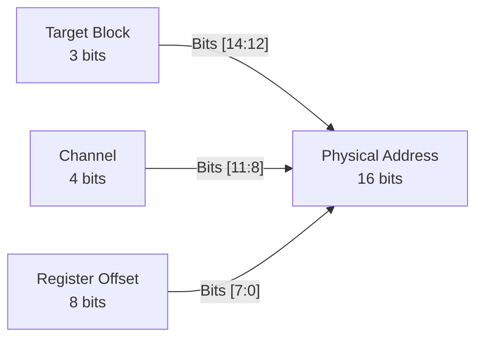

**Macro:**
```c
#define XLNX_REG(_target_, _channel_, _reg_) \
    ((XLNX_DMA_TARGET_##_target_ << 12) | \
    ((_channel_) << 8) | \
    XLNX_DMA_##_reg_)
```

**Target Blocks:**

| Target | Value | Description |
|--------|-------|-------------|
| `XLNX_DMA_TARGET_H2C` | 0 | Host-to-Card DMA engine |
| `XLNX_DMA_TARGET_C2H` | 1 | Card-to-Host DMA engine |
| `XLNX_DMA_TARGET_IRQ` | 2 | Interrupt controller |
| `XLNX_DMA_TARGET_CONFIG` | 3 | Configuration registers |
| `XLNX_DMA_TARGET_H2C_SGDMA` | 4 | H2C Scatter-Gather DMA |
| `XLNX_DMA_TARGET_C2H_SGDMA` | 5 | C2H Scatter-Gather DMA |
| `XLNX_DMA_TARGET_SGDMA` | 6 | Common SGDMA registers |

**Sources:** [kernel-module/picoevb-rdma.h:39-52]()

---

### DMA Descriptor Structure

The kernel module uses Xilinx DMA descriptors to program transfers:

```c
struct xlnx_dma_desc {
    u32 control;      // Control flags and magic
    u32 len;          // Transfer length
    u32 src_adr;      // Source address [31:0]
    u32 src_adr_hi;   // Source address [63:32]
    u32 dst_adr;      // Destination address [31:0]
    u32 dst_adr_hi;   // Destination address [63:32]
    u32 nxt_adr;      // Next descriptor [31:0]
    u32 nxt_adr_hi;   // Next descriptor [63:32]
} __packed;
```

**Control Field Bitfields:**

| Field | Bits | Mask/Value | Description |
|-------|------|------------|-------------|
| MAGIC | [31:16] | 0xad4b | Required magic value |
| NEXT_ADJ | [13:8] | 0x3f | Next descriptor offset |
| EOP | [4] | 0x10 | End of packet |
| COMPLETED | [1] | 0x02 | Completion status |
| STOP | [0] | 0x01 | Stop after this descriptor |

**Length Constraints:**

| Constraint | Value | Description |
|------------|-------|-------------|
| `XLNX_DMA_DESC_LEN_MAX` | 268,435,455 | Maximum transfer size (2^28 - 1) |
| `XLNX_DMA_DESC_LEN_MAX_WORD_ALIGNED` | 268,435,452 | Maximum 4-byte aligned |
| `XLNX_DMA_DESC_LEN_MAX_POW2_ALIGNED` | 134,217,728 | Maximum power-of-2 aligned (2^27) |

**Sources:** [kernel-module/picoevb-rdma.h:19-37]()

---

### H2C/C2H Engine Registers

Both Host-to-Card and Card-to-Host DMA engines share similar register layouts:

```mermaid
graph TB
    subgraph "DMA Engine Registers"
        ID["0x00: ID Register<br/>Subsystem and version info"]
        CTRL["0x04: Control Register<br/>RUN, interrupts, mode"]
        CTRL_W1S["0x08: Control W1S<br/>Write-1-to-set"]
        CTRL_W1C["0x0C: Control W1C<br/>Write-1-to-clear"]
        STATUS["0x40: Status Register<br/>Error flags, busy state"]
        STATUS_RC["0x44: Status Read-Clear<br/>Clear on read"]
        DESC_CNT["0x48: Completed Desc Count"]
        INT_EN["0x90: Interrupt Enable"]
        INT_EN_W1S["0x94: Interrupt Enable W1S"]
        INT_EN_W1C["0x98: Interrupt Enable W1C"]
        PERF_CTRL["0xC0: Performance Control"]
        PERF_CYC_L["0xC4: Perf Cycle Low"]
        PERF_CYC_H["0xC8: Perf Cycle High"]
        PERF_DAT_L["0xCC: Perf Data Low"]
        PERF_DAT_H["0xD0: Perf Data High"]
    end
    
    subgraph "Register Groups"
        CONTROL["Control Group<br/>Start/stop engine"]
        STATUS_GRP["Status Group<br/>Monitor state"]
        INTERRUPT["Interrupt Group<br/>Enable/mask"]
        PERFORMANCE["Performance Group<br/>Counters"]
    end
    
    ID --> CONTROL
    CTRL --> CONTROL
    CTRL_W1S --> CONTROL
    CTRL_W1C --> CONTROL
    
    STATUS --> STATUS_GRP
    STATUS_RC --> STATUS_GRP
    DESC_CNT --> STATUS_GRP
    
    INT_EN --> INTERRUPT
    INT_EN_W1S --> INTERRUPT
    INT_EN_W1C --> INTERRUPT
    
    PERF_CTRL --> PERFORMANCE
    PERF_CYC_L --> PERFORMANCE
    PERF_CYC_H --> PERFORMANCE
    PERF_DAT_L --> PERFORMANCE
    PERF_DAT_H --> PERFORMANCE
```

**Key Control Register Bits:**

| Bit | Name | Description |
|-----|------|-------------|
| 0 | `XLNX_DMA_H2C_CTRL_RUN` | Start DMA engine |
| 1 | `XLNX_DMA_H2C_CTRL_IE_DESC_STOPPED` | Interrupt on descriptor stop |
| 2 | `XLNX_DMA_H2C_CTRL_IE_DESC_COMPLETED` | Interrupt on completion |
| 3 | `XLNX_DMA_H2C_CTRL_IE_ALIGN_MISMATCH` | Interrupt on alignment error |
| 4 | `XLNX_DMA_H2C_CTRL_IE_MAGIC_STOPPED` | Interrupt on magic error |
| 5 | `XLNX_DMA_H2C_CTRL_IE_INVALID_LEN` | Interrupt on invalid length |
| 6 | `XLNX_DMA_H2C_CTRL_IE_IDLE_STOPPED` | Interrupt on idle stop |
| 25 | `XLNX_DMA_H2C_CTRL_NON_INC_MOD` | Non-incrementing mode |
| 26 | `XLNX_DMA_H2C_CTRL_POLLMODE_WB_EN` | Poll-mode writeback enable |
| 27 | `XLNX_DMA_H2C_CTRL_STREAM_WB_DIS` | Stream writeback disable |

**Key Status Register Bits:**

| Bit | Name | Description |
|-----|------|-------------|
| 0 | `XLNX_DMA_H2C_STATUS_BUSY` | Engine is busy |
| 1 | `XLNX_DMA_H2C_STATUS_DESC_STOPPED` | Descriptor stopped |
| 2 | `XLNX_DMA_H2C_STATUS_DESC_COMPLETED` | Descriptor completed |
| 3 | `XLNX_DMA_H2C_STATUS_ALIGN_MISMATCH` | Alignment error |
| 4 | `XLNX_DMA_H2C_STATUS_MAGIC_STOPPED` | Invalid magic number |
| 5 | `XLNX_DMA_H2C_STATUS_INVALID_LEN` | Invalid transfer length |
| 6 | `XLNX_DMA_H2C_STATUS_IDLE_STOPPED` | Idle stop |

**Sources:** [kernel-module/picoevb-rdma.h:54-139]()

---

### SGDMA Registers

Scatter-Gather DMA registers control descriptor chain execution:

**H2C/C2H SGDMA Registers:**

| Offset | Register | Description |
|--------|----------|-------------|
| 0x00 | `XLNX_DMA_H2C_SGDMA_ID` | SGDMA identification |
| 0x80 | `XLNX_DMA_H2C_SGDMA_DESC_LOW_ADDR` | Descriptor address [31:0] |
| 0x84 | `XLNX_DMA_H2C_SGDMA_DESC_HIGH_ADDR` | Descriptor address [63:32] |
| 0x88 | `XLNX_DMA_H2C_SGDMA_DESC_ADJACENT` | Adjacent descriptor count |

**Common SGDMA Control:**

| Offset | Register | Description |
|--------|----------|-------------|
| 0x00 | `XLNX_DMA_SGDMA_CMN_ID` | Common SGDMA identification |
| 0x10 | `XLNX_DMA_SGDMA_CTRL` | Descriptor halt control |
| 0x14 | `XLNX_DMA_SGDMA_CTRL_W1S` | Control write-1-to-set |
| 0x18 | `XLNX_DMA_SGDMA_CTRL_W1C` | Control write-1-to-clear |

**Sources:** [kernel-module/picoevb-rdma.h:174-212]()

---

### IRQ Controller Registers

The interrupt controller manages interrupts from all DMA channels:

**Register Layout:**

| Offset | Register | Description |
|--------|----------|-------------|
| 0x00 | `XLNX_DMA_IRQ_ID` | IRQ controller identification |
| 0x10 | `XLNX_DMA_IRQ_CH_INT_EN` | Channel interrupt enable |
| 0x14 | `XLNX_DMA_IRQ_CH_INT_EN_W1S` | Enable write-1-to-set |
| 0x18 | `XLNX_DMA_IRQ_CH_INT_EN_W1C` | Enable write-1-to-clear |
| 0x4C | `XLNX_DMA_IRQ_CH_PENDING` | Pending interrupts |

**Channel Interrupt Bits:**

```c
// H2C channel N uses bit N
#define XLNX_DMA_IRQ_CH_H2C_BIT(channel) \
    BIT(channel)

// C2H channel N uses bit (N + num_h2c)
#define XLNX_DMA_IRQ_CH_C2H_BIT(channel, num_h2c) \
    BIT((channel) + (num_h2c))
```

**Sources:** [kernel-module/picoevb-rdma.h:141-162]()

---

## Error Handling

### IOCTL Return Values

All IOCTL commands return standard Linux error codes:

| Return Value | Condition | Description |
|--------------|-----------|-------------|
| 0 | Success | Operation completed successfully |
| -EINVAL | Invalid parameter | Invalid address, size, handle, or flags |
| -EFAULT | Bad address | User-space pointer inaccessible |
| -ENOMEM | Out of memory | Cannot allocate kernel resources |
| -EBUSY | Resource busy | Device or DMA engine busy |
| -EIO | I/O error | DMA transfer failed or hardware error |
| -ENODEV | No device | FPGA device not present or not responding |

### Common Error Scenarios

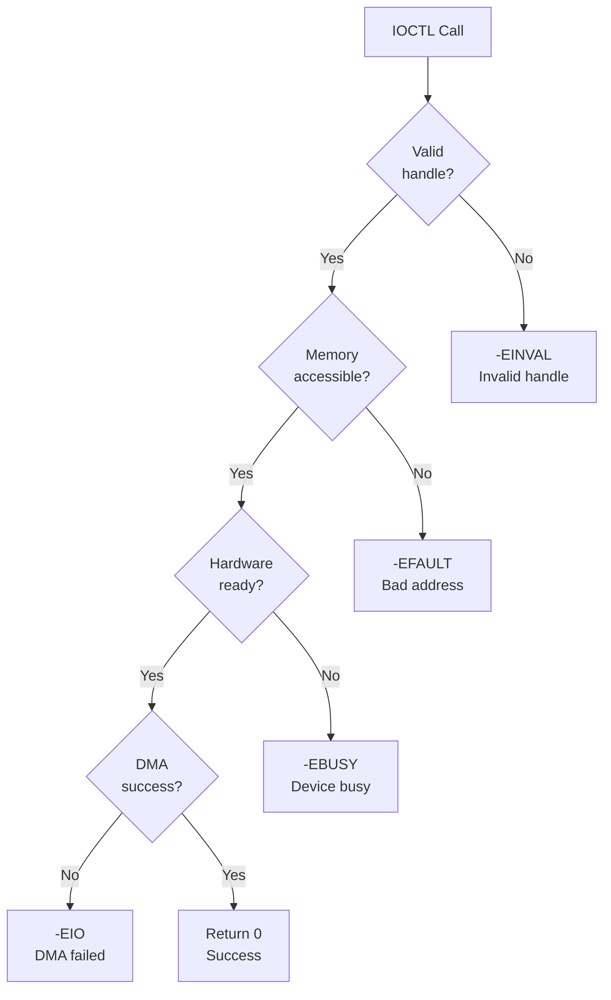

**Error Checking Pattern:**
```c
struct picoevb_rdma_h2c2h_dma dma;
// ... populate dma structure ...

int ret = ioctl(fd, PICOEVB_IOC_H2C2H_DMA, &dma);
if (ret < 0) {
    switch (errno) {
    case EINVAL:
        fprintf(stderr, "Invalid parameters\n");
        break;
    case EFAULT:
        fprintf(stderr, "Bad memory address\n");
        break;
    case EIO:
        fprintf(stderr, "DMA transfer failed\n");
        break;
    default:
        perror("ioctl");
        break;
    }
    return -1;
}
```

**Sources:** Standard Linux error codes

---

## Performance Measurement

### DMA Timing

All DMA operations return timing information in the `dma_time_ns` field:

**Timing Methodology:**
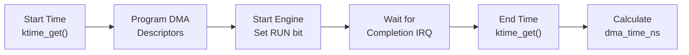

**Measured Duration:**
- Includes descriptor programming time
- Includes actual data transfer time
- Includes interrupt latency
- Does NOT include memory pinning time
- Does NOT include user-space overhead

**Bandwidth Calculation:**
```
bandwidth_mb_s = (transfer_size_bytes / dma_time_ns) * 1000
```

**Example:**
```
Transfer size: 64 MB (67108864 bytes)
DMA time: 13421772 ns (13.4 ms)
Bandwidth: (67108864 / 13421772) * 1000 = 5000 MB/s
```

**Sources:** [kernel-module/picoevb-rdma-ioctl.h:41](), [kernel-module/picoevb-rdma-ioctl.h:60](), [kernel-module/picoevb-rdma-ioctl.h:73]()

---

## Platform-Specific Considerations

### iGPU vs dGPU Memory

The API behaves differently on integrated GPU (iGPU) vs discrete GPU (dGPU) platforms:

**iGPU Platforms (Jetson, Drive AGX Xavier):**
- Use `cudaHostAlloc()` for unified memory
- Memory is physically in system RAM
- GPU and DMA engine access same physical addresses
- Lower latency for CPU↔GPU transfers

**dGPU Platforms (PC with discrete GPU):**
- Use `cudaMalloc()` for device memory
- Memory is physically in GPU VRAM
- Requires GPUDirect RDMA (nvidia_p2p API)
- Higher bandwidth for direct FPGA↔GPU transfers

**API Implications:**

| Platform | Allocation | Pin Required? | P2P API Used? |
|----------|------------|---------------|---------------|
| iGPU | `cudaHostAlloc()` | Yes | Yes |
| dGPU | `cudaMalloc()` | Yes | Yes |
| Any | `malloc()` | No (automatic) | No |

**Sources:** System architecture knowledge

---

## API Version and Compatibility

### IOCTL Magic Number

The IOCTL commands use magic number `'P'` (0x50):

```c
#define PICOEVB_IOC_LED       _IOW('P', 0, __u32)
#define PICOEVB_IOC_PIN_CUDA  _IOWR('P', 1, struct picoevb_rdma_pin_cuda)
// ... etc
```

### Structure Versioning

The current API has no explicit version field. Breaking changes would require:
- New IOCTL command numbers
- New magic number
- New device node

**Backward Compatibility:**
- Adding new flags is backward compatible (ignored by old kernels)
- Adding new IOCTL commands is backward compatible
- Changing structure sizes breaks compatibility

**Sources:** [kernel-module/picoevb-rdma-ioctl.h:77-83]()

---

## Complete API Summary Table

### All IOCTL Commands

| Command | Number | Direction | Structure | Purpose |
|---------|--------|-----------|-----------|---------|
| `PICOEVB_IOC_LED` | 0 | Write | `__u32` | Control LEDs/GPIOs |
| `PICOEVB_IOC_PIN_CUDA` | 1 | Read/Write | `picoevb_rdma_pin_cuda` | Pin CUDA memory |
| `PICOEVB_IOC_UNPIN_CUDA` | 2 | Write | `picoevb_rdma_unpin_cuda` | Unpin CUDA memory |
| `PICOEVB_IOC_H2C2H_DMA` | 3 | Read/Write | `picoevb_rdma_h2c2h_dma` | Bidirectional transfer |
| `PICOEVB_IOC_CARD_INFO` | 4 | Read | `picoevb_rdma_card_info` | Query hardware info |
| `PICOEVB_IOC_H2C_DMA` | 5 | Read/Write | `picoevb_rdma_h2c_dma` | Host-to-Card transfer |
| `PICOEVB_IOC_C2H_DMA` | 6 | Read/Write | `picoevb_rdma_c2h_dma` | Card-to-Host transfer |

### All Flag Constants

| Flag | Value | Used In | Meaning |
|------|-------|---------|---------|
| `PICOEVB_H2C2H_DMA_FLAG_SRC_IS_CUDA` | 0x1 | H2C2H_DMA | Source is CUDA handle |
| `PICOEVB_H2C2H_DMA_FLAG_DST_IS_CUDA` | 0x2 | H2C2H_DMA | Destination is CUDA handle |
| `PICOEVB_H2C_DMA_FLAG_SRC_IS_CUDA` | 0x1 | H2C_DMA | Source is CUDA handle |
| `PICOEVB_C2H_DMA_FLAG_DST_IS_CUDA` | 0x1 | C2H_DMA | Destination is CUDA handle |

### All Hardware Constants

| Constant | Value | Description |
|----------|-------|-------------|
| `XLNX_DMA_DESC_LEN_MAX` | 268,435,455 | Maximum descriptor length |
| `XLNX_DMA_DESC_CONTROL_MAGIC` | 0xad4b0000 | Required descriptor magic |
| `XLNX_DMA_SUBSYS_ID` | 0x1fc | Subsystem identifier |

**Sources:** [kernel-module/picoevb-rdma-ioctl.h:1-86](), [kernel-module/picoevb-rdma.h:1-213]()