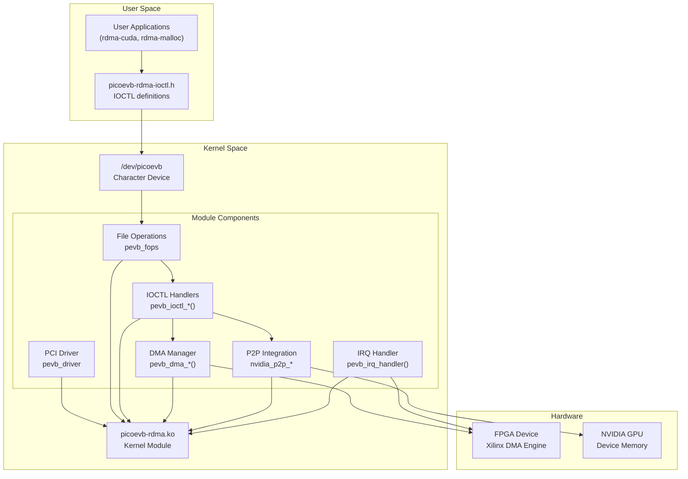
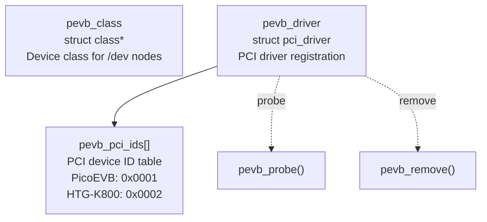
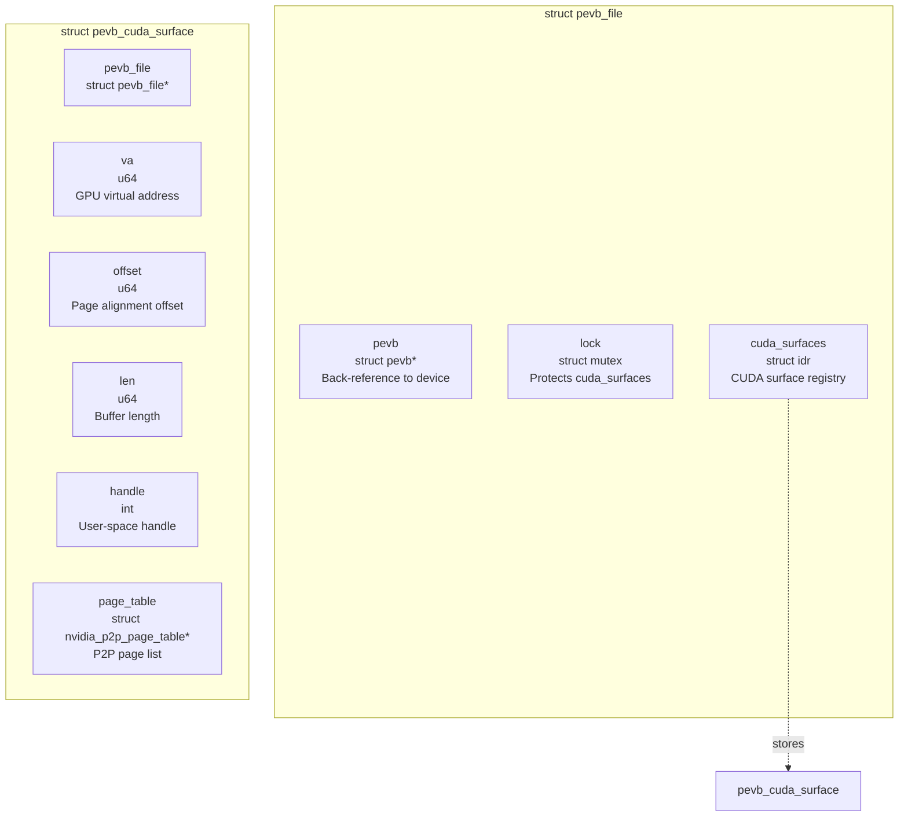
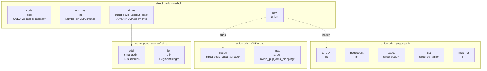
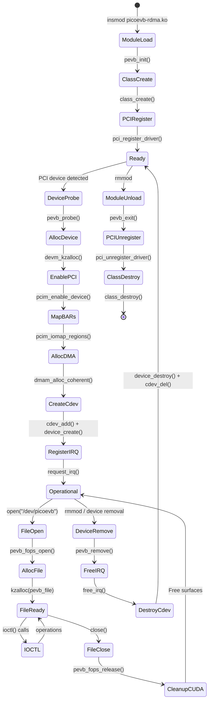
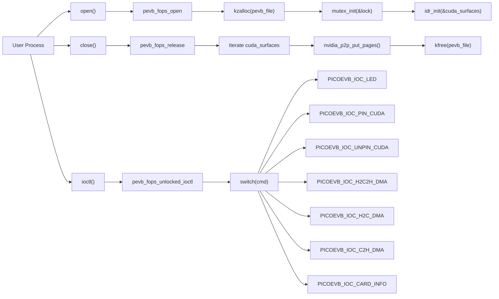
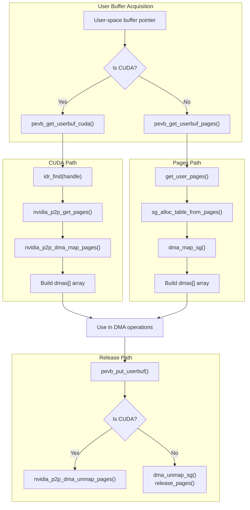
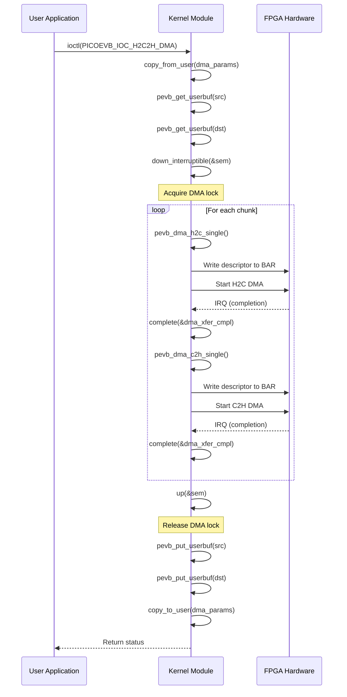
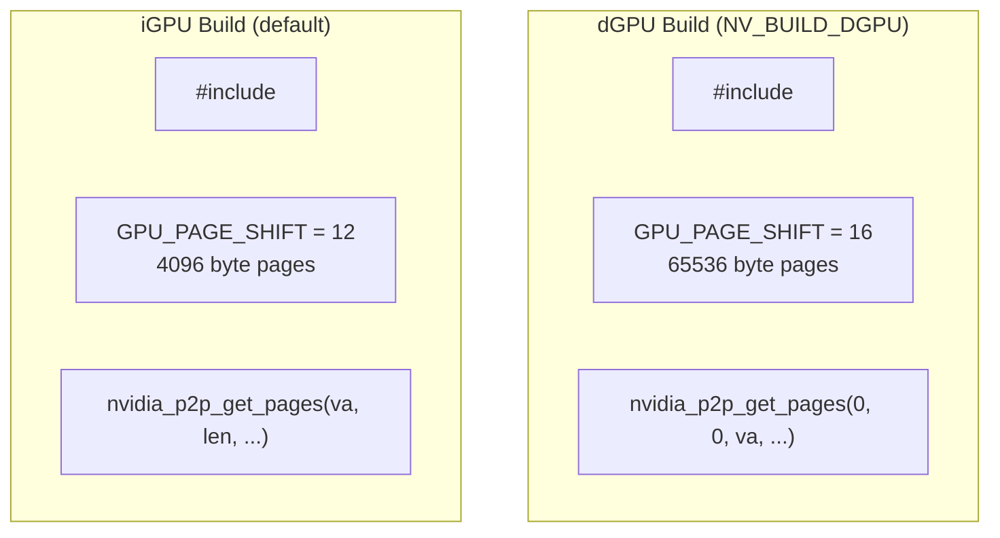

<!-- source: DeepWiki mcp.deepwiki.com · repo NVIDIA/jetson-rdma-picoevb · page 4.1 Module Overview · fetched 2026-11-11 -->

# Module Overview

Relevant source files

The following files were used as context for generating this wiki page:

- [kernel-module/picoevb-rdma.c](kernel-module/picoevb-rdma.c)

This document provides an overview of the `picoevb-rdma` kernel module, which serves as the core component of the jetson-rdma-picoevb system. The module implements a Linux PCI driver that bridges user-space applications with FPGA hardware and NVIDIA GPU memory.

This page covers the module's architecture, core data structures, and operational lifecycle. For detailed information about specific subsystems, see:
- IOCTL command interface: [IOCTL Interface](#4.2)
- DMA transfer mechanisms: [DMA Operations](#4.3)
- NVIDIA GPU memory integration: [CUDA P2P Integration](#4.4)
- Hardware register programming: [Hardware Register Interface](#4.5)
- Interrupt-driven completion: [Interrupt Handling](#4.6)

## Module Purpose and Responsibilities

The `picoevb-rdma.ko` kernel module performs the following functions:

| Responsibility | Implementation |
|----------------|----------------|
| **PCI Device Driver** | Enumerates and manages PicoEVB/HTG-K800 FPGA cards on the PCIe bus |
| **Character Device** | Exposes `/dev/picoevb` for user-space communication |
| **Memory Abstraction** | Unifies regular host memory and CUDA GPU memory for DMA operations |
| **DMA Orchestration** | Programs Xilinx DMA engine for H2C, C2H, and H2C2H transfers |
| **P2P Bridge** | Integrates with NVIDIA's P2P API for direct GPU memory access |
| **Interrupt Management** | Handles DMA completion and error signaling |

**Sources:** [kernel-module/picoevb-rdma.c:1-1312]()

## System Position

**Diagram: Module Architecture and System Integration**

The module operates as a standard Linux PCI driver, registering with the kernel PCI subsystem and creating a character device for user-space interaction. It abstracts two distinct memory subsystems (host and GPU) behind a unified DMA interface.

**Sources:** [kernel-module/picoevb-rdma.c:1273-1302](), [kernel-module/picoevb-rdma.c:1131-1136]()

## Core Data Structures

### Module-Level Structures

**Diagram: Module Registration Structures**

The module uses a static `struct class` pointer for device node management and registers a `struct pci_driver` with the kernel PCI subsystem. The driver supports two PCI subsystem device IDs differentiated by their `driver_data` field.

**Sources:** [kernel-module/picoevb-rdma.c:119](), [kernel-module/picoevb-rdma.c:1273-1279](), [kernel-module/picoevb-rdma.c:1266-1271]()

### Per-Device Structure: `struct pevb`

```mermaid
graph TB
    subgraph "struct pevb"
        pdev["pdev<br/>struct pci_dev*<br/>PCI device handle"]
        drvdata["drvdata<br/>const struct pevb_drvdata*<br/>Board-specific configuration"]
        devnode["devnode<br/>struct device*<br/>/dev/picoevb node"]
        devt["devt<br/>dev_t<br/>Character device number"]
        cdev["cdev<br/>struct cdev<br/>Character device"]
        iomap["iomap<br/>void __iomem**<br/>BAR memory mappings"]
        sem["sem<br/>struct semaphore<br/>DMA operation serialization"]
        descs_ptr["descs_ptr<br/>void*<br/>DMA descriptor buffer"]
        descs_dma_addr["descs_dma_addr<br/>dma_addr_t<br/>Descriptor bus address"]
        dma_xfer_cmpl["dma_xfer_cmpl<br/>struct completion<br/>DMA completion signal"]
        h2c_error["h2c_error<br/>bool<br/>H2C transfer error flag"]
        c2h_error["c2h_error<br/>bool<br/>C2H transfer error flag"]
    end
    
    subgraph "struct pevb_drvdata"
        num_h2c_chans["num_h2c_chans<br/>u32<br/>Number of H2C channels"]
        fpga_ram_size["fpga_ram_size<br/>u64<br/>FPGA RAM capacity"]
    end
    
    drvdata --> num_h2c_chans
    drvdata --> fpga_ram_size
```

**Diagram: Primary Device Structure**

The `struct pevb` [kernel-module/picoevb-rdma.c:56-71]() maintains per-device state. Each FPGA card detected by the PCI subsystem gets one instance. The `drvdata` field points to board-specific configuration, with two variants defined:
- `drvdata_picoevb`: 1 H2C channel, 64KB FPGA RAM [kernel-module/picoevb-rdma.c:1248-1251]()
- `drvdata_htg_k800`: 1 H2C channel, 2GB FPGA RAM [kernel-module/picoevb-rdma.c:1253-1256]()

The semaphore `sem` ensures only one DMA operation executes at a time, preventing concurrent access to the shared FPGA RAM and descriptor buffer.

**Sources:** [kernel-module/picoevb-rdma.c:51-71](), [kernel-module/picoevb-rdma.c:1248-1256]()

### Per-File-Descriptor Structure: `struct pevb_file`

**Diagram: File Descriptor State**

Each `open()` call on `/dev/picoevb` allocates a `struct pevb_file` [kernel-module/picoevb-rdma.c:73-77]() that tracks per-process state. The `cuda_surfaces` IDR (integer ID allocator) maps user-space handles to `struct pevb_cuda_surface` [kernel-module/picoevb-rdma.c:80-87]() instances representing pinned CUDA memory regions.

The IDR mechanism allows user-space to reference CUDA surfaces by small integer handles rather than pointers, providing a safe and efficient lookup mechanism.

**Sources:** [kernel-module/picoevb-rdma.c:73-77](), [kernel-module/picoevb-rdma.c:80-87](), [kernel-module/picoevb-rdma.c:137-153]()

### User Buffer Abstraction: `struct pevb_userbuf`

**Diagram: User Buffer Representation**

The `struct pevb_userbuf` [kernel-module/picoevb-rdma.c:95-117]() abstracts both regular host memory (acquired via `get_user_pages()`) and CUDA GPU memory (via `nvidia_p2p_get_pages()`). This unified representation allows DMA functions to operate on either memory type without conditional logic.

The `dmas` array contains physically contiguous DMA segments after scatter-gather mapping. The `pevb_userbuf_add_dma_chunk()` [kernel-module/picoevb-rdma.c:334-353]() function coalesces adjacent segments to minimize descriptor count.

**Sources:** [kernel-module/picoevb-rdma.c:90-117](), [kernel-module/picoevb-rdma.c:334-353]()

## Module Initialization and Lifecycle

**Diagram: Module and Device Lifecycle**

The module follows standard Linux driver initialization patterns:

1. **Module Load** (`pevb_init()`): Creates device class and registers PCI driver [kernel-module/picoevb-rdma.c:1281-1294]()
2. **Device Probe** (`pevb_probe()`): Called for each matching PCI device [kernel-module/picoevb-rdma.c:1138-1230]()
3. **Device Removal** (`pevb_remove()`): Cleanup when device is removed [kernel-module/picoevb-rdma.c:1232-1242]()
4. **Module Unload** (`pevb_exit()`): Unregisters driver and destroys class [kernel-module/picoevb-rdma.c:1297-1301]()

**Sources:** [kernel-module/picoevb-rdma.c:1281-1302](), [kernel-module/picoevb-rdma.c:1138-1242]()

## Character Device and File Operations

The module implements a character device with the following file operations structure:

| Operation | Handler Function | Purpose |
|-----------|------------------|---------|
| `open` | `pevb_fops_open()` | Allocate per-file state, initialize IDR for CUDA surfaces |
| `release` | `pevb_fops_release()` | Cleanup CUDA surfaces, free per-file state |
| `unlocked_ioctl` | `pevb_fops_unlocked_ioctl()` | Main IOCTL dispatcher |

**Diagram: File Operations Flow**

The file operations are defined in `pevb_fops` [kernel-module/picoevb-rdma.c:1131-1136]() and registered with the character device during `pevb_probe()`.

**File Open:** Allocates `struct pevb_file`, initializes mutex and IDR [kernel-module/picoevb-rdma.c:137-153]()

**File Close:** Iterates all pinned CUDA surfaces and unpins them using `nvidia_p2p_put_pages()`, ensuring resources are released even if user-space crashes [kernel-module/picoevb-rdma.c:176-217]()

**IOCTL Dispatch:** Routes commands to specific handler functions [kernel-module/picoevb-rdma.c:1104-1129]()

**Sources:** [kernel-module/picoevb-rdma.c:1131-1136](), [kernel-module/picoevb-rdma.c:137-217](), [kernel-module/picoevb-rdma.c:1104-1129]()

## Memory Handling Paths

The module supports two distinct memory types, each with its own acquisition and release path:

**Diagram: Memory Acquisition and Release**

**CUDA Memory Path** (`pevb_get_userbuf_cuda()`): Uses the NVIDIA P2P API to pin and map GPU memory. The function handles both dGPU and iGPU conditional compilation variants [kernel-module/picoevb-rdma.c:356-414]()

**Host Memory Path** (`pevb_get_userbuf_pages()`): Uses standard Linux `get_user_pages()` to pin user-space memory, then `dma_map_sg()` to create bus-addressable mappings [kernel-module/picoevb-rdma.c:417-485]()

Both paths populate the unified `pevb_userbuf` structure with an array of physically contiguous DMA segments, allowing DMA operations to be memory-type-agnostic.

**Sources:** [kernel-module/picoevb-rdma.c:356-414](), [kernel-module/picoevb-rdma.c:417-485](), [kernel-module/picoevb-rdma.c:518-527]()

## Operation Execution Flow

**Diagram: Typical IOCTL Operation Sequence**

The general pattern for DMA operations follows this flow:

1. **Copy parameters from user-space** using `copy_from_user()`
2. **Acquire and map user buffers** via `pevb_get_userbuf_*()`
3. **Acquire semaphore** to serialize DMA operations
4. **Execute DMA transfers** in chunks sized to FPGA RAM capacity
5. **Release semaphore** to allow next operation
6. **Unmap buffers** via `pevb_put_userbuf()`
7. **Copy results to user-space** using `copy_to_user()`

Each DMA transfer is interrupt-driven: the module programs the hardware, then waits on the `dma_xfer_cmpl` completion object [kernel-module/picoevb-rdma.c:68]() until `pevb_irq_handler()` signals completion [kernel-module/picoevb-rdma.c:529-568]().

**Sources:** [kernel-module/picoevb-rdma.c:915-976](), [kernel-module/picoevb-rdma.c:636](), [kernel-module/picoevb-rdma.c:529-568]()

## Build-Time Configuration

The module supports conditional compilation for different GPU architectures:

| Macro | Purpose | When Defined |
|-------|---------|--------------|
| `NV_BUILD_NO_CUDA` | Disable all CUDA support | Build without GPU support |
| `NV_BUILD_DGPU` | Use discrete GPU P2P API | x86 PC with discrete GPU |
| Neither defined | Use integrated GPU P2P API | Jetson/Drive with iGPU |

Key differences between dGPU and iGPU builds:

**Diagram: Build-Time GPU Architecture Variants**

The dGPU variant uses 64KB GPU pages while iGPU uses 4KB pages, affecting alignment and chunking calculations [kernel-module/picoevb-rdma.c:42-49](). The P2P API signatures also differ between platforms [kernel-module/picoevb-rdma.c:250-259]().

**Sources:** [kernel-module/picoevb-rdma.c:26-32](), [kernel-module/picoevb-rdma.c:42-49](), [kernel-module/picoevb-rdma.c:250-259]()

## Summary

The `picoevb-rdma` kernel module bridges three domains:
- **Linux kernel infrastructure** (PCI driver, character device, DMA API)
- **NVIDIA GPU subsystem** (P2P API for GPU memory access)
- **Xilinx FPGA hardware** (DMA engine programming, interrupt handling)

Its architecture centers on abstracting memory types behind a unified interface, enabling user-space applications to perform DMA operations on both regular host memory and GPU memory without needing to understand the underlying mechanisms.

The module's design prioritizes safety through:
- Per-file-descriptor resource tracking for automatic cleanup
- Semaphore-based serialization to prevent concurrent DMA operations
- Interrupt-driven operation to avoid polling overhead
- Comprehensive error detection and reporting

**Sources:** [kernel-module/picoevb-rdma.c:1-1312]()

---

