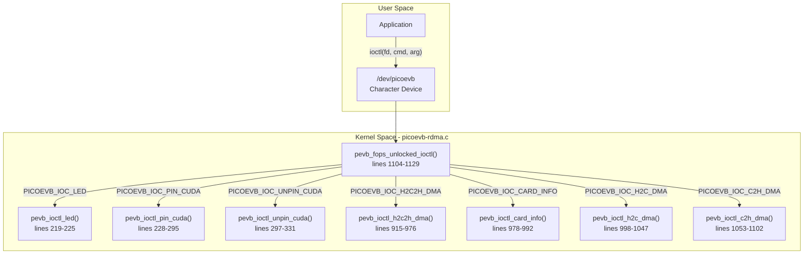
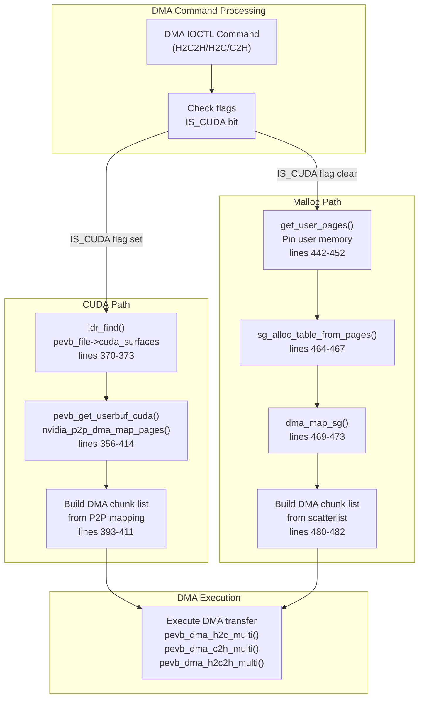
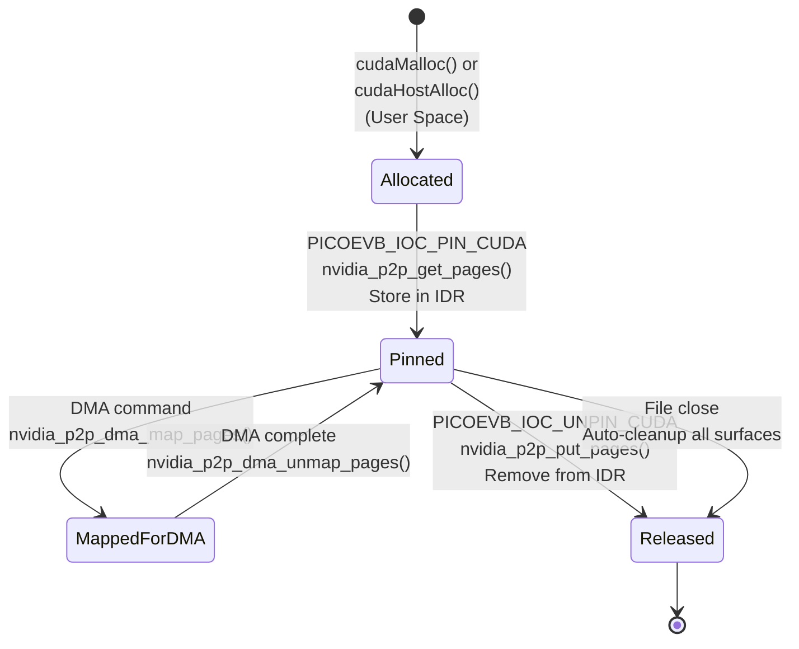
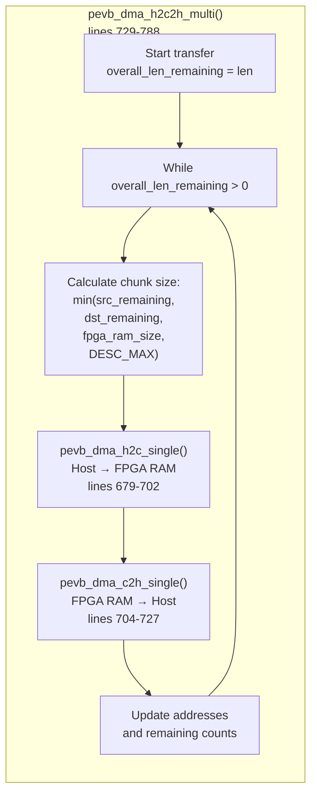

<!-- source: DeepWiki mcp.deepwiki.com · repo NVIDIA/jetson-rdma-picoevb · page 4.2 IOCTL Interface · fetched 2026-11-11 -->

# IOCTL Interface

<details>
<summary>Relevant source files</summary>

The following files were used as context for generating this wiki page:

- [kernel-module/picoevb-rdma-ioctl.h](kernel-module/picoevb-rdma-ioctl.h)
- [kernel-module/picoevb-rdma.c](kernel-module/picoevb-rdma.c)

</details>


This document describes the IOCTL interface provided by the `picoevb-rdma` kernel module. The IOCTL interface serves as the primary communication channel between user-space applications and the kernel driver, enabling applications to control hardware, manage memory pinning, and execute DMA transfers.

For information about the kernel module implementation details, see [Module Overview](#4.1). For details about DMA operations, see [DMA Operations](#4.3). For CUDA memory integration, see [CUDA P2P Integration](#4.4).

## Interface Overview

The IOCTL interface is accessed through the `/dev/picoevb` character device. Applications open this device file and issue `ioctl()` system calls with specific command codes and associated data structures. The kernel module handles these requests in `pevb_fops_unlocked_ioctl()` which dispatches to specialized handler functions.

All IOCTL commands and data structures are defined in `kernel-module/picoevb-rdma-ioctl.h`, providing a stable API contract between user space and kernel space.

**Sources:** [kernel-module/picoevb-rdma-ioctl.h:14-85](), [kernel-module/picoevb-rdma.c:1104-1129]()

## Command Dispatcher Flow



**Sources:** [kernel-module/picoevb-rdma.c:1104-1129]()

## IOCTL Commands

The following table summarizes all available IOCTL commands:

| Command | Value | Type | Purpose |
|---------|-------|------|---------|
| `PICOEVB_IOC_LED` | `_IOW('P', 0, __u32)` | Write | Control GPIO/LED state |
| `PICOEVB_IOC_PIN_CUDA` | `_IOWR('P', 1, ...)` | Read/Write | Pin CUDA memory for DMA access |
| `PICOEVB_IOC_UNPIN_CUDA` | `_IOW('P', 2, ...)` | Write | Unpin previously pinned CUDA memory |
| `PICOEVB_IOC_H2C2H_DMA` | `_IOWR('P', 3, ...)` | Read/Write | Execute Host→Card→Host DMA transfer |
| `PICOEVB_IOC_CARD_INFO` | `_IOR('P', 4, ...)` | Read | Query FPGA card information |
| `PICOEVB_IOC_H2C_DMA` | `_IOWR('P', 5, ...)` | Read/Write | Execute Host→Card DMA transfer |
| `PICOEVB_IOC_C2H_DMA` | `_IOWR('P', 6, ...)` | Read/Write | Execute Card→Host DMA transfer |

**Sources:** [kernel-module/picoevb-rdma-ioctl.h:77-83]()

## Data Structures

### LED Control

```c
// Command: PICOEVB_IOC_LED
// Direct __u32 value (no structure)
// Input: LED state bitmask
```

The LED control command takes a simple 32-bit unsigned integer directly. The value is written to the GPIO BAR at offset 0.

**Sources:** [kernel-module/picoevb-rdma-ioctl.h:77](), [kernel-module/picoevb-rdma.c:219-225]()

### CUDA Memory Pinning

```c
struct picoevb_rdma_pin_cuda {
    /* Input */
    __u64 va;      // Virtual address of CUDA buffer
    __u64 size;    // Size in bytes to pin
    /* Output */
    __u32 handle;  // Handle for subsequent operations
};
```

The `va` field specifies the starting virtual address of a CUDA-allocated buffer (`cudaMalloc` or `cudaHostAlloc`). The `size` field indicates the length to pin. The kernel returns a `handle` that identifies this pinned region for use in DMA operations.

**Behavior:**
- The address is aligned down to GPU page boundaries (`GPU_PAGE_MASK`)
- Offset within the page is tracked internally (`GPU_PAGE_OFFSET`)
- Calls `nvidia_p2p_get_pages()` to obtain physical page mappings
- Handle is stored in `pevb_file->cuda_surfaces` IDR for lifetime management

**Sources:** [kernel-module/picoevb-rdma-ioctl.h:19-25](), [kernel-module/picoevb-rdma.c:228-295]()

### CUDA Memory Unpinning

```c
struct picoevb_rdma_unpin_cuda {
    /* Input */
    __u32 handle;  // Handle from PICOEVB_IOC_PIN_CUDA
};
```

Releases a previously pinned CUDA memory region. The handle is removed from the IDR and `nvidia_p2p_put_pages()` is called to release the P2P mapping.

**Sources:** [kernel-module/picoevb-rdma-ioctl.h:27-30](), [kernel-module/picoevb-rdma.c:297-331]()

### Host-to-Card-to-Host DMA

```c
struct picoevb_rdma_h2c2h_dma {
    /* Input */
    __u64 src;           // Source: malloc pointer or CUDA handle
    __u64 dst;           // Destination: malloc pointer or CUDA handle
    __u64 len;           // Transfer length in bytes
    __u64 flags;         // Memory type flags
    /* Output */
    __u64 dma_time_ns;   // Transfer duration in nanoseconds
};
```

**Flags:**
- `PICOEVB_H2C2H_DMA_FLAG_SRC_IS_CUDA` (1 << 0): Source is a CUDA handle
- `PICOEVB_H2C2H_DMA_FLAG_DST_IS_CUDA` (1 << 1): Destination is a CUDA handle

If a flag is not set, the corresponding address is treated as a regular user-space pointer (`malloc`).

**Transfer Pattern:**
1. Data is copied from source (host/GPU) to FPGA RAM
2. Data is copied from FPGA RAM to destination (host/GPU)
3. Transfers are chunked by FPGA RAM size and DMA engine limits

**Sources:** [kernel-module/picoevb-rdma-ioctl.h:32-44](), [kernel-module/picoevb-rdma.c:915-976]()

### Card Information

```c
struct picoevb_rdma_card_info {
    /* Output */
    __u64 fpga_ram_size;  // FPGA onboard RAM size in bytes
};
```

Returns hardware capabilities. The `fpga_ram_size` is 64KB for PicoEVB and 2GB for HTG-K800.

**Sources:** [kernel-module/picoevb-rdma-ioctl.h:46-49](), [kernel-module/picoevb-rdma.c:978-992]()

### Host-to-Card DMA

```c
struct picoevb_rdma_h2c_dma {
    /* Input */
    __u64 src;           // Source: malloc pointer or CUDA handle
    __u64 dst;           // Destination: FPGA RAM offset
    __u64 len;           // Transfer length in bytes
    __u64 flags;         // Memory type flags
    /* Output */
    __u64 dma_time_ns;   // Transfer duration in nanoseconds
};
```

**Flags:**
- `PICOEVB_H2C_DMA_FLAG_SRC_IS_CUDA` (1 << 0): Source is a CUDA handle

The `dst` field is an offset into FPGA RAM (0 to `fpga_ram_size - 1`). Data from the host/GPU is copied to the specified FPGA RAM location.

**Sources:** [kernel-module/picoevb-rdma-ioctl.h:51-62](), [kernel-module/picoevb-rdma.c:998-1047]()

### Card-to-Host DMA

```c
struct picoevb_rdma_c2h_dma {
    /* Input */
    __u64 dst;           // Destination: malloc pointer or CUDA handle
    __u64 src;           // Source: FPGA RAM offset
    __u64 len;           // Transfer length in bytes
    __u64 flags;         // Memory type flags
    /* Output */
    __u64 dma_time_ns;   // Transfer duration in nanoseconds
};
```

**Flags:**
- `PICOEVB_C2H_DMA_FLAG_DST_IS_CUDA` (1 << 0): Destination is a CUDA handle

The `src` field is an offset into FPGA RAM. Data from the FPGA RAM is copied to the specified host/GPU location.

**Sources:** [kernel-module/picoevb-rdma-ioctl.h:64-75](), [kernel-module/picoevb-rdma.c:1053-1102]()

## Memory Type Handling

The DMA commands support two memory types: regular host memory (via `malloc`) and CUDA memory. The handling differs based on flags:



**Sources:** [kernel-module/picoevb-rdma.c:356-414](), [kernel-module/picoevb-rdma.c:417-485](), [kernel-module/picoevb-rdma.c:932-954](), [kernel-module/picoevb-rdma.c:1018-1027](), [kernel-module/picoevb-rdma.c:1073-1082]()

## CUDA Surface Lifecycle

CUDA memory regions must be explicitly pinned before use and unpinned after use:



**Key structures:**
- `struct pevb_file` contains `struct idr cuda_surfaces` for tracking pinned surfaces
- `struct pevb_cuda_surface` stores virtual address, length, handle, and `nvidia_p2p_page_table`
- Callback `pevb_p2p_free_callback()` handles cleanup when NVIDIA driver invalidates pages

**Sources:** [kernel-module/picoevb-rdma.c:73-88](), [kernel-module/picoevb-rdma.c:137-153](), [kernel-module/picoevb-rdma.c:156-174](), [kernel-module/picoevb-rdma.c:176-217]()

## Usage Patterns

### Pattern 1: CUDA Memory DMA (Common)

```
1. cudaMalloc(&gpu_ptr, size)
2. ioctl(fd, PICOEVB_IOC_PIN_CUDA, {va=gpu_ptr, size=size}) → handle
3. ioctl(fd, PICOEVB_IOC_H2C_DMA, {src=handle, dst=offset, flags=IS_CUDA})
4. ioctl(fd, PICOEVB_IOC_C2H_DMA, {src=offset, dst=handle, flags=IS_CUDA})
5. ioctl(fd, PICOEVB_IOC_UNPIN_CUDA, {handle=handle})
6. cudaFree(gpu_ptr)
```

**Sources:** [kernel-module/picoevb-rdma.c:228-295](), [kernel-module/picoevb-rdma.c:297-331](), [kernel-module/picoevb-rdma.c:998-1047](), [kernel-module/picoevb-rdma.c:1053-1102]()

### Pattern 2: Host Memory DMA (Simple)

```
1. ptr = malloc(size)
2. ioctl(fd, PICOEVB_IOC_H2C2H_DMA, {src=ptr, dst=ptr2, len=size, flags=0})
   (No pinning required - kernel calls get_user_pages automatically)
3. free(ptr)
```

**Sources:** [kernel-module/picoevb-rdma.c:915-976]()

### Pattern 3: Mixed CUDA and Host

```
1. gpu_ptr = cudaMalloc(size)
2. host_ptr = malloc(size)
3. ioctl(fd, PICOEVB_IOC_PIN_CUDA, {va=gpu_ptr, size=size}) → handle
4. ioctl(fd, PICOEVB_IOC_H2C2H_DMA, {
     src=handle,
     dst=host_ptr,
     flags=PICOEVB_H2C2H_DMA_FLAG_SRC_IS_CUDA
   })
5. ioctl(fd, PICOEVB_IOC_UNPIN_CUDA, {handle=handle})
```

**Sources:** [kernel-module/picoevb-rdma.c:915-976]()

## DMA Chunking and Limits

DMA transfers are subject to several constraints that require chunking:

| Constraint | Value | Source |
|------------|-------|--------|
| FPGA RAM size | 64KB (PicoEVB)<br/>2GB (HTG-K800) | `drvdata->fpga_ram_size` |
| DMA descriptor max | `XLNX_DMA_DESC_LEN_MAX_WORD_ALIGNED` | Hardware register limit |
| Scatter-gather segments | Variable | IOMMU and physical memory layout |

The H2C2H transfer path chunks transfers to fit FPGA RAM:



**Sources:** [kernel-module/picoevb-rdma.c:729-788]()

## Error Handling

All IOCTL handlers follow consistent error handling:

1. **Input Validation:** `copy_from_user()` checks for invalid user pointers
2. **Flag Validation:** Unknown flags are rejected with `-EINVAL`
3. **Range Validation:** FPGA RAM offsets are bounds-checked
4. **Handle Validation:** CUDA handles are verified via IDR lookup
5. **DMA Errors:** Hardware errors are detected via interrupt status bits
6. **Cleanup:** Resources are released even on error paths (goto labels)

The dispatcher returns error codes:
- `-EFAULT`: Memory access error
- `-EINVAL`: Invalid parameters or flags
- `-ENOMEM`: Memory allocation failure
- `-EIO`: DMA hardware error
- `-ERESTARTSYS`: Operation interrupted by signal

**Sources:** [kernel-module/picoevb-rdma.c:1104-1129](), [kernel-module/picoevb-rdma.c:915-976](), [kernel-module/picoevb-rdma.c:570-677]()

## Thread Safety and Locking

The IOCTL interface uses multiple synchronization mechanisms:

| Lock | Type | Scope | Purpose |
|------|------|-------|---------|
| `pevb_file->lock` | `struct mutex` | Per file descriptor | Protects `cuda_surfaces` IDR |
| `pevb->sem` | `struct semaphore` | Per device | Serializes DMA operations |
| `pevb->dma_xfer_cmpl` | `struct completion` | Per device | Synchronizes with DMA IRQ |

**Locking order (to prevent deadlock):**
1. Acquire `pevb_file->lock` (if accessing CUDA surfaces)
2. Acquire `pevb->sem` (if executing DMA)
3. Wait on `pevb->dma_xfer_cmpl` (during DMA execution)

**Sources:** [kernel-module/picoevb-rdma.c:56-77](), [kernel-module/picoevb-rdma.c:740-785](), [kernel-module/picoevb-rdma.c:800-845](), [kernel-module/picoevb-rdma.c:930-973]()

## Performance Considerations

1. **Timing Measurement:** DMA commands return `dma_time_ns` which measures kernel execution time from `ktime_get_ns()` calls before and after the DMA operation. This includes chunking overhead but excludes IOCTL syscall overhead.

2. **Pinning Overhead:** CUDA memory pinning (`PICOEVB_IOC_PIN_CUDA`) should be done once per buffer and reused for multiple transfers to avoid repeated P2P setup costs.

3. **Chunking Penalty:** H2C2H transfers on PicoEVB (64KB RAM) incur significant chunking overhead for large transfers. HTG-K800 (2GB RAM) reduces this substantially.

4. **IOMMU Impact:** Systems with IOMMU may present contiguous DMA mappings regardless of physical page fragmentation, reducing chunking for H2C and C2H operations.

**Sources:** [kernel-module/picoevb-rdma.c:958-960](), [kernel-module/picoevb-rdma.c:1031-1033](), [kernel-module/picoevb-rdma.c:1086-1088](), [kernel-module/picoevb-rdma.c:762-764]()

---

