<!-- source: DeepWiki mcp.deepwiki.com · repo NVIDIA/jetson-rdma-picoevb · page 4.4 CUDA P2P Integration · fetched 2026-11-11 -->

# CUDA P2P Integration

<details>
<summary>Relevant source files</summary>

The following files were used as context for generating this wiki page:

- [kernel-module/picoevb-rdma.c](kernel-module/picoevb-rdma.c)

</details>


## Purpose and Scope

This page documents how the picoevb-rdma kernel module integrates with NVIDIA's P2P (Peer-to-Peer) API to enable GPUDirect RDMA transfers. The P2P API allows the kernel module to pin GPU memory pages and map them for DMA access by the FPGA hardware, enabling zero-copy data transfers between GPU and FPGA.

For information about the IOCTL interface that user applications use to trigger these operations, see [IOCTL Interface](#4.2). For details on how DMA transfers are executed once memory is pinned and mapped, see [DMA Operations](#4.3). For higher-level memory management concepts, see [Memory Management](#3.3).

**Sources:** [kernel-module/picoevb-rdma.c:1-1312]()

---

## Overview

The kernel module uses NVIDIA's P2P kernel API to enable direct DMA access to CUDA-allocated memory. This integration provides two critical capabilities:

1. **Memory Pinning**: Prevents GPU memory pages from being relocated or paged out during DMA operations
2. **DMA Mapping**: Obtains physical bus addresses that the FPGA DMA engine can use to read/write GPU memory

The P2P integration is conditionally compiled based on the `NV_BUILD_NO_CUDA` flag and supports two different GPU architectures (dGPU and iGPU) with distinct API signatures and page size requirements.

**Sources:** [kernel-module/picoevb-rdma.c:26-32](), [kernel-module/picoevb-rdma.c:42-49]()

---

## GPU Platform Differences

The kernel module handles two distinct GPU architectures with different P2P API characteristics:

### Platform Configuration

| Platform | Header File | Page Size | Typical Hardware |
|----------|-------------|-----------|------------------|
| **dGPU** (Discrete GPU) | `<nv-p2p.h>` | 64KB (2^16) | Quadro, Tesla GPUs |
| **iGPU** (Integrated GPU) | `<linux/nv-p2p.h>` | 4KB (2^12) | Jetson Xavier, Drive AGX Xavier |

**Page Size Constants:**

```c
#ifdef NV_BUILD_DGPU
#define GPU_PAGE_SHIFT	16        // 64KB pages
#else
#define GPU_PAGE_SHIFT	12        // 4KB pages
#endif
#define GPU_PAGE_SIZE	(((u64)1) << GPU_PAGE_SHIFT)
#define GPU_PAGE_OFFSET	(GPU_PAGE_SIZE - 1)
#define GPU_PAGE_MASK	(~GPU_PAGE_OFFSET)
```

### API Signature Differences

The P2P API functions have different signatures between dGPU and iGPU platforms:

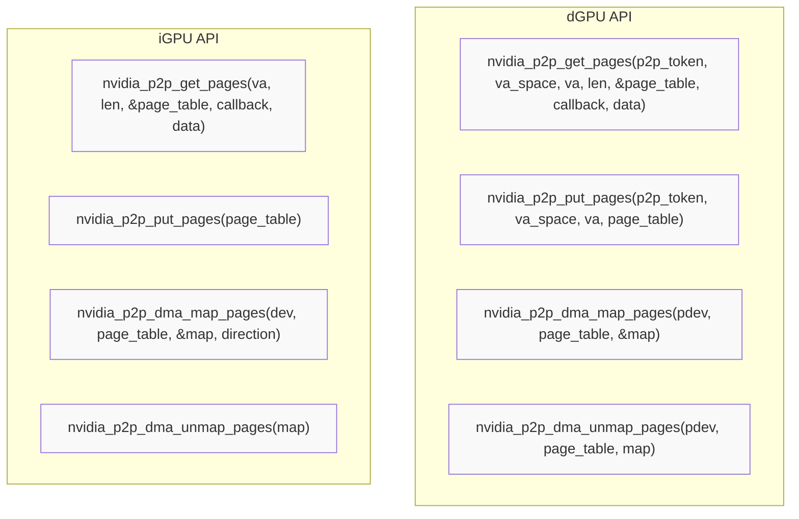

**Key Differences:**

- **dGPU**: Requires `p2p_token` and `va_space` parameters (set to 0)
- **iGPU**: Omits these parameters; requires `direction` parameter for DMA mapping
- **iGPU**: Automatically invokes the free callback on `nvidia_p2p_put_pages()`
- **dGPU**: Requires manual callback invocation after `nvidia_p2p_put_pages()`

**Sources:** [kernel-module/picoevb-rdma.c:26-32](), [kernel-module/picoevb-rdma.c:42-49](), [kernel-module/picoevb-rdma.c:250-259](), [kernel-module/picoevb-rdma.c:378-386]()

---

## CUDA Surface Data Structure

The kernel module uses `struct pevb_cuda_surface` to track each pinned CUDA memory region:

```c
struct pevb_cuda_surface {
    struct pevb_file              *pevb_file;     // Back-reference to owning file descriptor
    u64                           va;             // Page-aligned virtual address
    u64                           offset;         // Offset within first page
    u64                           len;            // Length of buffer
    int                           handle;         // User-space handle (IDR-allocated)
    struct nvidia_p2p_page_table  *page_table;    // P2P page table from NVIDIA driver
};
```

### Field Descriptions

| Field | Purpose |
|-------|---------|
| `pevb_file` | Reference to the file descriptor that owns this surface; used for IDR cleanup |
| `va` | GPU virtual address aligned to GPU page boundary |
| `offset` | Byte offset from `va` to the actual start of the user's buffer |
| `len` | Original buffer length requested by the user |
| `handle` | Integer handle returned to user-space (stored in `pevb_file->cuda_surfaces` IDR) |
| `page_table` | Opaque NVIDIA structure containing pinned page information |

### Handle Management with IDR

Each file descriptor maintains an IDR (Integer ID Allocator) of CUDA surfaces:

```mermaid
graph LR
    PEVB_FILE["struct pevb_file"]
    IDR["cuda_surfaces (IDR)"]
    SURF0["handle=0<br/>cusurf"]
    SURF1["handle=1<br/>cusurf"]
    SURF2["handle=5<br/>cusurf"]
    
    PEVB_FILE -->|contains| IDR
    IDR -->|idr_find(0)| SURF0
    IDR -->|idr_find(1)| SURF1
    IDR -->|idr_find(5)| SURF2
```

The IDR automatically allocates unique integer handles and provides efficient lookup by handle.

**Sources:** [kernel-module/picoevb-rdma.c:80-88](), [kernel-module/picoevb-rdma.c:73-77](), [kernel-module/picoevb-rdma.c:148]()

---

## CUDA Surface Lifecycle

The lifecycle of a CUDA surface involves four main operations: pin, map, unmap, and free.

### Lifecycle State Machine

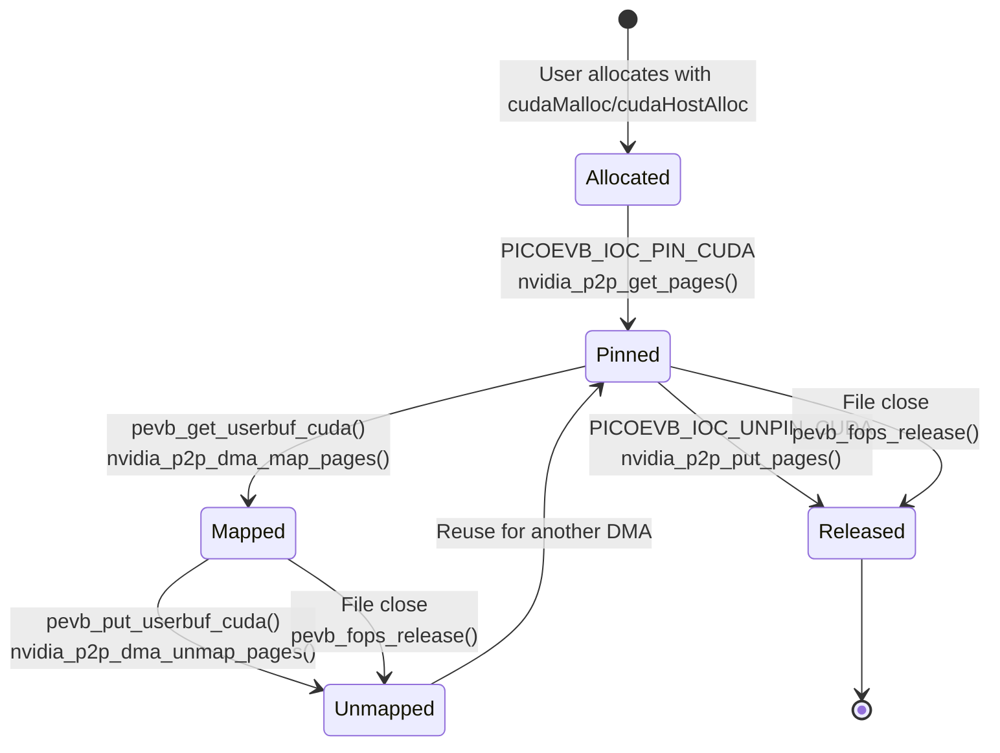

### Phase 1: Pin (User IOCTL)

**Function:** `pevb_ioctl_pin_cuda()`

**Purpose:** Pin GPU memory pages to prevent relocation during DMA operations.

**Process:**
1. User passes virtual address and size via `PICOEVB_IOC_PIN_CUDA` IOCTL
2. Kernel aligns the address to GPU page boundaries
3. Calls `nvidia_p2p_get_pages()` to pin the memory
4. Allocates a handle via IDR and returns it to user-space

**Address Alignment:**
```
User VA:    0x7f1234567890, len = 0x1000
Aligned VA: 0x7f1234560000 (va)
Offset:     0x7890 (offset)
Aligned len:0x8000 (covers original range)
```

**Sources:** [kernel-module/picoevb-rdma.c:228-295]()

### Phase 2: Map for DMA (Internal)

**Function:** `pevb_get_userbuf_cuda()`

**Purpose:** Map pinned pages for DMA access by the FPGA.

**Process:**
1. Look up CUDA surface by handle in IDR
2. Call `nvidia_p2p_dma_map_pages()` to obtain DMA addresses
3. Build scatter-gather list from DMA addresses
4. Handle page offset and length adjustments

**DMA Mapping Structure:**

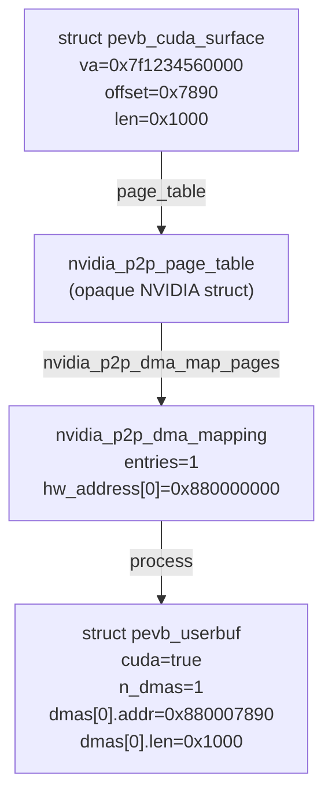

**Offset Application:**
The first page's DMA address is adjusted by the offset to point to the actual buffer start:
```
DMA address from P2P: 0x880000000
Add offset:          +0x7890
Final DMA address:    0x880007890
```

**Sources:** [kernel-module/picoevb-rdma.c:356-414]()

### Phase 3: Unmap (Internal)

**Function:** `pevb_put_userbuf_cuda()`

**Purpose:** Unmap DMA addresses after transfer completes.

**Process:**
1. Call `nvidia_p2p_dma_unmap_pages()` with the mapping
2. Free the DMA scatter-gather list
3. CUDA surface remains pinned for potential reuse

**Sources:** [kernel-module/picoevb-rdma.c:505-516]()

### Phase 4: Unpin (User IOCTL or Cleanup)

**Function:** `pevb_ioctl_unpin_cuda()` or `pevb_fops_release()`

**Purpose:** Unpin GPU memory pages and release resources.

**Process:**
1. Remove handle from IDR
2. Call `nvidia_p2p_put_pages()`
3. Invoke `pevb_p2p_free_callback()` (automatic on iGPU, manual on dGPU)
4. Free CUDA surface structure

**Automatic Cleanup on File Close:**
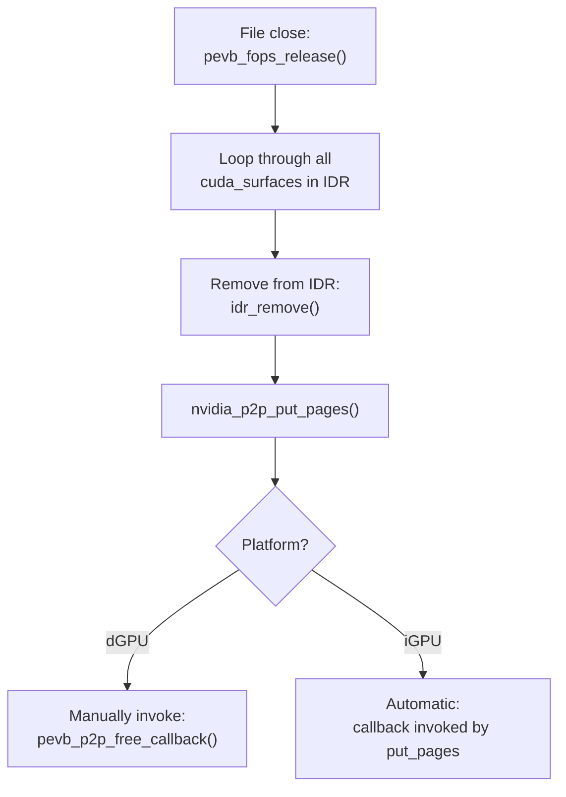

**Sources:** [kernel-module/picoevb-rdma.c:297-331](), [kernel-module/picoevb-rdma.c:176-217]()

---

## Pin Operation Details

### IOCTL Handler: pevb_ioctl_pin_cuda()

**Input Structure:**
```c
struct picoevb_rdma_pin_cuda {
    __u64 va;      // Virtual address to pin
    __u64 size;    // Size in bytes
    __u64 handle;  // [OUT] Handle for subsequent operations
};
```

**Implementation Flow:**

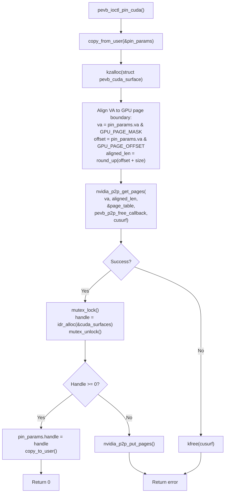

**Callback Registration:**
When calling `nvidia_p2p_get_pages()`, the kernel module registers `pevb_p2p_free_callback` as the cleanup callback. This callback is invoked by the NVIDIA driver when the GPU memory is freed by the application or when the driver needs to reclaim the pages.

**Sources:** [kernel-module/picoevb-rdma.c:228-295]()

---

## Unpin Operation Details

### IOCTL Handler: pevb_ioctl_unpin_cuda()

**Input Structure:**
```c
struct picoevb_rdma_unpin_cuda {
    __u64 handle;  // Handle from pin operation
};
```

**Implementation Flow:**

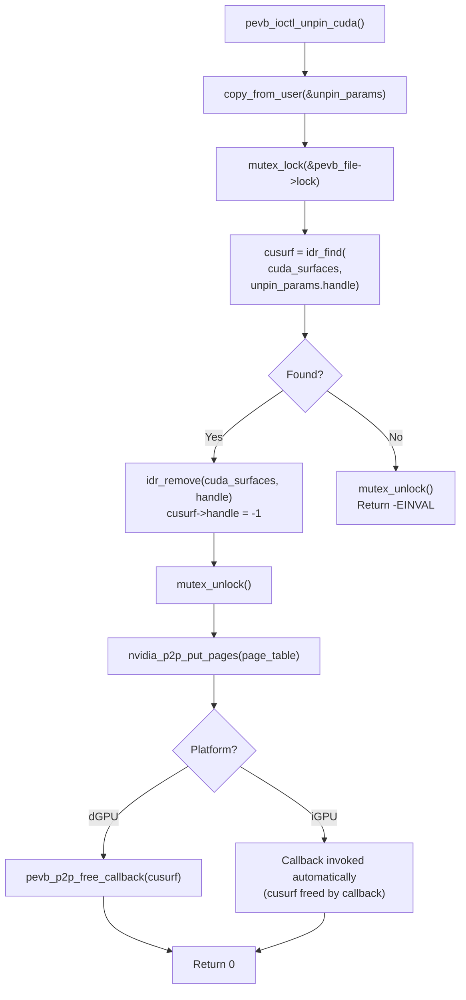

**Critical Detail:** The handle is set to -1 before calling `nvidia_p2p_put_pages()` to prevent the callback from attempting to remove it from the IDR again (which would fail since we already removed it).

**Sources:** [kernel-module/picoevb-rdma.c:297-331]()

---

## P2P Free Callback Mechanism

### Callback Function: pevb_p2p_free_callback()

The callback is registered when pinning memory and invoked by the NVIDIA driver when:
1. The application explicitly unpins the memory
2. The application frees the GPU memory while it's still pinned
3. The GPU driver needs to reclaim the pages for internal reasons

**Implementation:**

```c
static void pevb_p2p_free_callback(void *data)
{
    struct pevb_cuda_surface *cusurf = data;
    struct pevb_file *pevb_file = cusurf->pevb_file;

    mutex_lock(&pevb_file->lock);
    if (cusurf->handle >= 0) {
        idr_remove(&pevb_file->cuda_surfaces, cusurf->handle);
        cusurf->handle = -1;
    }
    mutex_unlock(&pevb_file->lock);

    nvidia_p2p_free_page_table(cusurf->page_table);
#ifndef NV_BUILD_DGPU
    kfree(cusurf->page_table);  // iGPU requires manual free
#endif
    kfree(cusurf);
}
```

**Callback Flow:**

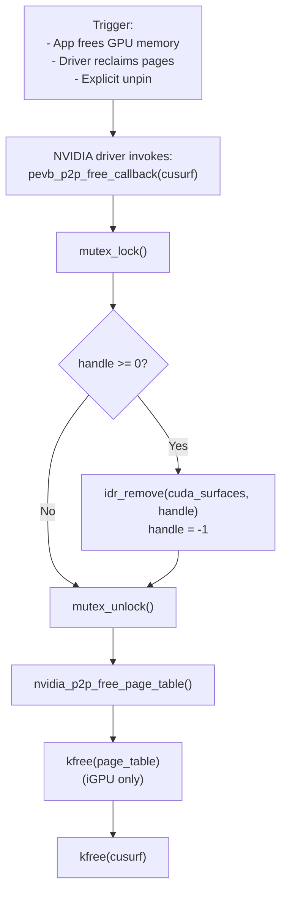

**Handle Check Purpose:** The `if (cusurf->handle >= 0)` check prevents double-removal from the IDR. When `pevb_ioctl_unpin_cuda()` is called, it sets the handle to -1 before putting the pages, so the callback knows not to remove it again.

**Platform-Specific Memory Management:** On iGPU platforms, the `page_table` structure itself must be manually freed because the NVIDIA driver only frees the internal pages, not the structure wrapper.

**Sources:** [kernel-module/picoevb-rdma.c:156-174]()

---

## DMA Mapping Process

### Function: pevb_get_userbuf_cuda()

This internal function is called when a DMA operation needs to access a pinned CUDA buffer.

**Call Chain:**

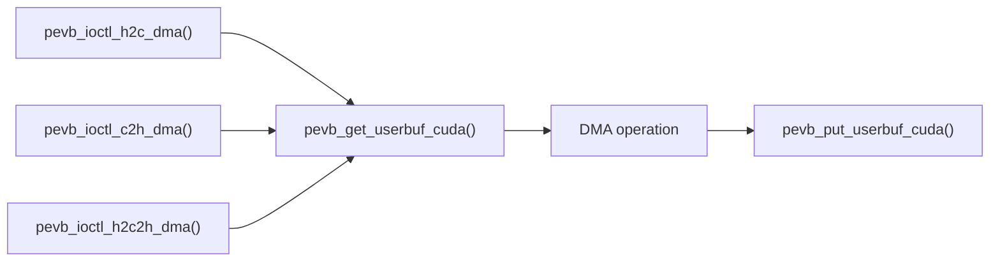

### Mapping Implementation

**Input Parameters:**
- `pevb_file`: File descriptor context
- `ubuf`: User buffer structure to populate
- `handle64`: CUDA surface handle (masked to 28 bits)
- `len`: Length to map (must be <= surface length)
- `to_dev`: DMA direction (1 = to device, 0 = from device)

**Process:**

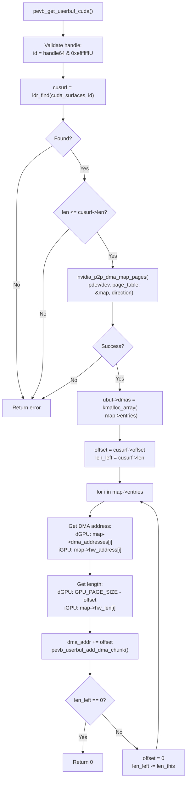

### DMA Address Construction

The function builds a scatter-gather list from the P2P mapping, handling platform differences:

**dGPU Platform:**
- Each entry in `dma_addresses[]` is a 64KB-aligned page
- Must manually calculate length based on offset and remaining bytes
- First page: `len = min(GPU_PAGE_SIZE - offset, len_left)`
- Subsequent pages: `len = min(GPU_PAGE_SIZE, len_left)`

**iGPU Platform:**
- Each entry provides both address (`hw_address[]`) and length (`hw_len[]`)
- Can directly use the provided lengths
- More flexible page sizes

**Scatter-Gather List Optimization:**
The `pevb_userbuf_add_dma_chunk()` function coalesces adjacent DMA addresses into a single entry:
```c
if (ubuf->n_dmas) {
    dma = &ubuf->dmas[ubuf->n_dmas - 1];
    end = dma->addr + dma->len;
    if (addr == end) {
        dma->len += len;  // Extend existing entry
        return;
    }
}
// Otherwise, add new entry
```

This optimization reduces the number of DMA descriptors needed when the GPU presents physically contiguous memory.

**Sources:** [kernel-module/picoevb-rdma.c:356-414](), [kernel-module/picoevb-rdma.c:334-353]()

---

## DMA Unmapping Process

### Function: pevb_put_userbuf_cuda()

Called after DMA operation completes to release the DMA mapping.

**Implementation:**

```c
static void pevb_put_userbuf_cuda(struct pevb *pevb, struct pevb_userbuf *ubuf)
{
    if (ubuf->priv.cuda.map)
#ifdef NV_BUILD_DGPU
        nvidia_p2p_dma_unmap_pages(pevb->pdev,
            ubuf->priv.cuda.cusurf->page_table,
            ubuf->priv.cuda.map);
#else
        nvidia_p2p_dma_unmap_pages(ubuf->priv.cuda.map);
#endif
}
```

**Platform Differences:**
- **dGPU**: Requires `pdev` and `page_table` parameters
- **iGPU**: Only requires the `map` structure

**What This Does:**
1. Invalidates the DMA mapping so FPGA can no longer access the GPU memory
2. Allows the GPU driver to relocate or reclaim the pages if needed
3. Does NOT unpin the pages (they remain pinned for reuse)

**Call Context:**
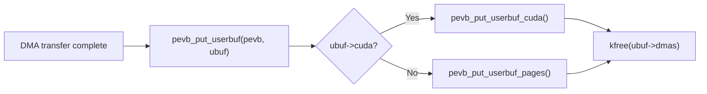

**Sources:** [kernel-module/picoevb-rdma.c:505-516](), [kernel-module/picoevb-rdma.c:518-527]()

---

## Integration with DMA Operations

CUDA P2P integration is used by all three DMA IOCTL handlers when the `*_IS_CUDA` flag is set.

### IOCTL Flag Constants

```c
// H2C DMA flags
#define PICOEVB_H2C_DMA_FLAG_SRC_IS_CUDA  (1 << 0)

// C2H DMA flags
#define PICOEVB_C2H_DMA_FLAG_DST_IS_CUDA  (1 << 0)

// H2C2H DMA flags
#define PICOEVB_H2C2H_DMA_FLAG_SRC_IS_CUDA  (1 << 0)
#define PICOEVB_H2C2H_DMA_FLAG_DST_IS_CUDA  (1 << 1)
```

### Usage Pattern in IOCTLs

All three DMA IOCTL handlers follow this pattern:

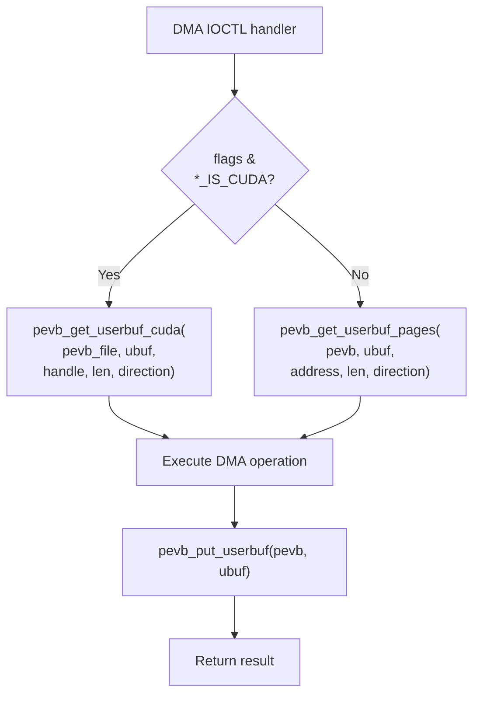

**Example from H2C DMA:**
```c
if (dma_params.flags & PICOEVB_H2C_DMA_FLAG_SRC_IS_CUDA)
#ifndef NV_BUILD_NO_CUDA
    ret = pevb_get_userbuf_cuda(pevb_file, &src_ubuf,
        dma_params.src, dma_params.len, 1);
#else
    ret = -EINVAL;
#endif
else
    ret = pevb_get_userbuf_pages(pevb, &src_ubuf, dma_params.src,
        dma_params.len, 1);
```

### Unified Buffer Abstraction

The `struct pevb_userbuf` provides a unified interface for both CUDA and regular memory:

```c
struct pevb_userbuf {
#ifndef NV_BUILD_NO_CUDA
    bool cuda;                    // true = CUDA, false = pages
#endif
    int n_dmas;                   // Number of DMA scatter-gather entries
    struct pevb_userbuf_dma *dmas; // Array of DMA address/length pairs
    
    union {
        struct { /* regular pages */ } pages;
        struct { /* CUDA surface */ } cuda;
    } priv;
};
```

This abstraction allows DMA functions like `pevb_dma_h2c_multi()` to work with either CUDA or regular memory without knowing the difference—they simply iterate over `ubuf->dmas[]` entries.

**Sources:** [kernel-module/picoevb-rdma.c:915-976](), [kernel-module/picoevb-rdma.c:998-1047](), [kernel-module/picoevb-rdma.c:1053-1102](), [kernel-module/picoevb-rdma.c:95-117]()

---

## Conditional Compilation

The CUDA P2P integration can be completely disabled via the `NV_BUILD_NO_CUDA` flag.

### Compilation Modes

| Flag | Purpose | Effect |
|------|---------|--------|
| `NV_BUILD_NO_CUDA` | Disable CUDA support entirely | Excludes P2P header, disables all CUDA IOCTLs |
| `NV_BUILD_DGPU` | Configure for discrete GPU | Uses dGPU API signatures, 64KB pages |
| Neither set | Configure for integrated GPU | Uses iGPU API signatures, 4KB pages |

### Conditional Code Blocks

**Header Inclusion:**
```c
#ifndef NV_BUILD_NO_CUDA
#ifdef NV_BUILD_DGPU
#include <nv-p2p.h>           // dGPU: system header
#else
#include <linux/nv-p2p.h>     // iGPU: kernel header
#endif
#endif
```

**IOCTL Registration:**
```c
switch (cmd) {
    case PICOEVB_IOC_LED:
        return pevb_ioctl_led(pevb_file, arg);
#ifndef NV_BUILD_NO_CUDA
    case PICOEVB_IOC_PIN_CUDA:
        return pevb_ioctl_pin_cuda(pevb_file, arg);
    case PICOEVB_IOC_UNPIN_CUDA:
        return pevb_ioctl_unpin_cuda(pevb_file, arg);
#endif
    // ... other IOCTLs
}
```

**DMA Flag Handling:**
```c
if (dma_params.flags & PICOEVB_H2C_DMA_FLAG_SRC_IS_CUDA)
#ifndef NV_BUILD_NO_CUDA
    ret = pevb_get_userbuf_cuda(...);
#else
    ret = -EINVAL;  // Not compiled with CUDA support
#endif
```

When `NV_BUILD_NO_CUDA` is defined, any attempt to use CUDA-related IOCTLs returns `-EINVAL`.

**Sources:** [kernel-module/picoevb-rdma.c:26-32](), [kernel-module/picoevb-rdma.c:1104-1129]()

---

## Error Handling

The P2P integration includes comprehensive error handling at each stage:

### Pin Operation Errors

| Condition | Error Code | Handling |
|-----------|------------|----------|
| `copy_from_user()` fails | `-EFAULT` | Return immediately |
| `kzalloc()` fails | `-ENOMEM` | Return immediately |
| `nvidia_p2p_get_pages()` fails | Return code from P2P API | Free cusurf, return error |
| IDR allocation fails | Return code from `idr_alloc()` | Call `nvidia_p2p_put_pages()`, free cusurf |
| `copy_to_user()` fails | `-EFAULT` | Call `nvidia_p2p_put_pages()`, free cusurf |

### Map Operation Errors

| Condition | Error Code | Handling |
|-----------|------------|----------|
| Invalid handle | `-EINVAL` | Return immediately |
| Length exceeds surface | `-EINVAL` | Return immediately |
| `nvidia_p2p_dma_map_pages()` fails | Return code from P2P API | Return error |
| `kmalloc_array()` fails | `-ENOMEM` | Return error (map gets cleaned up by put_userbuf) |

### Cleanup on Error

The DMA IOCTL handlers use a consistent goto-based cleanup pattern:

```c
ret = pevb_get_userbuf_cuda(...);
if (ret)
    goto put_userbuf_src;

// ... do DMA ...

put_userbuf_src:
    pevb_put_userbuf(pevb, &src_ubuf);
    mutex_unlock(&pevb_file->lock);
    return ret;
```

This ensures that partially-initialized structures are properly cleaned up even when errors occur midway through processing.

**Sources:** [kernel-module/picoevb-rdma.c:228-295](), [kernel-module/picoevb-rdma.c:356-414](), [kernel-module/picoevb-rdma.c:915-976]()

---

## Thread Safety

The CUDA P2P integration uses multiple locking mechanisms to ensure thread safety:

### Mutex Protection

**Per-File Descriptor Mutex:**
Each `struct pevb_file` has a mutex that protects:
- The `cuda_surfaces` IDR
- Concurrent access to CUDA surface handles

```mermaid
graph TD
    THREAD1["Thread 1:<br/>PIN_CUDA IOCTL"]
    THREAD2["Thread 2:<br/>UNPIN_CUDA IOCTL"]
    THREAD3["Thread 3:<br/>H2C_DMA IOCTL"]
    MUTEX["pevb_file->lock<br/>(mutex)"]
    IDR["cuda_surfaces IDR"]
    
    THREAD1 -.->|mutex_lock()| MUTEX
    THREAD2 -.->|mutex_lock()| MUTEX
    THREAD3 -.->|mutex_lock()| MUTEX
    MUTEX --> IDR
```

**Operations Protected by Mutex:**
1. `idr_alloc()` when pinning
2. `idr_find()` when looking up handle for DMA
3. `idr_remove()` when unpinning
4. `idr_get_next()` when cleaning up on file close

### Semaphore for DMA Serialization

**Per-Device Semaphore:**
Each `struct pevb` has a semaphore (`sem`) that serializes DMA operations:

```c
if (down_interruptible(&pevb->sem))
    return -ERESTARTSYS;

// ... execute DMA ...

up(&pevb->sem);
```

This prevents concurrent DMA operations from interfering with each other, as the FPGA hardware can only handle one transfer at a time.

### Callback Race Protection

The free callback uses `handle >= 0` check to prevent race conditions:

**Race Scenario:**
1. Thread A calls `pevb_ioctl_unpin_cuda()`, removes handle from IDR, sets handle to -1
2. Thread B (callback) is simultaneously triggered by GPU driver
3. Callback checks `if (handle >= 0)` and skips IDR removal since it's already removed

This prevents the callback from attempting to remove an already-removed handle, which would corrupt the IDR.

**Sources:** [kernel-module/picoevb-rdma.c:147](), [kernel-module/picoevb-rdma.c:164](), [kernel-module/picoevb-rdma.c:739-740]()

---

## Performance Considerations

### Page Size Impact

The GPU page size directly affects DMA efficiency:

| Platform | Page Size | Impact |
|----------|-----------|--------|
| dGPU | 64KB | Fewer DMA descriptors for large transfers, better bandwidth |
| iGPU | 4KB | More DMA descriptors, potentially more overhead |

### DMA Mapping Overhead

Calling `nvidia_p2p_dma_map_pages()` has non-trivial overhead. The kernel module optimizes this by:

1. **Keeping pages pinned:** Pages remain pinned between DMA operations for reuse
2. **Mapping only when needed:** DMA mapping happens per-transfer, not per-pin
3. **Scatter-gather coalescing:** Adjacent pages are combined into single DMA entries

### Alignment Considerations

GPU memory alignment affects the number of pages that must be pinned:

**Misaligned Example:**
```
User allocates:     0x7f1234567890, len = 0x1000
GPU page alignment: 64KB (0x10000)
Pages to pin:       0x7f1234560000 to 0x7f1234570000 (2 pages = 128KB)
```

For optimal performance, applications should allocate GPU memory aligned to GPU page boundaries.

### Reusability Pattern

Applications can optimize performance by:
1. Pin memory once with `PICOEVB_IOC_PIN_CUDA`
2. Perform multiple DMA operations using the handle
3. Unpin only when done with `PICOEVB_IOC_UNPIN_CUDA`

This amortizes the cost of pinning across multiple transfers.

**Sources:** [kernel-module/picoevb-rdma.c:42-49](), [kernel-module/picoevb-rdma.c:244-248](), [kernel-module/picoevb-rdma.c:334-353]()

---

