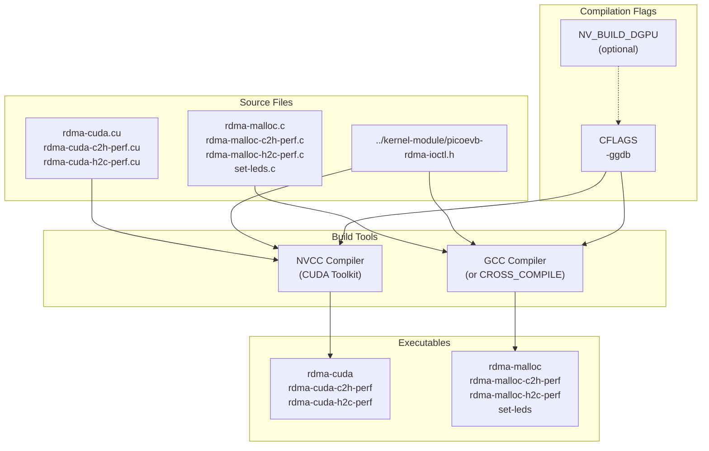
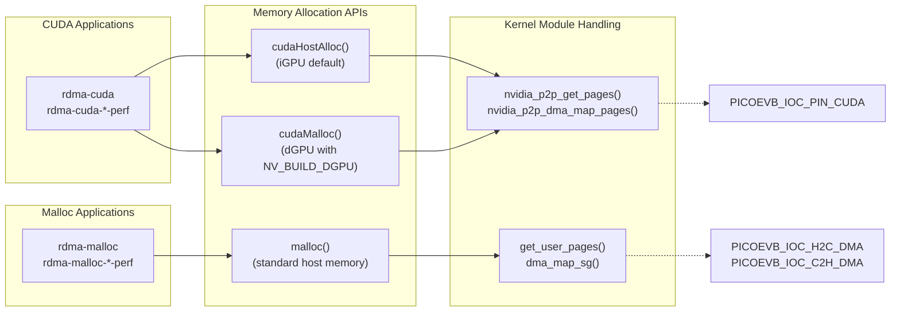
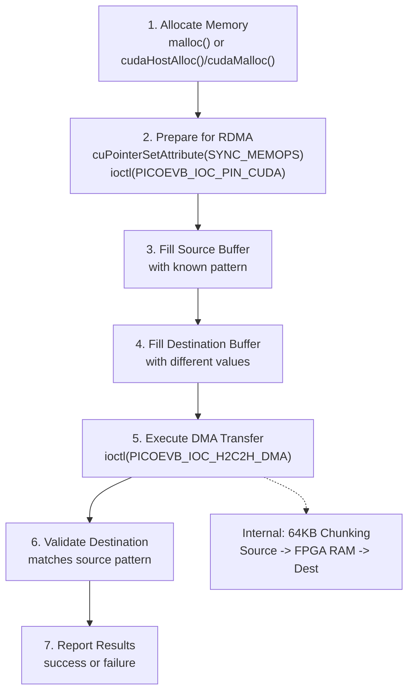
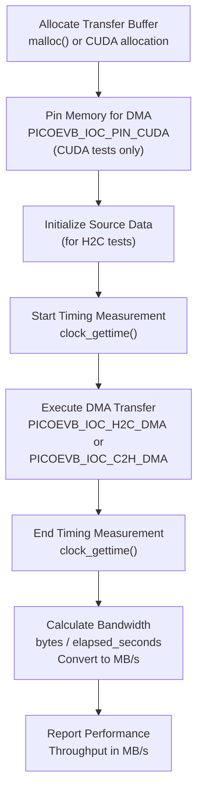
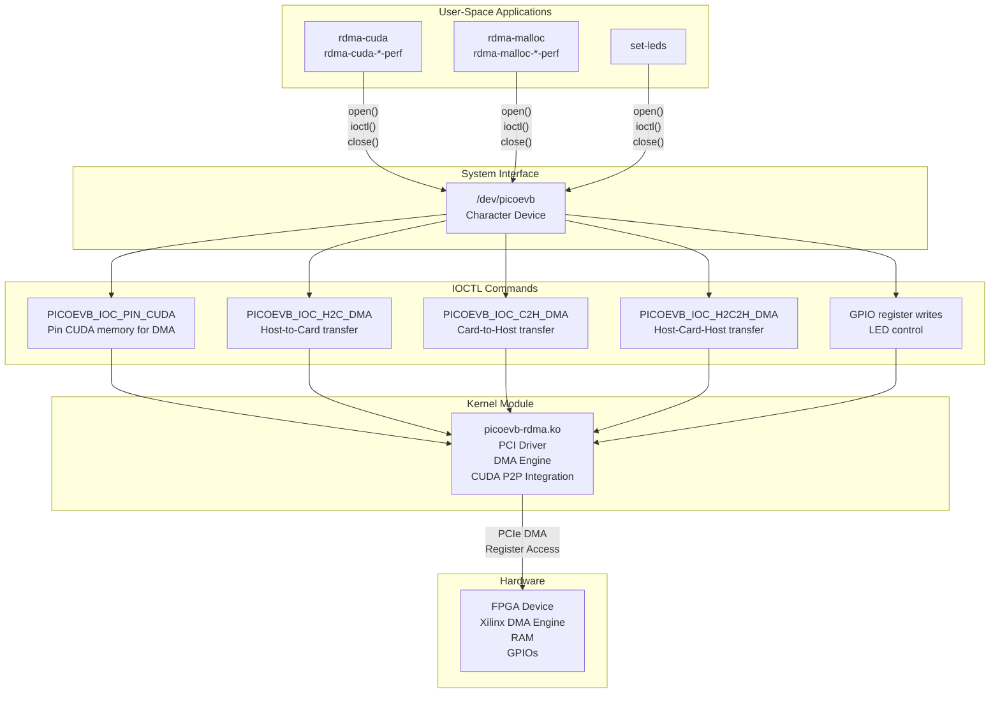

<!-- source: DeepWiki mcp.deepwiki.com · repo NVIDIA/jetson-rdma-picoevb · page 5 Client Applications · fetched 2026-11-11 -->

# Client Applications

<details>
<summary>Relevant source files</summary>

The following files were used as context for generating this wiki page:

- [README.md](README.md)
- [client-applications/Makefile](client-applications/Makefile)

</details>


This document describes the user-space test applications and utilities that demonstrate and validate GPUDirect RDMA functionality. These applications communicate with the `picoevb-rdma` kernel module via ioctl commands to perform DMA transfers between host memory, GPU memory, and FPGA hardware.

For information about the kernel module's IOCTL interface, see [IOCTL Interface](#4.2). For details on building these applications, see [Building Client Applications](#7.3).

---

## Application Categories and Build Targets

The client applications are organized into three functional categories, each targeting specific validation or measurement objectives:

| Category | Applications | Memory Type | Purpose |
|----------|-------------|-------------|---------|
| Functional Tests | `rdma-cuda`<br>`rdma-malloc` | CUDA memory<br>Host memory | Data integrity validation via H2C2H transfers |
| Performance Tests | `rdma-cuda-c2h-perf`<br>`rdma-cuda-h2c-perf`<br>`rdma-malloc-c2h-perf`<br>`rdma-malloc-h2c-perf` | CUDA memory<br>CUDA memory<br>Host memory<br>Host memory | Unidirectional bandwidth measurement |
| Hardware Utilities | `set-leds` | N/A | GPIO/LED control for hardware validation |

All applications are built from the `client-applications/` directory using a single Makefile that handles both CUDA (`.cu`) and C (`.c`) source files.

**Sources:** [README.md:280-384](), [client-applications/Makefile:40-48]()

---

### Build System and Compilation



The Makefile automatically detects the CUDA toolkit location by checking common installation paths: `/usr/local/cuda`, `/usr/local/cuda-10.1`, and `/usr/local/cuda-10.0`. The `NVCC` compiler is used for `.cu` files with CUDA code, while `GCC` (or a cross-compiler) is used for pure C `.c` files.

The `NV_BUILD_DGPU` flag controls memory allocation strategy in CUDA applications. When defined, applications use `cudaMalloc()` for discrete GPU (dGPU) device memory. When undefined (default), applications use `cudaHostAlloc()` for integrated GPU (iGPU) unified memory.

**Sources:** [client-applications/Makefile:21-57](), [README.md:282-321]()

---

## Memory Type Support

Applications in this suite test two distinct memory allocation strategies, each representing different memory management approaches:



The `rdma-cuda` family uses CUDA memory allocation APIs, requiring explicit pinning via `PICOEVB_IOC_PIN_CUDA` before DMA operations. The kernel module uses NVIDIA's P2P API to map GPU memory for PCIe access. The `rdma-malloc` family uses standard `malloc()` buffers, which the kernel module pins using Linux's `get_user_pages()` mechanism.

**Sources:** [README.md:327-330](), [client-applications/Makefile:35-38]()

---

## Functional Tests

The functional tests validate data integrity through bidirectional H2C2H (Host-to-Card-to-Host) transfers. These tests use the FPGA's onboard RAM as an intermediate staging buffer, copying data from a source buffer to FPGA RAM (H2C), then from FPGA RAM to a destination buffer (C2H). This exercises both PCIe read and write operations while verifying data correctness.

### Test Execution Pattern



Both tests follow identical logical flow but differ in memory allocation method. The kernel module internally divides transfers into 64KB chunks (limited by PicoEVB's FPGA RAM size) or larger chunks (for HTG-K800 with 2GB RAM). Each chunk performs H2C transfer followed by C2H transfer.

**Sources:** [README.md:332-359]()

---

### rdma-cuda Test

**Executable:** `rdma-cuda`  
**Source File:** `client-applications/rdma-cuda.cu`

This test validates RDMA functionality with CUDA-managed memory. On Jetson/Drive AGX Xavier systems (iGPU), it allocates memory using `cudaHostAlloc()` for unified memory accessible by both CPU and GPU. On PC systems with discrete GPUs (when `NV_BUILD_DGPU` is defined), it uses `cudaMalloc()` for device-only memory.

Before performing DMA, the test calls `cuPointerSetAttribute(CU_POINTER_ATTRIBUTE_SYNC_MEMOPS)` to ensure CUDA operations are synchronized properly with PCIe DMA. It then pins the memory using `PICOEVB_IOC_PIN_CUDA` ioctl, which invokes the kernel module's NVIDIA P2P integration to obtain physical page mappings.

**Execution:**
```bash
sudo ./rdma-cuda
```

The `sudo` requirement exists because the device file `/dev/picoevb` requires root access by default. This can be avoided by adjusting device file permissions.

**Sources:** [README.md:327-346](), [client-applications/Makefile:35-38]()

---

### rdma-malloc Test

**Executable:** `rdma-malloc`  
**Source File:** `client-applications/rdma-malloc.c`

This test validates RDMA functionality with standard host memory allocated via `malloc()`. Unlike the CUDA test, this test does not require GPU memory or CUDA runtime. The kernel module uses Linux's `get_user_pages()` and `dma_map_sg()` to pin and map the host memory for DMA operations.

This test is structurally identical to `rdma-cuda` but demonstrates that the RDMA infrastructure works with regular system memory, not just CUDA memory. This is useful for non-GPU workloads or for testing the kernel module's memory management independently of CUDA.

**Execution:**
```bash
sudo ./rdma-malloc
```

**Sources:** [README.md:327-346](), [client-applications/Makefile:53-54]()

---

## Performance Benchmarks

The performance benchmark applications measure unidirectional DMA throughput for Host-to-Card (H2C) and Card-to-Host (C2H) transfers. Unlike the functional tests which perform H2C2H bidirectional copies, these tests exercise single-direction transfers to isolate and measure bandwidth for each direction independently.

### Benchmark Operation Flow



Each performance test measures elapsed time for the DMA operation using high-resolution timers, then calculates throughput in MB/s. The tests transfer large buffers to amortize setup overhead and obtain representative bandwidth measurements.

**Sources:** [README.md:361-371]()

---

### CUDA Performance Tests

**Executables:** `rdma-cuda-h2c-perf`, `rdma-cuda-c2h-perf`  
**Source Files:** `client-applications/rdma-cuda-h2c-perf.cu`, `client-applications/rdma-cuda-c2h-perf.cu`

These benchmarks measure DMA bandwidth with CUDA-allocated memory:

- **rdma-cuda-h2c-perf**: Measures Host-to-Card write bandwidth. Allocates CUDA memory, pins it, then uses `PICOEVB_IOC_H2C_DMA` to copy data from host/GPU memory to FPGA RAM. Reports write throughput in MB/s.

- **rdma-cuda-c2h-perf**: Measures Card-to-Host read bandwidth. Allocates CUDA memory, pins it, then uses `PICOEVB_IOC_C2H_DMA` to copy data from FPGA RAM to host/GPU memory. Reports read throughput in MB/s.

These tests respect the `NV_BUILD_DGPU` flag: on discrete GPU systems, they use `cudaMalloc()` for device memory, while on integrated GPU systems, they use `cudaHostAlloc()` for unified memory.

**Execution:**
```bash
sudo ./rdma-cuda-h2c-perf
sudo ./rdma-cuda-c2h-perf
```

**Sources:** [README.md:361-371](), [client-applications/Makefile:42-43]()

---

### Malloc Performance Tests

**Executables:** `rdma-malloc-h2c-perf`, `rdma-malloc-c2h-perf`  
**Source Files:** `client-applications/rdma-malloc-h2c-perf.c`, `client-applications/rdma-malloc-c2h-perf.c`

These benchmarks measure DMA bandwidth with standard host memory:

- **rdma-malloc-h2c-perf**: Measures Host-to-Card write bandwidth using `malloc()` buffers. Uses `PICOEVB_IOC_H2C_DMA` to transfer data from host memory to FPGA RAM.

- **rdma-malloc-c2h-perf**: Measures Card-to-Host read bandwidth using `malloc()` buffers. Uses `PICOEVB_IOC_C2H_DMA` to transfer data from FPGA RAM to host memory.

These tests provide a baseline for comparing CUDA memory performance against standard host memory, and can run on systems without CUDA support.

**Execution:**
```bash
sudo ./rdma-malloc-h2c-perf
sudo ./rdma-malloc-c2h-perf
```

**Sources:** [README.md:361-371](), [client-applications/Makefile:45-46]()

---

## Hardware Control Utilities

### set-leds

**Executable:** `set-leds`  
**Source File:** `client-applications/set-leds.c`

This utility controls the three LEDs on the PicoEVB board for visual hardware validation. It accepts a single command-line parameter (0-7) representing a 3-bit binary value to display on the LEDs. The hardware inverts the value, so:
- Parameter `0` turns **on** all LEDs (binary 000)
- Parameter `7` turns **off** all LEDs (binary 111)
- Parameter `2` displays binary pattern 010 (inverted to 101)

This utility provides a simple mechanism to verify that:
1. The FPGA is properly programmed and responsive
2. The kernel module successfully loaded and bound to the device
3. User-space can communicate with the FPGA via ioctl

**Usage Examples:**
```bash
./set-leds 0  # All LEDs on
./set-leds 7  # All LEDs off
./set-leds 2  # Custom pattern (binary 010)
./set-leds 5  # Custom pattern (binary 101)
```

The utility uses IOCTL commands to write to the FPGA's GPIO registers, demonstrating basic register access without involving DMA or memory transfers.

**Sources:** [README.md:373-383](), [client-applications/Makefile:47,56-57]()

---

## Application-Kernel Communication Interface

All client applications communicate with the `picoevb-rdma` kernel module through the `/dev/picoevb` character device using ioctl system calls. The following diagram illustrates the communication pattern:



Applications include `picoevb-rdma-ioctl.h` header to access IOCTL command definitions and data structures. The kernel module enforces memory alignment requirements, handles DMA descriptor programming, and manages interrupt-driven completion notification.

**Sources:** [client-applications/Makefile:50-57](), [README.md:332-359]()

---

## Common Usage Patterns

### Running Tests Without sudo

By default, all applications require `sudo` because `/dev/picoevb` is created with root-only permissions. To avoid using `sudo`, adjust device permissions:

```bash
sudo chmod 666 /dev/picoevb
```

Or create a udev rule for persistent permissions across reboots.

### Verifying FPGA Functionality

A typical verification workflow:

1. Load kernel module: `sudo insmod picoevb-rdma.ko`
2. Verify device binding: `lspci -v | grep picoevb-rdma`
3. Test basic hardware access: `./set-leds 0` (should illuminate LEDs)
4. Run functional test: `sudo ./rdma-malloc`
5. Measure performance: `sudo ./rdma-malloc-h2c-perf`

### Interpreting Test Results

- **Functional tests** report "PASS" or "FAIL" based on data integrity validation
- **Performance tests** report throughput in MB/s
- Test failures typically indicate hardware issues, incorrect FPGA bitstream, or kernel module problems

**Sources:** [README.md:349-350](), [README.md:373-383]()

---

