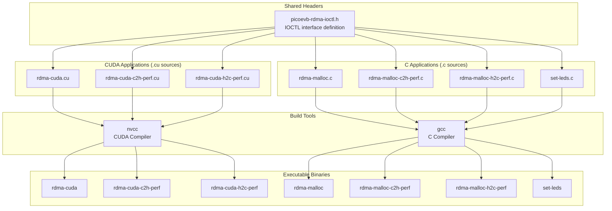
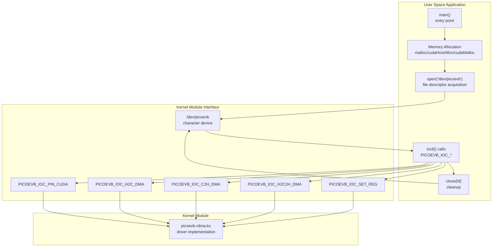
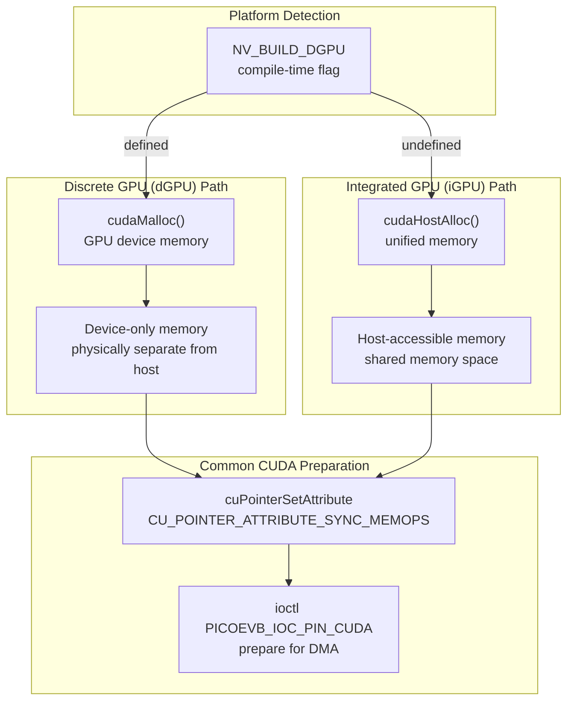

<!-- source: DeepWiki mcp.deepwiki.com · repo NVIDIA/jetson-rdma-picoevb · page 5.1 Application Overview · fetched 2026-11-11 -->

# Application Overview

<details>
<summary>Relevant source files</summary>

The following files were used as context for generating this wiki page:

- [README.md](README.md)
- [client-applications/Makefile](client-applications/Makefile)

</details>


This page introduces the suite of user-space client applications included in this repository. These applications demonstrate and validate the GPUDirect RDMA functionality provided by the `picoevb-rdma` kernel module. For detailed documentation of specific application types, see [Functional Tests](#5.2), [Performance Benchmarks](#5.3), and [Hardware Control Utilities](#5.4). For build instructions, see [Building Client Applications](#7.3).

## Purpose and Scope

The client applications serve three primary purposes:

1. **Functional Validation**: Verify data integrity of DMA transfers with pattern-based testing
2. **Performance Measurement**: Quantify transfer bandwidth for different memory types and directions
3. **Hardware Control**: Provide basic utilities for FPGA hardware interaction

All applications communicate with the kernel module through the ioctl interface defined in [kernel-module/picoevb-rdma-ioctl.h](). They are implemented as standalone executables that require root privileges or appropriate device file permissions to access `/dev/picoevb`.

## Application Categories

The repository provides seven client applications, organized by functionality:

| Application | Category | Memory Type | Transfer Direction | Purpose |
|------------|----------|-------------|-------------------|---------|
| `rdma-cuda` | Functional Test | CUDA (cudaHostAlloc/cudaMalloc) | Bidirectional (H2C2H) | Data integrity validation |
| `rdma-malloc` | Functional Test | Host (malloc) | Bidirectional (H2C2H) | Data integrity validation |
| `rdma-cuda-c2h-perf` | Performance | CUDA | Card-to-Host | Bandwidth measurement |
| `rdma-cuda-h2c-perf` | Performance | CUDA | Host-to-Card | Bandwidth measurement |
| `rdma-malloc-c2h-perf` | Performance | Host (malloc) | Card-to-Host | Bandwidth measurement |
| `rdma-malloc-h2c-perf` | Performance | Host (malloc) | Host-to-Card | Bandwidth measurement |
| `set-leds` | Utility | N/A | N/A | GPIO/LED control |

**Sources:** [README.md:327-383](), [client-applications/Makefile:41-47]()

## Application Binaries and Source Files



**Diagram: Application Build Pipeline**

This diagram maps source files to their compiled executables. CUDA applications require the NVIDIA CUDA Compiler (`nvcc`), while standard C applications use `gcc`. All applications include the shared ioctl header for kernel module communication.

**Sources:** [client-applications/Makefile:21-57]()

## Common Application Architecture

All client applications follow a consistent architectural pattern for interacting with the kernel module:



**Diagram: Common Application Execution Pattern**

All applications open `/dev/picoevb`, issue ioctl commands to configure and execute DMA transfers, then close the device file. The specific ioctl commands used depend on the application's purpose.

**Sources:** [README.md:327-350](), [kernel-module/picoevb-rdma-ioctl.h]()

## Memory Allocation Strategies

The client applications are divided into two families based on memory management approach:

### malloc-Based Applications

- **Source Files**: `rdma-malloc.c`, `rdma-malloc-c2h-perf.c`, `rdma-malloc-h2c-perf.c`
- **Memory Allocation**: Standard `malloc()` for host memory
- **Kernel Module Handling**: Uses `get_user_pages()` and `dma_map_sg()` to pin and map memory
- **Use Case**: Demonstrates PCIe DMA to regular system memory without GPU involvement

### CUDA-Based Applications

- **Source Files**: `rdma-cuda.cu`, `rdma-cuda-c2h-perf.cu`, `rdma-cuda-h2c-perf.cu`
- **Memory Allocation**: Platform-dependent CUDA APIs
- **Kernel Module Handling**: Uses `nvidia_p2p_get_pages()` and `nvidia_p2p_dma_map_pages()` to pin and map GPU memory
- **Use Case**: Demonstrates GPUDirect RDMA to GPU-accessible memory



**Diagram: CUDA Memory Allocation Strategy**

The CUDA applications use conditional compilation based on `NV_BUILD_DGPU` to select the appropriate memory allocation API. Discrete GPUs (x86 PCs with Quadro/Tesla) use `cudaMalloc()` for device-only memory, while integrated GPUs (Jetson/Drive AGX Xavier) use `cudaHostAlloc()` for unified memory. Both paths require calling `cuPointerSetAttribute()` and pinning via ioctl before DMA operations.

**Sources:** [client-applications/Makefile:35-38](), [README.md:329-336]()

## Build System

The [client-applications/Makefile]() provides a unified build system for all applications:

### Compilation Rules

| Pattern | Compiler | Flags | Dependencies |
|---------|----------|-------|--------------|
| `%.cu` → executable | `nvcc` | `-Xcompiler $(CFLAGS)`, `-l cuda` | `picoevb-rdma-ioctl.h` |
| `rdma-malloc%.c` → executable | `gcc` | `$(CFLAGS)` | `picoevb-rdma-ioctl.h` |
| `set-leds.c` → executable | `gcc` | `$(CFLAGS)` | `picoevb-rdma-ioctl.h` |

### Platform-Specific Build Scripts

| Script | Target Platform | Compiler Configuration |
|--------|----------------|------------------------|
| `build-for-jetson-drive-igpu-native.sh` | Jetson/Drive AGX Xavier | Native ARM64, no `NV_BUILD_DGPU` |
| `build-for-jetson-drive-igpu-on-pc.sh` | Cross-compile for Jetson/Drive | `aarch64-linux-gnu-gcc`, no `NV_BUILD_DGPU` |
| `build-for-pc-native.sh` | x86 PC with dGPU | Native x86_64, defines `NV_BUILD_DGPU` |

**Sources:** [client-applications/Makefile:21-60](), [README.md:282-321]()

## Execution Model

### Privileges

All applications require access to `/dev/picoevb`, which is created by the kernel module with root-only permissions by default. Applications must be executed with `sudo` or the device file permissions must be modified.

**Sources:** [README.md:343-350]()

### Typical Execution Flow

1. **Allocation**: Call `malloc()`, `cudaHostAlloc()`, or `cudaMalloc()` to obtain memory buffers
2. **Device Open**: Open `/dev/picoevb` to obtain a file descriptor
3. **CUDA Preparation** (CUDA applications only): Call `cuPointerSetAttribute()` with `CU_POINTER_ATTRIBUTE_SYNC_MEMOPS`
4. **Memory Pinning** (CUDA applications only): Issue `PICOEVB_IOC_PIN_CUDA` ioctl to pin GPU memory
5. **Data Initialization**: Write known patterns to source buffers for validation
6. **DMA Transfer**: Issue `PICOEVB_IOC_H2C_DMA`, `PICOEVB_IOC_C2H_DMA`, or `PICOEVB_IOC_H2C2H_DMA` ioctl
7. **Validation/Measurement**: Verify data integrity or calculate bandwidth metrics
8. **Cleanup**: Close device file and free memory

**Sources:** [README.md:332-357]()

## Application Usage Patterns

### Functional Tests

```
sudo ./rdma-malloc
sudo ./rdma-cuda
```

Both functional tests perform bidirectional H2C2H transfers using the FPGA's onboard RAM as an intermediate buffer. They validate data integrity by comparing destination buffer contents against known source patterns. Exit code 0 indicates success; non-zero indicates data corruption.

**Sources:** [README.md:343-359]()

### Performance Tests

```
sudo ./rdma-malloc-h2c-perf
sudo ./rdma-malloc-c2h-perf
sudo ./rdma-cuda-h2c-perf
sudo ./rdma-cuda-c2h-perf
```

Performance tests execute unidirectional DMA transfers and report throughput in MB/s. They perform repeated transfers to obtain stable bandwidth measurements.

**Sources:** [README.md:361-371]()

### Hardware Control

```
sudo ./set-leds <value>
```

The `set-leds` utility accepts a command-line parameter (0-7) to control three LEDs on the PicoEVB board. The hardware inverts the value, so `0` illuminates all LEDs and `7` extinguishes all LEDs. This utility directly writes to GPIO registers via `PICOEVB_IOC_SET_REG` ioctl.

**Sources:** [README.md:373-383]()

## Relationship to Other Components

The client applications depend on:

- **Kernel Module Interface**: All ioctl command definitions from [kernel-module/picoevb-rdma-ioctl.h]()
- **CUDA Runtime**: CUDA applications link against libcuda for memory management and P2P attribute configuration
- **Kernel Module**: The `picoevb-rdma.ko` driver must be loaded before applications can execute

For detailed information on the kernel module's ioctl interface, see [IOCTL Interface](#4.2). For information on building these applications, see [Building Client Applications](#7.3).

**Sources:** [README.md:207-383](), [client-applications/Makefile]()

---

