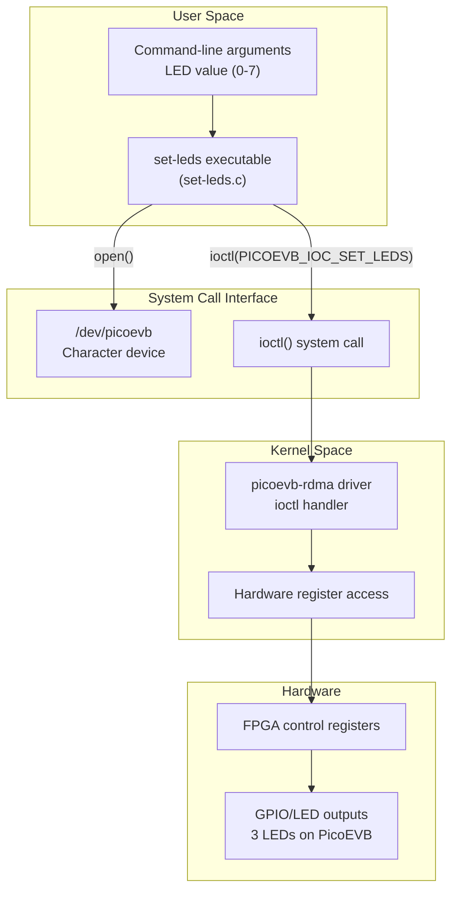
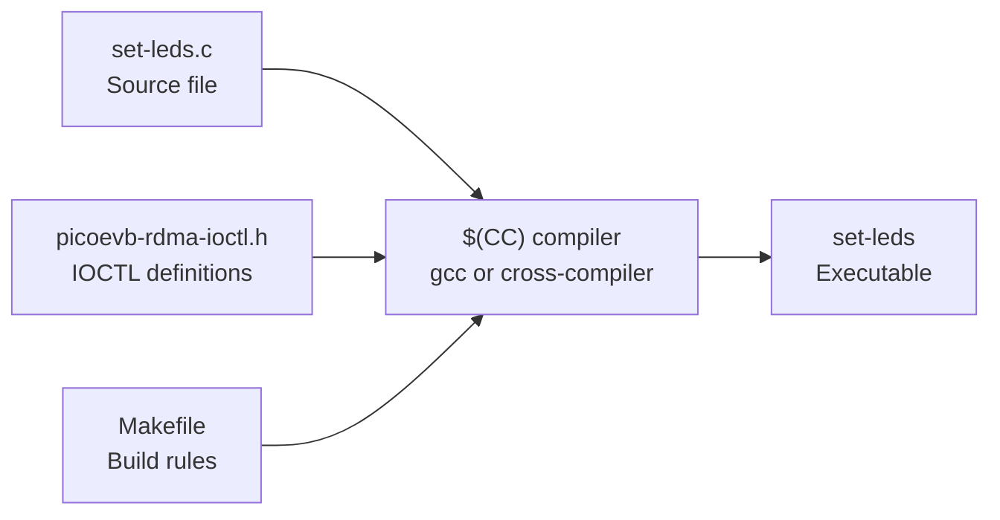
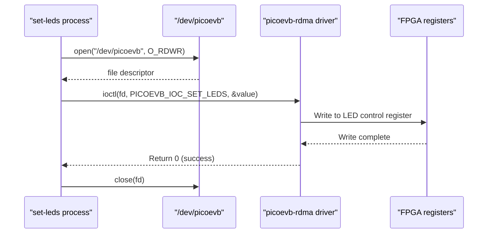
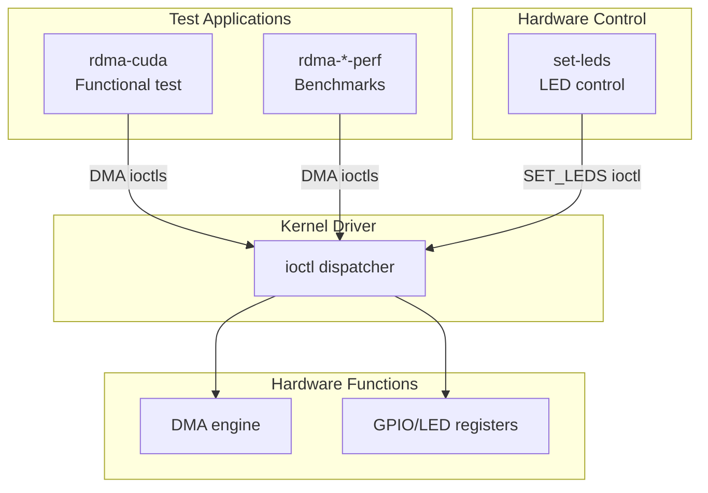

<!-- source: DeepWiki mcp.deepwiki.com · repo NVIDIA/jetson-rdma-picoevb · page 5.4 Hardware Control Utilities · fetched 2026-11-11 -->

# Hardware Control Utilities

<details>
<summary>Relevant source files</summary>

The following files were used as context for generating this wiki page:

- [README.md](README.md)
- [client-applications/Makefile](client-applications/Makefile)

</details>


## Purpose and Scope

This document describes the hardware control utilities provided in the `client-applications/` directory. These are user-space tools that allow direct manipulation of FPGA hardware features, primarily for validation, debugging, and basic hardware testing purposes. The primary utility documented here is `set-leds`, which controls GPIO/LED outputs on the FPGA board.

For functional data transfer testing, see [Functional Tests](#5.2). For performance measurement, see [Performance Benchmarks](#5.3).

**Sources**: [README.md:373-383](), [client-applications/Makefile:47,56-57]()

---

## Overview

Hardware control utilities provide direct access to FPGA peripheral features that are not related to DMA data transfers. These utilities communicate with the kernel module through the `/dev/picoevb` character device using ioctl system calls. Unlike the functional and performance test applications, hardware control utilities typically perform simple register writes to control GPIO pins, LEDs, or other auxiliary hardware features.

The utilities serve multiple purposes:
- **Hardware validation**: Verify that the FPGA is properly programmed and responsive
- **Debugging aid**: Provide visual feedback during development and troubleshooting
- **Basic testing**: Confirm that the kernel driver can communicate with the FPGA

**Sources**: [README.md:373-383]()

---

## System Architecture for Hardware Control



**Diagram: Hardware Control Flow**

This diagram shows how the `set-leds` utility sends commands from user space through the kernel driver to control physical LEDs on the FPGA board. The flow uses standard POSIX system calls and the custom ioctl interface defined in `picoevb-rdma-ioctl.h`.

**Sources**: [README.md:373-383](), [client-applications/Makefile:56-57]()

---

## set-leds Utility

### Purpose

The `set-leds` utility controls the three LEDs on the PicoEVB FPGA board. It provides a simple command-line interface for setting LED states by writing to FPGA control registers. This utility is useful for:
- Verifying basic FPGA communication
- Providing visual status indicators during development
- Testing the ioctl interface without DMA operations

**Note**: This utility is specific to the PicoEVB board. The HTG-K800 board may have different GPIO capabilities.

**Sources**: [README.md:373-383]()

### Command-Line Interface


**Diagram: set-leds Execution Flow**

The utility accepts a single integer parameter representing a 3-bit binary value (0-7), where each bit corresponds to one LED.

**Sources**: [README.md:375-378]()

### Hardware Behavior and Value Inversion

The PicoEVB hardware implements **inverted logic** for LED control:

| Parameter Value | Binary | LED State |
|----------------|--------|-----------|
| 0 | 000 | All LEDs ON |
| 1 | 001 | LED0, LED1 ON; LED2 OFF |
| 2 | 010 | LED0, LED2 ON; LED1 OFF |
| 3 | 011 | LED0 ON; LED1, LED2 OFF |
| 4 | 100 | LED1, LED2 ON; LED0 OFF |
| 5 | 101 | LED1 ON; LED0, LED2 OFF |
| 6 | 110 | LED2 ON; LED0, LED1 OFF |
| 7 | 111 | All LEDs OFF |

**Table: LED Control Value Mapping**

The hardware inverts the provided value before applying it to the LED outputs. This is a hardware design characteristic of the PicoEVB board.

**Sources**: [README.md:375-378]()

### Usage Examples

```bash
# Turn on all LEDs (inverted: 000 = all on)
sudo ./set-leds 0

# Turn off all LEDs (inverted: 111 = all off)
sudo ./set-leds 7

# Set LEDs to binary pattern 010 (LED1 off, others on)
sudo ./set-leds 2

# Set LEDs to binary pattern 101 (LED1 on, others off)
sudo ./set-leds 5
```

**Note**: The `sudo` prefix is required unless appropriate permissions have been applied to `/dev/picoevb`. See [Installation and Module Loading](#7.5) for details on device file permissions.

**Sources**: [README.md:380-383]()

---

## Implementation Details

### Build Configuration

The `set-leds` utility is built as a simple C application without CUDA dependencies:



**Diagram: set-leds Build Process**

The build process is defined in [client-applications/Makefile:56-57]():

```makefile
set-leds: set-leds.c ../kernel-module/picoevb-rdma-ioctl.h Makefile
	$(CC) $(CFLAGS) -o $@ $<
```

The utility is compiled with standard C compiler (gcc) and does not require NVCC or CUDA libraries. This makes it suitable for systems without CUDA development tools installed.

**Sources**: [client-applications/Makefile:56-57,21,33-34]()

### IOCTL Communication Pattern



**Diagram: IOCTL Sequence for LED Control**

The utility follows a standard pattern:
1. Open the character device `/dev/picoevb`
2. Issue an ioctl command with the LED value
3. The kernel driver writes to the FPGA control register
4. Close the device file

The specific ioctl command used is `PICOEVB_IOC_SET_LEDS`, which is defined in `picoevb-rdma-ioctl.h`.

**Sources**: [README.md:373-383](), [client-applications/Makefile:56-57]()

---

## Building Hardware Control Utilities

### Native Compilation on Target Platform

On Jetson/Drive AGX Xavier or x86 PC with the target hardware:

```bash
cd /path/to/this/project/client-applications/
./build-for-jetson-drive-igpu-native.sh  # For ARM64 platforms
# OR
./build-for-pc-native.sh                  # For x86 platforms
```

The build scripts compile all client applications, including `set-leds`.

**Sources**: [README.md:282-292,312-321](), [client-applications/Makefile:47-48]()

### Cross-Compilation

To cross-compile from x86 PC for ARM64 targets:

```bash
cd /path/to/this/project/client-applications/
./build-for-jetson-drive-igpu-on-pc.sh
```

The `set-leds` utility can be cross-compiled because it has no CUDA dependencies. The build scripts automatically configure the cross-compiler toolchain.

**Sources**: [README.md:294-310]()

### Manual Compilation

To build only `set-leds`:

```bash
cd client-applications/
gcc -ggdb -o set-leds set-leds.c
```

This produces the `set-leds` executable without building other applications.

**Sources**: [client-applications/Makefile:33-34,56-57]()

---

## Usage Patterns

### Hardware Validation

After programming the FPGA and loading the kernel module, use `set-leds` to verify basic communication:

```bash
# Cycle through all LED patterns
for i in 0 1 2 3 4 5 6 7; do
    sudo ./set-leds $i
    sleep 1
done
```

If the LEDs respond correctly, this confirms:
- The FPGA bitstream is properly programmed
- The kernel module loaded successfully
- The PCIe communication path is functional
- The ioctl interface is working

**Sources**: [README.md:373-383]()

### Visual Status Indicators

During development or testing, LEDs can indicate system state:

```bash
# Signal start of test sequence
sudo ./set-leds 0  # All LEDs on

# Run tests...
# ...

# Signal test completion
sudo ./set-leds 7  # All LEDs off
```

### Debugging Aid

When troubleshooting complex issues, LED patterns can provide visual feedback without requiring console access:

```bash
# Indicate different stages with unique patterns
sudo ./set-leds 1  # Stage 1: Initialization
# ... initialization code ...

sudo ./set-leds 3  # Stage 2: Memory allocation
# ... allocation code ...

sudo ./set-leds 7  # Stage 3: Complete
```

**Sources**: [README.md:373-383]()

---

## Permissions and Access Control

The `set-leds` utility requires write access to `/dev/picoevb`. By default, this requires root privileges:

```bash
sudo ./set-leds 5
```

To avoid requiring `sudo`, adjust device file permissions after loading the kernel module:

```bash
sudo chmod 666 /dev/picoevb
./set-leds 5  # No sudo needed
```

For persistent permissions, create a udev rule. See [Installation and Module Loading](#7.5) for details.

**Sources**: [README.md:349-350,380-383]()

---

## Integration with Other Applications



**Diagram: Application Integration Architecture**

Hardware control utilities like `set-leds` share the same kernel driver and device file with data transfer applications. However, they use different ioctl commands and access different hardware subsystems:
- Data transfer applications use DMA-related ioctls (`PICOEVB_IOC_H2C_DMA`, `PICOEVB_IOC_C2H_DMA`)
- Hardware control utilities use peripheral control ioctls (`PICOEVB_IOC_SET_LEDS`)

This separation allows LED control to operate independently without interfering with DMA operations.

**Sources**: [README.md:327-371,373-383](), [client-applications/Makefile:40-48]()

---

## Summary

The `set-leds` utility provides simple hardware control functionality for the PicoEVB board:

| Feature | Description |
|---------|-------------|
| **Source File** | `set-leds.c` |
| **Build Target** | Standard C executable (no CUDA) |
| **Hardware Support** | PicoEVB board (3 LEDs) |
| **Interface** | Single integer parameter (0-7) |
| **Logic** | Inverted (0=all on, 7=all off) |
| **Access Required** | Write permission on `/dev/picoevb` |
| **Use Cases** | Validation, debugging, status indication |

**Table: set-leds Utility Summary**

While simple in functionality, this utility demonstrates the basic pattern for hardware control through the picoevb-rdma driver and serves as a valuable tool for system validation and debugging.

**Sources**: [README.md:373-383](), [client-applications/Makefile:47,56-57]()

---

