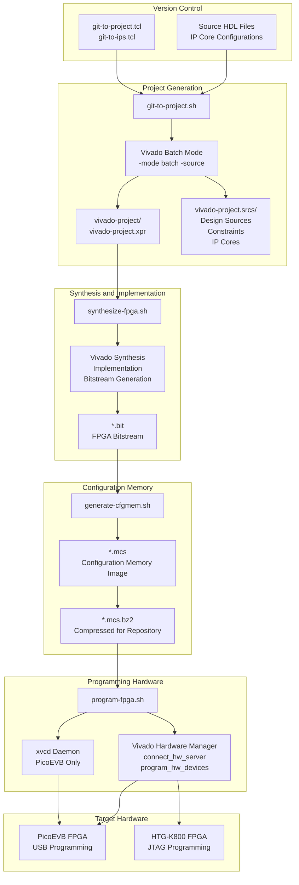
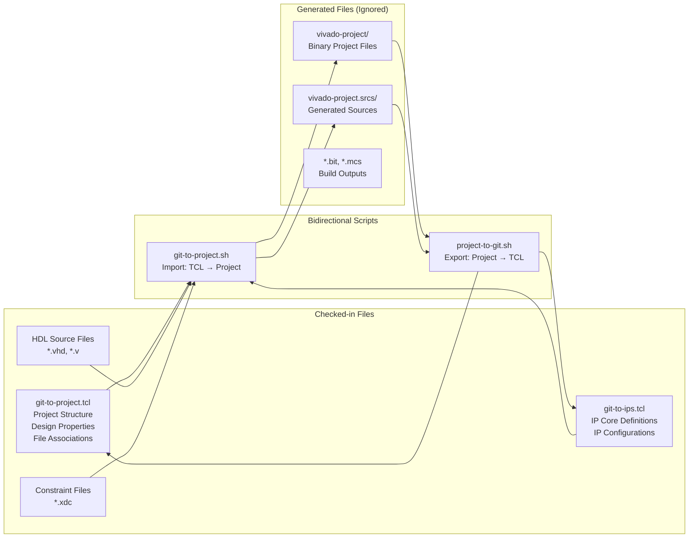
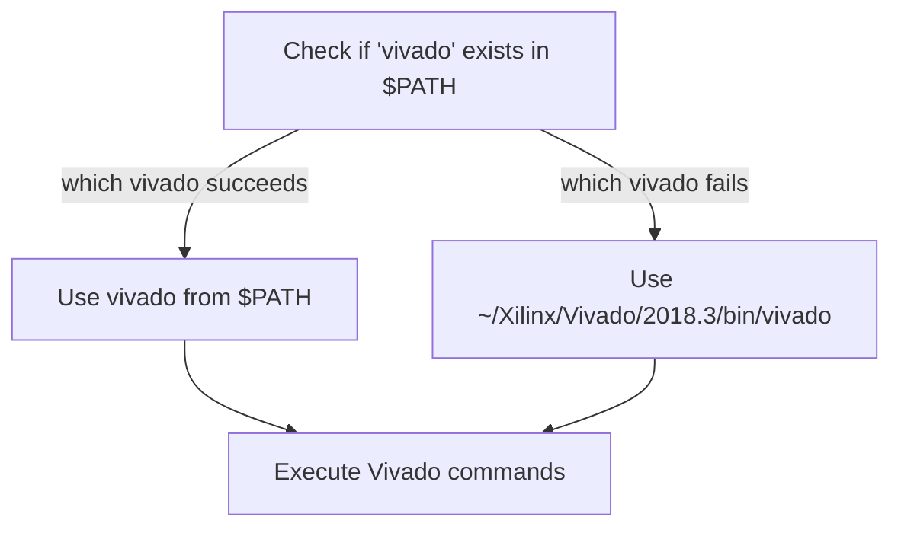

<!-- source: DeepWiki mcp.deepwiki.com · repo NVIDIA/jetson-rdma-picoevb · page 6 FPGA Development · fetched 2026-11-11 -->

# FPGA Development

<details>
<summary>Relevant source files</summary>

The following files were used as context for generating this wiki page:

- [README.md](README.md)
- [fpga-htg-k800/git-to-project.sh](fpga-htg-k800/git-to-project.sh)

</details>


This page covers the FPGA bitstream development workflow using Xilinx Vivado, including project structure, synthesis procedures, and programming methods for both supported FPGA boards. This documentation is for developers who need to modify, rebuild, or program the FPGA designs.

For information about the FPGA hardware specifications and board compatibility, see [Hardware Compatibility](#1.2). For information about installing and using the software prerequisites, see [Software Prerequisites](#2.2).

---

## Overview

The jetson-rdma-picoevb system supports two FPGA boards with different development workflows:

| Board | FPGA Project Directory | Vivado Version | Programming Method | Bitstream Format |
|-------|----------------------|----------------|-------------------|------------------|
| PicoEVB | `fpga-picoevb/` | 2018.3 | xvcd via USB | `*.mcs.bz2` |
| HTG-K800 | `fpga-htg-k800/` | 2018.1 | JTAG (Platform Cable USB II) | `*.mcs.bz2` |

Pre-compiled bitstreams are provided in each FPGA project directory as compressed configuration memory images ([README.md:142]()), eliminating the need to rebuild unless modifications are required.

**Sources**: [README.md:17-206]()

---

## FPGA Development Workflow

The following diagram illustrates the complete FPGA development lifecycle, from version-controlled sources to programmed hardware:



**Sources**: [README.md:136-206](), [fpga-htg-k800/git-to-project.sh:1-40]()

---

## Version Control Integration

The FPGA projects use a script-based approach to integrate with version control, storing project configuration as TCL scripts rather than binary Vivado project files.

### Script Architecture



The `git-to-project.sh` script reconstructs the Vivado project from checked-in TCL scripts ([fpga-htg-k800/git-to-project.sh:23-40]()):

1. Cleans any existing `vivado-project.srcs/` and `vivado-project/` directories ([fpga-htg-k800/git-to-project.sh:32-33]())
2. Executes `git-to-ips.tcl` to generate IP cores ([fpga-htg-k800/git-to-project.sh:34]())
3. Moves generated sources to `vivado-project.srcs/` ([fpga-htg-k800/git-to-project.sh:35]())
4. Executes `git-to-project.tcl` to create the project structure ([fpga-htg-k800/git-to-project.sh:39]())

The inverse operation is performed by `project-to-git.sh`, which exports modifications back to TCL format for version control ([README.md:158-161]()).

**Sources**: [README.md:136-161](), [fpga-htg-k800/git-to-project.sh:23-40]()

---

## Vivado Path Detection

The build scripts automatically locate the Vivado installation using a fallback strategy ([fpga-htg-k800/git-to-project.sh:27-30]()):



This logic is implemented in `git-to-project.sh` at lines 27-30:
```bash
vivado=vivado
if [ ! -x "$(which ${vivado})" ]; then
    vivado=~/Xilinx/Vivado/2018.3/bin/vivado
fi
```

**Note**: The HTG-K800 project uses Vivado 2018.3 as shown in [fpga-htg-k800/git-to-project.sh:29](), while the PicoEVB project uses 2018.1, as documented in [README.md:103-105]().

**Sources**: [fpga-htg-k800/git-to-project.sh:27-30](), [README.md:95-107]()

---

## Building Bitstreams

### Step-by-Step Build Process

The complete bitstream generation workflow consists of three sequential steps:

| Step | Script | Input | Output | Duration |
|------|--------|-------|--------|----------|
| 1. Project Generation | `git-to-project.sh` | TCL scripts, source files | `vivado-project.xpr` | < 1 minute |
| 2. Synthesis & Implementation | `synthesize-fpga.sh` | `vivado-project.xpr` | `*.bit` bitstream | 5-60 minutes |
| 3. Configuration Memory | `generate-cfgmem.sh` | `*.bit` bitstream | `*.mcs` image | < 1 minute |

**Build Workflow**:

```bash
cd fpga-picoevb/   # or fpga-htg-k800/
./git-to-project.sh
./synthesize-fpga.sh
./generate-cfgmem.sh
```

The `synthesize-fpga.sh` script can be replaced by opening `fpga-*/vivado-project/vivado-project.xpr` in the Vivado GUI and requesting bitstream generation ([README.md:150-155]()).

**Sources**: [README.md:136-157]()

---

## Programming FPGAs

The programming procedures differ significantly between the two supported boards:

### Programming Workflow Comparison

```mermaid
graph TB
    subgraph "PicoEVB Programming"
        PICO_BOARD["PicoEVB Board<br/>Connected via M.2 USB"]
        XVCD_HOST["System with FPGA<br/>Jetson or x86 PC"]
        XVCD_DAEMON["xvcd Daemon<br/>sudo ./xvcd -P 0x6015"]
        SSH_TUNNEL["SSH Port Forward<br/>-L 2542:127.0.0.1:2542"]
        VIVADO_PC1["Vivado on x86 PC<br/>program-fpga.sh"]
        PICO_PROGRAMMED["PicoEVB Programmed<br/>20-40 minutes"]
        
        PICO_BOARD --> XVCD_HOST
        XVCD_HOST --> XVCD_DAEMON
        XVCD_DAEMON --> SSH_TUNNEL
        SSH_TUNNEL --> VIVADO_PC1
        VIVADO_PC1 --> PICO_PROGRAMMED
    end
    
    subgraph "HTG-K800 Programming"
        HTG_BOARD["HTG-K800 Board<br/>Connected via JTAG"]
        PLATFORM_CABLE["Xilinx Platform Cable USB II"]
        VIVADO_PC2["Vivado on x86 PC<br/>program-fpga.sh"]
        HTG_PROGRAMMED["HTG-K800 Programmed<br/>Few minutes"]
        
        HTG_BOARD --> PLATFORM_CABLE
        PLATFORM_CABLE --> VIVADO_PC2
        VIVADO_PC2 --> HTG_PROGRAMMED
    end
```



**Sources**: [README.md:163-206]()

---

### PicoEVB Programming Procedure

PicoEVB programming requires coordination between the system containing the board and an x86 PC running Vivado.

**Requirements**:
- Vivado installed on x86 Linux PC
- xvcd running on system with PicoEVB ([README.md:109-134]())
- Network connectivity between the two systems

**Programming Steps** ([README.md:165-191]()):

1. **Start xvcd on the host system** (Jetson or x86 PC with PicoEVB):
   ```bash
   sudo ./xvcd -P 0x6015
   ```

2. **Establish SSH tunnel** (if xvcd runs on remote Jetson):
   ```bash
   ssh -L 2542:127.0.0.1:2542 ip_address_of_jetson
   ```

3. **Execute programming script** on x86 PC with Vivado:
   ```bash
   cd fpga-picoevb/
   ./program-fpga.sh
   ```

**Programming Duration**: 20-40 minutes with no output during most of the operation ([README.md:189-191]()).

**Reliability Note**: The connection process can be unreliable and may require multiple attempts ([README.md:185-187]()).

**Drive AGX Xavier Limitation**: The M.2 slot on Drive AGX Xavier does not support USB, so the PicoEVB must be programmed on a different system before being connected to Drive ([README.md:117-120]()).

**Sources**: [README.md:165-191]()

---

### HTG-K800 Programming Procedure

HTG-K800 programming is more straightforward, using direct JTAG connection.

**Requirements**:
- Vivado installed on x86 Linux PC
- Xilinx Platform Cable USB II connected to the board ([README.md:87-91]())

**Programming Steps** ([README.md:193-205]()):

1. **Execute programming script**:
   ```bash
   cd fpga-htg-k800/
   ./program-fpga.sh
   ```

**Programming Duration**: A few minutes with no output during most of the operation ([README.md:203-205]()).

**Sources**: [README.md:193-205]()

---

## Vivado Invocation Patterns

The FPGA build scripts use consistent patterns for invoking Vivado in batch mode:

### Batch Mode Parameters


This invocation pattern appears in [fpga-htg-k800/git-to-project.sh:34]() and [fpga-htg-k800/git-to-project.sh:39]():
```bash
"${vivado}" -nojournal -nolog -mode batch -source git-to-ips.tcl
"${vivado}" -nojournal -nolog -mode batch -source ../git-to-project.tcl
```

| Parameter | Purpose |
|-----------|---------|
| `-nojournal` | Suppresses generation of `vivado.jou` journal file |
| `-nolog` | Suppresses generation of `vivado.log` log file |
| `-mode batch` | Runs Vivado in non-interactive batch mode |
| `-source <file.tcl>` | Executes the specified TCL script |

**Sources**: [fpga-htg-k800/git-to-project.sh:34-39]()

---

## Pre-compiled Bitstreams

The repository includes pre-compiled configuration memory images to enable immediate hardware usage without rebuilding:

### Bitstream Files

| Directory | File Pattern | Format | Purpose |
|-----------|-------------|--------|---------|
| `fpga-picoevb/` | `*.mcs.bz2` | Compressed MCS | Configuration memory image for PicoEVB |
| `fpga-htg-k800/` | `*.mcs.bz2` | Compressed MCS | Configuration memory image for HTG-K800 |

These files are referenced in [README.md:142]() and serve as the input to the `program-fpga.sh` script. The `.mcs` (Memory Configuration Specification) format is generated from the `.bit` bitstream by the `generate-cfgmem.sh` script and then compressed for version control.

**Sources**: [README.md:142-157]()

---

## Vivado Version Requirements

The two FPGA projects require different Vivado versions due to their different FPGA families and board support:

| Project | Vivado Version | FPGA Device | Notes |
|---------|---------------|-------------|-------|
| PicoEVB | 2018.3 | Xilinx 7-series | Specified in [README.md:103]() |
| HTG-K800 | 2018.1 | Xilinx Kintex UltraScale (XCKU-60) | Specified in [README.md:105]() |

Both projects can be imported into newer versions of Vivado ([README.md:107]()), though this has not been extensively tested.

The free Vivado WebPACK Edition is sufficient for both projects ([README.md:100]()).

**Sources**: [README.md:95-107]()

---

## Summary of FPGA Scripts

The following table summarizes all FPGA development scripts:

| Script | Purpose | Inputs | Outputs | Vivado Required |
|--------|---------|--------|---------|-----------------|
| `git-to-project.sh` | Generate Vivado project from version control | `git-to-project.tcl`, `git-to-ips.tcl`, source files | `vivado-project/vivado-project.xpr` | Yes |
| `project-to-git.sh` | Export Vivado project to version control | `vivado-project/` | `git-to-project.tcl`, `git-to-ips.tcl` | Yes |
| `synthesize-fpga.sh` | Synthesize, implement, and generate bitstream | `vivado-project.xpr` | `*.bit` | Yes |
| `generate-cfgmem.sh` | Generate configuration memory image | `*.bit` | `*.mcs` | Yes |
| `program-fpga.sh` | Program FPGA hardware | `*.mcs.bz2` | Programmed FPGA | Yes |

**Sources**: [README.md:136-206](), [fpga-htg-k800/git-to-project.sh:1-40]()

---

