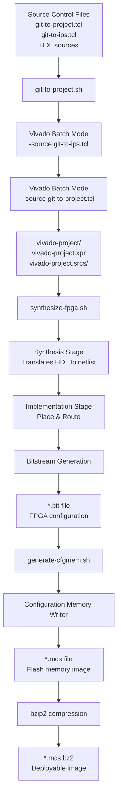
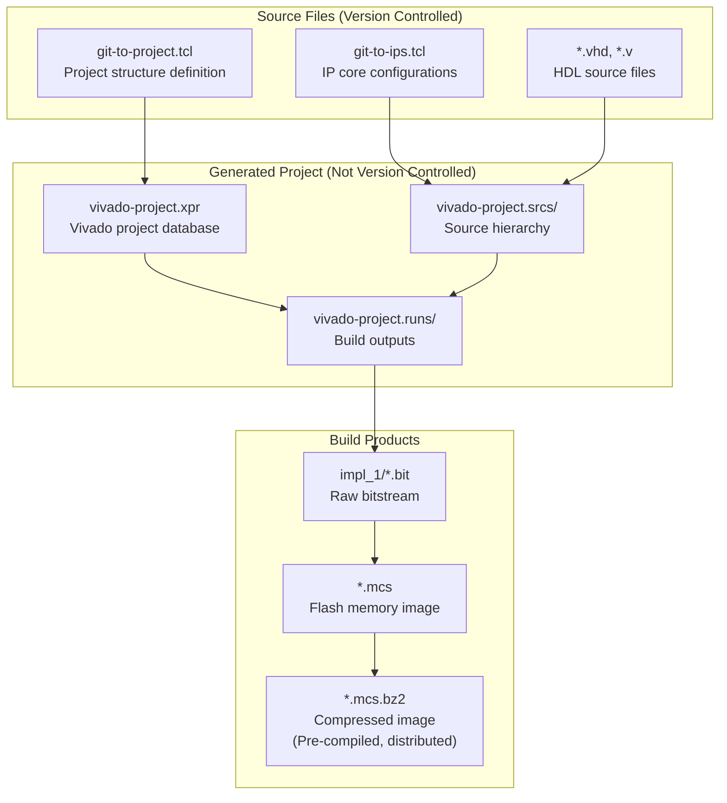

<!-- source: DeepWiki mcp.deepwiki.com · repo NVIDIA/jetson-rdma-picoevb · page 6.2 Building Bitstreams · fetched 2026-11-11 -->

# Building Bitstreams

<details>
<summary>Relevant source files</summary>

The following files were used as context for generating this wiki page:

- [README.md](README.md)
- [fpga-htg-k800/git-to-project.sh](fpga-htg-k800/git-to-project.sh)

</details>


This page describes the process of synthesizing and generating FPGA bitstreams for the PicoEVB and HTG-K800 boards using Xilinx Vivado. This covers the workflow from source-controlled project files to deployable bitstream images.

For information about the FPGA project structure and version control integration, see [FPGA Project Structure](#6.1). For instructions on programming the generated bitstreams to hardware, see [Programming FPGAs](#6.3).

## Overview

The bitstream build process transforms HDL source code and IP configurations into a binary image that can be programmed onto the FPGA. This system provides pre-compiled bitstreams (`fpga-*/*.mcs.bz2`), so rebuilding is optional unless modifications are made to the FPGA design.

The build process consists of three stages:

| Stage | Script | Output | Purpose |
|-------|--------|--------|---------|
| Project Generation | `git-to-project.sh` | `vivado-project/` | Converts version-controlled TCL scripts to Vivado project files |
| Synthesis & Implementation | `synthesize-fpga.sh` | `*.bit` | Compiles HDL to FPGA configuration bitstream |
| Memory Image Generation | `generate-cfgmem.sh` | `*.mcs` | Packages bitstream for flash memory programming |

**Sources:** [README.md:136-161]()

## Build Process Flow



**Sources:** [README.md:136-161](), [fpga-htg-k800/git-to-project.sh:1-41]()

## Prerequisites

### Vivado Installation

The build process requires Xilinx Vivado Design Suite (WebPACK Edition is sufficient):

| FPGA Board | Required Vivado Version |
|------------|------------------------|
| PicoEVB | 2018.3 |
| HTG-K800 | 2018.1 |

Newer Vivado versions should be able to import these projects with automatic migration.

### Build System Requirements

- **Platform:** x86 Linux PC (ARM platforms are not supported for Vivado)
- **Disk Space:** 20+ GB for Vivado installation, 5+ GB for project build artifacts
- **Memory:** 8+ GB RAM recommended for synthesis
- **Software:** `bash`, standard Unix utilities

The `git-to-project.sh` script attempts to locate Vivado in the following order:
1. `vivado` command in `$PATH` [fpga-htg-k800/git-to-project.sh:27]()
2. `~/Xilinx/Vivado/2018.3/bin/vivado` fallback path [fpga-htg-k800/git-to-project.sh:29]()

**Sources:** [README.md:93-107](), [fpga-htg-k800/git-to-project.sh:27-30]()

## Step-by-Step Build Instructions

### Step 1: Generate Vivado Project

Navigate to the FPGA project directory and execute the project generation script:

```bash
cd fpga-picoevb/    # or fpga-htg-k800/
./git-to-project.sh
```

This script performs the following operations [fpga-htg-k800/git-to-project.sh:32-39]():

1. **Clean Previous Build:** Removes existing `vivado-project/` and `vivado-project.srcs/` directories
2. **Generate IP Blocks:** Executes `git-to-ips.tcl` in Vivado batch mode to regenerate IP core configurations
3. **Reorganize Structure:** Moves `vivado-project.srcs/` to the top level
4. **Create Project:** Executes `git-to-project.tcl` to create the main Vivado project file

The script runs Vivado with the following flags:
- `-nojournal`: Suppresses creation of `.jou` journal files
- `-nolog`: Suppresses creation of `.log` files
- `-mode batch`: Runs non-interactively
- `-source <script>`: Executes the specified TCL script

**Outputs:**
- `vivado-project/vivado-project.xpr` - Main project file
- `vivado-project.srcs/` - Source file hierarchy

**Sources:** [README.md:146-149](), [fpga-htg-k800/git-to-project.sh:23-40]()

### Step 2: Synthesize and Implement

Execute the synthesis script to build the bitstream:

```bash
./synthesize-fpga.sh
```

This script automates the complete Vivado build flow:

1. **Synthesis:** Converts HDL source code to a gate-level netlist
2. **Implementation:** Performs placement and routing on the target FPGA
3. **Bitstream Generation:** Creates the binary configuration file

**Build Time:** 5-60 minutes depending on system performance and FPGA complexity

**Alternative:** The synthesis can also be performed through the Vivado GUI:

```bash
vivado vivado-project/vivado-project.xpr
```

Then select "Generate Bitstream" from the Flow Navigator panel.

**Outputs:**
- `vivado-project/vivado-project.runs/impl_1/*.bit` - FPGA bitstream file

**Sources:** [README.md:150-155]()

### Step 3: Generate Configuration Memory Image

Convert the bitstream to a flash memory programming format:

```bash
./generate-cfgmem.sh
```

This script invokes Vivado's configuration memory writer to package the `.bit` file into an `.mcs` (Memory Configuration Stream) file suitable for flash memory programming.

The script compresses the output to reduce storage and transfer size.

**Outputs:**
- `fpga-*/*.mcs` - Uncompressed memory configuration file
- `fpga-*/*.mcs.bz2` - Compressed memory configuration file (distributed with repository)

**Sources:** [README.md:156-157](), [README.md:142]()

## Build Artifacts and File Structure



**Sources:** [README.md:136-161](), [fpga-htg-k800/git-to-project.sh:32-39]()

## Version Control Integration

### Committing Design Changes

After modifying the Vivado project (adding sources, changing IP configurations, adjusting constraints), regenerate the version-controlled TCL scripts:

```bash
./project-to-git.sh
```

This script exports the project state to `git-to-project.tcl` and `git-to-ips.tcl`, ensuring that project modifications are captured in a diffable text format suitable for source control.

**Files Updated:**
- `git-to-project.tcl` - Project structure and settings
- `git-to-ips.tcl` - IP block configurations

The generated TCL files should be committed to the repository, while the binary `vivado-project/` directory remains excluded via `.gitignore`.

**Sources:** [README.md:158-161]()

## FPGA-Specific Considerations

### PicoEVB Build

- **FPGA Device:** Xilinx Artix-7 or similar (M.2 form factor)
- **Vivado Version:** 2018.3
- **Build Directory:** `fpga-picoevb/`
- **Memory Resources:** 64KB onboard RAM

### HTG-K800 Build

- **FPGA Device:** Xilinx Kintex UltraScale XCKU-60
- **Vivado Version:** 2018.1
- **Build Directory:** `fpga-htg-k800/`
- **Memory Resources:** 2GB onboard RAM
- **Expandability:** FPGA model can be changed by modifying project properties and re-synthesizing [README.md:83-85]()

**Sources:** [README.md:138-140](), [README.md:83-85]()

## Build Performance Expectations

| Build Stage | Typical Duration | Notes |
|-------------|------------------|-------|
| Project Generation | < 1 minute | TCL script execution |
| Synthesis | 5-15 minutes | CPU-intensive, depends on design size |
| Implementation | 10-40 minutes | Placement and routing |
| Bitstream Generation | 1-5 minutes | Final binary generation |
| Configuration Memory | < 1 minute | Format conversion |
| **Total** | **20-60 minutes** | Varies significantly by system performance |

The build process generates minimal console output during synthesis and implementation. The process may appear to hang but is actually running. Monitor CPU usage to verify progress.

**Sources:** [README.md:154-155]()

## Troubleshooting

### Vivado Not Found

**Symptom:** `vivado: command not found` error

**Solution:** Edit the `vivado` variable in `git-to-project.sh` [fpga-htg-k800/git-to-project.sh:27-30]() to specify the full path to your Vivado installation:

```bash
vivado=/path/to/Xilinx/Vivado/2018.x/bin/vivado
```

### Build Fails with Timing Errors

**Symptom:** Implementation fails to meet timing constraints

**Solution:** 
- Review timing reports in `vivado-project/vivado-project.runs/impl_1/`
- Adjust constraint files to relax critical paths
- Consider using faster speed-grade FPGA if available

### Insufficient Disk Space

**Symptom:** Build terminates with I/O errors

**Solution:** Ensure at least 5GB free space in the project directory. Clean previous build artifacts:

```bash
rm -rf vivado-project/vivado-project.runs/
```

### Version Mismatch Warnings

**Symptom:** Vivado warns about project version mismatch

**Solution:** Newer Vivado versions can usually upgrade projects automatically. Follow the migration wizard prompts. Note that this may require updating the TCL scripts afterward using `project-to-git.sh`.

**Sources:** [README.md:107](), [fpga-htg-k800/git-to-project.sh:27-30]()

## Pre-Compiled Bitstreams

The repository includes pre-compiled bitstreams to avoid the need for a complete build:

- **Location:** `fpga-picoevb/*.mcs.bz2` or `fpga-htg-k800/*.mcs.bz2`
- **Format:** bzip2-compressed MCS flash memory images
- **Usage:** Decompress before programming: `bunzip2 *.mcs.bz2`

These bitstreams are built from the latest committed source and are suitable for immediate use with the programming procedures described in [Programming FPGAs](#6.3).

**Sources:** [README.md:142-143]()

---

