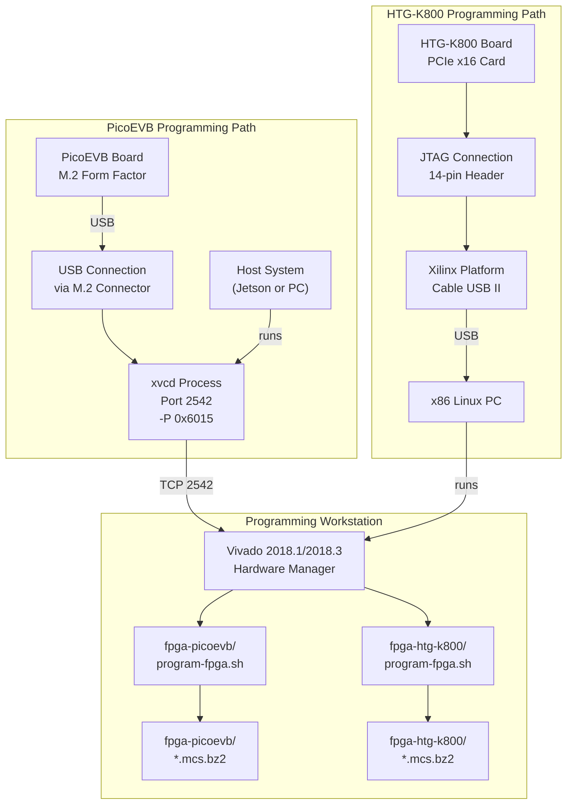
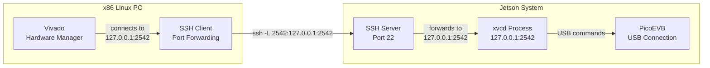
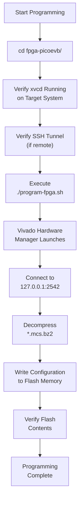
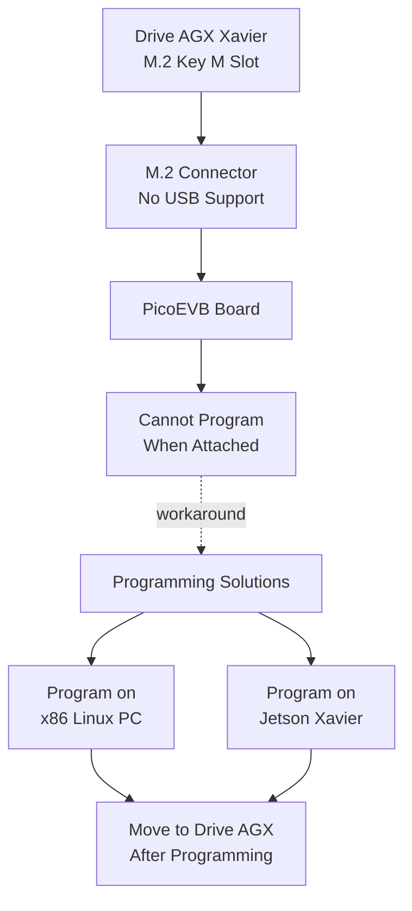
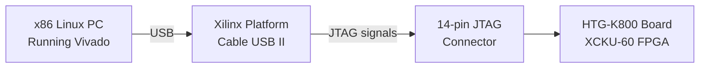
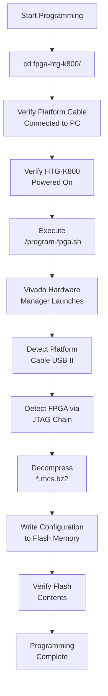

<!-- source: DeepWiki mcp.deepwiki.com · repo NVIDIA/jetson-rdma-picoevb · page 6.3 Programming FPGAs · fetched 2026-11-11 -->

# Programming FPGAs

<details>
<summary>Relevant source files</summary>

The following files were used as context for generating this wiki page:

- [README.md](README.md)

</details>


## Purpose and Scope

This page documents the process of programming (flashing) FPGA bitstreams onto the supported hardware boards: PicoEVB and HTG-K800. Programming refers to loading the compiled bitstream into the FPGA's configuration memory, making it persistent across power cycles.

For information about generating bitstreams from FPGA source code, see [Building Bitstreams](#6.2). For the overall FPGA project organization and version control, see [FPGA Project Structure](#6.1).

---

## Programming Architecture Overview

The two supported FPGA boards use different programming mechanisms, requiring different hardware connections and software tools.

### Programming Methods by Board Type



**Sources:** [README.md:163-205]()

---

## PicoEVB Programming

### Prerequisites

The following components must be available before programming a PicoEVB board:

| Component | Location | Purpose |
|-----------|----------|---------|
| Vivado 2018.3 | x86 Linux PC | FPGA programming tool |
| xvcd | System with PicoEVB attached | USB-to-JTAG bridge daemon |
| PicoEVB board | Jetson or PC M.2 slot | Target device |
| `fpga-picoevb/*.mcs.bz2` | Project directory | Bitstream configuration file |
| `fpga-picoevb/program-fpga.sh` | Project directory | Programming automation script |

**Sources:** [README.md:165-168]()

### xvcd Installation and Setup

The xvcd (Xilinx Virtual Cable Daemon) software provides a TCP server that allows Vivado to communicate with the PicoEVB board over USB. This must be installed and running on the system containing the PicoEVB board.

#### Installation Steps

```bash
sudo apt update
sudo apt install build-essential libftdi-dev
git clone https://github.com/RHSResearchLLC/xvcd.git
cd xvcd/linux/src
make
```

#### Running xvcd

On the system with the PicoEVB board installed, execute:

```bash
sudo ./xvcd -P 0x6015
```

The `-P 0x6015` parameter specifies the USB Product ID for the PicoEVB board. The xvcd process will listen on TCP port 2542 for connections from Vivado.

**Sources:** [README.md:109-134](), [README.md:176-178]()

### Network Configuration for Remote Programming



When programming a PicoEVB board installed in a Jetson system from a remote x86 Linux PC, SSH port forwarding is required to allow Vivado to access the xvcd daemon.

#### SSH Port Forwarding Command

On the x86 Linux PC running Vivado, execute:

```bash
ssh -L 2542:127.0.0.1:2542 ip_address_of_jetson
```

This creates a local port forward: connections to `127.0.0.1:2542` on the PC are tunneled to `127.0.0.1:2542` on the Jetson system, where xvcd is listening.

**Sources:** [README.md:170-174]()

### Programming Execution

#### Programming Script Workflow



To program the PicoEVB board:

1. Navigate to the FPGA project directory:
   ```bash
   cd /path/to/jetson-rdma-picoevb/fpga-picoevb/
   ```

2. Execute the programming script:
   ```bash
   ./program-fpga.sh
   ```

The script performs the following operations:
- Launches Vivado in batch mode
- Connects to xvcd via TCP port 2542
- Decompresses the `.mcs.bz2` configuration file
- Programs the configuration memory on the FPGA
- Verifies the written data

**Sources:** [README.md:180-183]()

### Programming Characteristics and Troubleshooting

| Characteristic | Description |
|----------------|-------------|
| **Duration** | 20 to 40 minutes |
| **Output** | Minimal output during operation; may appear hung but is running |
| **Reliability** | Connection can be unreliable; may require multiple attempts |
| **Retry Strategy** | If script exits without programming, re-execute `program-fpga.sh` |
| **Success Indicator** | Script completes without error; power cycle board to load new bitstream |

The programming process writes to non-volatile flash memory on the FPGA board. After successful programming, the new bitstream will be loaded automatically when the board is power-cycled or reset.

**Sources:** [README.md:185-191]()

### Drive AGX Xavier Limitation

The Drive AGX Xavier platform has a specific limitation for PicoEVB programming:



The M.2 Key M connector on Drive AGX Xavier does not expose the USB signals required for FPGA programming. To use a PicoEVB board with Drive AGX Xavier:

1. Program the board on a Jetson AGX Xavier or x86 Linux PC
2. Power down the programming system
3. Remove the PicoEVB board
4. Install it in the Drive AGX Xavier
5. Power on Drive AGX Xavier

**Sources:** [README.md:117-120]()

---

## HTG-K800 Programming

### Prerequisites

The HTG-K800 board requires a different programming setup compared to PicoEVB:

| Component | Location | Purpose |
|-----------|----------|---------|
| Vivado 2018.1 | x86 Linux PC | FPGA programming tool |
| Platform Cable USB II | Connected to PC | JTAG programming interface |
| JTAG cable | Platform Cable to HTG-K800 | 14-pin JTAG connection |
| HTG-K800 board | PCIe slot | Target device |
| `fpga-htg-k800/*.mcs.bz2` | Project directory | Bitstream configuration file |
| `fpga-htg-k800/program-fpga.sh` | Project directory | Programming automation script |

**Sources:** [README.md:87-91](), [README.md:193-196]()

### Hardware Connection



The HTG-K800 board uses a standard Xilinx JTAG interface via a 14-pin connector on the board. The Xilinx Platform Cable USB II connects directly to the x86 Linux PC running Vivado, requiring no additional network configuration or daemon processes.

**Sources:** [README.md:87-91]()

### Programming Execution

#### Programming Workflow



To program the HTG-K800 board:

1. Ensure the Xilinx Platform Cable USB II is connected to the PC and the HTG-K800 board
2. Navigate to the FPGA project directory:
   ```bash
   cd /path/to/jetson-rdma-picoevb/fpga-htg-k800/
   ```

3. Execute the programming script:
   ```bash
   ./program-fpga.sh
   ```

**Sources:** [README.md:198-201]()

### Programming Characteristics

| Characteristic | Description |
|----------------|-------------|
| **Duration** | A few minutes |
| **Output** | Minimal output during operation; may appear hung but is running |
| **Reliability** | More reliable than PicoEVB (direct JTAG connection) |
| **Success Indicator** | Script completes without error; power cycle board to load new bitstream |

The HTG-K800 programming process is typically faster and more reliable than PicoEVB programming due to the direct JTAG connection without network intermediaries.

**Sources:** [README.md:203-205]()

---

## Post-Programming Verification

After successfully programming either FPGA board, verification steps should be performed:

### Loading the New Bitstream

1. **Power cycle the system** containing the FPGA board to trigger FPGA reconfiguration from the newly programmed flash memory

2. **Verify PCIe enumeration**:
   ```bash
   lspci | grep NVIDIA
   ```
   Expected output should show a device with vendor ID NVIDIA (10de) and device ID 0001

3. **Load the kernel module**:
   ```bash
   sudo insmod picoevb-rdma.ko
   ```

4. **Verify driver binding**:
   ```bash
   lspci -v
   ```
   The FPGA device should show `Kernel driver in use: picoevb-rdma`

5. **Test basic functionality**:
   ```bash
   sudo ./set-leds 0
   sudo ./set-leds 7
   ```
   This test application exercises basic register access (see [Hardware Control Utilities](#5.4))

**Sources:** [README.md:257-278](), [README.md:373-383]()

---

## Bitstream File Format

Both FPGA projects use the `.mcs.bz2` file format for distribution:

| Extension | Description |
|-----------|-------------|
| `.mcs` | Memory Configuration Specification format (Intel HEX variant) |
| `.bz2` | bzip2 compression |

The programming scripts automatically decompress the `.mcs.bz2` files before programming. The `.mcs` format contains the complete flash memory image, including:
- FPGA bitstream
- Boot loader
- Configuration metadata

**Sources:** [README.md:142](), [README.md:156]()

---

## Summary of Programming Commands

### PicoEVB

```bash
# On system with PicoEVB board installed
sudo ./xvcd -P 0x6015

# On x86 Linux PC (if programming remotely)
ssh -L 2542:127.0.0.1:2542 ip_address_of_target
cd fpga-picoevb/
./program-fpga.sh
```

### HTG-K800

```bash
# On x86 Linux PC with Platform Cable attached
cd fpga-htg-k800/
./program-fpga.sh
```

**Sources:** [README.md:163-205]()

---

