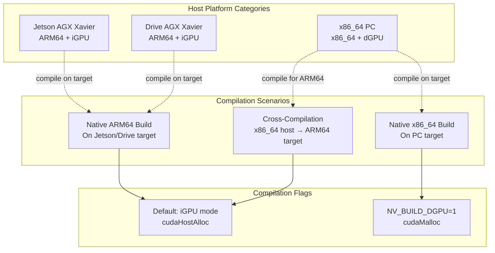
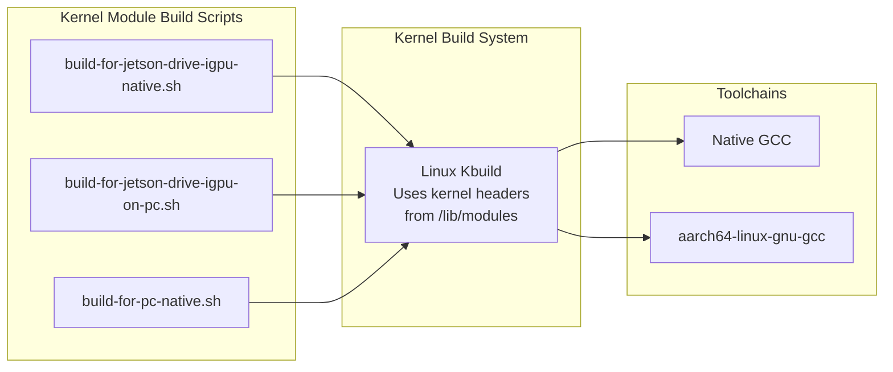
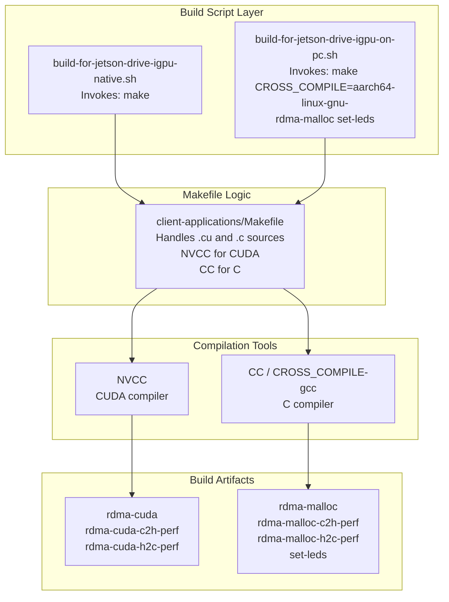
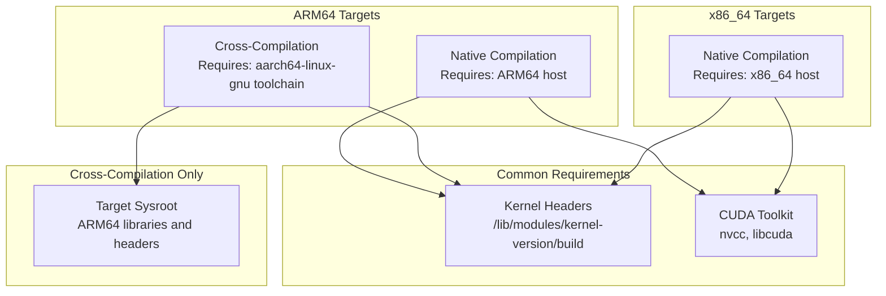
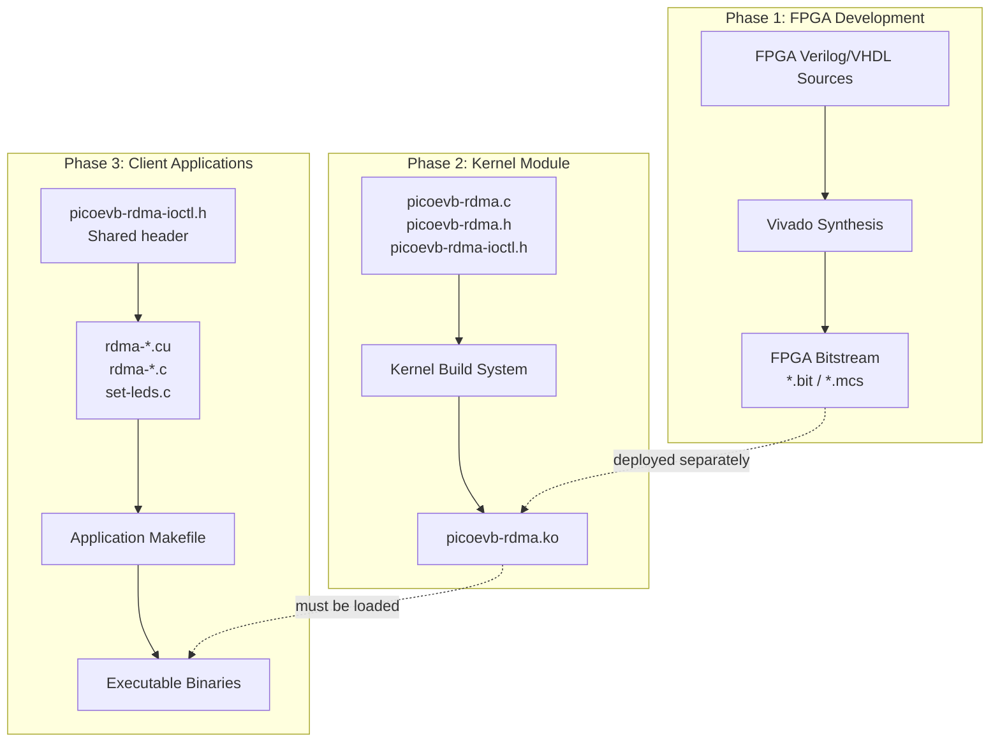

<!-- source: DeepWiki mcp.deepwiki.com · repo NVIDIA/jetson-rdma-picoevb · page 7.1 Build System Overview · fetched 2026-11-11 -->

# Build System Overview

<details>
<summary>Relevant source files</summary>

The following files were used as context for generating this wiki page:

- [client-applications/build-for-jetson-drive-igpu-native.sh](client-applications/build-for-jetson-drive-igpu-native.sh)
- [client-applications/build-for-jetson-drive-igpu-on-pc.sh](client-applications/build-for-jetson-drive-igpu-on-pc.sh)

</details>


## Purpose and Scope

This page provides a high-level overview of the jetson-rdma-picoevb build system architecture, explaining the distinction between native and cross-compilation workflows, the organization of build scripts, and platform-specific considerations that affect compilation. This document covers the conceptual framework and decision-making process for building the system.

For detailed step-by-step instructions on building specific components, see:
- Building the kernel module: [Section 7.2](#7.2)
- Building client applications: [Section 7.3](#7.3)
- Cross-compilation procedures: [Section 7.4](#7.4)

For FPGA bitstream synthesis, see [Section 6.2](#6.2).

## Build System Architecture

The jetson-rdma-picoevb project consists of three independently buildable components, each with its own toolchain and build process:

| Component | Build Tool | Source Language | Output Artifact | Build Location |
|-----------|------------|-----------------|-----------------|----------------|
| Kernel Module | `make` (kernel build system) | C | `picoevb-rdma.ko` | `kernel-module/` |
| Client Applications | `make` (custom Makefile) | CUDA C++ (.cu), C (.c) | Executable binaries | `client-applications/` |
| FPGA Bitstreams | Vivado TCL scripts | Verilog/VHDL | `.bit`, `.mcs` files | `fpga-picoevb-kintex-7/`, `fpga-htg-k800/` |

The kernel module and client applications support both native and cross-compilation scenarios, while FPGA bitstreams are always synthesized using Vivado on a separate development machine.

**Sources:** Diagram 3 from high-level architecture, README.md

## Platform Targets and Compilation Modes

### Supported Platform Combinations



### Native vs Cross-Compilation Decision Matrix

| Scenario | Compilation Mode | Build Script | Toolchain | Use Case |
|----------|-----------------|--------------|-----------|----------|
| Building on Jetson/Drive for local use | Native ARM64 | `build-for-jetson-drive-igpu-native.sh` | Native gcc/nvcc | Development and testing on target |
| Building on x86 PC for x86 PC | Native x86_64 | `build-for-pc-native.sh` | Native gcc/nvcc | Development with discrete GPU |
| Building on x86 PC for Jetson/Drive | Cross-compile | `build-for-jetson-drive-igpu-on-pc.sh` | `aarch64-linux-gnu-*` | CI/CD, remote development |

**Sources:** [client-applications/build-for-jetson-drive-igpu-native.sh:1-24](), [client-applications/build-for-jetson-drive-igpu-on-pc.sh:1-24]()

## Build Scripts Organization

### Kernel Module Build Scripts

Located in `kernel-module/`, these scripts wrap the Linux kernel build system:



The kernel module build scripts are thin wrappers that invoke `make` with appropriate parameters. The actual build logic is handled by the Linux kernel's Kbuild system, which reads `Kconfig` and `Makefile` in the kernel-module directory.

**Sources:** [kernel-module/build-for-jetson-drive-igpu-native.sh](), [kernel-module/build-for-jetson-drive-igpu-on-pc.sh](), [kernel-module/build-for-pc-native.sh]()

### Client Application Build Scripts

Located in `client-applications/`, these scripts invoke a custom Makefile:



#### Native Build Script Behavior

[client-applications/build-for-jetson-drive-igpu-native.sh:23]() simply executes:
```bash
exec make
```

This invokes the Makefile with default settings, building all targets using the native toolchain.

#### Cross-Compilation Build Script Behavior

[client-applications/build-for-jetson-drive-igpu-on-pc.sh:23]() executes:
```bash
exec make CROSS_COMPILE=aarch64-linux-gnu- rdma-malloc set-leds
```

This builds only non-CUDA targets (`rdma-malloc`, `set-leds`) because:
1. The `CROSS_COMPILE` variable prefixes the C compiler with `aarch64-linux-gnu-`
2. CUDA applications cannot be cross-compiled (NVCC requires native execution on the target architecture)
3. The script explicitly lists buildable targets, excluding CUDA applications

**Sources:** [client-applications/build-for-jetson-drive-igpu-native.sh:1-24](), [client-applications/build-for-jetson-drive-igpu-on-pc.sh:1-24]()

## Platform-Specific Considerations

### Integrated GPU (iGPU) vs Discrete GPU (dGPU) Compilation

The system uses conditional compilation to handle architectural differences between integrated and discrete GPUs:

| Platform Type | GPU Architecture | Memory Model | Compilation Flag | Memory Allocation API |
|--------------|------------------|--------------|------------------|----------------------|
| Jetson/Drive AGX Xavier | Integrated GPU | Unified Memory | Default (no flag) | `cudaHostAlloc()` |
| x86 PC with Quadro/Tesla | Discrete GPU | Separate Memory | `NV_BUILD_DGPU=1` | `cudaMalloc()` |

The `NV_BUILD_DGPU` preprocessor macro switches between:
- **iGPU mode:** Uses `cudaHostAlloc()` for zero-copy access to host-pinned memory
- **dGPU mode:** Uses `cudaMalloc()` for device-only memory with explicit transfers

This distinction affects how the client applications allocate and access GPU memory, but does not change the kernel module behavior.

**Sources:** Diagram 6 from high-level architecture, client-applications/rdma-cuda.cu

### Architecture-Specific Toolchain Requirements



#### Native Compilation Requirements

For native compilation (building on the target platform):
- Kernel headers matching the running kernel version
- CUDA toolkit with `nvcc` compiler
- Standard development tools (`gcc`, `make`, `binutils`)

#### Cross-Compilation Requirements

For cross-compilation from x86 PC to ARM64:
- ARM64 cross-compiler toolchain (`aarch64-linux-gnu-gcc`)
- Target platform's kernel headers
- Target platform's sysroot with libraries
- **Limitation:** CUDA applications cannot be cross-compiled; they must be built natively on ARM64

**Sources:** README.md, build script files

## Build Flow and Dependencies

### Build Order and Inter-Component Dependencies



### Critical Interface: picoevb-rdma-ioctl.h

The `picoevb-rdma-ioctl.h` header serves as the contract between kernel space and user space:

- Located in `kernel-module/picoevb-rdma-ioctl.h`
- Included by both kernel module and client applications
- Defines IOCTL command numbers and data structures
- Must remain ABI-compatible between kernel module and applications

Client applications directly include this header from the kernel-module directory, creating a build-time dependency. Changes to this interface require rebuilding both the kernel module and all client applications.

**Sources:** [kernel-module/picoevb-rdma-ioctl.h](), Diagram 4 from high-level architecture

## Build System Design Rationale

### Why Multiple Build Scripts?

The project provides separate build scripts for different scenarios rather than a single unified build system because:

1. **Toolchain Detection Complexity:** Automatically detecting whether to use native or cross-compilation toolchains is error-prone
2. **Platform-Specific Optimizations:** Each platform has different optimal build flags
3. **Clarity:** Explicit script names make the intended build target obvious
4. **CI/CD Integration:** Separate scripts allow different build configurations in automated pipelines

### Why Thin Wrapper Scripts?

The build scripts [client-applications/build-for-jetson-drive-igpu-native.sh:23]() and [client-applications/build-for-jetson-drive-igpu-on-pc.sh:23]() are intentionally minimal:

- They delegate to existing build systems (`make`, `Kbuild`)
- They avoid duplicating logic that already exists in Makefiles
- They serve as documentation (the script name describes the build scenario)
- They provide stable entry points for automation and documentation

**Sources:** [client-applications/build-for-jetson-drive-igpu-native.sh:1-24](), [client-applications/build-for-jetson-drive-igpu-on-pc.sh:1-24]()

## Summary

The jetson-rdma-picoevb build system is organized around three independent components (kernel module, client applications, FPGA), each with its own toolchain. The system supports native compilation on both ARM64 and x86_64 platforms, as well as cross-compilation from x86 to ARM64 for non-CUDA components. Build scripts serve as thin wrappers around standard build systems, with explicit naming that documents the intended build scenario. The key architectural consideration is the distinction between iGPU (unified memory) and dGPU (discrete memory) platforms, controlled via the `NV_BUILD_DGPU` compilation flag.

---

