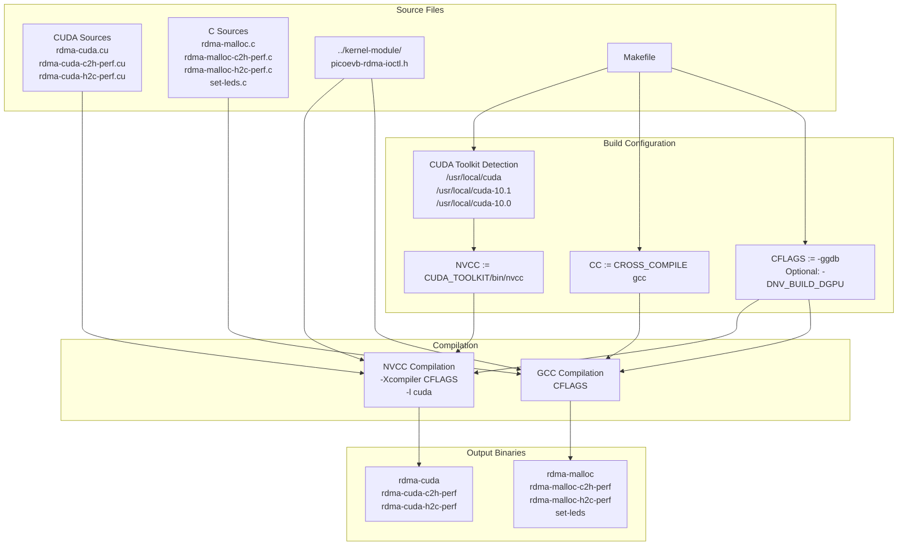
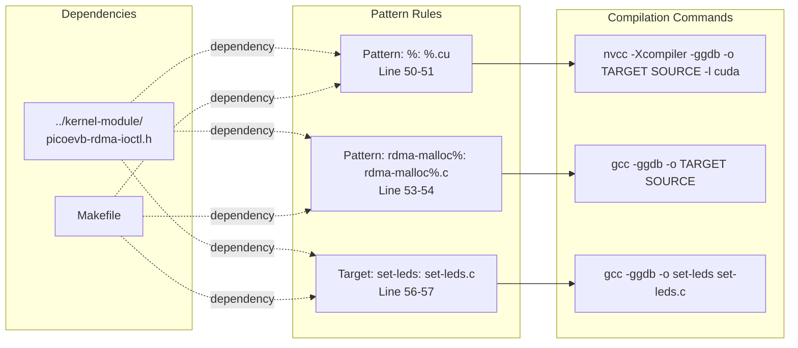
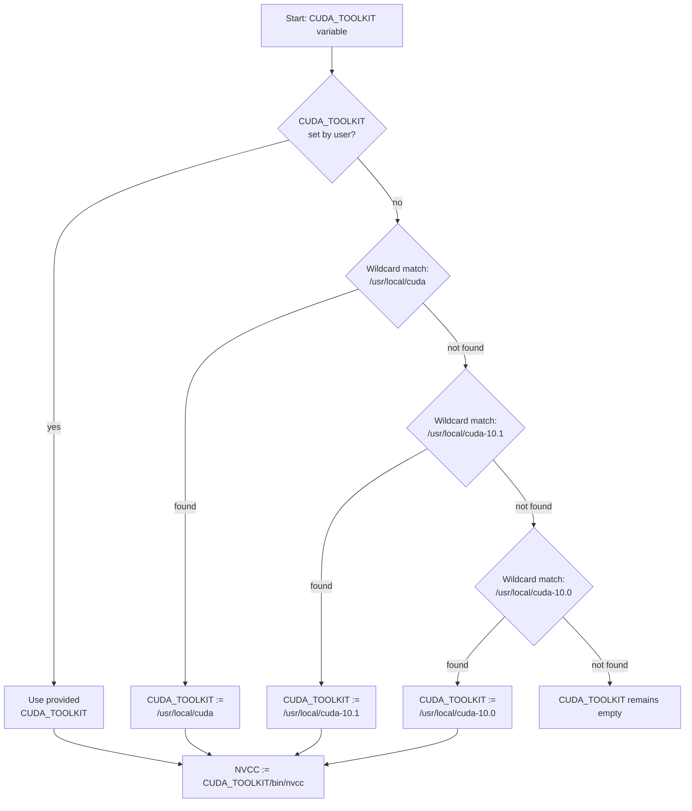
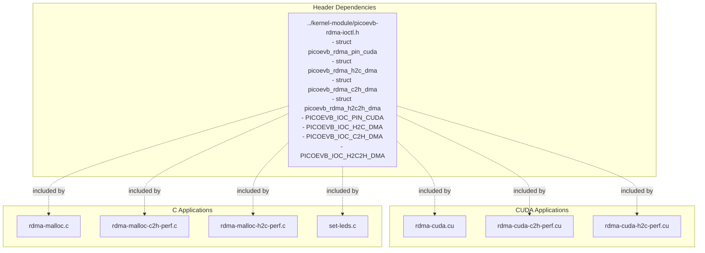

<!-- source: DeepWiki mcp.deepwiki.com · repo NVIDIA/jetson-rdma-picoevb · page 7.3 Building Client Applications · fetched 2026-11-11 -->

# Building Client Applications

<details>
<summary>Relevant source files</summary>

The following files were used as context for generating this wiki page:

- [README.md](README.md)
- [client-applications/Makefile](client-applications/Makefile)

</details>


This page documents the build process for the user-space test and benchmark applications in the `client-applications/` directory. These applications provide functional validation and performance measurement tools for the GPUDirect RDMA system.

For information about building the kernel module, see [Building the Kernel Module](#7.2). For detailed cross-compilation instructions, see [Cross-Compilation Guide](#7.4).

**Sources**: [README.md:280-323](), [client-applications/Makefile:1-61]()

---

## Build System Overview

The client applications use a Makefile-based build system that handles two distinct source types: CUDA applications (`.cu` files) and standard C applications (`.c` files). The build system automatically detects the CUDA toolkit installation and selects appropriate compilers for each source type.

### Application Categories

The build system produces seven executable binaries:

| Application | Source File | Compiler | Purpose |
|-------------|-------------|----------|---------|
| `rdma-cuda` | `rdma-cuda.cu` | NVCC | CUDA memory functional test |
| `rdma-cuda-c2h-perf` | `rdma-cuda-c2h-perf.cu` | NVCC | Card-to-host bandwidth test (CUDA) |
| `rdma-cuda-h2c-perf` | `rdma-cuda-h2c-perf.cu` | NVCC | Host-to-card bandwidth test (CUDA) |
| `rdma-malloc` | `rdma-malloc.c` | GCC | Host memory functional test |
| `rdma-malloc-c2h-perf` | `rdma-malloc-c2h-perf.c` | GCC | Card-to-host bandwidth test (malloc) |
| `rdma-malloc-h2c-perf` | `rdma-malloc-h2c-perf.c` | GCC | Host-to-card bandwidth test (malloc) |
| `set-leds` | `set-leds.c` | GCC | LED control utility |

**Sources**: [client-applications/Makefile:40-47](), [README.md:327-383]()

---

## Build Process Flow

The following diagram illustrates the complete build process from source files to executable binaries:

**Build Process and Dependency Resolution**



**Sources**: [client-applications/Makefile:21-57]()

---

## Platform-Specific Build Scripts

The build system provides three wrapper scripts that invoke `make` with platform-specific configurations:

### Native Jetson/Drive Build Script

**Script**: `build-for-jetson-drive-igpu-native.sh`

This script builds applications natively on Jetson AGX Xavier or Drive AGX Xavier systems with integrated GPUs. It uses the system's native compiler toolchain and CUDA toolkit.

```
cd /path/to/this/project/client-applications/
./build-for-jetson-drive-igpu-native.sh
```

**Characteristics**:
- Uses native ARM64 GCC and NVCC compilers
- Does not set `NV_BUILD_DGPU` flag
- Applications use `cudaHostAlloc()` for unified memory on iGPU systems

**Sources**: [README.md:282-292]()

---

### Cross-Compilation Script for Jetson/Drive

**Script**: `build-for-jetson-drive-igpu-on-pc.sh`

This script cross-compiles applications on an x86 PC for ARM64 targets. Note that CUDA application cross-compilation is not fully supported.

```
cd /path/to/this/project/client-applications/
./build-for-jetson-drive-igpu-on-pc.sh
```

**Characteristics**:
- Sets `CROSS_COMPILE` to ARM64 cross-compiler prefix (e.g., `aarch64-linux-gnu-`)
- Only compiles C applications successfully
- CUDA applications require native compilation on target

**Limitations**: The Makefile does not support cross-compiling CUDA applications because NVCC must target the specific GPU architecture present on the target system.

**Sources**: [README.md:294-310]()

---

### Native PC Build Script

**Script**: `build-for-pc-native.sh`

This script builds applications natively on x86 Linux PCs with discrete NVIDIA GPUs (Quadro/Tesla).

```
cd /path/to/this/project/client-applications/
./build-for-pc-native.sh
```

**Characteristics**:
- Uses native x86_64 GCC and NVCC compilers
- Sets `NV_BUILD_DGPU` flag for discrete GPU code paths
- Applications use `cudaMalloc()` for separate device memory on dGPU systems

**Sources**: [README.md:312-321]()

---

## Makefile Build Rules

The following diagram maps Makefile pattern rules to their corresponding compilation commands:

**Makefile Target Resolution**



**Sources**: [client-applications/Makefile:50-57]()

---

## CUDA Toolkit Detection Logic

The Makefile implements a fallback chain to locate the CUDA toolkit installation:

**CUDA Toolkit Detection Sequence**



**Manual Override**: Users can set the `CUDA_TOOLKIT` environment variable to specify a custom installation path:

```bash
CUDA_TOOLKIT=/opt/cuda-11.0 make
```

**Sources**: [client-applications/Makefile:22-31]()

---

## Compilation Flags and Preprocessor Definitions

### Debug Symbols

All applications are compiled with the `-ggdb` flag to include debugging symbols:

[client-applications/Makefile:33-34]()

### Discrete GPU Support

The `NV_BUILD_DGPU` preprocessor macro enables discrete GPU code paths in CUDA applications:

[client-applications/Makefile:35-38]()

When `NV_BUILD_DGPU` is defined:
- Applications use `cudaMalloc()` to allocate separate device memory
- Memory transfers require explicit copy operations between host and device

When `NV_BUILD_DGPU` is not defined:
- Applications use `cudaHostAlloc()` for unified memory
- Memory is accessible from both CPU and GPU without explicit copies

**Usage**: Set this flag in the build script or environment:

```bash
NV_BUILD_DGPU=1 make rdma-cuda
```

**Sources**: [client-applications/Makefile:35-38](), [README.md:329-330]()

---

## Compiler Invocation Details

### NVCC Compilation

CUDA source files are compiled using NVCC with the following command structure:

```bash
$(NVCC) $(addprefix -Xcompiler ,$(CFLAGS)) -o $@ $< -l cuda
```

**Command Components**:
- `$(NVCC)`: CUDA compiler binary (e.g., `/usr/local/cuda/bin/nvcc`)
- `-Xcompiler $(CFLAGS)`: Passes CFLAGS to the underlying host compiler
- `-o $@`: Output file name (target name)
- `$<`: Input source file
- `-l cuda`: Links against the CUDA runtime library

**Example Expansion**:
```bash
/usr/local/cuda/bin/nvcc -Xcompiler -ggdb -o rdma-cuda rdma-cuda.cu -l cuda
```

**Sources**: [client-applications/Makefile:50-51]()

---

### GCC Compilation

C source files are compiled using GCC with a simpler command structure:

```bash
$(CC) $(CFLAGS) -o $@ $<
```

**Command Components**:
- `$(CC)`: C compiler (either `gcc` or cross-compiler like `aarch64-linux-gnu-gcc`)
- `$(CFLAGS)`: Compilation flags (debug symbols)
- `-o $@`: Output file name (target name)
- `$<`: Input source file

**Example Expansion**:
```bash
gcc -ggdb -o rdma-malloc rdma-malloc.c
```

**Sources**: [client-applications/Makefile:53-57]()

---

## Build Dependencies

All applications depend on the kernel module's IOCTL header file, which defines the user-kernel interface:

**Dependency Graph**



**Interface Definition**: The IOCTL header defines the data structures and command codes that applications use to communicate with the `picoevb-rdma` kernel module. Changes to this header require rebuilding all applications.

**Sources**: [client-applications/Makefile:50-57]()

---

## Cross-Compiler Configuration

For cross-compilation scenarios, the `CROSS_COMPILE` variable specifies the toolchain prefix:

[client-applications/Makefile:21]()

**Common Cross-Compiler Prefixes**:

| Target Architecture | CROSS_COMPILE Value | Typical Package |
|---------------------|---------------------|-----------------|
| ARM64 (aarch64) | `aarch64-linux-gnu-` | `gcc-aarch64-linux-gnu` |
| ARMv7 | `arm-linux-gnueabihf-` | `gcc-arm-linux-gnueabihf` |

**Example Cross-Compilation**:
```bash
CROSS_COMPILE=aarch64-linux-gnu- make rdma-malloc
```

This expands `CC` to `aarch64-linux-gnu-gcc`.

**Sources**: [client-applications/Makefile:21](), [README.md:308-310]()

---

## Build Targets and Clean Target

### Default Target

The `default` target builds all seven applications:

[client-applications/Makefile:48]()

```bash
make  # Builds all targets
```

### Individual Targets

Each application can be built independently:

```bash
make rdma-cuda          # Build only CUDA functional test
make rdma-malloc-c2h-perf  # Build only C2H performance test
```

### Clean Target

The clean target removes all compiled binaries:

[client-applications/Makefile:59-60]()

```bash
make clean
```

**Sources**: [client-applications/Makefile:40-60]()

---

## Prerequisites Summary

Before building client applications, ensure the following prerequisites are met:

| Requirement | Native Jetson/Drive | Cross-Compile from PC | Native PC |
|-------------|---------------------|----------------------|-----------|
| Build tools | `build-essential`, `bc` | `build-essential`, `bc` | `build-essential`, `bc` |
| CUDA toolkit | Yes (L4T JetPack) | N/A for CUDA apps | Yes (CUDA drivers) |
| Cross-compiler | N/A | `gcc-aarch64-linux-gnu` | N/A |
| Kernel headers | Not required for apps | Not required for apps | Not required for apps |

**Installation Commands**:

```bash
sudo apt update
sudo apt install build-essential bc
```

**Sources**: [README.md:288-289](), [README.md:302-303](), [README.md:317-318]()

---

## Troubleshooting Build Issues

### CUDA Toolkit Not Found

**Symptom**: Build fails with "nvcc: command not found"

**Solution**: 
1. Verify CUDA toolkit installation: `which nvcc`
2. Set `CUDA_TOOLKIT` environment variable manually:
   ```bash
   CUDA_TOOLKIT=/usr/local/cuda-11.0 make
   ```
3. Add CUDA toolkit to PATH:
   ```bash
   export PATH=/usr/local/cuda/bin:$PATH
   ```

---

### Cross-Compilation Failures for CUDA Applications

**Symptom**: CUDA applications fail to build when using cross-compilation script

**Explanation**: NVCC must run natively on the target platform to properly target the GPU architecture.

**Solution**: Build CUDA applications natively on Jetson/Drive AGX Xavier or x86 PC. Only C applications (rdma-malloc variants and set-leds) support cross-compilation.

**Sources**: [README.md:296-298]()

---

### Linker Errors with CUDA Library

**Symptom**: "cannot find -lcuda"

**Solution**: Ensure CUDA runtime libraries are installed and in the library search path. On Jetson/Drive, these are typically installed with JetPack. On PC, install the CUDA Toolkit.

---

### Makefile Dependency Issues

**Symptom**: Changes to `picoevb-rdma-ioctl.h` don't trigger rebuild

**Solution**: Run `make clean` followed by `make` to force a complete rebuild. The Makefile declares this header as a dependency for all targets.

**Sources**: [client-applications/Makefile:50-57]()

---

